<div align="center">

<a href="#tour">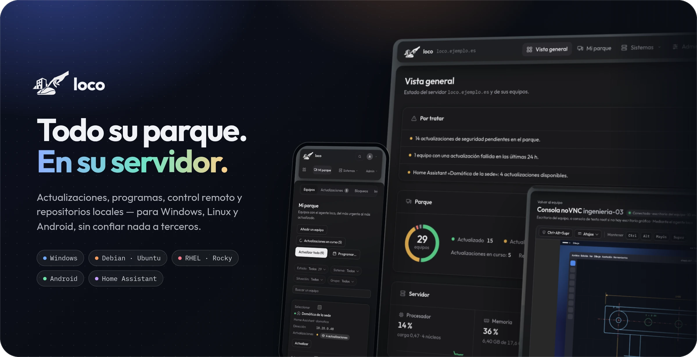</a>

<br><br>

[](https://github.com/ShaNouhAr/loco/releases)
[](LICENSE)


[English](README.md) &nbsp;·&nbsp; [Français](README.fr.md) &nbsp;·&nbsp; **Español**

**[La visita guiada](#tour)** &nbsp;·&nbsp; **[Instalar](#instalar)** &nbsp;·&nbsp; **[Cómo funciona](#funcionamiento)** &nbsp;·&nbsp; **[Documentación](#documentacion)** &nbsp;·&nbsp; **[Novedades](CHANGELOG.es.md)**

</div>

<br>

> **loco** es el servidor que se instala una vez y que se encarga del resto.
> Guarda una copia de las actualizaciones, ordena su software, conoce cada equipo — y le lleva a él en un clic.
>
> Sin nube. Sin suscripción. Sin telemetría. Basta con una máquina virtual, un contenedor o un PC viejo.

<br>

## Lo que loco hace por usted

<table>
<tr>
<td width="33%" valign="top">
<br>
<b>Un parque que se lee de un vistazo</b><br>
Un indicador por equipo, todo su inventario en su ficha, y lo urgente arriba de la página.
</td>
<td width="33%" valign="top">
<br>
<b>Actualizaciones que se ven avanzar</b><br>
Windows Update, APT, DNF, Flatpak: un equipo, un grupo o todo el parque — paquete por paquete, en directo.
</td>
<td width="33%" valign="top">
<br>
<b>El control de cualquier equipo</b><br>
Escritorio, terminal y archivos en el navegador. Ningún puerto que abrir, ni VNC, ni SSH.
</td>
</tr>
<tr>
<td valign="top">
<br>
<b>Su software en un clic</b><br>
El catálogo WinGet al alcance de la mano, sus instaladores propios al lado. Desplegados en silencio, verificados por huella.
</td>
<td valign="top">
<br>
<b>Internet, una sola vez</b><br>
Cada actualización se descarga una vez y luego se sirve en local. Sus <code>.deb</code> y <code>.rpm</code> tienen sus repositorios firmados.
</td>
<td valign="top">
<br>
<b>La rutina funciona sola</b><br>
Scripts, programaciones, despliegues por oleadas que se detienen solos si algo falla.
</td>
</tr>
<tr>
<td valign="top">
<br>
<b>Cada uno en su lugar</b><br>
94 permisos, perfiles limitados a una parte del parque, SSO, doble autenticación, claves de acceso. Y un diario de todo.
</td>
<td valign="top">
<br>
<b>Listo para sus asistentes de IA</b><br>
Un servidor MCP integrado: Claude Code, Cursor o VS Code consultan y manejan loco, dentro de los límites que usted fija.
</td>
<td valign="top">
<br>
<b>Más allá de los PC</b><br>
Teléfonos y tabletas Android, Home Assistant, agente Wazuh: mismo portal, mismos permisos, mismo diario.
</td>
</tr>
</table>

<br>

<a id="tour"></a>

## La visita guiada

###  &nbsp;Mi parque

**Del más urgente al más actualizado.** Verde, todo va bien. Naranja, hay actualizaciones pendientes. Rojo, ya es hora.

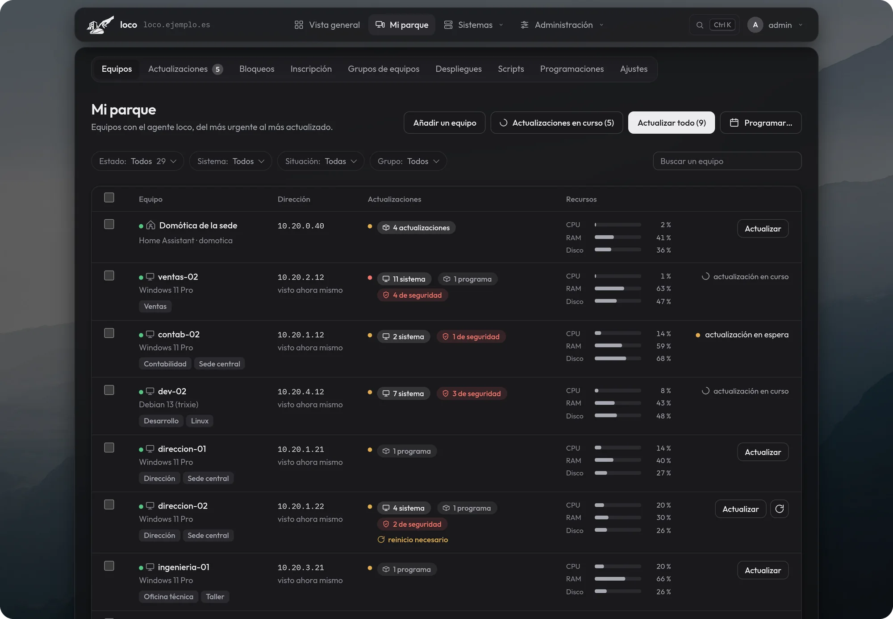

- **Todo en una línea** — sistema, dirección, actualizaciones, parches de seguridad, procesador, memoria, disco.
- **Todo en un gesto** — marque y actualice, con reinicio si hace falta, o despierte los equipos apagados (Wake-on-LAN).
- **Un equipo que se mueve se queda en el parque** — otra dirección, otro sitio, VPN: conserva su identidad.

<p align="center">
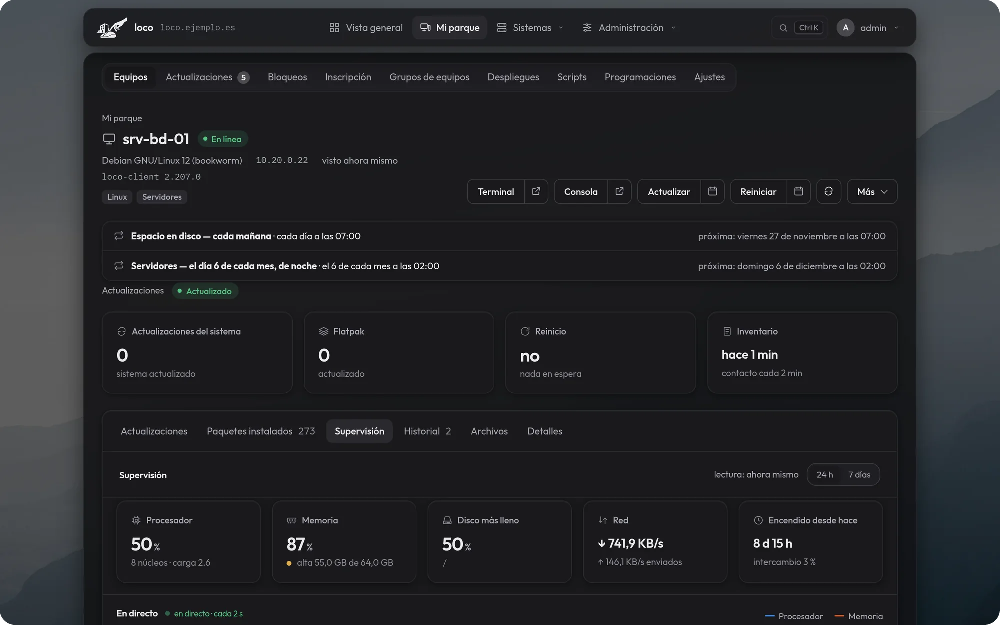
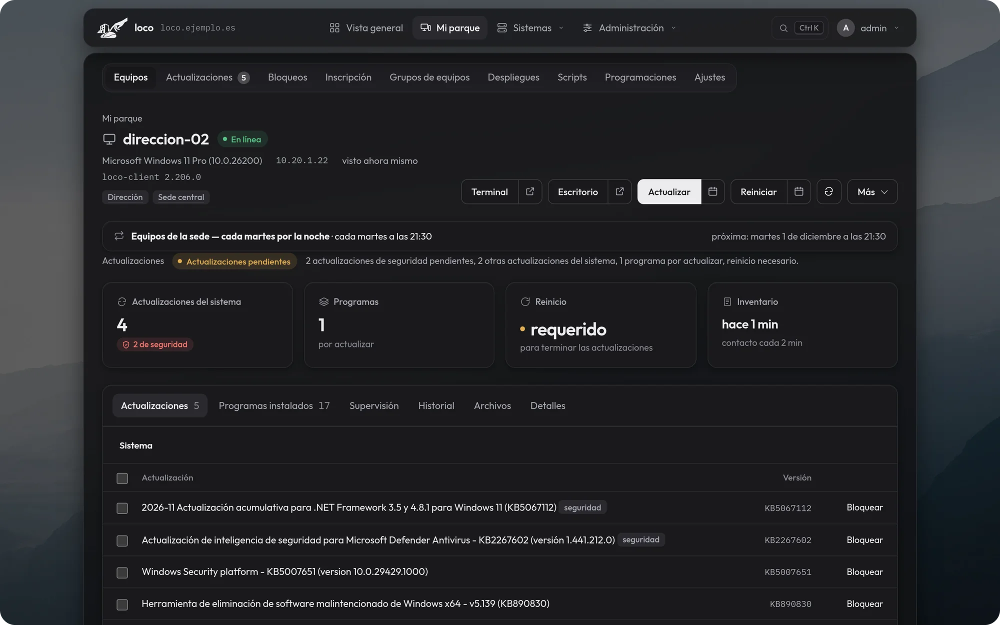
</p>
<p align="center"><sub>← <b>Supervisión</b> — en directo cada 2 segundos, luego en 24 horas o 7 días.<br><b>Ficha de un equipo</b> — actualizaciones a la carta, software del catálogo, historial. →</sub></p>

<br>

###  &nbsp;Actualizaciones, en directo

**Haga clic. Mire.** El paso, el paquete en curso, lo que está hecho, lo que ha fallado — sin recargar la página.

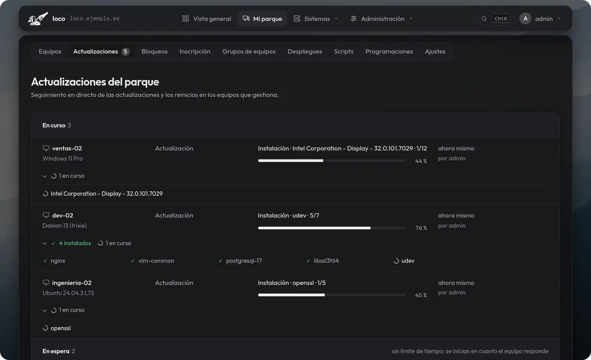

- **Nada se pierde** — una acción pendiente no caduca: sale cuando el equipo vuelve.
- **Por oleadas** — diez equipos primero, los demás después. ¿Demasiados fallos? Todo se pausa y usted decide.
- **¿Una actualización dudosa?** Bloquéela, en todo el parque o en un grupo. Nadie la instalará ya por error.
- **De noche es mejor** — una vez, cada día, cada semana o cada mes.

<br>

###  &nbsp;Control remoto

**El agente llama al servidor. Nunca al revés.** Ningún puerto de entrada en los equipos, ningún servidor VNC, ninguna cuenta SSH.

<p align="center">
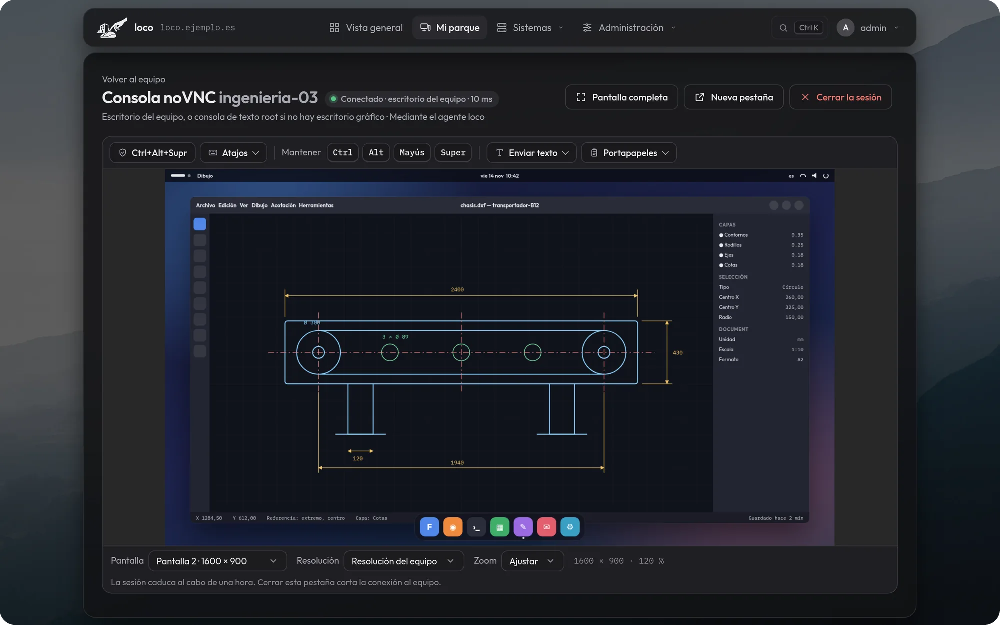
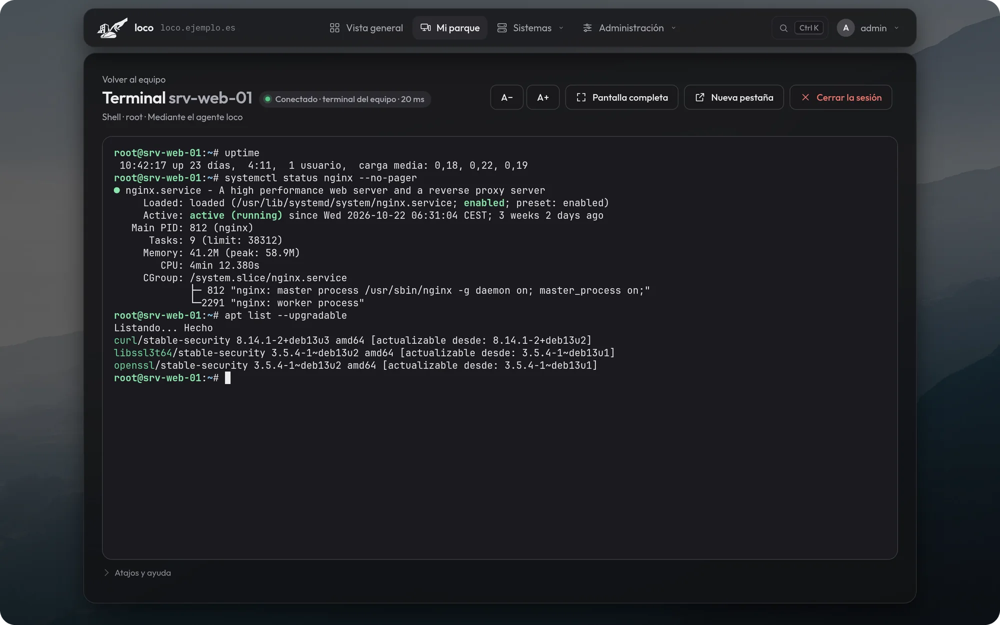
</p>
<p align="center"><sub>← <b>Escritorio</b> — ¿dos pantallas? Elija cuál mirar.<br><b>Terminal</b> — un verdadero shell root o PowerShell SYSTEM. →</sub></p>

- **Windows**, pantalla de inicio de sesión y ventana UAC incluidas. **Linux** con X11, GNOME, KDE Plasma, Sway o Hyprland.
- **Ctrl+Alt+Supr**, portapapeles compartido, envío de una contraseña carácter a carácter.
- **Gestor de archivos** — arrastre, suelte, modifique un archivo de texto sin salir de la página.
- **Con el consentimiento de la persona**, si lo desea: acepta o rechaza antes de cualquier imagen.

<br>

###  &nbsp;Software de Windows

**Busque, añada, despliegue.** loco descarga el instalador oficial, comprueba su huella y recuerda cómo instalarlo en silencio.

<p align="center">
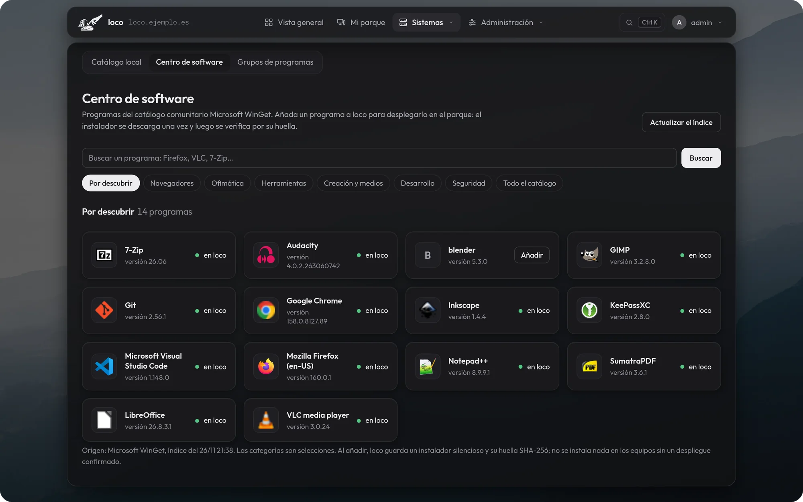
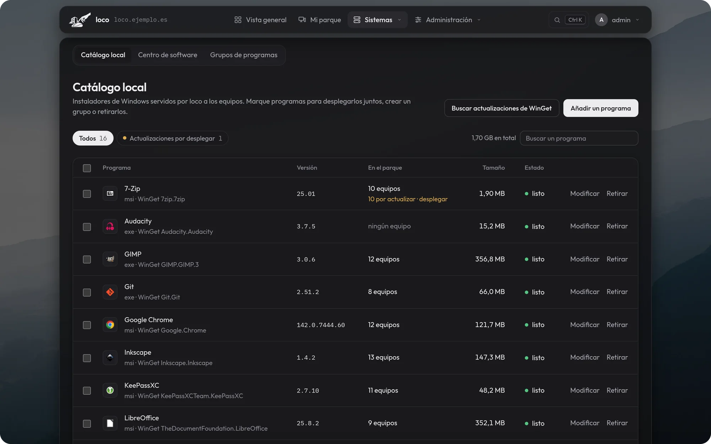
</p>
<p align="center"><sub>← <b>Centro de software</b> — el catálogo WinGet, ordenado por categorías.<br><b>Catálogo local</b> — quién lo tiene, quién va con retraso. →</sub></p>

- **Nada sale sin su visto bueno** — la vista previa muestra los equipos destinatarios y los descartados.
- **Grupos de software** — «Puesto estándar», «Oficina técnica»: un equipo nuevo queda listo de una vez.
- **Sus propios instaladores** — `exe`, `msi`, `msu` o `ps1`, por enlace o por archivo.

<br>

###  &nbsp;Cachés y repositorios

**Descargado una vez, servido a todos.** Su conexión a Internet respira, sus equipos se actualizan a la velocidad de la red local.

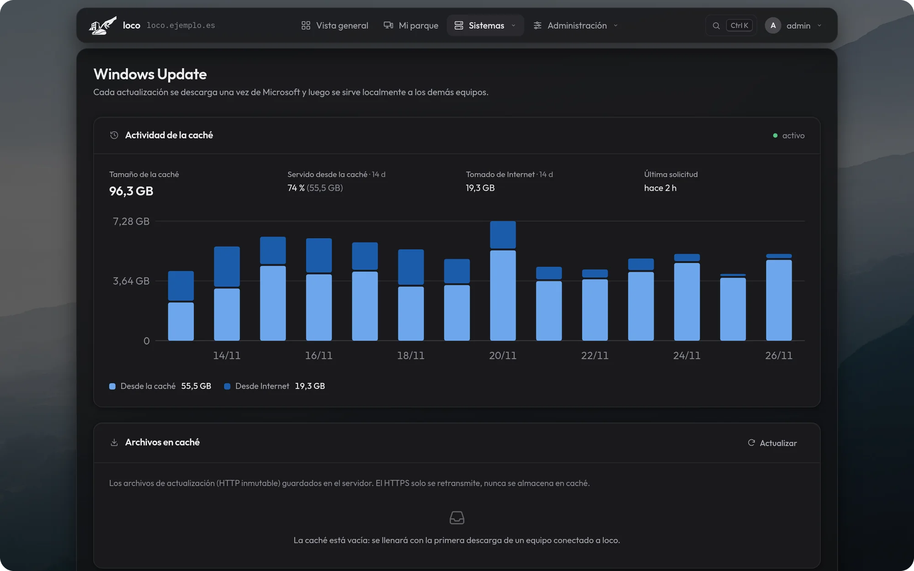

| Lo que pasa por loco | Cómo |
|---|---|
| **Windows Update** | por el DNS de la red, o por un proxy integrado — sin tocar el DNS |
| **Debian, Ubuntu** | caché APT, y repositorios firmados para sus propios `.deb` |
| **RHEL, Rocky, AlmaLinux** | caché de las réplicas y de EPEL, y repositorios RPM firmados por versión principal |
| **Flatpak** | caché de Flathub, y repositorio local firmado para sus aplicaciones |

¿Detrás de un proxy de empresa? También funciona.

<br>

###  &nbsp;Scripts y programaciones

**Escrito una vez, revisado y luego lanzado en todas partes.** PowerShell, shell o Python, con la salida de cada equipo.

<p align="center">
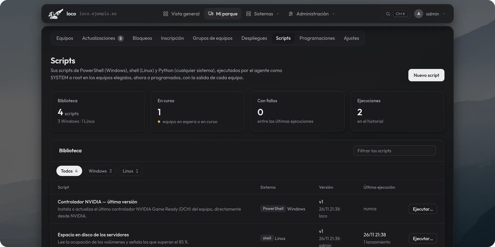
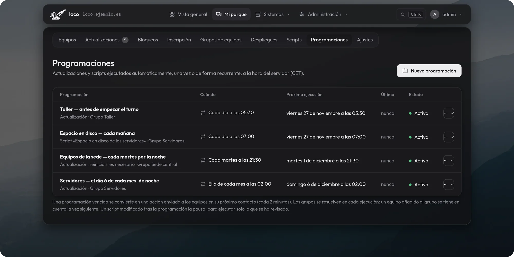
</p>
<p align="center"><sub>← <b>Scripts</b> — versionados, fijados por huella al salir.<br><b>Programaciones</b> — «cada martes a las 21:30, los equipos de la sede». →</sub></p>

<br>

###  &nbsp;Permisos, SSO y diario

**El acceso adecuado, para la persona adecuada, en los equipos adecuados.** Y el rastro de cada gesto.

<p align="center">
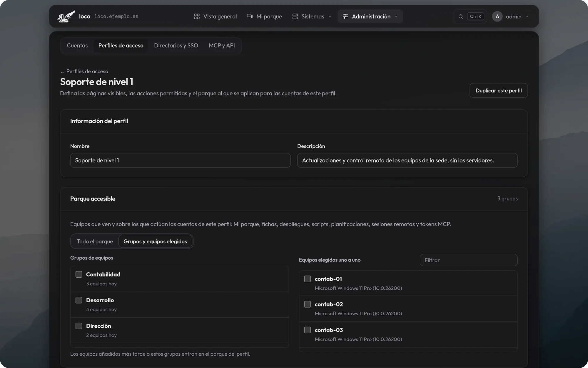
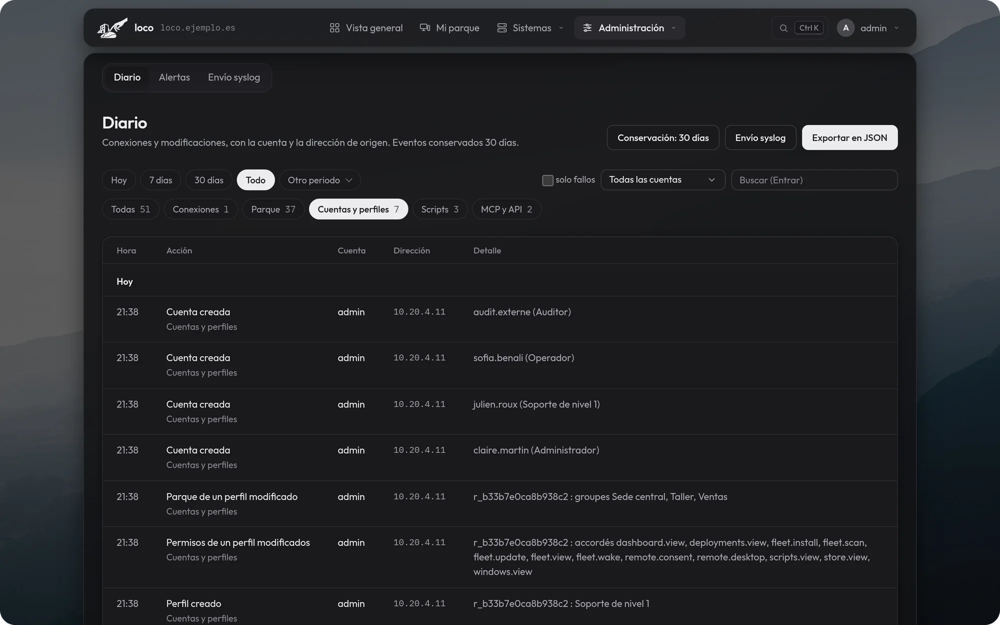
</p>
<p align="center"><sub>← <b>Perfiles</b> — permisos, y el ámbito en el que se ejercen.<br><b>Diario</b> — quién, qué, cuándo, desde dónde. Exportable, o enviado por syslog. →</sub></p>

- **Sus identidades** — Active Directory, LDAP, RADIUS, OpenID Connect (Authentik, Keycloak, Entra ID…).
- **Dos cerrojos valen más que uno** — códigos de un solo uso (TOTP) y claves de acceso (passkeys).
- **Nadie entra por sorpresa** — una cuenta de directorio espera a ser aprobada.

<br>

###  &nbsp;Asistentes de IA

**«¿Qué equipos no se han reiniciado desde hace un mes?»** Pregúnteselo a su asistente.

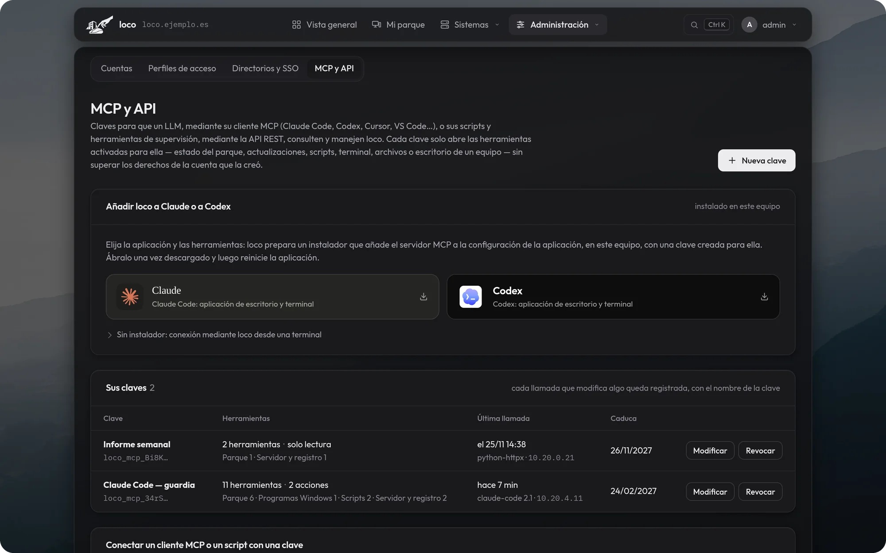

- **Claude o Codex en un clic** — un instalador añade loco a la configuración MCP de la aplicación, en su ordenador.
- **40 herramientas**, marcadas una a una para cada clave: leer, actualizar, lanzar un script, abrir un terminal — por MCP o por la API REST.
- **Nunca más permisos que usted** — una clave se queda dentro de los límites de la cuenta que la creó, y cada cuenta ve las suyas.
- **Todo queda anotado** — cada llamada que cambia algo pasa al diario, con el nombre de la clave.

<br>

###  &nbsp;Android, Home Assistant y Wazuh

**Tres opciones, desactivadas por defecto.** Actívelas si le interesan.

<p align="center">
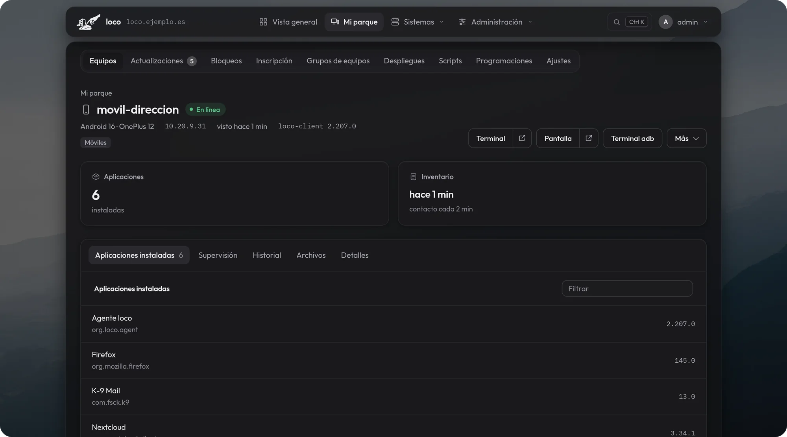
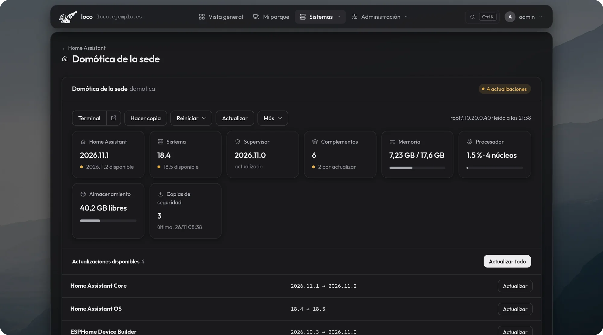
</p>
<p align="center"><sub>← <b>Android</b> <i>(experimental)</i> — pantalla, terminal, archivos y aplicaciones de sus propios dispositivos. Siempre visible, siempre consentido.<br><b>Home Assistant</b> <i>(opcional)</i> — actualizaciones, copias de seguridad, salud y terminal, por SSH con una clave propia de loco. →</sub></p>

**Agente Wazuh** *(opcional)* — ¿tiene un manager Wazuh? loco instala su agente en los equipos que usted marca, configurado para su manager, y muestra en cada ficha si está conectado. loco verifica el paquete oficial y luego lo entrega a los equipos, que no necesitan Internet. Retirar el agente de un equipo también puede borrar su entrada en el manager. [Más información](docs/es/wazuh.md).

<br>

###  &nbsp;A su imagen

**Seis temas, ocho colores, quince fondos.** O su logotipo y sus colores, para toda la empresa.

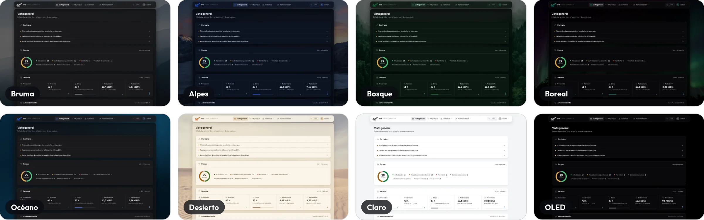

<br>

###  &nbsp;En el bolsillo

**¿Una alerta a las 22:00?** El portal se instala como una aplicación y cabe en una mano.

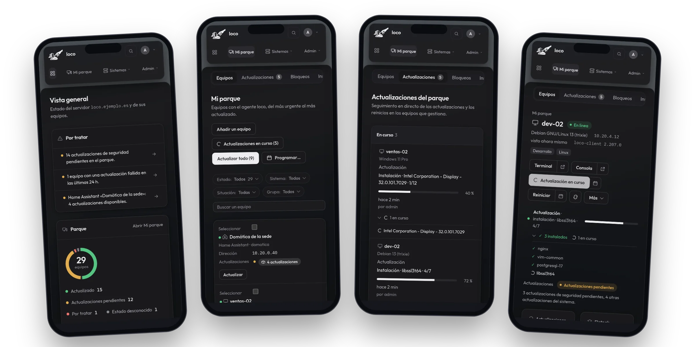

<br>

<div align="center">

</div>

<br>

<a id="instalar"></a>

## Instalar en cinco minutos

Elija su terreno. El portal, los repositorios y las cachés son los mismos en todas partes.

| | Para quién | Sistemas |
|---|---|---|
|  &nbsp;**Linux nativo** — recomendado | producción | Debian 12 / 13 · Ubuntu 22.04 / 24.04 / 26.04 · Rocky Linux 8 / 9 / 10 |
|  &nbsp;**Contenedor LXC** | un anfitrión Proxmox VE | Proxmox VE 7 / 8 / 9 |
|  &nbsp;**Appliance ISO** | una máquina dedicada, incluso sin conexión | Alpine Linux, BIOS o UEFI |
|  &nbsp;**Docker** | una prueba rápida | Docker Engine 26+ y Compose v2 |
|  &nbsp;**Windows nativo** | un parque sin Linux | Windows 11 · Windows Server 2022 / 2025 |

<details open>
<summary> &nbsp;<b>Linux nativo</b></summary>
<br>

```bash
git clone https://github.com/ShaNouhAr/loco.git
cd loco
sudo ./install.sh
```

La instalación muestra la dirección del portal (`https://<ip>:8443`), la huella de su autoridad y la contraseña inicial de la cuenta `admin`.
Volver a lanzar el mismo comando actualiza.

</details>

<details>
<summary> &nbsp;<b>Contenedor LXC en Proxmox VE</b></summary>
<br>

```bash
curl -fsSLO https://raw.githubusercontent.com/ShaNouhAr/loco/main/linux/lxc/proxmox-lxc.sh
bash proxmox-lxc.sh
```

El script crea el contenedor, instala en él la última versión publicada y muestra la dirección del portal.

</details>

<details>
<summary> &nbsp;<b>Appliance ISO</b></summary>
<br>

Descargue la ISO de la [última versión](https://github.com/ShaNouhAr/loco/releases/latest), arranque con ella y siga el asistente.
Los paquetes van incluidos: la instalación no necesita Internet. Detalles: [guía de la appliance](linux/iso/README.es.md).

</details>

<details>
<summary> &nbsp;<b>Docker</b></summary>
<br>

Basta un archivo, sin clonar el proyecto:

```bash
mkdir loco && cd loco
curl -fsSLO https://raw.githubusercontent.com/ShaNouhAr/loco/main/linux/docker/docker-compose.yml
docker compose up -d
docker compose logs loco    # dirección, huella de la autoridad, contraseña inicial
```

La imagen `ghcr.io/shanouhar/loco` se publica con cada versión. Para actualizar: `docker compose pull && docker compose up -d`.

</details>

<details>
<summary> &nbsp;<b>Windows nativo</b></summary>
<br>

En una consola PowerShell de **administrador**:

```powershell
Invoke-WebRequest https://github.com/ShaNouhAr/loco/archive/refs/heads/main.zip -OutFile loco.zip
Expand-Archive loco.zip -DestinationPath .
cd loco-main
powershell.exe -NoProfile -ExecutionPolicy Bypass -File .\windows\install.ps1
```

Ni WSL, ni Hyper-V, ni Docker: loco funciona en un servicio de Windows.

</details>

**¿Y después?**

1. Abra `https://<ip>:8443` y cambie la contraseña de `admin`.
2. Vaya a **Mi parque › Inscripción**: un comando que copiar por equipo — o un MSI, un `.deb`, un `.rpm`.
3. Mire cómo se llena el parque.

Todas las opciones, el proxy de empresa, los certificados: **[Instalar loco](docs/es/installation.md)**.

<br>

<a id="funcionamiento"></a>

## Cómo funciona

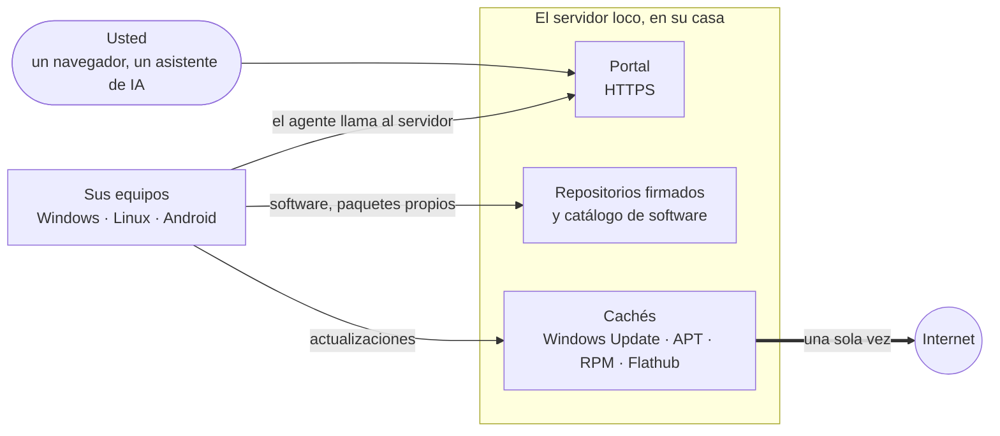

- **Los equipos llaman al servidor.** Nunca al revés: nada que abrir en los equipos, nada que exponer en Internet.
- **Todo se verifica.** Repositorios firmados, instaladores comprobados por huella SHA-256, autoridad del servidor fijada por los agentes.
- **Nada sale.** Sus inventarios, sus registros y sus claves se quedan en su servidor.

<br>

<a id="documentacion"></a>

## Documentación

<table>
<tr>
<td width="33%" valign="top">
<h4>Poner en marcha</h4>
 &nbsp;<b><a href="docs/es/installation.md">Instalar loco</a></b><br><sub>Las cinco instalaciones y sus opciones.</sub><br><br>
 &nbsp;<b><a href="docs/es/linux.md">Servidor Linux en la empresa</a></b><br><sub>Red, GPO, proxy, Docker, LXC, Rocky, ISO.</sub><br><br>
 &nbsp;<b><a href="docs/es/windows.md">Servidor Windows</a></b><br><sub>Instalación, límites, dimensionamiento.</sub><br><br>
 &nbsp;<b><a href="docs/es/connecting-devices.md">Conectar los equipos</a></b><br><sub>Repositorios, cachés, Windows Update.</sub><br><br>
 &nbsp;<b><a href="docs/es/high-availability.md">Alta disponibilidad</a></b><br><sub>Dos servidores, una sola dirección.</sub><br><br>
</td>
<td width="33%" valign="top">
<h4>Usar</h4>
 &nbsp;<b><a href="docs/es/fleet.md">Mi parque</a></b><br><sub>Agente, actualizaciones, oleadas, bloqueos, scripts.</sub><br><br>
 &nbsp;<b><a href="docs/es/windows-software.md">Software de Windows</a></b><br><sub>Catálogo, grupos, despliegues.</sub><br><br>
 &nbsp;<b><a href="docs/es/remote-sessions.md">Sesiones remotas</a></b><br><sub>Escritorio, terminal, archivos.</sub><br><br>
 &nbsp;<b><a href="docs/es/accounts.md">Cuentas, perfiles y SSO</a></b><br><sub>Permisos, directorios, apariencia.</sub><br><br>
 &nbsp;<b><a href="docs/es/mcp.md">MCP y API</a></b><br><sub>Conectar un asistente de IA o un script.</sub><br><br>
 &nbsp;<b><a href="docs/es/android.md">Android</a></b><br><sub>Dispositivos, aplicaciones, pantalla remota.</sub><br><br>
 &nbsp;<b><a href="docs/es/homeassistant.md">Home Assistant</a></b><br><sub>Vínculo SSH, actualizaciones, copias de seguridad.</sub><br><br>
 &nbsp;<b><a href="docs/es/wazuh.md">Agente Wazuh</a></b><br><sub>Instalado en los equipos, configurado para su manager.</sub><br><br>
 &nbsp;<b><a href="docs/es/file-shares.md">Recursos compartidos</a></b><br><sub>Carpetas SMB, tamaños límite, cuentas, gestor de archivos.</sub><br><br>
</td>
<td width="33%" valign="top">
<h4>Mantener en marcha</h4>
 &nbsp;<b><a href="docs/es/operations.md">Explotar loco a diario</a></b><br><sub>Rutina, copias de seguridad, actualizaciones, incidencias.</sub><br><br>
 &nbsp;<b><a href="docs/es/audit-log.md">Diario y syslog</a></b><br><sub>Lo que se registra, adónde enviarlo.</sub><br><br>
 &nbsp;<b><a href="SECURITY.es.md">Seguridad</a></b><br><sub>El modelo, sus límites, avisar de una vulnerabilidad.</sub><br><br>
<h4>Contribuir</h4>
 &nbsp;<b><a href="docs/es/development.md">Desarrollo</a></b><br><sub>Repositorio, pruebas, publicación.</sub><br><br>
 &nbsp;<b><a href="CHANGELOG.es.md">Historial de versiones</a></b><br><sub>Todas las versiones, una a una.</sub><br><br>
</td>
</tr>
</table>

<br>

## Seguridad, en resumen

- **En su casa** — ninguna telemetría; nada sale del servidor sin que usted lo haya decidido.
- **Confinado** — el portal funciona sin privilegios; un agente separado revalida cada operación de administración.
- **Firmado y verificado** — repositorios APT, RPM y Flatpak firmados, instaladores comprobados por SHA-256.
- **Reforzado** — HTTPS, política de contenido estricta, protección CSRF, bloqueo de los intentos de inicio de sesión, filtrado por red.
- **Registrado** — inicios de sesión, fallos y cambios en el diario, con la cuenta y la dirección.

El detalle, y lo que loco no protege: **[SECURITY.md](SECURITY.es.md)**.

<br>

## Licencia

[MIT](LICENSE). Fuentes IBM Plex, Outfit y JetBrains Mono con licencia SIL OFL 1.1 (`portal/static/fonts/`); fotos de los fondos de pantalla acreditadas en `portal/static/wallpapers/CREDITS.txt`.

<br>

<div align="center">
<picture>
  <source media="(prefers-color-scheme: dark)" srcset="docs/logo-dark.svg">
  
</picture>
<br>
<sub>Capturas tomadas en una instancia de demostración: la empresa, sus equipos y sus cuentas son inventados.</sub>
</div>
