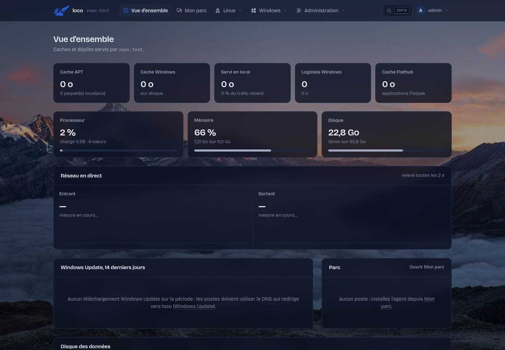
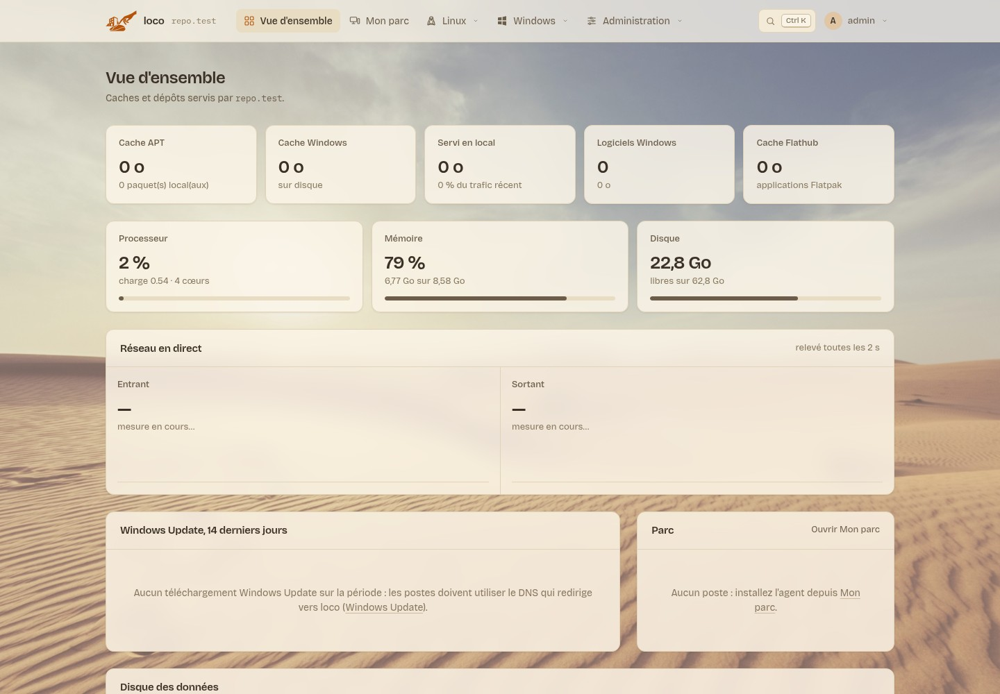
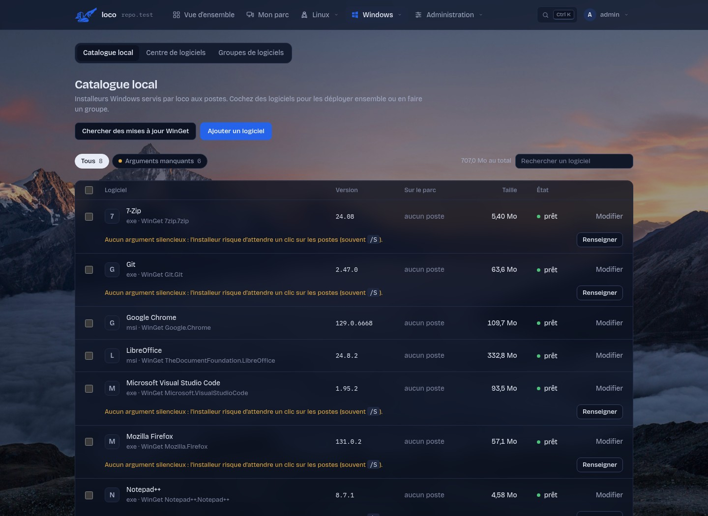
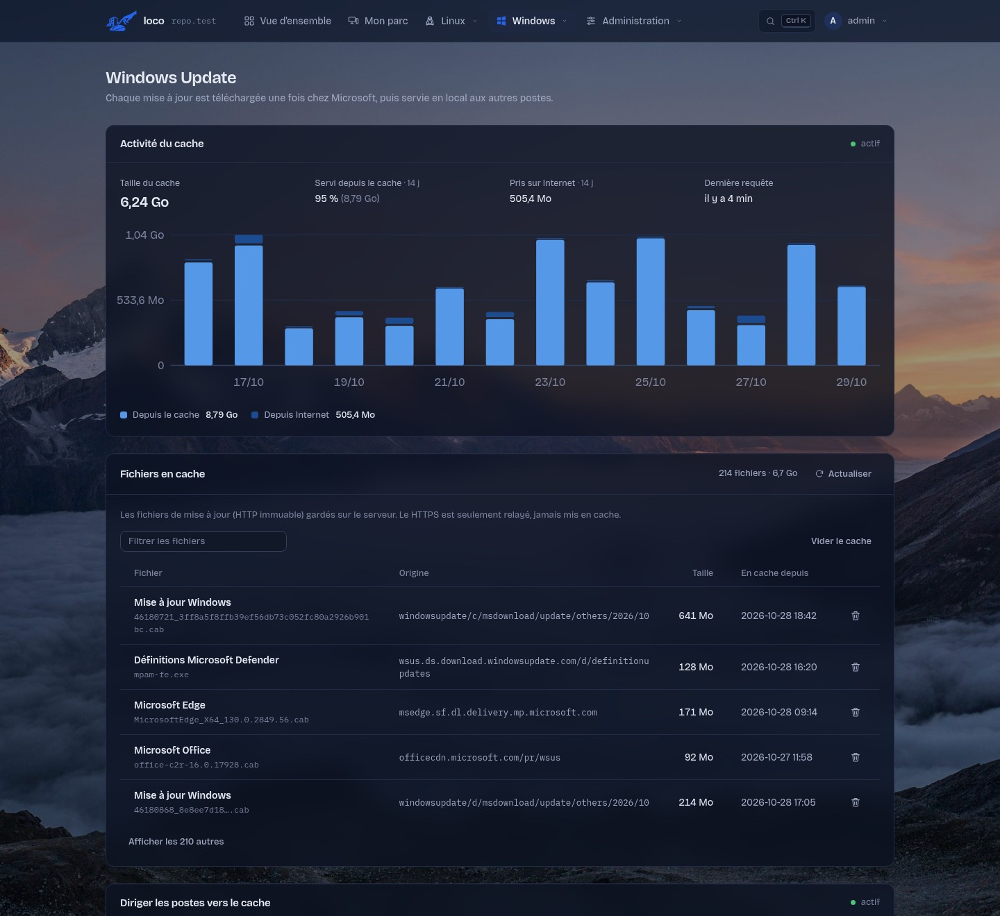

<div align="center">

<picture>
  <source media="(prefers-color-scheme: dark)" srcset="docs/logo-dark.svg">
  
</picture>

# loco

### Dépôts, caches et gestion de parc, pour tout un réseau d'entreprise

Un seul serveur pour les mises à jour **Linux** et **Windows**, les logiciels et la supervision du parc —
même hors ligne ou derrière un proxy d'entreprise.

[](https://github.com/ShaNouhAr/loco/actions/workflows/ci.yml)
[](https://github.com/ShaNouhAr/loco/releases)
[](LICENSE)


</div>

Serveur de dépôts et de caches pour un réseau d'entreprise, installé sur Debian, Ubuntu, Rocky Linux ou Windows
(installation native, recommandée), dans un **conteneur LXC Proxmox VE** ou avec **Docker Compose** :

- **Paquets Linux** : cache APT pour Debian / Ubuntu (apt-cacher-ng sous Linux, nginx sous Windows)
  et dépôts APT signés pour vos propres `.deb`, séparés par distribution et version.
- **Famille Red Hat** : cache des miroirs Rocky Linux, AlmaLinux et EPEL, et dépôts RPM signés par
  version majeure (`el8`, `el9`, `el10`) pour RHEL, Rocky Linux et AlmaLinux.
- **Windows Update** : cache des téléchargements de mises à jour (même principe que [lancache](https://lancache.net)).
- **Logiciels Windows** : catalogue d'installeurs (`exe`, `msi`, `msu`, `ps1`) installés en silence par PowerShell.
- **Flatpak** : cache Flathub et, sur un serveur Linux, dépôt Flatpak local signé pour les applications de l'entreprise.
- **Mon parc** : agent sur les postes Windows (service `loco-client`, installeur MSI) et Linux (systemd), avec
  voyant vert / orange / rouge par poste, mise à jour d'un poste ou de tout le parc en un clic (Windows Update,
  APT, DNF, Flatpak et logiciels du catalogue). Un poste reste rattaché quand il change d'adresse IP.
- **Catalogue winget** : recherche dans le catalogue public de Microsoft et import en un clic (installeur officiel
  vérifié par SHA-256, options silencieuses et détection des versions installées sur le parc).
- **Portail web** en HTTPS : comptes nommés, journal d'audit, supervision, sauvegardes ; **apparence personnalisable** par
  utilisateur (thèmes clairs et sombres, couleur d'accent, transparence, fonds d'écran dont des photos), dans le cadre
  fixé pour l'instance (logo, couleur et fond de l'entreprise, thèmes proposés, couleur ou fond imposés).

| | |
|---|---|
|  |  |
|  |  |

## Sommaire

- **Installer** — [Choisir son installation](#choisir-son-installation) · [Serveur Linux](#serveur-linux) · [Serveur Windows](#serveur-windows)
- **Déployer** — [Brancher les postes](#brancher-les-postes) · [Mon parc : agent des postes](#mon-parc--agent-des-postes) · [Centre de logiciels Windows](#centre-de-logiciels-windows) · [Scripts](#scripts)
- **Administrer** — [Sessions distantes](#sessions-distantes-via-lagent) · [Annuaires et SSO](#annuaires-et-sso) · [Serveur MCP](#serveur-mcp) · [Utilisateurs et profils](#utilisateurs-et-profils-daccès) · [Journal](#journal) · [Fonctionnalités](#fonctionnalités)
- **Références** — [Sécurité](SECURITY.md) · [Développement](#développement) · [Changelog](CHANGELOG.md) · [Licence](#licence)

## Choisir son installation

| Serveur | Systèmes | Installation | Guide |
|---|---|---|---|
| **Linux natif** (recommandé) | Debian 12 / 13, Ubuntu 22.04 / 24.04 / 26.04, Rocky Linux 8 / 9 / 10 | `sudo ./install.sh` | [docs/linux.md](docs/linux.md) |
| **Windows natif** | Windows 11, Windows Server 2022 / 2025 | `windows\install.ps1` | [docs/windows.md](docs/windows.md) |
| Conteneur LXC | Proxmox VE 7 / 8 / 9 | `linux/lxc/proxmox-lxc.sh` | [docs/linux.md](docs/linux.md) |
| Appliance ISO | Alpine Linux (BusyBox), BIOS/UEFI | `linux/iso/` (assistant, réponses et portail) | [docs/linux.md](docs/linux.md) |
| Docker | Docker Engine 26+ et Compose v2 | `linux/docker/` | [docs/linux.md](docs/linux.md) |

Le portail, les dépôts et les caches sont les mêmes partout ; seul le dépôt Flatpak local demande un
serveur Linux.

```text
portal/     portail web et scripts des postes, communs à Linux et Windows
conf/       gabarits nginx communs
linux/      installateur Linux (install.sh, remove.sh), outils d'administration, Docker, conteneur LXC,
            Alpine (lib/alpine.sh) et fabrique ISO (iso/)
windows/    installateur Windows (install.ps1, remove.ps1), service Windows, composants vérifiés
docs/       guides Linux et Windows
tests/      tests unitaires et de bout en bout (VM Linux, Windows Server)
install.sh  raccourci vers linux/install.sh
```


**Langues** : interface en français ou en anglais, au choix de chaque compte (menu *Apparence*), sinon selon le
navigateur. Traductions : `portal/i18n/en.json` (texte français -> anglais), vérifiées par `tests/test_i18n.py`.

## Serveur Linux

### Installation native (recommandée)

```bash
git clone https://github.com/ShaNouhAr/loco.git
cd loco
sudo ./install.sh
```

Debian 12 / 13, Ubuntu 22.04 / 24.04 / 26.04 et Rocky Linux 8 / 9 / 10 (validations serveur en amd64). L'installation affiche l'adresse de l'interface
(`https://<ip>:8443`), l'empreinte de l'autorité de certification et le mot de passe initial du compte
`admin` (à changer à la première connexion). Le script est relançable : il sert aussi à mettre à jour
(`git pull && sudo ./install.sh`) et à reconfigurer.

Sur Rocky Linux, la même commande détecte le système et utilise DNF avec EPEL et PowerTools (8) ou CRB (9/10). SELinux reste
actif ; les contextes et les ports nécessaires sont configurés. Si firewalld tourne déjà, une règle de
service dédiée est ajoutée ; les réseaux autorisés restent contrôlés par `--allow` et `--admin-allow`.
Rocky 10 compile le cache APT depuis une version des sources Debian avec ses correctifs, vérifiée par
SHA-256 (ce composant manque dans EPEL 10). Rocky 8 compile uniquement l’indexeur `apt-ftparchive`
2.6.1 depuis les sources Debian vérifiées ; il utilise Python 3.11 pour le portail, dans un environnement
isolé. Si nginx ne fournit pas le relais TLS requis, l’installateur sélectionne le flux nginx 1.24
d’AppStream ; un nginx préexistant est mis à jour en conservant sa configuration et reste sur ce flux
après désinstallation. La première installation prend donc plus de temps ; les relances réutilisent les outils compilés.

Options principales (toutes : `sudo ./install.sh --help`) :

| Option | Effet |
|---|---|
| `--allow "CIDR …"` | réseaux autorisés pour les postes (défaut : réseaux privés) |
| `--admin-allow "CIDR …"` | réseaux autorisés pour l'interface (défaut : comme `--allow`) |
| `--proxy http://hôte:port` | proxy d'entreprise pour sortir sur Internet |
| `--no-http` | HTTPS seul (autorité déjà déployée sur les postes) |
| `--no-wu`, `--no-flatpak`, `--no-rpm` | sans cache Windows Update, sans Flatpak, sans famille Red Hat |
| `--wu-proxy-port P` | port du proxy-cache Windows Update (Squid, sans DNS ; 3128 par défaut) |
| `--tls-cert F --tls-key F` | certificat d'entreprise au lieu de l'autorité locale |
| `--backup-keep N` | sauvegardes quotidiennes gardées (défaut 3, 0 = aucune) |

### Conteneur LXC sur Proxmox VE

Sur n'importe quel hôte Proxmox VE 7, 8 ou 9, en root :

```bash
curl -fsSLO https://raw.githubusercontent.com/ShaNouhAr/loco/main/linux/lxc/proxmox-lxc.sh
bash proxmox-lxc.sh                                   # DHCP, 100 Go, 2 processeurs, 2 Go de mémoire
bash proxmox-lxc.sh --ip 192.168.10.20/24 --gw 192.168.10.1 --disk 300 -- --allow "192.168.10.0/24"
```

Le script crée un conteneur Debian 13 non privilégié (Debian 12 sur Proxmox 7), choisit le stockage
(`local-lvm`, `local-zfs`…) et le pont (`vmbr0`) disponibles, télécharge la dernière version publiée
et y fait l'installation native ; les options après `--` sont celles d'`install.sh`. Il affiche ensuite
l'adresse, l'empreinte de l'autorité et le mot de passe initial. Mise à jour :
`bash proxmox-lxc.sh --ctid N --update`. Toutes les options : `bash proxmox-lxc.sh --help`.

### Avec Docker

```bash
git clone https://github.com/ShaNouhAr/loco.git
cd loco/linux/docker
cp .env.example .env          # réglages : LOCO_HOST, LOCO_ALLOW, LOCO_PROXY, LOCO_WU…
sudo ./up.sh
docker compose logs loco   # adresse, empreinte de l'autorité, mot de passe initial de « admin »
```

Même portail, mêmes fonctions et même configuration que l'installation native : au démarrage, le
conteneur applique les variables de `.env` avec `linux/install.sh --container`, puis `supervisord` lance nginx,
apt-cacher-ng, le portail et les tâches périodiques. Le conteneur utilise le **réseau de l'hôte** (ports
8443, 8088, 3142, et 80/443 pour Windows Update) : ne pas l'associer à une installation native sur la même
machine. Les données sont dans des volumes Docker (`LOCO_DATA_DIR` : dossier de l'hôte pour les dépôts et
caches). Installation et mise à jour : `sudo ./up.sh` (dans `linux/docker`, après `git pull`). Ce script
migre aussi un ancien projet Docker `local-repo`, en conservant ses volumes d'origine.

L'installation native reste recommandée en production : elle confine chaque service avec systemd
(détails dans [SECURITY.md](SECURITY.md)). Docker Engine 26 ou plus récent avec Compose v2 (validé avec
les paquets `docker.io` et `docker-compose` de Debian 13).

Déploiement en entreprise (réseau, GPO, proxy, sauvegardes, supervision, LXC, Docker, dépannage) :
**[guide Linux](docs/linux.md)**.

### Administration

```bash
sudo loco-user list | roles | add NOM [PROFIL] | set-role NOM PROFIL | passwd NOM   # comptes (accès perdu : passwd admin)
sudo loco-backup create | list | restore ARCHIVE             # sauvegardes
sudo /opt/loco/remove.sh [--purge]                           # désinstallation
```

Dans un conteneur LXC, depuis l'hôte Proxmox : `pct exec N -- loco-user list`, etc.
Avec Docker, les mêmes commandes passent par le conteneur : `docker compose exec loco loco-user list`,
`docker compose exec loco loco-backup create`. Désinstallation : `docker compose down`
(ajouter `-v` pour effacer aussi les données).

### Architecture

| Élément | Emplacement | Port |
|---|---|---|
| Portail (Flask + gunicorn, unité `loco-portal`, confinée) | `/opt/loco` | 8089, local |
| nginx : interface et fichiers des postes (HTTPS) | `/etc/nginx/sites-available/loco-portal.conf` | 8443 |
| nginx : amorçage HTTP (optionnel) | même fichier | 8088 |
| nginx : cache Windows Update, relais HTTPS (SNI) | `loco-wucache.conf`, `modules-enabled/99-loco-stream.conf` | 80, 443 |
| squid : proxy-cache Windows Update (sans DNS) | `/etc/squid/squid.conf`, cache `/srv/loco/wuproxy` | 3128 |
| apt-cacher-ng | `/var/cache/apt-cacher-ng` | 3142 |
| Données : dépôts, catalogue, caches | `/srv/loco` | — |
| Base, clé GPG, statistiques | `/var/lib/loco` | — |
| Configuration, autorité et certificats | `/etc/loco` | — |

Sur Debian / Ubuntu, les dépendances viennent des dépôts officiels (`nginx`, `apt-cacher-ng`, `python3-flask`, `gunicorn`,
`gnupg`, `flatpak`, `ostree`, `createrepo-c`, `rpm`) : les correctifs de sécurité arrivent avec `apt upgrade`, ou
depuis le portail (**Administration → Mises à jour** : correctifs de sécurité, noyau, redémarrage).
Sur Rocky, les paquets système sont suivis par `dnf upgrade` ; le runtime Python isolé et les composants
compilés sont figés et mis à jour avec les versions de loco.

## Serveur Windows

### Installation

Windows 11 Professionnel / Entreprise et Windows Server 2022 / 2025, en x64, avec PowerShell 5.1
ou supérieur. Dans une console PowerShell **administrateur**, depuis les sources du projet :

```powershell
Invoke-WebRequest https://github.com/ShaNouhAr/loco/archive/refs/heads/main.zip -OutFile loco.zip
Expand-Archive loco.zip -DestinationPath .
cd loco-main
powershell.exe -NoProfile -ExecutionPolicy Bypass -File .\windows\install.ps1
```

L'application tourne dans le service Windows `loco`, avec ses composants Windows natifs :
Python et nginx ; les dépôts sont signés par le programme lui-même (OpenPGP). Aucune VM Linux, WSL,
Hyper-V ou installation Docker n'est nécessaire.
Relancer le même script met à jour le programme en conservant les comptes, les clés et les dépôts.

Les dépôts APT/RPM signés, les caches APT/RPM/Flathub, le catalogue Windows et Windows Update
sont disponibles. Le **dépôt Flatpak local** reste réservé aux serveurs Linux. Pour un réseau important,
consulter les limites du nginx Windows et le dimensionnement dans le [guide Windows](docs/windows.md).

### Administration

Dans une console administrateur :

```powershell
$lr = "$env:ProgramFiles\loco\loco.cmd"
& $lr user list ; & $lr user passwd admin ; & $lr backup create ; & $lr status
powershell -ExecutionPolicy Bypass -File "$env:ProgramFiles\loco\windows\remove.ps1"   # -Purge : tout effacer
```

### Architecture

Service `loco` (compte `NT SERVICE\loco`) qui lance nginx et le portail
(Waitress, 8089 en local) ; programme dans `%ProgramFiles%\loco`, données, configuration et journaux
dans `%ProgramData%\loco`. Ports : 8443 (HTTPS), 8088 (amorçage HTTP), 3142 (cache APT), 80 et 443
(Windows Update). Détails : [guide Windows](docs/windows.md).

## Brancher les postes

Dans **Linux › Paquets**, créez d'abord les dépôts nécessaires : distribution, numéro de version
facultatif et nom de code (par exemple `debian/trixie` ou `ubuntu/noble`). Une future version s'ajoute
depuis cette page, sans modifier le code. Chaque dépôt a ses propres fichiers et index signés.

Les postes font confiance à l'autorité locale (`ca.crt`, déployée par GPO ou depuis la page
*Administration › Système*), puis :

```bash
# Debian / Ubuntu : dépôt local + cache APT
curl -fsSL https://<ip>:8443/linux/setup.sh | sudo sh
# … premier branchement, autorité pas encore importée (affiche son empreinte)
curl -fsSL http://<ip>:8088/linux/setup.sh | sudo sh -s -- --trust-ca
# Cache seul, sans dépôt local
curl -fsSL https://<ip>:8443/linux/setup.sh | sudo sh -s -- --cache-only

# Rocky Linux, AlmaLinux, RHEL 8+ : dépôt local elN + dépôts officiels via le cache (--epel : EPEL aussi)
curl -fsSL https://<ip>:8443/rpm/setup.sh | sudo sh

# Flatpak : Flathub via le cache + dépôt local « loco »
curl -fsSL https://<ip>:8443/flatpak/setup.sh | sudo sh
```

```powershell
# Windows, PowerShell administrateur : installe un ou plusieurs logiciels du catalogue
irm 'https://<ip>:8443/win/i/7-zip,vlc' | iex
```

Le script Windows vérifie le SHA-256 de chaque installeur, laisse 30 minutes à chacun (`$env:LOCO_TIMEOUT`)
et reconnaît les codes « redémarrage requis », « déjà installé » et « non applicable ».

Pour Windows Update, deux façons d'envoyer les téléchargements des postes vers loco, au choix sur la page
*Windows Update* : **par DNS** (le DNS du réseau renvoie l'IP du serveur pour les domaines de mise à jour ; un
script pour un DNS Active Directory est fourni) ou **par proxy, sans DNS** — loco embarque un proxy-cache (Squid) et
l'agent règle le proxy WinHTTP des postes Windows gérés vers loco (par poste, réversible, retiré si loco devient
injoignable). Les deux mettent en cache les mêmes fichiers immuables et relaient le HTTPS sans le déchiffrer. La
commande manuelle `netsh winhttp set proxy` est aussi proposée (pages *Windows Update* et *Enrôlement*).

Le script Linux lit `/etc/os-release` et sélectionne le dépôt correspondant au poste. Si ce dépôt
n'existe pas, il s'arrête avant de remplacer la configuration. Les dérivées peuvent choisir explicitement
`--distribution ubuntu --suite noble`. Les sources APT sont au format deb822 (`loco.sources`).

**Mise à jour depuis 1.0.0** : l'ancien dépôt `/apt/` et les postes déjà branchés restent fonctionnels.
L'action *Copier vers un autre dépôt* conserve les originaux. Vérifiez la compatibilité de chaque paquet,
puis relancez le script sur les postes. `--legacy` permet de conserver explicitement l'ancien dépôt partagé.

## Centre de logiciels Windows

Dans **Windows → Logiciels**, les onglets **Catalogue local**, **Centre de logiciels** et **Groupes de logiciels** réunissent les applications ; leurs boutons *Déployer* ouvrent la préparation d'un déploiement, qui se suit dans **Mon parc → Déploiements** (une action sur les appareils, comme les scripts). Le centre de logiciels utilise le catalogue communautaire Microsoft WinGet, avec recherche, catégories, fiches et logos vérifiés puis mis en cache sur loco. Une initiale remplace les logos indisponibles. Les fiches indiquent l'éditeur, la version, la licence et l'installeur silencieux disponible. **Ajouter à loco** télécharge l'installeur officiel et vérifie son empreinte SHA-256. L'index est renouvelé chaque jour ; son dernier exemplaire valide reste consultable si Internet est momentanément indisponible.

Depuis une fiche du centre de logiciels, **Déployer sur des appareils ou groupes** importe le logiciel si nécessaire, puis ouvre la préparation commune aux logiciels du catalogue. On peut aussi sélectionner plusieurs logiciels dans le catalogue ou créer un **groupe de logiciels** (par exemple « Socle bureautique »). Un logiciel peut appartenir à plusieurs groupes. Ajouter un logiciel à un groupe depuis le centre de logiciels l'importe une seule fois dans le catalogue ; les actualisations et nouvelles tentatives conservent la vérification de l'empreinte WinGet.

Dans **Mon parc → Groupes de machines**, créez les groupes et choisissez leurs membres ; la fiche d'un appareil permet aussi de modifier ses appartenances. Un appareil peut être dans plusieurs groupes. Le filtre de Mon parc affiche un groupe et limite l'action de mise à jour globale aux appareils de ce groupe.

Un déploiement peut combiner logiciels et groupes de logiciels, puis appareils individuels et groupes de machines. La prévisualisation déduplique les sélections et indique les appareils exclus : les logiciels de ce store sont destinés à Windows, tandis que les groupes de machines peuvent aussi contenir Linux. **Aucune installation ne part avant la confirmation** et la vérification des installeurs. La sélection est figée à la préparation, valable une heure : ajouter un membre à un groupe ne provoque aucune installation implicite. Une fiche, un fichier ou une cible modifiés depuis la préparation imposent une nouvelle prévisualisation.

À la confirmation, loco conserve les versions des installeurs et envoie un lot à chaque agent Windows concerné, au prochain contact du poste, y compris après une période hors ligne. Modifier ou supprimer ensuite le logiciel du catalogue ne remplace pas ces fichiers. Les versions déjà installées d'après un inventaire récent et les installations identiques déjà en attente sont ignorées ; une option permet la réinstallation explicite. **Mon parc → Déploiements** présente l'avancement, les exclusions et le journal de chaque poste. L'annulation arrête les commandes non transmises ; une installation déjà reçue par un agent peut se terminer. Les sauvegardes conservent les groupes, les commandes et les fichiers nécessaires ; le cache des versions sans commande active est purgé après une heure.

Les droits **Gérer les groupes de logiciels**, **Gérer les groupes de machines**, **Consulter les déploiements** et **Déployer sur des groupes ou plusieurs postes** sont distincts. Le dernier est réservé aux administrateurs par défaut ; l'Opérateur conserve le déploiement individuel. Les droits sont revérifiés à la confirmation puis avant transmission aux agents.

## Mon parc : agent des postes

L'agent `loco-client` (Windows et Linux) remonte l'inventaire des postes et exécute les actions reçues de loco —
mises à jour, logiciels, scripts, redémarrage. Un poste reste rattaché même quand son adresse IP change.

<details>
<summary><b>Lire le détail</b></summary>

La page **Mon parc** liste les postes équipés de l'agent `loco-client`. Pour en ajouter un, ouvrez **Enrôlement**
(barre de navigation, ou *Ajouter un poste* dans Mon parc) : un onglet par système (Windows ; Debian, Ubuntu ;
Rocky, AlmaLinux, RHEL) avec l'installeur de l'agent à télécharger — **MSI**, paquet **.deb** ou **.rpm** — et sa
commande d'installation, puis la configuration des dépôts et caches (APT, DNF, Flatpak) et, sous Windows, les
logiciels du catalogue. Les fichiers et commandes de l'agent contiennent la clé d'inscription du serveur. Sans
paquet, la commande reste disponible :

```powershell
# Windows 10/11, Windows Server 2016+ (PowerShell administrateur) : installe le MSI, service « loco-client »
irm 'https://<ip>:8443/agent/windows.ps1?key=<clé>' | iex
```

```bash
# Debian, Ubuntu, Rocky Linux, AlmaLinux, RHEL (systemd) : agent Python et minuterie systemd
curl -fsSL 'https://<ip>:8443/agent/linux.sh?key=<clé>' | sudo sh
```

**Inscrire directement dans un groupe** : en haut de la page Enrôlement, *Inscrire les postes dans le groupe* bascule
le MSI, les paquets .deb/.rpm, les commandes et la commande de déploiement en masse (GPO, Intune) sur la **clé du
groupe** (`g<id>-…`) : un poste inscrit avec eux rejoint ce groupe (un poste déjà inscrit le rejoint aussi, sans
quitter les siens). Aucun agent à mettre à jour : la clé de groupe prend la place de la clé du serveur. Par défaut,
aucun groupe ; *Enrôler des postes dans ce groupe* (menu ⋯ d'un groupe) ouvre la page sur lui. Un compte limité à
une partie du parc n'inscrit que dans les groupes attribués à son profil (jamais sans groupe : le poste sortirait de
son parc). *Changer la clé de ce groupe* (droit *Configurer le parc*) rend caducs ses fichiers et commandes déjà
distribués ; supprimer le groupe aussi.

- L'agent contacte loco toutes les deux minutes et envoie l'inventaire des mises à jour (Windows Update avec les
  correctifs de sécurité, APT, DNF, Flatpak). L'inventaire des logiciels installés est aussi remonté, sous Windows
  (logiciels installés) comme sous Linux (paquets APT/RPM avec version, architecture et taille, applications Flatpak,
  et caractéristiques du poste : processeur, mémoire, disque, noyau, virtualisation) ; il s'affiche sur la fiche du
  poste dans Mon parc.
- **Voyants** : vert, aucune mise à jour ; orange, 1 à 9 mises à jour ; rouge, 10 mises à jour ou plus.
  Le total additionne système, Flatpak et logiciels du catalogue. Le seuil rouge est réglable dans Mon parc.
  Un inventaire manquant, incomplet ou un poste sans contact récent est gris, sans fausser le comptage.
- **Actions** : *Mettre à jour* (un poste) ou *Tout mettre à jour* (tout le parc, tous systèmes), avec redémarrage
  facultatif ; installer ou mettre à jour un logiciel du catalogue ; inventaire ; redémarrage ; retrait de l'agent.
  Ces actions utilisent une liste fermée ; les administrateurs disposent aussi du terminal interactif décrit ci-dessous.
- **Planifications** (*Mon parc → Planifications*) : mises à jour et scripts lancés **une fois, chaque jour, chaque
  semaine** (jours au choix) **ou chaque mois** (jour fixe ou dernier jour), à l'heure du serveur, sur tout le parc, des
  groupes (membres résolus à chaque exécution) ou des appareils. On planifie aussi en contexte : bouton calendrier à
  côté de *Mettre à jour* sur la fiche d'un poste, *Planifier…* à côté de *Tout mettre à jour*, et choix « Maintenant /
  Planifier » à l'exécution d'un script. Un résumé en clair (« Chaque mardi et jeudi à 02:00 · prochaine exécution… »)
  accompagne la saisie ; la fiche d'un poste liste les planifications qui le concernent. Une planification due devient
  une action envoyée au prochain contact des agents ; une occurrence manquée n'est pas rattrapée. Pause, reprise et
  suppression depuis la liste. Un script modifié après sa planification la met en pause (on n'exécute que ce qui a été
  relu) ; une action encore en file s'annule depuis la fiche du poste. Droits : ceux de l'action planifiée (mettre à
  jour, tout le parc, redémarrer, exécuter des scripts), revérifiés à l'envoi aux postes.
- **Identité** : chaque poste a un identifiant et un jeton propres, indépendants de son adresse. Un poste qui change
  d'IP (DHCP, autre site, VPN) reste dans le parc ; seul *Retirer l'agent*, poussé depuis loco, le détache.
- **Sécurité** : l'autorité HTTPS de loco est épinglée par l'agent (empreinte SHA-256) sans modifier le magasin de
  certificats du poste ; installeurs vérifiés par SHA-256 ; jetons stockés hachés côté serveur.
- **Paquets .deb et .rpm** : produits par loco pour ce serveur (adresse, autorité épinglée et clé incluses), ils
  s'installent par `sudo apt install ./loco-client_<version>+depots_all.deb` ou
  `sudo dnf install ./loco-client-<version>-1.depots.noarch.rpm` et inscrivent le poste aussitôt. Cette variante
  recommandée configure aussi les dépôts et le cache de loco (autorité confiée au système) ; la variante
  « agent seul » (`loco-client_<version>_all.deb`, `loco-client-<version>-1.noarch.rpm`) ne touche pas aux dépôts.
  Passer de l'agent seul au paquet complet est une mise à jour qui garde l'inscription ; désinstaller le paquet
  retire l'agent (et, pour le paquet complet, la configuration des dépôts). Le paquet ne contient que les scripts
  d'installation : l'agent se met ensuite à jour seul. Ils se téléchargent aussi depuis le poste, en HTTPS ou par
  le port HTTP d'amorçage (`/agent/loco-client.deb?key=…`, `&depots=1` pour la variante complète).
- **Windows, MSI téléchargé** : la page *Enrôlement* propose le MSI en téléchargement direct (lien public, également
  ouvrable depuis le navigateur du poste) et la commande `msiexec` à lancer en administrateur avec l'adresse, la clé
  et l'empreinte du serveur ; un simple double-clic installe le service sans l'inscrire.
- **Windows en masse** : distribuer `loco-client.msi` (GPO, Intune, SCCM) et définir `Server`, `Key` et `CaSha256`
  sous `HKLM\SOFTWARE\Policies\loco\Client`, ou `msiexec /i loco-client.msi SERVER=… KEY=… CA_SHA256=… /qn`.
  Le MSI est publié avec chaque version ; le serveur le télécharge depuis GitHub à la première installation
  (empreinte vérifiée) ou utilise celui déposé dans `portal/agents/`. Il n'est pas signé (pas de certificat de
  signature de code) : SmartScreen peut avertir lors d'une installation manuelle.
- **Logiciels** : dans *Logiciels Windows*, renseigner le nom affiché dans Windows et la version permet de repérer les
  postes à mettre à jour. Le *Centre de logiciels* importe un logiciel avec ces informations ; *Nouvelles versions*
  met à jour les logiciels issus de winget, puis les postes concernés passent en orange.

L'agent se met à jour automatiquement avec loco.

**Changer l'adresse du serveur** : annoncez d'abord la future adresse (*Mon parc › Adresse du serveur pour les agents*,
ou `sudo loco-fleet announce https://192.168.1.20:8443`), attendez que tous les postes soient prévenus
(`loco-fleet servers`), puis changez l'adresse (`install.sh --host`, ou `setup-loco` sur l'appliance qui fait l'annonce
lui-même). Les agents passent seuls à la nouvelle adresse, après vérification de l'autorité HTTPS de loco ; un poste
resté éteint pendant toute l'annonce se réinscrit avec la commande d'installation (même identité).

Sur Windows, le MSI installe aussi **loco-tray.exe**, lancé dans chaque session utilisateur. Sa pastille reprend l'état de Mon parc : vert sans mise à jour, orange de 1 à 9 mises à jour, rouge à partir de 10 (seuil réglable). Un état indisponible ou ancien est gris. Le menu et le double-clic affichent uniquement des détails : **aucune action de mise à jour n'est accessible à l'utilisateur**. Le compagnon ne contacte pas le serveur et ne lit aucun jeton ; il consulte un fichier d'état public, accessible uniquement en lecture aux utilisateurs standards. Le service privilégié reste seul responsable des actions reçues de loco.

</details>

## Sessions distantes via l’agent

Terminal, bureau noVNC et gestionnaire de fichiers d’un poste, pilotés par l’agent via un relais HTTPS
sortant — aucun port entrant, serveur VNC ou compte SSH sur le poste.

<details>
<summary><b>Lire le détail</b></summary>

Dans la fiche d’un poste de **Mon parc**, un administrateur peut ouvrir un **Terminal / PowerShell** ou le **Bureau noVNC**. Les boutons **Plein écran** et **Nouvel onglet** sont disponibles dans les deux vues. En **plein écran du bureau**, l’image occupe tout l’écran et les commandes (résolution, zoom, Ctrl+Alt+Suppr, raccourcis, touches maintenues, envoi de texte, presse-papiers, fermeture) passent dans un **rail latéral gauche rétractable** : une poignée au bord de l’écran le déploie ou le replie. Le curseur du poste reste affiché et aligné en plein écran comme au retour. Le nouvel onglet ouvre une **console dédiée**, sans la navigation du portail : une petite barre d’outils et tout l’espace disponible pour le poste. La fiche de l’appareil reste ouverte dans son onglet ; chaque console dispose de sa connexion indépendante.

L’agent loco 2.4 ou ultérieur établit lui-même les connexions HTTPS sortantes vers loco, avec l’autorité du serveur épinglée. Aucun port entrant sur le poste, compte SSH, serveur VNC distinct ni accès Proxmox n’est nécessaire. Le terminal utilise un vrai PTY Linux ou ConPTY Windows, avec un shell **root** ou **PowerShell SYSTEM** selon le compte du service.

Le bureau se règle par deux menus indépendants, mémorisés par le navigateur. **Résolution** : *Adaptée à la fenêtre* (par défaut) change la résolution du bureau Windows pour remplir la fenêtre, **sans jamais d’ascenseurs** : si le pilote impose un mode un peu différent, l’image est ajustée ; *Résolution du poste* garde — et rétablit — la résolution d’origine. **Zoom** : *Ajuster*, ou 50 à 200 %. En résolution adaptée, le zoom agrandit l’interface du poste (comme la mise à l’échelle de Windows) tout en remplissant la fenêtre ; en résolution du poste, il agrandit l’image, avec défilement au-delà de la fenêtre (100 % : un pixel du poste par pixel de l’écran). La résolution et le pourcentage obtenus restent affichés, et le curseur du poste suit la même échelle. À partir de l’agent Windows **2.13.1**, la résolution adaptée reconfigure temporairement le bureau selon les modes du pilote, puis restaure la résolution initiale à la fermeture ; une seule session la modifie, les postes multi-moniteurs conservent leur configuration et une demande faite pendant l’UAC attend le retour au bureau. Avec l’adaptateur VGA standard d’une machine virtuelle (une seule résolution), préférer VirtIO-GPU et son pilote virtio-win. Un ancien agent ou un bureau X11 conserve l’ajustement local ; la console texte Linux 2.13 ou plus récente adapte réellement le PTY.

Une pastille indique l’état de la session et la latence vers le serveur ; une superposition accompagne l’ouverture et propose, en fin de session, d’en ouvrir une nouvelle en un clic. À partir de l’agent Windows **2.17**, l’écran est lu par **duplication DXGI** : seulement quand il change, avec les zones modifiées, et la demande d’image reste en attente tant que rien ne bouge (aucun trafic ni calcul sur un bureau immobile). GDI prend le relais sur le bureau sécurisé, avec plusieurs écrans ou un pilote sans duplication. Les zones d’interface (texte, aplats, icônes) sont transmises **sans perte** (Tight zlib), les zones complexes (photos, dégradés, fonds d’écran) en **JPEG** ; un écran immobile n’est pas retransmis. Sur les machines dont le pilote d’affichage n’a pas de curseur matériel (VM, adaptateur de base), Windows dessine son curseur dans l’image : l’agent le reconnaît et le navigateur n’en affiche alors qu’un point de repère, au lieu d’une seconde flèche décalée. Le **presse-papiers texte** est partagé dans les deux sens (agent Windows 2.15) via le panneau *Presse-papiers* : le texte copié sur le poste s’affiche dans le navigateur (et, s’il l’autorise, dans le presse-papiers local) ; *Envoyer au poste* place un texte dans le presse-papiers du poste. Une option envoie automatiquement le presse-papiers local au poste à chaque clic sur le bureau. Uniquement sur le bureau utilisateur, jamais sur le bureau sécurisé ; rien n’est conservé par loco.

Le bureau partage la session graphique existante : session interactive sous **Windows 11 et Windows Server 2022/2025**, ou bureau **X11** sous Linux (bibliothèques X11 et XTest requises). Le bureau Wayland n’est pas pris en charge. L’agent Windows 2.13 permet également le contrôle du bureau sécurisé (UAC, connexion/verrouillage) dans la session interactive. Un Linux sans session X11 peut ouvrir la console texte décrite ci-dessous.

Dans la même fiche, l’onglet **Fichiers** ouvre un **gestionnaire de fichiers** du poste (agent loco **2.23** ou ultérieur) : parcourir l’arborescence, téléverser (bouton ou glisser-déposer), télécharger, créer un dossier, renommer, copier, déplacer, supprimer, modifier un fichier texte dans l’éditeur intégré et, sous Linux, ajuster les droits (octal). Fil d’Ariane, raccourcis vers la racine et le dossier personnel, affichage optionnel des fichiers cachés et progression par transfert. Comme le terminal et le bureau, tout passe par le même relais HTTPS sortant : l’agent exécute chaque opération en **root** (SYSTEM sous Windows) et le serveur ne se connecte jamais au poste. Le rafraîchissement automatique de la fiche est suspendu tant que l’onglet reste ouvert, pour ne pas interrompre un transfert ou une édition.

Les sessions nécessitent le droit **Terminal distant**, **Bureau noVNC** ou **Gérer les fichiers du poste**, selon le type choisi, et restent liées à la connexion au portail. Le profil Administrateur possède ces droits ; les autres profils doivent les recevoir explicitement. La fermeture de l’onglet, la déconnexion, le retrait de l’agent ou la révocation des droits les coupe. Elles expirent après une heure, après une minute sans navigateur ou après une perte prolongée du contact avec l’agent. Deux sessions de chaque type peuvent coexister par poste, dans une limite de huit sessions pour le serveur. Recharger la page ferme l’ancien flux ; **Nouvelle session** permet de repartir proprement.

Sur un Linux sans session graphique X11, **Console noVNC** ouvre automatiquement une **console texte root** rendue en RFB par l'agent 2.7 ou plus récent : shell interactif, couleurs ANSI, flèches, tabulation et Ctrl+C. Aucun serveur X ni port VNC n'est nécessaire. Le droit **Terminal distant** est requis en plus du droit **Bureau noVNC** ; sans lui, aucun shell n'est lancé. Un bureau Wayland reste signalé comme non pris en charge. Cette console privée ne remplace pas le terminal physique du poste. L’écran démarre à 128 colonnes × 40 lignes (1024 × 640 pixels) et adapte le PTY et ses pixels à la fenêtre avec l’agent 2.13, avec glyphes latins et tracés de tableaux ; utilisez le terminal habituel pour la sélection/copie de texte, le défilement et les autres écritures.

La console texte embarque les sources de [pyte](https://pyte.readthedocs.io/en/stable/) (LGPLv3), wcwidth (MIT) et font8x8 (domaine public), avec leurs licences dans `portal/agents/console` ; aucun téléchargement de dépendance n'est effectué sur le poste.

Sur Windows, l’agent 2.13 suit le bureau sécurisé lors d’une demande UAC et revient ensuite au bureau utilisateur. Le contrôle graphique s’exécute sous SYSTEM dans la session interactive ; le tray reste non privilégié. Les transitions momentanément indisponibles suspendent la capture et la saisie sans fermer la session. Aucune stratégie UAC n’est désactivée.

Le **panneau de commandes** de la console noVNC envoie **Ctrl+Alt+Suppr** et les raccourcis courants (menu Démarrer, Exécuter, Explorateur, Afficher le bureau, Verrouiller, Gestionnaire des tâches, Alt+Tab, Alt+F4, Échap, Impr. écran, menu contextuel). Les touches Ctrl, Alt, Maj et Win peuvent être maintenues jusqu’au clic suivant. **Envoyer du texte** tape un texte caractère par caractère, quelle que soit la disposition du clavier du poste (mots de passe, commandes) ; rien n’est conservé. Sous Windows, la séquence sécurisée n’est acceptée que d’un service : le compagnon de bureau la signale au service loco-client, qui l’envoie uniquement pendant une session de bureau à distance (agent 2.14).

Le journal conserve les ouvertures et fermetures, sans enregistrer les frappes ni le contenu des écrans. Les files de transfert sont bornées, acquittées puis effacées ; elles sont exclues des sauvegardes avec les sessions actives.

</details>

## Scripts

**Mon parc → Scripts** regroupe une bibliothèque de scripts **PowerShell** (Windows) et **shell** (Linux) avec leur description, leur auteur et leur version : chaque changement de contenu ou de système crée une nouvelle version. **Exécuter** ouvre la sélection des appareils et des groupes de machines ; seuls les postes actifs du bon système sont retenus. La version relue doit être celle exécutée : un script modifié entre-temps impose de le revoir.

Le contenu envoyé est figé à l’exécution avec son empreinte SHA-256, vérifiée par l’agent avant de lancer le script en **SYSTEM** (PowerShell sans profil) ou **root** (`/bin/sh`, ou l’interpréteur de la première ligne `#!`), avec un délai de 30 minutes. La page de l’exécution suit chaque poste en direct : état, code de retour, sortie standard et erreurs. Les postes qui n’ont pas encore reçu le script peuvent être annulés ; un script déjà transmis se termine. Les résultats restent consultables après la suppression du script.

Les droits **Consulter les scripts**, **Gérer les scripts** et **Exécuter des scripts** sont distincts ; les deux derniers sont sensibles et réservés par défaut aux administrateurs. Le droit d’exécution est revérifié avant la transmission à l’agent. Agents Windows et Linux 2.14 ou plus récents.

## Annuaires et SSO

Dans **Administration → Annuaires et SSO**, ajoutez un annuaire **LDAP** (Active Directory, OpenLDAP, 389 DS, FreeIPA…) ou un serveur **RADIUS** (NPS, FreeRADIUS…) : les utilisateurs se connectent avec leur identifiant et leur mot de passe habituels, **depuis le formulaire de connexion de loco** ; un identifiant inconnu de loco est essayé dans l’ordre des annuaires actifs (boutons **Monter**). Ajoutez aussi un fournisseur **OpenID Connect** (**Authentik**, Keycloak, Zitadel, Authelia, Microsoft Entra ID…) : un bouton **Se connecter avec …** apparaît sur la page de connexion.

- **LDAP** : adresse `ldaps://` (recommandé) ou `ldap://` avec **StartTLS** obligatoire, le mot de passe ne circule jamais en clair ; certificat vérifié avec les autorités du système ou l’autorité PEM fournie. Avec un **compte de service**, loco recherche l’utilisateur (base et filtre, modèles Active Directory et OpenLDAP) puis vérifie son mot de passe par une liaison ; sans compte de service, il se lie directement avec un modèle (`{username}@entreprise.local` ou `uid={username},ou=people,dc=exemple,dc=org`). Le nom affiché et le courriel sont relus à chaque connexion. Les identifiants sont échappés dans le filtre (RFC 4515) et un mot de passe vide est refusé.
- **RADIUS** : authentification PAP (RFC 2865) avec le secret partagé ; loco envoie et **exige l’attribut Message-Authenticator** dans les réponses (protection BlastRADIUS, RFC 3579). Sur NPS ou FreeRADIUS, déclarez loco comme client RADIUS et activez cet attribut dans les réponses.
- **Authentik / OpenID Connect** : dans Authentik, créez une application avec un fournisseur **OAuth2/OpenID** de type **Confidentiel**, l’URL de redirection affichée par loco (mode strict) et le type d’autorisation **Authorization Code** ; recopiez dans loco l’émetteur (`https://authentik.exemple.fr/application/o/<slug>/`), l’identifiant et le secret client. Flux « code » avec **PKCE** (S256), `state` et `nonce` liés au navigateur ; jeton d’identité vérifié (signature RSA, ECDSA ou EdDSA par les clés publiées, ou HS256 avec le secret client quand le fournisseur Authentik n’a pas de clé de signature ; émetteur, audience, expiration). Le certificat auto-signé d’Authentik se colle tel quel (il est alors **épinglé**), comme l’autorité de votre réseau. Aucun jeton n’est conservé ; mot de passe, double authentification et règles d’accès restent gérés par le fournisseur.
- **Tester** vérifie la connexion à l’annuaire et un compte, sans créer de demande ; le résultat est journalisé sans le mot de passe. Pour OpenID Connect, c’est une vraie connexion chez le fournisseur, qui affiche l’identité reçue (identifiant proposé, nom, courriel, groupes) ; elle fonctionne aussi avant l’activation.

La première connexion d’une identité crée un compte **sans accès**, en tête de **Comptes**. Une personne disposant du droit **Approuver les comptes d’annuaire** choisit son profil puis l’approuve. Aucune correspondance de nom ou de courriel ne fusionne un compte local avec une identité d’annuaire, et les groupes de l’annuaire n’attribuent aucun droit loco. Un compte d’annuaire change son mot de passe dans l’annuaire. **Les comptes locaux restent toujours disponibles** pour administrer loco.

Les secrets (mot de passe du compte de service, secret partagé, secret client) sont chiffrés avec une clé dérivée de la clé de session du serveur, conservée dans ses sauvegardes, et ne sont jamais réaffichés. Modifier ou désactiver un annuaire ferme les sessions de ses comptes ; le supprimer les désactive. Les droits **Gérer les annuaires** et **Approuver les comptes d’annuaire** sont distincts et attribués aux administrateurs par défaut.

Les connexions OpenID Connect d’avant la 2.14 (retirées alors, revenues en 2.112 sous cette forme) ne sont pas reprises : leurs comptes restent sans accès. Dans **Comptes**, **Mot de passe local** leur donne un mot de passe temporaire ; ou supprimez-les et laissez la personne refaire une demande avec le bouton du fournisseur.

## Serveur MCP

loco expose un **serveur MCP** (Model Context Protocol, le protocole par lequel un LLM appelle des outils) : un LLM consulte et pilote loco depuis son **client MCP** — Claude Code, Cursor, VS Code ou tout client qui accepte un en-tête d’authentification. Dans **Administration → Serveur MCP**, créez un **jeton** par client et activez un à un les outils qu’il ouvre. Le LLM peut alors répondre à « quels postes attendent des mises à jour ? », lancer celles-ci, lire un journal système ou ouvrir le terminal d’un poste, dans les limites du jeton. Les clients qui se connectent depuis le cloud de leur éditeur (claude.ai, ChatGPT) ne joignent pas un loco installé sur un réseau local.

- **Outil par outil** : chaque jeton n’ouvre que les outils activés (lister ou consulter les postes, rechercher un logiciel installé, demander un inventaire, mettre à jour, redémarrer, installer un logiciel du catalogue, annuler une action en attente, lire et lancer les scripts de la bibliothèque, exécuter des commandes écrites par le LLM, état du serveur, journal…). La fenêtre du jeton les range par domaine, avec leur nom MCP (`list_devices`, `terminal_run`…) et un repère **action** ou **sensible** ; préréglages **Lecture seule**, **Tout ce que je peux** ou **Rien**.
- **Accès distant en direct**, par les mêmes sessions que l’interface (droits **Ouvrir un terminal distant**, **Gérer les fichiers du poste**, **Ouvrir le bureau noVNC**) :
  - **terminal** : commande ou script (jusqu’à 64 Ko) dans le bash root (Linux) ou le PowerShell SYSTEM (Windows) du poste, sortie et code de sortie en quelques secondes, interrompue (Ctrl+C) au-delà du délai choisi (jusqu’à 5 min) ;
  - **terminal interactif** : le LLM tape et appuie sur des touches (`{enter}`, `{ctrl+c}`, `{esc}`, flèches…) et lit l’écran du terminal (120 × 40), pour vim, top, les invites oui/non ou PowerShell ; la session garde son état d’un appel à l’autre ;
  - **fichiers** : parcourir, lire (texte ou base64), écrire (remplacement atomique), créer un dossier, copier, déplacer, renommer, changer les droits, supprimer — outils distincts pour la lecture, l’écriture, l’organisation et la suppression ;
  - **bureau** : capture d’écran renvoyée en image au LLM (bureau Windows ou Linux, y compris GNOME en Wayland, écran de verrouillage, console texte d’un poste sans affichage ; zoom sur une zone), clic, saisie de texte, touches et raccourcis (Ctrl+Alt+Suppr compris), molette — chaque action renvoie une nouvelle capture.

  Une session par jeton, poste et type est réutilisée d’un appel à l’autre et se ferme après 5 minutes sans appel (2 pour le bureau) ; révoquer ou modifier le jeton la ferme aussitôt. Une personne passe avant le client MCP : si la limite de sessions du poste est atteinte, ouvrir une session depuis l’interface ferme d’abord les sessions MCP inactives. Un poste visé par un appel MCP est « préchauffé » une minute (relevé toutes les 2 s) pour que la session suivante s’ouvre vite, et l’agent espace ses relevés quand une session reste silencieuse. Après la première capture, seules les zones modifiées de l’écran transitent ; la saisie de texte suit la disposition réelle du clavier du poste (AZERTY, touches mortes, AltGr). Chaque commande, écriture, suppression et action sur le bureau entre au journal (le texte saisi n’y figure pas).
- **Jamais plus que son créateur** : un jeton est rattaché au compte qui le crée ; ses droits effectifs sont, à chaque appel, les outils activés **et** permis par le profil actuel de ce compte. Compte désactivé, supprimé ou à finaliser, annuaire coupé, jeton expiré ou révoqué : refus immédiat. L’agent du poste revérifie aussi les droits du compte avant d’exécuter.
- **Jeton montré une seule fois** (loco n’en garde qu’une empreinte), avec la commande `claude mcp add` et la configuration JSON déjà remplies. Expiration au choix (30 jours, 90 jours, 1 an, jamais).
- **Traçabilité** : chaque action passe par les mêmes fonctions que l’interface et entre au journal avec le nom du jeton (« · MCP « Claude Code » ») ; une commande écrite par le LLM est gardée telle quelle dans l’historique des scripts (« MCP : … »). La liste des jetons montre le dernier appel de chacun (date, adresse, client).
- **Protocole** : `https://<serveur>:8443/mcp`, transport HTTP « Streamable HTTP » sans session, en-tête `Authorization: Bearer <jeton>`. loco répond aux deux générations de MCP : la poignée de main `initialize` (2025-03-26 à 2025-11-25) et la génération 2026-07-28 (`server/discover`, métadonnées par requête). Servi uniquement en HTTPS, derrière les mêmes réseaux autorisés que l’interface ; une page web d’une autre origine est refusée. Les clients Node.js qui ne connaissent pas le certificat de loco l’acceptent avec `NODE_EXTRA_CA_CERTS=ca.crt` (autorité téléchargeable sur `/ca.crt`).

Le droit **Créer des jetons MCP** (administrateurs par défaut) permet de créer ses propres jetons et de révoquer ceux des comptes que l’on gère. Fonction désactivable dans **Fonctionnalités** (« Serveur MCP »).

## Fonctionnalités

**Administration → Fonctionnalités**, réservé au compte local **admin** créé à l’installation (même les autres administrateurs n’y ont pas accès), active ou désactive des pans entiers de loco : paquets APT, RPM et Flatpak, cache Windows Update, Mon parc et agents, logiciels Windows, accès distant, scripts, annuaires, alertes et serveur MCP. Une fonctionnalité désactivée disparaît de la navigation, des boutons et de la vue d’ensemble ; ses pages et API sont refusées avec un message explicite et ses droits deviennent inopérants. Les agents reçoivent « réessayer plus tard » quand le parc est coupé ; installations et scripts attendent la réactivation. Les dépendances sont appliquées (accès distant et scripts suivent le parc). Sur l’appliance, les caches Windows Update, RPM et Flatpak sont aussi arrêtés ou relancés. Les données sont conservées et chaque changement est journalisé.

## Mon compte et apparence

**Mon compte** présente le profil, le type de compte et ses dates, avec quatre onglets : **Sécurité** (changement du mot de passe avec ses règles vérifiées en direct), **Apparence**, **Mes droits** (regroupés par domaine) et **Activité récente** (dix dernières actions du compte). La fenêtre **Apparence** (menu du compte) propose cinq thèmes — **OLED**, **Sombre doux**, **Minuit**, **Clair** et **Sépia** —, huit **couleurs d’accent**, la **transparence** des panneaux, des **fonds** (dégradés, photos, image personnelle) et des presets ; le choix est enregistré sur le compte et le suit d’un navigateur à l’autre.

**Apparence de l’instance** (*Administration → Apparence*, droit *Configurer le serveur*) : l’identité de l’entreprise et le cadre des choix de chacun. À l’installation, tout est proposé, comme ci-dessus.
- **Identité** : **logo** (en-tête, écran de connexion, icône de l’onglet), **couleur de l’entreprise** (proposée comme couleur d’accent ; le texte posé dessus passe en noir ou en blanc selon sa clarté) et **fond de l’entreprise** (image proposée dans les fonds, servie aussi à l’écran de connexion).
- **Apparence par défaut** : thème, couleur, fond et opacité des nouveaux comptes, de l’écran de connexion et du bouton *Réinitialiser*.
- **Choix laissés à chacun** : les **thèmes proposés** (par exemple un clair et un sombre seulement), la couleur d’accent et le fond **au choix ou imposés**. Rien n’est supprimé : un thème décoché est seulement masqué, et ce qui n’est plus proposé est remplacé à l’affichage par l’apparence par défaut, sans toucher aux réglages enregistrés des comptes. *Réglages d’origine* rétablit tous les choix.

## Utilisateurs et profils d’accès

Six profils intégrés (Administrateur, Lecture seule, Opérateur, Gestionnaire des dépôts, Auditeur, Sans accès)
et **57 permissions** granulaires ; profils personnalisables, **limités à une partie du parc** si besoin (groupes de
machines et postes choisis), et délégation qui respecte les droits et le parc de chacun.

<details>
<summary><b>Lire le détail</b></summary>

Dans **Administration → Comptes**, attribuez un profil à chaque utilisateur. **Profils d’accès** permet de consulter les droits, dupliquer un modèle et créer ou modifier vos propres profils. Les comptes existants conservent leur profil et leur mot de passe à la mise à jour.

| Profil intégré | Accès par défaut |
|---|---|
| Sans accès | Aucun droit ; profil initial des comptes d’annuaire en attente. |
| Administrateur | Tous les droits actuels et futurs ; profil protégé. |
| Lecture seule | Vue d’ensemble, appareils, caches et catalogues locaux. |
| Opérateur | Lecture seule, inventaires, mises à jour individuelles et déploiement de logiciels. Les redémarrages, actions sur tout le parc, retraits d’agents et consoles distantes demandent leurs propres droits. |
| Gestionnaire des dépôts | Gestion des paquets et installeurs APT, RPM, Flatpak, Windows et du centre de logiciels ; aucun déploiement sur les appareils. |
| Auditeur | Consultation, système, comptes, profils, journal et son export JSON ; aucune modification. |

Les **57 permissions** distinguent la consultation et les actions : création, import, copie et suppression de paquets ; ajout, édition et actualisation des logiciels ; inventaire, mise à jour, déploiement, redémarrage et retrait des appareils ; action sur tout le parc ; terminal et bureau distant ; consultation, gestion et exécution des scripts ; configuration, mises à jour et redémarrage du serveur ; consultation, création, modification, réinitialisation et suppression des comptes ; gestion des profils et des annuaires ; lecture, export et durée de conservation du journal. Elles s’appliquent aux pages, API et requêtes directes, ainsi qu’à la navigation et aux boutons visibles.

L’éditeur organise les droits par domaine avec navigation directe, recherche, filtres « accordés » et « sensibles », compteurs et sélection des droits visibles d’une catégorie. La barre d’enregistrement reste accessible en bas de page. Cocher une action sélectionne ses prérequis ; retirer un prérequis retire les actions qui en dépendent, avec indication des ajustements automatiques. Les droits de consultation nécessaires sont aussi ajoutés automatiquement à l’enregistrement côté serveur. Un profil vide laisse l’utilisateur accéder à **Mon compte** et changer son mot de passe. Les profils intégrés restent protégés ; dupliquez-les pour les adapter. Un profil personnalisé ne reçoit aucun nouveau droit automatiquement lors des futures versions.

La délégation respecte les droits de la personne qui administre : elle peut attribuer uniquement des profils dont elle possède tous les droits, et gérer uniquement des comptes dans cette limite. Seul un Administrateur complet peut attribuer le profil Administrateur ou gérer un autre administrateur. Changer son propre profil, désactiver ou supprimer son propre compte et modifier le profil qui protège son accès sont bloqués. Il doit rester au moins un administrateur local actif, y compris lors de modifications simultanées.

Changer les droits d’un profil ferme les connexions de tous ses membres et leurs sessions distantes. Changer le profil d’un compte, le désactiver ou réinitialiser/changer son mot de passe révoque aussi ses accès. Ses commandes encore en attente sur le serveur sont annulées avant transmission aux agents ; les opérations déjà transmises peuvent se terminer. Les connexions et les droits sont contrôlés à nouveau à chaque requête, et avant l’envoi d’une commande à un agent. Le journal conserve les changements de comptes, de profils et de permissions.

**Parc accessible.** Chaque profil personnalisé couvre **tout le parc** (par défaut) ou des **groupes et postes choisis** : les postes ajoutés plus tard à un groupe choisi y entrent d’eux-mêmes. Ses comptes ne voient et ne visent que ces postes, partout — Mon parc, fiche, recherche, vue d’ensemble, groupes (réduits à leurs postes), déploiements, scripts et leur historique, planifications, sessions distantes et jetons MCP, dont les outils suivent le parc du compte qui les a créés. Un poste hors parc répond « introuvable » ; un déploiement, une exécution de script ou une planification qui en vise un reste invisible. Une planification applique à chaque occurrence le parc de son auteur, et un profil limité ne peut pas viser « Tout le parc ». Gérer les groupes de machines et configurer le parc (clé d’inscription, adresses, seuils) sont réservés aux profils qui couvrent tout le parc, puisque les groupes définissent le parc des autres. Un gérant limité ne crée ou n’attribue que des profils dont les groupes et postes sont dans les siens. Changer le parc d’un profil reconnecte ses comptes ; une session distante dont le poste sort du parc se ferme. Les profils intégrés couvrent tout le parc ; le journal reste global.

Ces permissions portent sur le portail. Les dépôts et caches destinés aux postes conservent leur contrôle d’accès par réseau.

Depuis la console d’administration :

```bash
sudo loco-user roles                         # identifiants des profils disponibles
sudo loco-user add alice viewer              # mot de passe temporaire
sudo loco-user set-role alice operator       # attribution ou récupération d’un profil
sudo loco-user passwd admin                  # récupérer l’accès au compte admin
```

Sur Windows natif, utilisez `loco user …` ; sur l’appliance Alpine, `loco-user …` en root.

</details>

## Journal

La page *Administration › Journal* trace les connexions et les actions, avec le compte et l'adresse d'origine.

- **Lecture** : événements groupés par jour, actions en clair (« Adresse du serveur annoncée aux agents ») et
  catégorie ; filtres par période (aujourd'hui, 7 jours, 30 jours, dates au choix), catégorie (connexions, parc,
  accès distant, logiciels, dépôts Linux, Windows Update, scripts, comptes et annuaires, serveur), compte, échecs seulement et recherche
  dans les détails ; pages de 100 événements. Les échecs de connexion des dernières 24 heures sont signalés en tête.
- **Export JSON** de la vue filtrée, d'une période (dates incluses) ou du journal entier : serveur, période, filtres,
  auteur de l'export et événements (date, compte, adresse, action et son libellé, détail). Chaque export est
  lui-même journalisé.
- **Conservation** réglable (7 jours à 2 ans, ou sans limite), **30 jours par défaut** : les événements plus anciens
  sont supprimés au démarrage du portail puis au plus une fois par heure. Exportez-les avant de réduire la durée.
- Droits distincts : *Consulter le journal*, *Exporter le journal* (inclus dans le profil Auditeur) et *Configurer la
  conservation du journal*.

## Supervision

Supervision : `https://<ip>:8443/metrics` (Prometheus) et `/healthz`.

## Sécurité

Comptes à rôles, HTTPS, CSP stricte, CSRF, blocage des tentatives, audit, filtrage réseau, processus
confiné, dépôts signés. Détails et limites : [SECURITY.md](SECURITY.md).

## Développement

```bash
sudo apt-get install python3-flask apt-utils gnupg createrepo-c rpm
python3 -m unittest discover -s tests          # portail, dépôts APT et RPM, signatures réelles
tests/e2e.sh                                   # bout en bout, sur une machine JETABLE uniquement
tests/vm-e2e.sh debian-13                       # VM jetable ; nécessite QEMU, genisoimage, SSH et curl
tests/vm-rocky-server-e2e.sh rocky-8             # serveur Rocky 8 natif, SELinux et pare-feu actifs
tests/vm-rpm-e2e.sh rocky-9                     # serveur Debian 13 + poste Rocky 9, deux VM jetables
tests/vm-docker-e2e.sh                          # image Docker et docker compose dans une VM Debian 13 jetable
```

### Intégration continue et publication

Tout tourne sur les machines de GitHub : un fork n'a besoin d'aucun secret, d'aucun serveur ni d'aucun réglage
(il suffit d'activer *Actions* sur le fork).

| Workflow | Quand | Contenu | Durée |
|---|---|---|---|
| [`ci.yml`](.github/workflows/ci.yml) | chaque push et pull request | `shellcheck`, `pyflakes`, tests unitaires, syntaxe PowerShell — sans VM | ~3 min |
| [`integration.yml`](.github/workflows/integration.yml) | push touchant installeurs, agents, ISO ou tests VM ; à la demande ; avant chaque publication | une VM QEMU par entrée de [`tests/platforms.json`](tests/platforms.json) (Debian 12/13, Ubuntu 22.04/24.04/26.04), serveur + poste pour [`tests/rpm-platforms.json`](tests/rpm-platforms.json) (Rocky et AlmaLinux 8/9/10), Docker, serveurs natifs Rocky 8/9/10 et Alpine, ISO de l'appliance (BIOS et UEFI), serveurs Windows 2022/2025 et agent MSI | ~20 min |
| [`release.yml`](.github/workflows/release.yml) | push d'un tag `vX.Y.Z` | vérifications + intégration complète, puis publication des sources, de l'ISO et de l'agent Windows testés dans ce même run | ~25 min |

Publier une version : mettre à jour `VERSION` dans `portal/loco/config.py` et le [CHANGELOG](CHANGELOG.md), puis
`git tag -a v1.2.3 -m v1.2.3 && git push origin v1.2.3`. Rien n'est publié si un test échoue.
Les images des VM sont vérifiées par leur empreinte officielle avant le démarrage ; les journaux de chaque test
sont conservés 14 jours. Les tests couvrent la mise à jour depuis 1.9.0, la détection du poste, l'isolation des
paquets, Flatpak, une restauration et la désinstallation.

Historique : [CHANGELOG.md](CHANGELOG.md).

## Licence

MIT. Polices [IBM Plex](https://github.com/IBM/plex) sous licence SIL OFL 1.1
(`portal/static/fonts/IBMPlex-LICENSE.txt`).

Passage depuis une version local-repo : [guide de migration vers loco](docs/migration-loco.md).
