<div align="center">

<a href="#tour">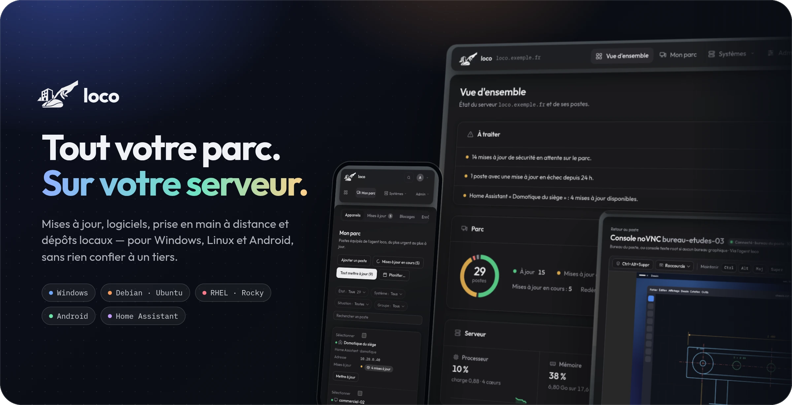</a>

<br><br>

[](https://github.com/ShaNouhAr/loco/releases)
[](LICENSE)


**[Le tour en images](#tour)** &nbsp;·&nbsp; **[Installer](#installer)** &nbsp;·&nbsp; **[Comment ça marche](#fonctionnement)** &nbsp;·&nbsp; **[Documentation](#documentation)** &nbsp;·&nbsp; **[Nouveautés](CHANGELOG.md)**

</div>

<br>

> **loco** est le serveur qu'on installe une fois et qui s'occupe du reste.
> Il garde une copie des mises à jour, range vos logiciels, connaît chaque poste — et vous y emmène en un clic.
>
> Pas de cloud. Pas d'abonnement. Pas de télémétrie. Une machine virtuelle, un conteneur ou un vieux PC suffisent.

<br>

## Ce que loco fait pour vous

<table>
<tr>
<td width="33%" valign="top">
<br>
<b>Un parc lisible d'un regard</b><br>
Un voyant par poste, tout son inventaire sur sa fiche, et ce qui presse en haut de la page.
</td>
<td width="33%" valign="top">
<br>
<b>Des mises à jour qu'on voit avancer</b><br>
Windows Update, APT, DNF, Flatpak : un poste, un groupe ou tout le parc — paquet par paquet, en direct.
</td>
<td width="33%" valign="top">
<br>
<b>La main sur n'importe quel poste</b><br>
Bureau, terminal et fichiers dans le navigateur. Aucun port à ouvrir, ni VNC, ni SSH.
</td>
</tr>
<tr>
<td valign="top">
<br>
<b>Vos logiciels en un clic</b><br>
Le catalogue WinGet à portée de main, vos installeurs maison à côté. Déployés en silence, vérifiés par empreinte.
</td>
<td valign="top">
<br>
<b>Internet, une seule fois</b><br>
Chaque mise à jour est téléchargée une fois, puis servie en local. Vos <code>.deb</code> et <code>.rpm</code> ont leurs dépôts signés.
</td>
<td valign="top">
<br>
<b>La routine tourne toute seule</b><br>
Scripts, planifications, déploiements par vagues qui s'arrêtent d'eux-mêmes si quelque chose casse.
</td>
</tr>
<tr>
<td valign="top">
<br>
<b>Chacun à sa place</b><br>
75 droits, des profils limités à une partie du parc, SSO, double authentification, clés d'accès. Et un journal de tout.
</td>
<td valign="top">
<br>
<b>Prêt pour vos assistants IA</b><br>
Un serveur MCP intégré : Claude Code, Cursor ou VS Code consultent et pilotent loco, dans les limites que vous fixez.
</td>
<td valign="top">
<br>
<b>Au-delà des PC</b><br>
Téléphones et tablettes Android, Home Assistant, agent Wazuh : même portail, mêmes droits, même journal.
</td>
</tr>
</table>

<br>

<a id="tour"></a>

## Le tour en images

###  &nbsp;Mon parc

**Du plus urgent au plus à jour.** Vert, tout va bien. Orange, des mises à jour attendent. Rouge, il est temps.

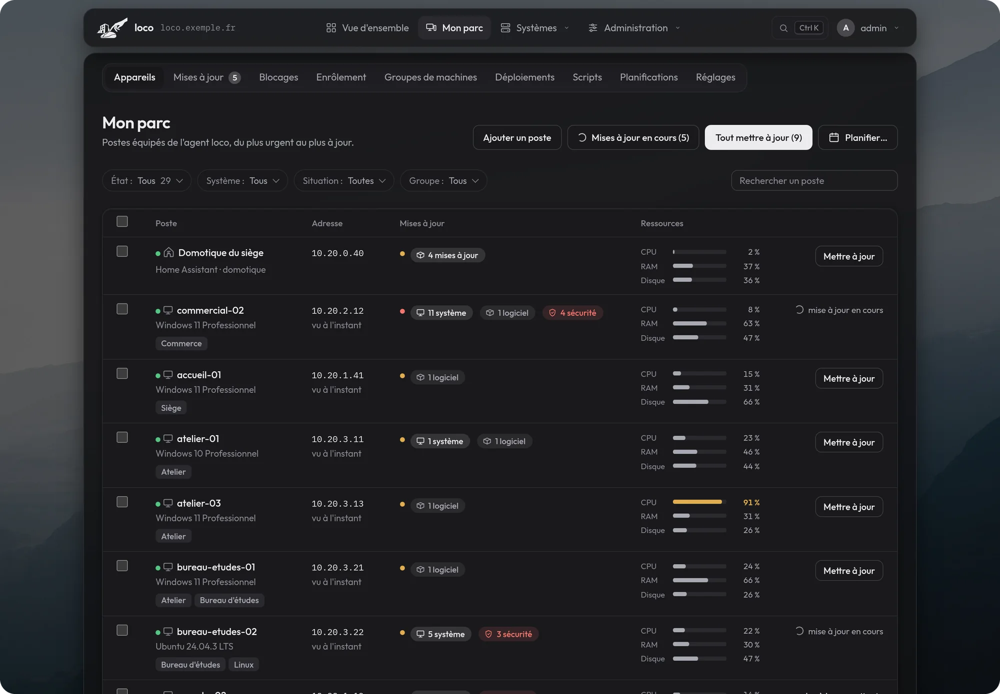

- **Tout sur une ligne** — système, adresse, mises à jour, correctifs de sécurité, processeur, mémoire, disque.
- **Tout en un geste** — cochez, puis mettez à jour, avec redémarrage si besoin, ou réveillez les postes éteints (Wake-on-LAN).
- **Un poste qui bouge reste dans le parc** — autre adresse, autre site, VPN : il garde son identité.

<p align="center">

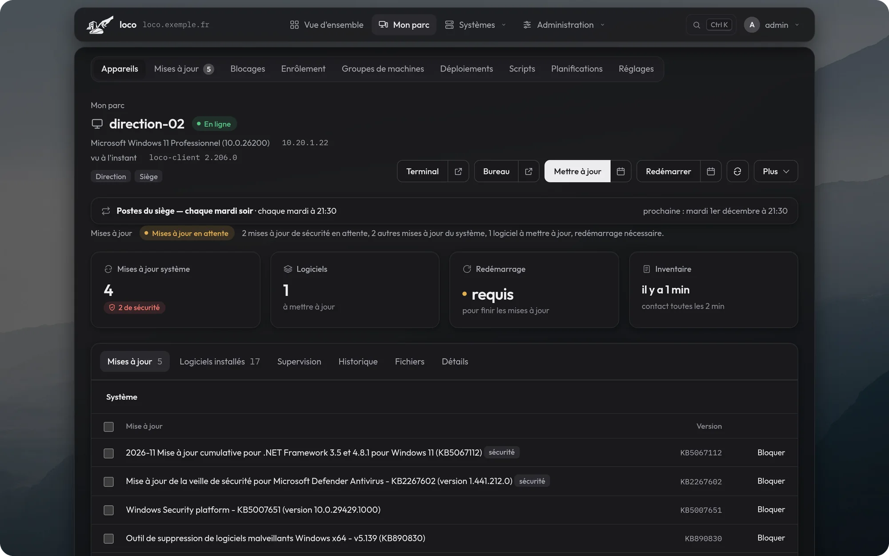
</p>
<p align="center"><sub>← <b>Supervision</b> — en direct toutes les 2 secondes, puis sur 24 heures ou 7 jours.<br><b>Fiche d'un poste</b> — mises à jour à la carte, logiciels du catalogue, historique. →</sub></p>

<br>

###  &nbsp;Mises à jour, en direct

**Cliquez. Regardez.** L'étape, le paquet en cours, ce qui est fait, ce qui a échoué — sans recharger la page.

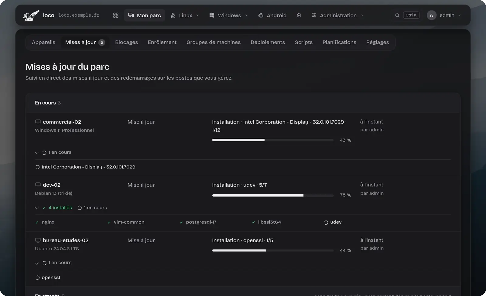

- **Rien ne se perd** — une action en attente n'expire pas : elle part quand le poste revient.
- **Par vagues** — dix postes d'abord, les autres ensuite. Trop d'échecs ? Tout se met en pause et vous décidez.
- **Une mise à jour douteuse ?** Bloquez-la, sur tout le parc ou sur un groupe. Plus personne ne l'installera par erreur.
- **La nuit, c'est mieux** — une fois, chaque jour, chaque semaine ou chaque mois.

<br>

###  &nbsp;Prise en main à distance

**L'agent appelle le serveur. Jamais l'inverse.** Pas de port entrant sur les postes, pas de serveur VNC, pas de compte SSH.

<p align="center">

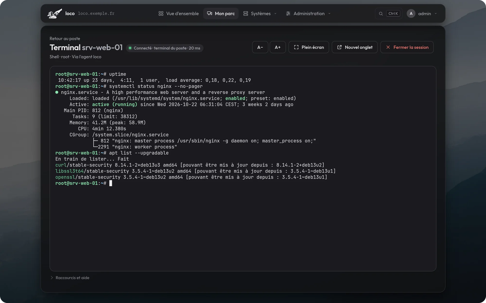
</p>
<p align="center"><sub>← <b>Bureau</b> — deux écrans ? Choisissez lequel regarder.<br><b>Terminal</b> — un vrai shell root ou PowerShell SYSTEM. →</sub></p>

- **Windows**, écran de connexion et fenêtre UAC compris. **Linux** sous X11, GNOME, KDE Plasma, Sway ou Hyprland.
- **Ctrl+Alt+Suppr**, presse-papiers partagé, envoi d'un mot de passe caractère par caractère.
- **Gestionnaire de fichiers** — glissez, déposez, modifiez un fichier texte sans quitter la page.
- **Avec l'accord de la personne**, si vous le voulez : elle accepte ou refuse avant toute image.

<br>

###  &nbsp;Logiciels Windows

**Cherchez, ajoutez, déployez.** loco télécharge l'installeur officiel, vérifie son empreinte et retient comment l'installer en silence.

<p align="center">

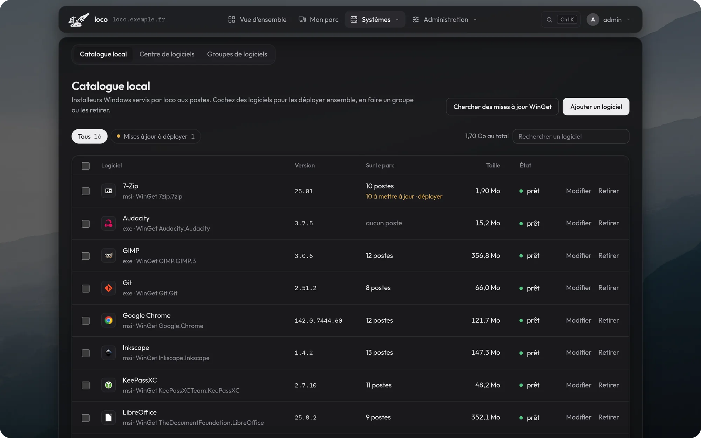
</p>
<p align="center"><sub>← <b>Centre de logiciels</b> — le catalogue WinGet, rangé par catégories.<br><b>Catalogue local</b> — qui l'a, qui est en retard. →</sub></p>

- **Rien ne part avant votre feu vert** — l'aperçu montre les postes visés et ceux qui sont écartés.
- **Des groupes de logiciels** — « Poste standard », « Bureau d'études » : un nouveau poste est prêt en une fois.
- **Vos propres installeurs** — `exe`, `msi`, `msu` ou `ps1`, par lien ou par fichier.

<br>

###  &nbsp;Caches et dépôts

**Téléchargé une fois, servi à tous.** Votre lien Internet respire, vos postes se mettent à jour à la vitesse du réseau local.

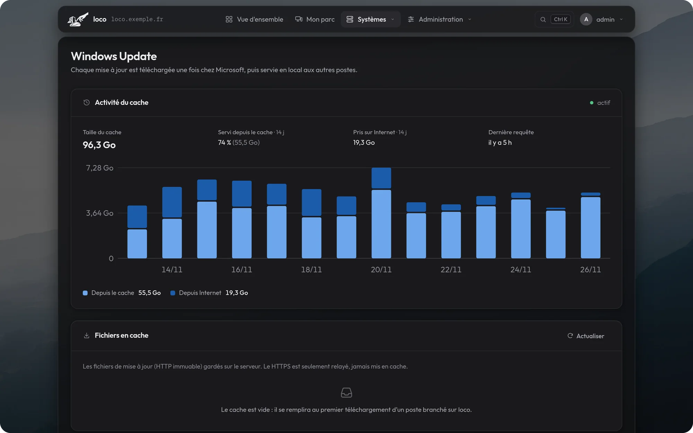

| Ce qui passe par loco | Comment |
|---|---|
| **Windows Update** | par le DNS du réseau, ou par un proxy intégré — sans toucher au DNS |
| **Debian, Ubuntu** | cache APT, et dépôts signés pour vos propres `.deb` |
| **RHEL, Rocky, AlmaLinux** | cache des miroirs et d'EPEL, et dépôts RPM signés par version majeure |
| **Flatpak** | cache Flathub, et dépôt local signé pour vos applications |

Derrière un proxy d'entreprise ? Ça marche aussi.

<br>

###  &nbsp;Scripts et planifications

**Écrit une fois, relu, puis lancé partout.** PowerShell, shell ou Python, avec la sortie de chaque poste.

<p align="center">
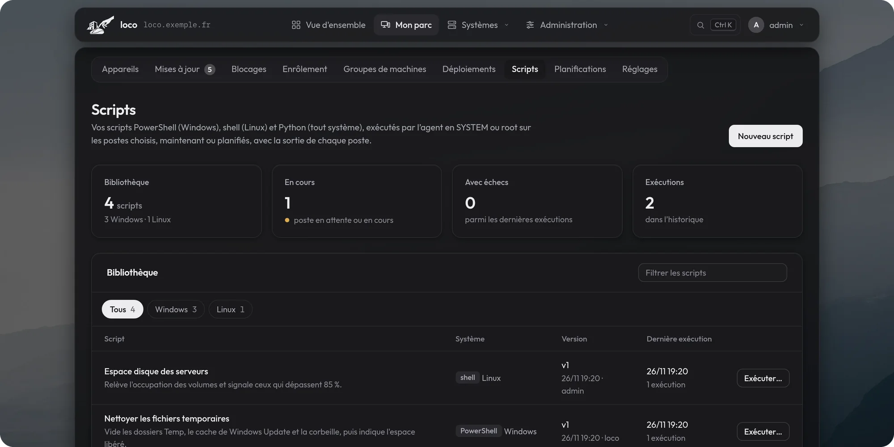
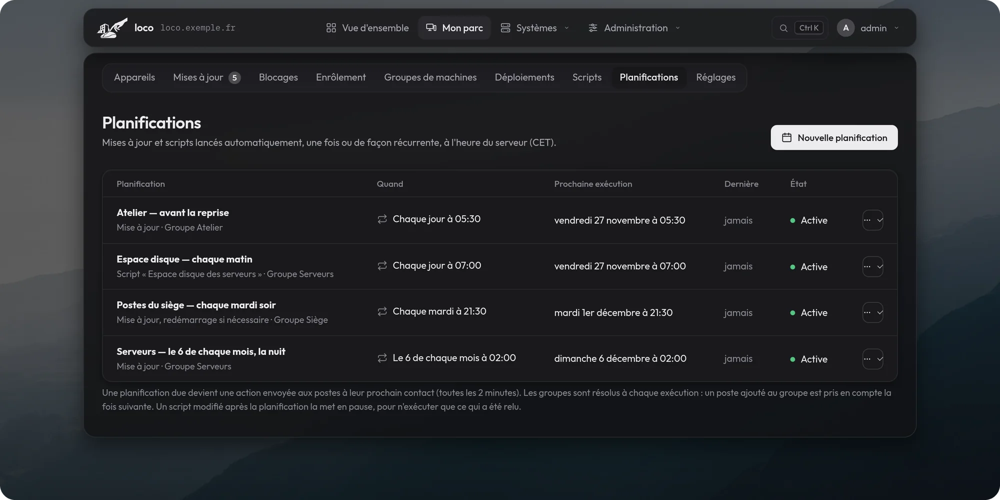
</p>
<p align="center"><sub>← <b>Scripts</b> — versionnés, figés par empreinte au moment de partir.<br><b>Planifications</b> — « chaque mardi à 21 h 30, les postes du siège ». →</sub></p>

<br>

###  &nbsp;Droits, SSO et journal

**Le bon accès, à la bonne personne, sur les bons postes.** Et la trace de chaque geste.

<p align="center">

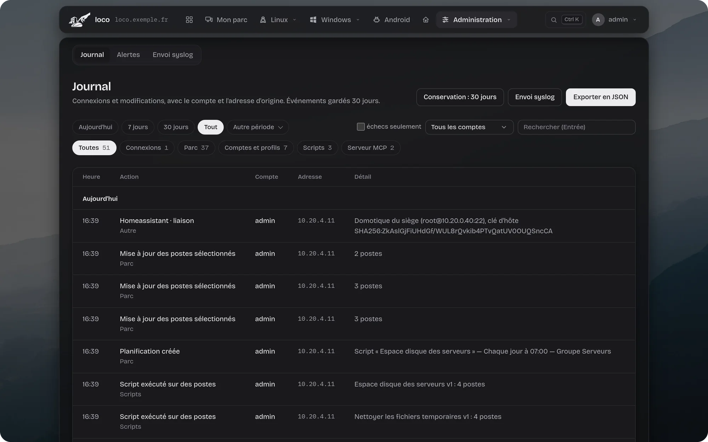
</p>
<p align="center"><sub>← <b>Profils</b> — des droits, et le périmètre où ils s'exercent.<br><b>Journal</b> — qui, quoi, quand, d'où. Exportable, ou envoyé en syslog. →</sub></p>

- **Vos identités** — Active Directory, LDAP, RADIUS, OpenID Connect (Authentik, Keycloak, Entra ID…).
- **Deux verrous valent mieux qu'un** — codes à usage unique (TOTP) et clés d'accès (passkeys).
- **Personne n'entre par surprise** — un compte d'annuaire attend qu'on l'approuve.

<br>

###  &nbsp;Assistants IA

**« Quels postes n'ont pas redémarré depuis un mois ? »** Demandez-le à votre assistant.

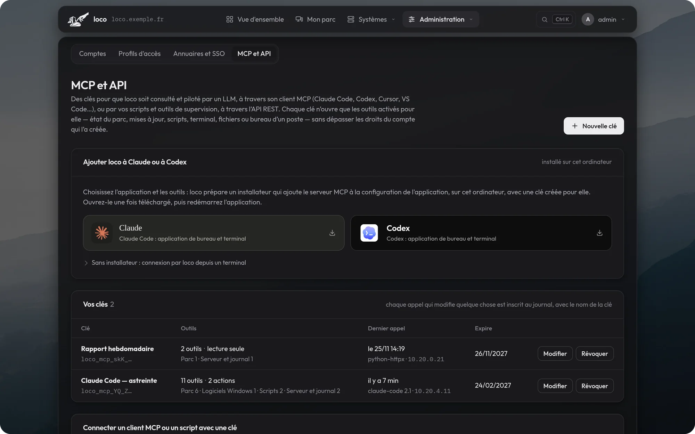

```bash
claude mcp add --transport http loco https://<serveur>:8443/mcp --header "Authorization: Bearer <jeton>"
```

- **34 outils**, cochés un à un pour chaque jeton : lire, mettre à jour, lancer un script, ouvrir un terminal.
- **Jamais plus de droits que vous** — un jeton reste dans les limites du compte qui l'a créé.
- **Tout est noté** — chaque appel qui change quelque chose rejoint le journal, au nom du jeton.

<br>

###  &nbsp;Android, Home Assistant et Wazuh

**Trois options, coupées par défaut.** À activer si elles vous parlent.

<p align="center">
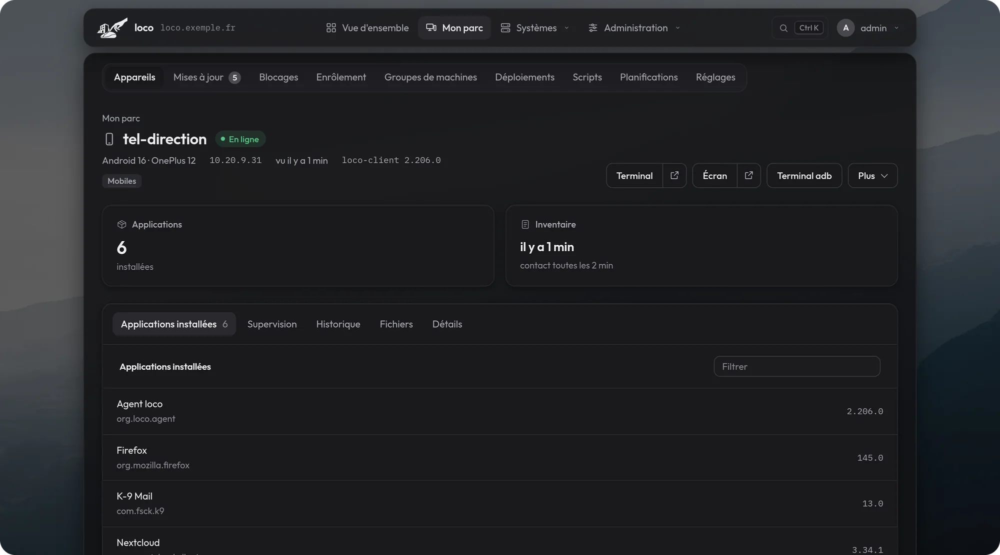
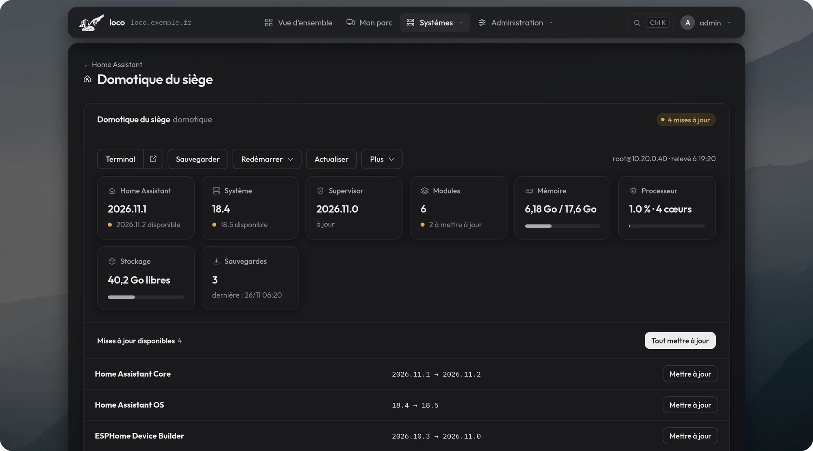
</p>
<p align="center"><sub>← <b>Android</b> <i>(expérimental)</i> — écran, terminal, fichiers et applications de vos propres appareils. Toujours visible, toujours consenti.<br><b>Home Assistant</b> <i>(facultatif)</i> — mises à jour, sauvegardes, santé et terminal, par SSH avec une clé propre à loco. →</sub></p>

**Agent Wazuh** *(facultatif)* — vous avez un manager Wazuh ? loco pose son agent sur les postes que vous cochez, réglé pour votre manager, et montre sur chaque fiche s'il est connecté. Le paquet officiel est vérifié par loco puis remis aux postes, qui n'ont pas besoin d'Internet. Retirer l'agent d'un poste peut aussi effacer son entrée sur le manager. [En savoir plus](docs/wazuh.md).

<br>

###  &nbsp;À votre image

**Six thèmes, huit couleurs, quinze fonds.** Ou votre logo et vos couleurs, pour toute l'entreprise.

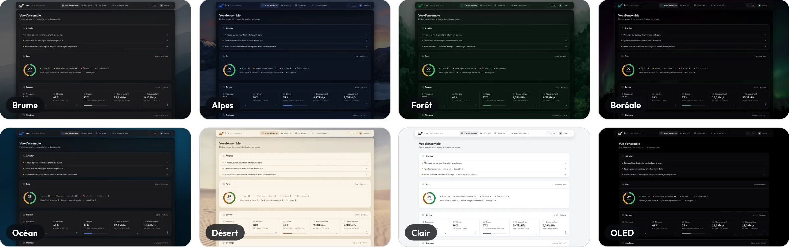

<br>

###  &nbsp;Dans la poche

**Une alerte à 22 h ?** Le portail s'installe comme une application et tient dans une main.

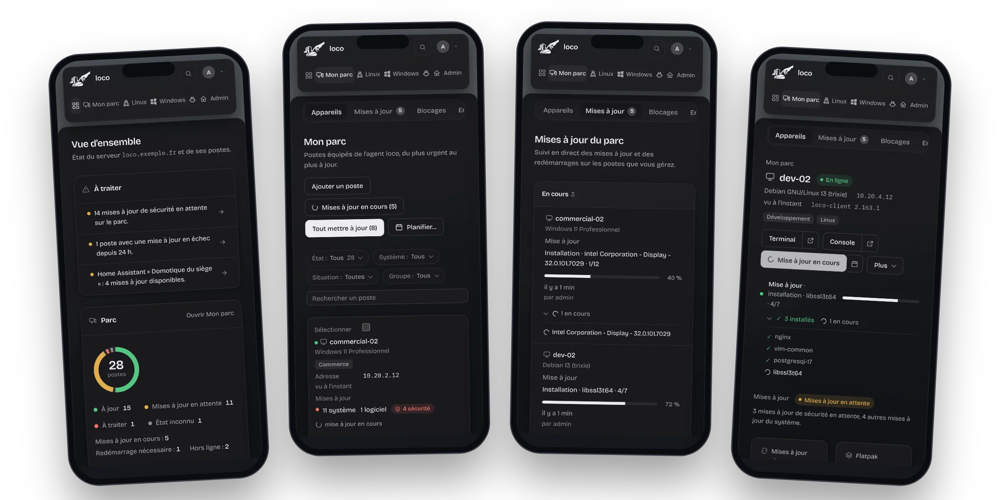

<br>

<div align="center">

</div>

<br>

<a id="installer"></a>

## Installer en cinq minutes

Choisissez votre terrain. Le portail, les dépôts et les caches sont les mêmes partout.

| | Pour qui | Systèmes |
|---|---|---|
|  &nbsp;**Linux natif** — recommandé | la production | Debian 12 / 13 · Ubuntu 22.04 / 24.04 / 26.04 · Rocky Linux 8 / 9 / 10 |
|  &nbsp;**Conteneur LXC** | un hôte Proxmox VE | Proxmox VE 7 / 8 / 9 |
|  &nbsp;**Appliance ISO** | une machine dédiée, même hors ligne | Alpine Linux, BIOS ou UEFI |
|  &nbsp;**Docker** | un essai rapide | Docker Engine 26+ et Compose v2 |
|  &nbsp;**Windows natif** | un parc sans Linux | Windows 11 · Windows Server 2022 / 2025 |

<details open>
<summary> &nbsp;<b>Linux natif</b></summary>
<br>

```bash
git clone https://github.com/ShaNouhAr/loco.git
cd loco
sudo ./install.sh
```

L'installation affiche l'adresse du portail (`https://<ip>:8443`), l'empreinte de son autorité et le mot de passe initial du compte `admin`.
Relancer la même commande met à jour.

</details>

<details>
<summary> &nbsp;<b>Conteneur LXC sur Proxmox VE</b></summary>
<br>

```bash
curl -fsSLO https://raw.githubusercontent.com/ShaNouhAr/loco/main/linux/lxc/proxmox-lxc.sh
bash proxmox-lxc.sh
```

Le script crée le conteneur, y installe la dernière version publiée et affiche l'adresse du portail.

</details>

<details>
<summary> &nbsp;<b>Appliance ISO</b></summary>
<br>

Téléchargez l'ISO de la [dernière version](https://github.com/ShaNouhAr/loco/releases/latest), démarrez dessus et suivez l'assistant.
Les paquets sont embarqués : l'installation se passe d'Internet. Détails : [guide de l'appliance](linux/iso/README.md).

</details>

<details>
<summary> &nbsp;<b>Docker</b></summary>
<br>

Un fichier suffit, sans cloner le projet :

```bash
mkdir loco && cd loco
curl -fsSLO https://raw.githubusercontent.com/ShaNouhAr/loco/main/linux/docker/docker-compose.yml
docker compose up -d
docker compose logs loco    # adresse, empreinte de l'autorité, mot de passe initial
```

L'image `ghcr.io/shanouhar/loco` est publiée avec chaque version. Mettre à jour : `docker compose pull && docker compose up -d`.

</details>

<details>
<summary> &nbsp;<b>Windows natif</b></summary>
<br>

Dans une console PowerShell **administrateur** :

```powershell
Invoke-WebRequest https://github.com/ShaNouhAr/loco/archive/refs/heads/main.zip -OutFile loco.zip
Expand-Archive loco.zip -DestinationPath .
cd loco-main
powershell.exe -NoProfile -ExecutionPolicy Bypass -File .\windows\install.ps1
```

Ni WSL, ni Hyper-V, ni Docker : loco tourne dans un service Windows.

</details>

**Et ensuite ?**

1. Ouvrez `https://<ip>:8443` et changez le mot de passe d'`admin`.
2. Allez dans **Mon parc › Enrôlement** : une commande à copier par poste — ou un MSI, un `.deb`, un `.rpm`.
3. Regardez le parc se remplir.

Toutes les options, le proxy d'entreprise, les certificats : **[Installer loco](docs/installation.md)**.

<br>

<a id="fonctionnement"></a>

## Comment ça marche

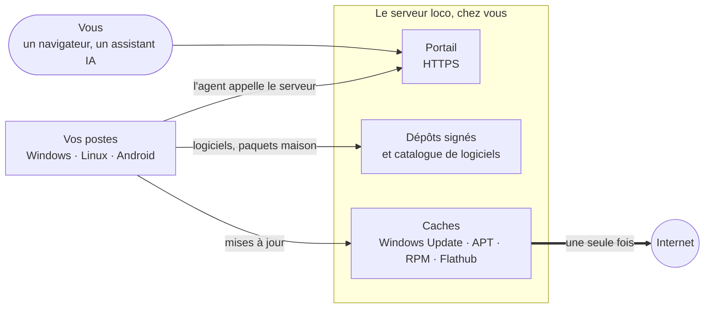

- **Les postes appellent le serveur.** Jamais l'inverse : rien à ouvrir sur les postes, rien à exposer sur Internet.
- **Tout est vérifié.** Dépôts signés, installeurs contrôlés par empreinte SHA-256, autorité du serveur épinglée par les agents.
- **Rien ne sort.** Vos inventaires, vos journaux et vos clés restent sur votre serveur.

<br>

<a id="documentation"></a>

## Documentation

<table>
<tr>
<td width="33%" valign="top">
<h4>Mettre en place</h4>
 &nbsp;<b><a href="docs/installation.md">Installer loco</a></b><br><sub>Les cinq installations et leurs options.</sub><br><br>
 &nbsp;<b><a href="docs/linux.md">Serveur Linux en entreprise</a></b><br><sub>Réseau, GPO, proxy, Docker, LXC, Rocky, ISO.</sub><br><br>
 &nbsp;<b><a href="docs/windows.md">Serveur Windows</a></b><br><sub>Installation, limites, dimensionnement.</sub><br><br>
 &nbsp;<b><a href="docs/postes.md">Brancher les postes</a></b><br><sub>Dépôts, caches, Windows Update.</sub><br><br>
 &nbsp;<b><a href="docs/haute-disponibilite.md">Haute disponibilité</a></b><br><sub>Deux serveurs, une seule adresse.</sub><br><br>
</td>
<td width="33%" valign="top">
<h4>Utiliser</h4>
 &nbsp;<b><a href="docs/parc.md">Mon parc</a></b><br><sub>Agent, mises à jour, vagues, blocages, scripts.</sub><br><br>
 &nbsp;<b><a href="docs/logiciels.md">Logiciels Windows</a></b><br><sub>Catalogue, groupes, déploiements.</sub><br><br>
 &nbsp;<b><a href="docs/sessions-distantes.md">Sessions distantes</a></b><br><sub>Bureau, terminal, fichiers.</sub><br><br>
 &nbsp;<b><a href="docs/comptes.md">Comptes, profils et SSO</a></b><br><sub>Droits, annuaires, apparence.</sub><br><br>
 &nbsp;<b><a href="docs/mcp.md">Serveur MCP</a></b><br><sub>Brancher un assistant IA.</sub><br><br>
 &nbsp;<b><a href="docs/android.md">Android</a></b><br><sub>Appareils, applications, écran distant.</sub><br><br>
 &nbsp;<b><a href="docs/homeassistant.md">Home Assistant</a></b><br><sub>Liaison SSH, mises à jour, sauvegardes.</sub><br><br>
 &nbsp;<b><a href="docs/wazuh.md">Agent Wazuh</a></b><br><sub>Posé sur les postes, réglé pour votre manager.</sub><br><br>
</td>
<td width="33%" valign="top">
<h4>Faire tourner</h4>
 &nbsp;<b><a href="docs/exploitation.md">Exploiter loco au quotidien</a></b><br><sub>Routine, sauvegardes, mises à jour, incidents.</sub><br><br>
 &nbsp;<b><a href="docs/journal.md">Journal et syslog</a></b><br><sub>Ce qui est tracé, où l'envoyer.</sub><br><br>
 &nbsp;<b><a href="SECURITY.md">Sécurité</a></b><br><sub>Le modèle, ses limites, signaler une faille.</sub><br><br>
<h4>Contribuer</h4>
 &nbsp;<b><a href="docs/developpement.md">Développement</a></b><br><sub>Dépôt, tests, publication.</sub><br><br>
 &nbsp;<b><a href="CHANGELOG.md">Changelog</a></b><br><sub>Toutes les versions, une par une.</sub><br><br>
</td>
</tr>
</table>

<br>

## Sécurité, en bref

- **Chez vous** — aucune télémétrie ; rien ne quitte le serveur sans que vous l'ayez décidé.
- **Confiné** — le portail tourne sans privilèges ; un agent séparé revalide chaque opération d'administration.
- **Signé et vérifié** — dépôts APT, RPM et Flatpak signés, installeurs contrôlés par SHA-256.
- **Durci** — HTTPS, politique de contenu stricte, protection CSRF, blocage des tentatives de connexion, filtrage par réseau.
- **Tracé** — connexions, échecs et modifications au journal, avec le compte et l'adresse.

Le détail, et ce que loco ne protège pas : **[SECURITY.md](SECURITY.md)**.

<br>

## Licence

[MIT](LICENSE). Polices IBM Plex, Bricolage Grotesque et JetBrains Mono sous licence SIL OFL 1.1 (`portal/static/fonts/`) ; photos des fonds d'écran créditées dans `portal/static/wallpapers/CREDITS.txt`.

<br>

<div align="center">
<picture>
  <source media="(prefers-color-scheme: dark)" srcset="docs/logo-dark.svg">
  
</picture>
<br>
<sub>Captures prises sur une instance de démonstration : l'entreprise, ses postes et ses comptes sont inventés.</sub>
</div>
