<div align="center">

<a href="#tour">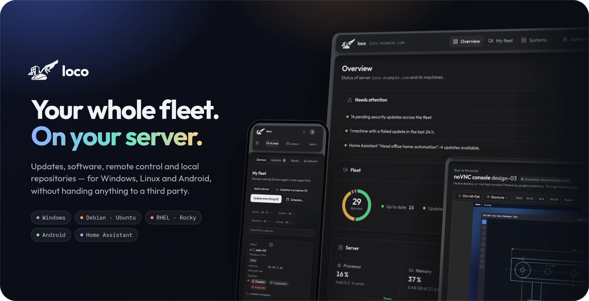</a>

<br><br>

[](https://github.com/ShaNouhAr/loco/releases)
[](LICENSE)


**English** &nbsp;·&nbsp; [Français](README.fr.md) &nbsp;·&nbsp; [Español](README.es.md)

**[The tour](#tour)** &nbsp;·&nbsp; **[Install](#install)** &nbsp;·&nbsp; **[How it works](#how-it-works)** &nbsp;·&nbsp; **[Documentation](#documentation)** &nbsp;·&nbsp; **[What's new](CHANGELOG.md)**

</div>

<br>

> **loco** is the server you install once and that takes care of the rest.
> It keeps a copy of the updates, organizes your software, knows every device — and takes you there in one click.
>
> No cloud. No subscription. No telemetry. A virtual machine, a container or an old PC is enough.

<br>

## What loco does for you

<table>
<tr>
<td width="33%" valign="top">
<br>
<b>A fleet you read at a glance</b><br>
One status light per device, its whole inventory on its page, and what is urgent at the top.
</td>
<td width="33%" valign="top">
<br>
<b>Updates you watch progress</b><br>
Windows Update, APT, DNF, Flatpak: one device, a group or the whole fleet — package by package, live.
</td>
<td width="33%" valign="top">
<br>
<b>Hands on any device</b><br>
Desktop, terminal and files in the browser. No port to open, no VNC, no SSH.
</td>
</tr>
<tr>
<td valign="top">
<br>
<b>Your software in one click</b><br>
The WinGet catalog at hand, your in-house installers next to it. Deployed silently, checked by fingerprint.
</td>
<td valign="top">
<br>
<b>The Internet, only once</b><br>
Each update is downloaded once, then served locally. Your <code>.deb</code> and <code>.rpm</code> packages get their signed repositories.
</td>
<td valign="top">
<br>
<b>The routine runs by itself</b><br>
Scripts, schedules, deployments in waves that stop on their own if something breaks.
</td>
</tr>
<tr>
<td valign="top">
<br>
<b>Everyone in their place</b><br>
94 rights, profiles limited to part of the fleet, SSO, two-factor authentication, passkeys. And an audit log of everything.
</td>
<td valign="top">
<br>
<b>Ready for your AI assistants</b><br>
A built-in MCP server: Claude Code, Cursor or VS Code query and operate loco, within the limits you set.
</td>
<td valign="top">
<br>
<b>Beyond PCs</b><br>
Android phones and tablets, Home Assistant, Wazuh agent: same portal, same rights, same audit log.
</td>
</tr>
</table>

<br>

<a id="tour"></a>

## The tour

###  &nbsp;My fleet

**From the most urgent to the most up to date.** Green, all is well. Orange, updates are waiting. Red, it is time.

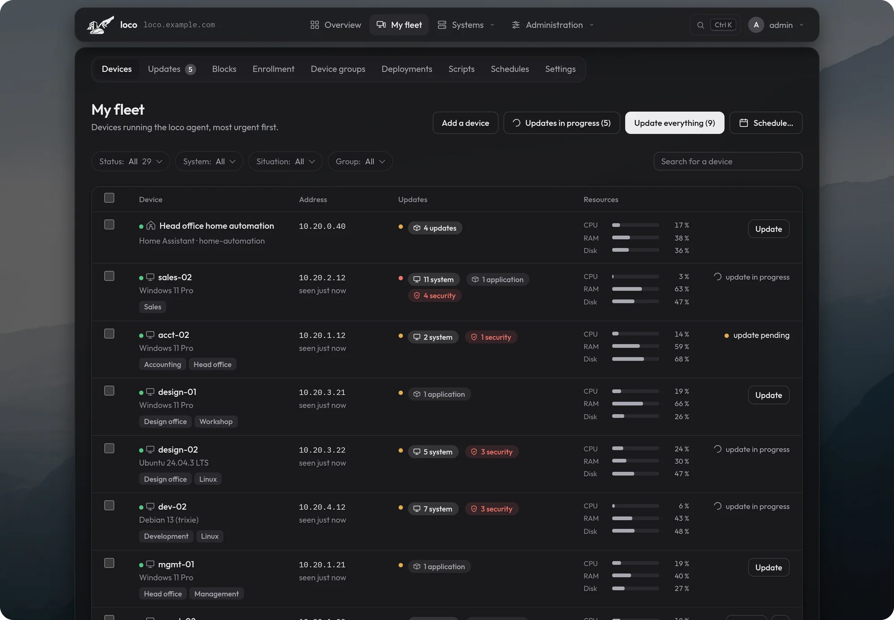

- **Everything on one line** — system, address, updates, security fixes, processor, memory, disk.
- **Everything in one move** — tick, then update, with a restart if needed, or wake up devices that are off (Wake-on-LAN).
- **A device that moves stays in the fleet** — another address, another site, VPN: it keeps its identity.

<p align="center">
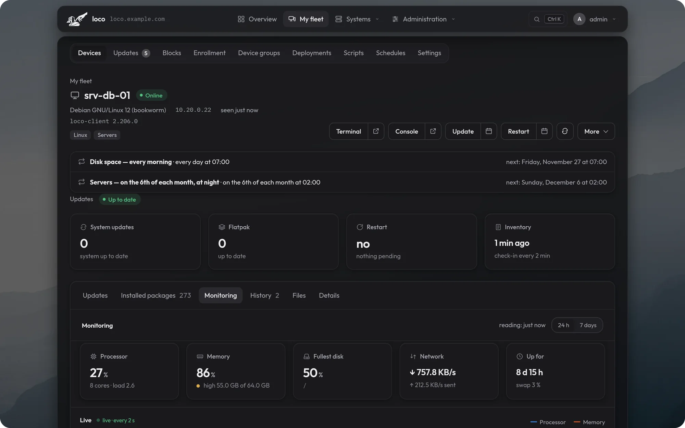
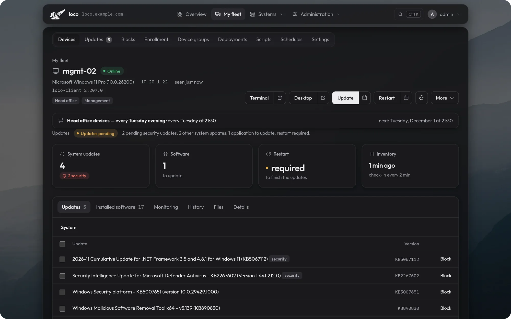
</p>
<p align="center"><sub>← <b>Monitoring</b> — live every 2 seconds, then over 24 hours or 7 days.<br><b>Device page</b> — updates à la carte, catalog software, history. →</sub></p>

<br>

###  &nbsp;Updates, live

**Click. Watch.** The step, the package in progress, what is done, what failed — without reloading the page.

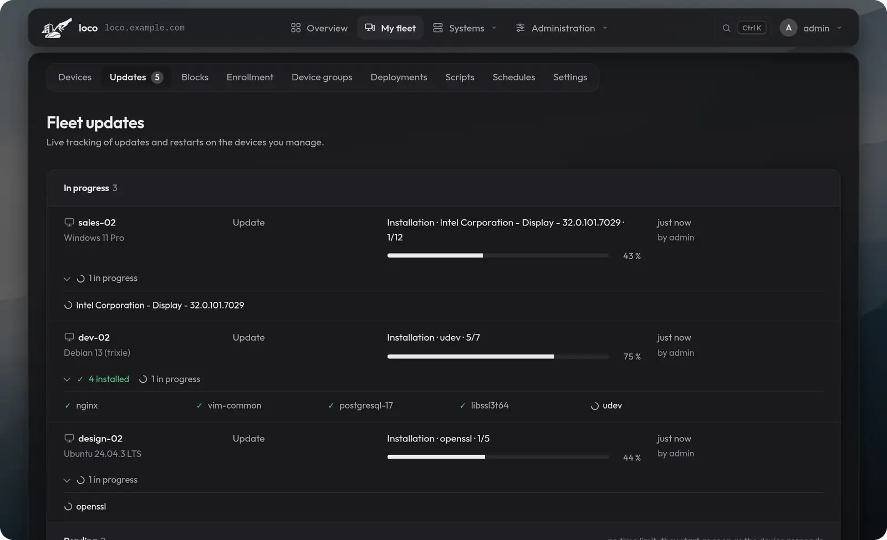

- **Nothing gets lost** — a pending action does not expire: it goes out when the device comes back.
- **In waves** — ten devices first, the others next. Too many failures? Everything pauses and you decide.
- **A doubtful update?** Block it, on the whole fleet or on a group. Nobody will install it by mistake anymore.
- **Night is better** — once, every day, every week or every month.

<br>

###  &nbsp;Remote control

**The agent calls the server. Never the other way around.** No inbound port on the devices, no VNC server, no SSH account.

<p align="center">
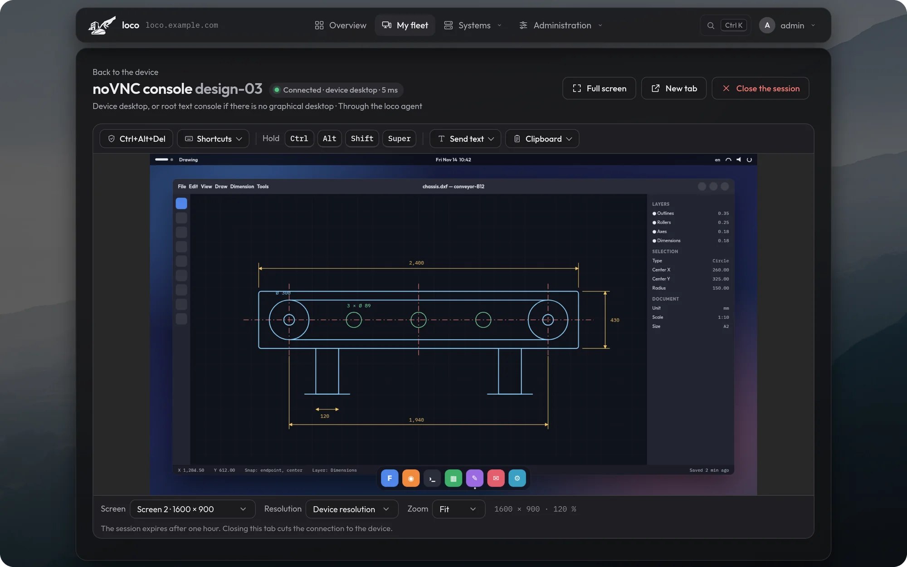
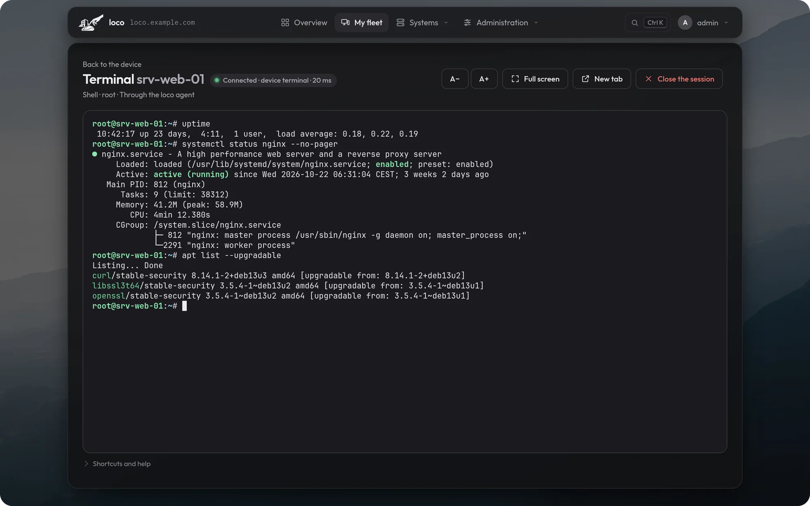
</p>
<p align="center"><sub>← <b>Desktop</b> — two screens? Choose which one to watch.<br><b>Terminal</b> — a real root shell or SYSTEM PowerShell. →</sub></p>

- **Windows**, sign-in screen and UAC window included. **Linux** on X11, GNOME, KDE Plasma, Sway or Hyprland.
- **Ctrl+Alt+Del**, shared clipboard, typing a password character by character.
- **File manager** — drag, drop, edit a text file without leaving the page.
- **With the person's consent**, if you want: they accept or refuse before any image.

<br>

###  &nbsp;Windows software

**Search, add, deploy.** loco downloads the official installer, checks its fingerprint and remembers how to install it silently.

<p align="center">
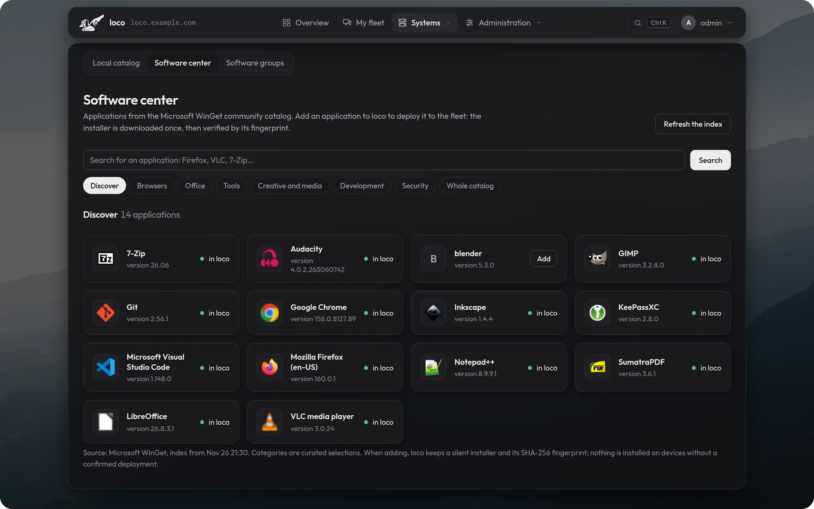
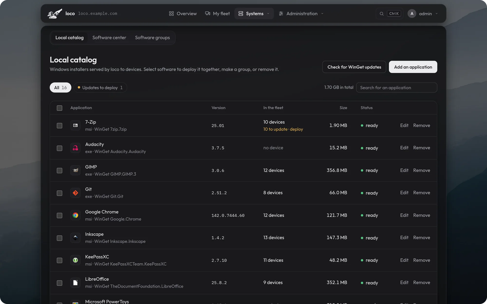
</p>
<p align="center"><sub>← <b>Software center</b> — the WinGet catalog, sorted by category.<br><b>Local catalog</b> — who has it, who is behind. →</sub></p>

- **Nothing leaves before your go-ahead** — the preview shows the targeted devices and those left out.
- **Software groups** — "Standard workstation", "Design office": a new device is ready in one go.
- **Your own installers** — `exe`, `msi`, `msu` or `ps1`, by link or by file.

<br>

###  &nbsp;Caches and repositories

**Downloaded once, served to all.** Your Internet link breathes, your devices update at the speed of the local network.

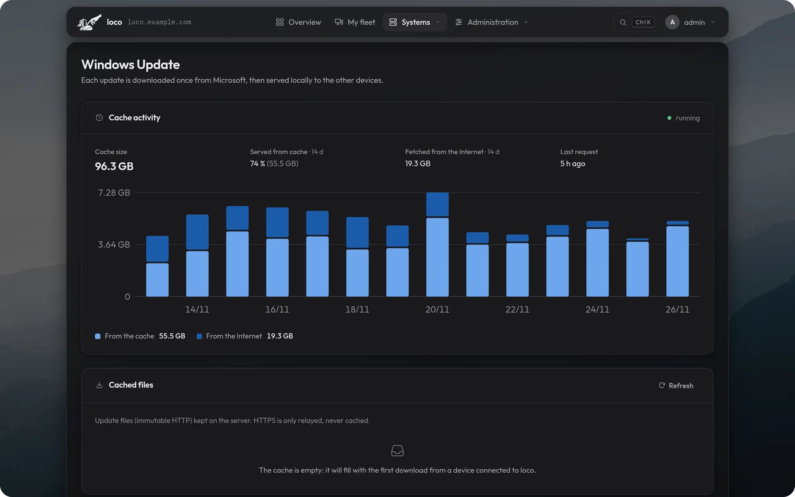

| What goes through loco | How |
|---|---|
| **Windows Update** | through the network's DNS, or through a built-in proxy — without touching the DNS |
| **Debian, Ubuntu** | APT cache, and signed repositories for your own `.deb` |
| **RHEL, Rocky, AlmaLinux** | cache of the mirrors and of EPEL, and RPM repositories signed per major version |
| **Flatpak** | Flathub cache, and a signed local repository for your applications |

Behind a company proxy? That works too.

<br>

###  &nbsp;Scripts and schedules

**Written once, reviewed, then run everywhere.** PowerShell, shell or Python, with the output of each device.

<p align="center">
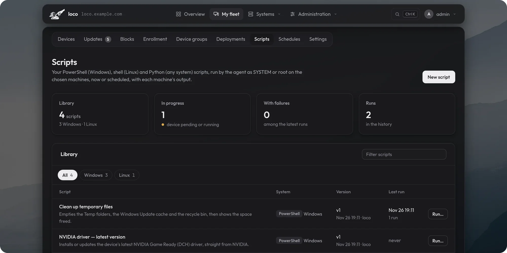
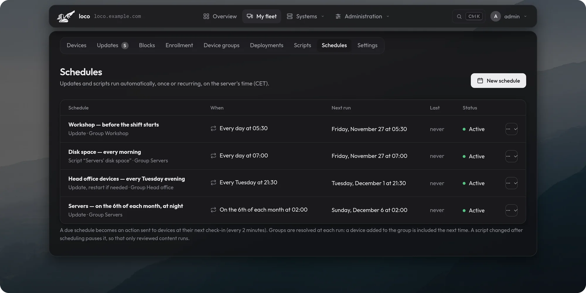
</p>
<p align="center"><sub>← <b>Scripts</b> — versioned, pinned by fingerprint when they go out.<br><b>Schedules</b> — "every Tuesday at 9:30 pm, the headquarters devices". →</sub></p>

<br>

###  &nbsp;Rights, SSO and audit log

**The right access, for the right person, on the right devices.** And a trace of every move.

<p align="center">
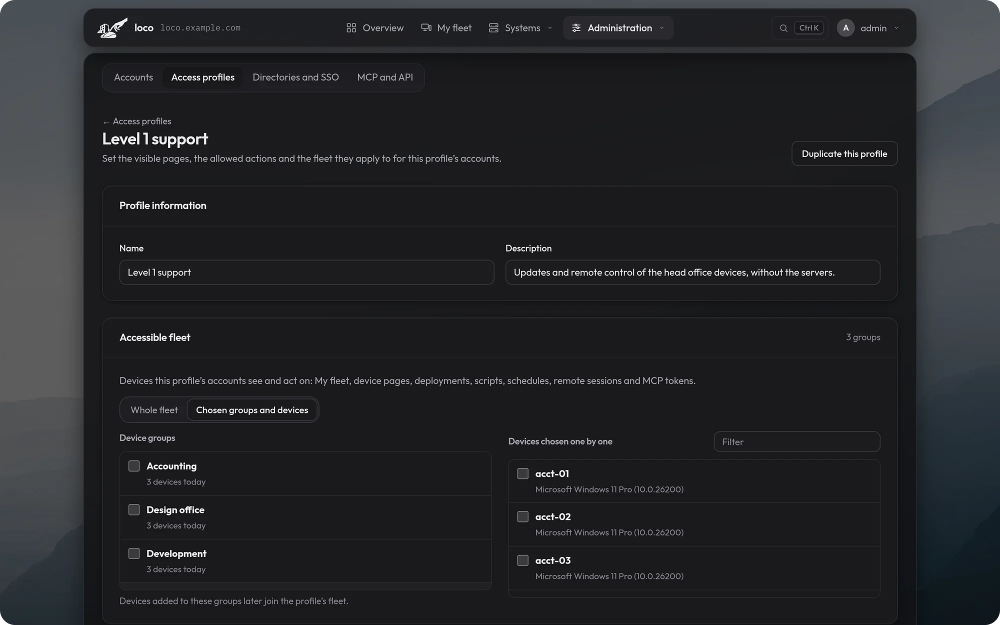
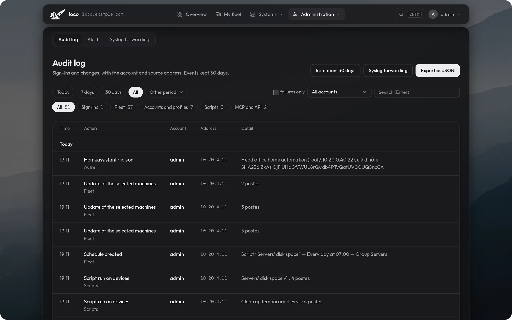
</p>
<p align="center"><sub>← <b>Profiles</b> — rights, and the scope where they apply.<br><b>Audit log</b> — who, what, when, from where. Exportable, or sent over syslog. →</sub></p>

- **Your identities** — Active Directory, LDAP, RADIUS, OpenID Connect (Authentik, Keycloak, Entra ID…).
- **Two locks are better than one** — one-time codes (TOTP) and passkeys.
- **Nobody gets in by surprise** — a directory account waits to be approved.

<br>

###  &nbsp;AI assistants

**"Which devices have not restarted for a month?"** Ask your assistant.

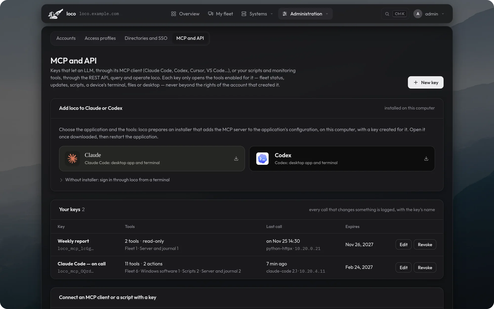

- **Claude or Codex in one click** — an installer adds loco to the application's MCP configuration, on your computer.
- **40 tools**, ticked one by one for each key: read, update, run a script, open a terminal — over MCP or the REST API.
- **Never more rights than you** — a key stays within the limits of the account that created it, and each account sees its own.
- **Everything is logged** — every call that changes something lands in the audit log, under the key's name.

<br>

###  &nbsp;Android, Home Assistant and Wazuh

**Three options, off by default.** Turn them on if they speak to you.

<p align="center">
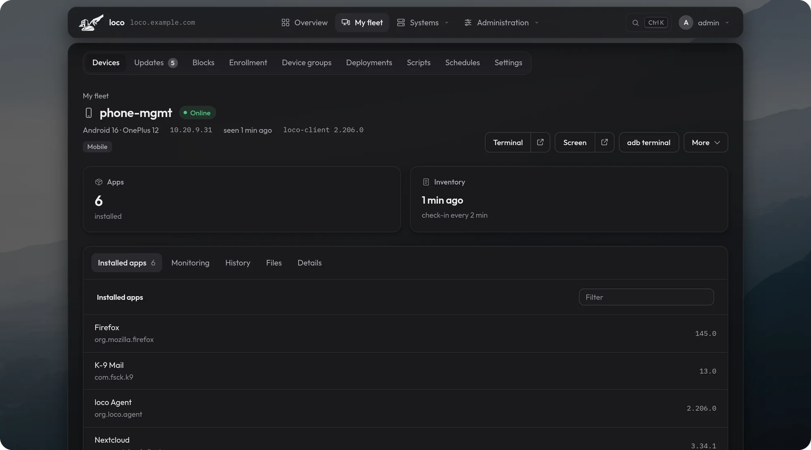
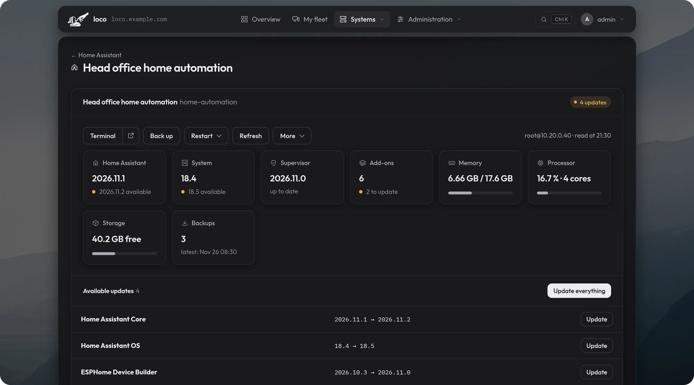
</p>
<p align="center"><sub>← <b>Android</b> <i>(experimental)</i> — screen, terminal, files and applications of your own devices. Always visible, always consented.<br><b>Home Assistant</b> <i>(optional)</i> — updates, backups, health and terminal, over SSH with a key of loco's own. →</sub></p>

**Wazuh agent** *(optional)* — you have a Wazuh manager? loco installs its agent on the devices you tick, set up for your manager, and shows on each device page whether it is connected. The official package is checked by loco then handed to the devices, which do not need the Internet. Removing the agent from a device can also delete its entry on the manager. [Learn more](docs/wazuh.md).

<br>

###  &nbsp;Your look

**Six themes, eight colors, fifteen backgrounds.** Or your logo and your colors, for the whole company.

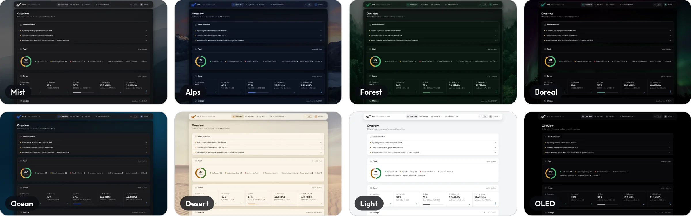

<br>

###  &nbsp;In your pocket

**An alert at 10 pm?** The portal installs like an app and fits in one hand.

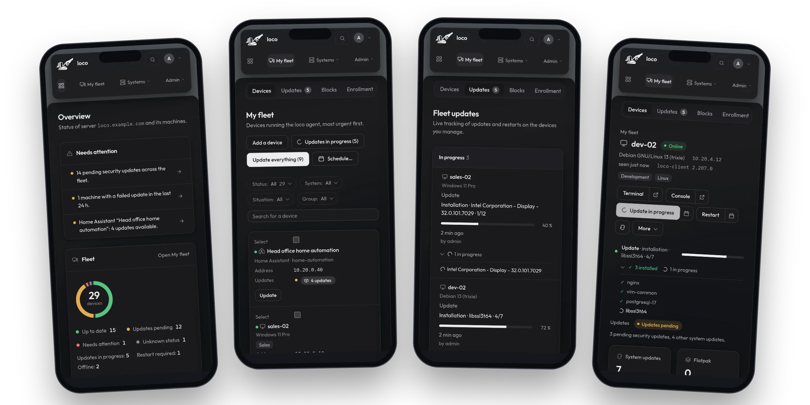

<br>

<div align="center">
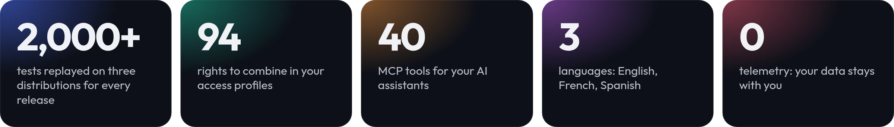
</div>

<br>

<a id="install"></a>

## Install in five minutes

Choose your ground. The portal, the repositories and the caches are the same everywhere.

| | For | Systems |
|---|---|---|
|  &nbsp;**Native Linux** — recommended | production | Debian 12 / 13 · Ubuntu 22.04 / 24.04 / 26.04 · Rocky Linux 8 / 9 / 10 |
|  &nbsp;**LXC container** | a Proxmox VE host | Proxmox VE 7 / 8 / 9 |
|  &nbsp;**ISO appliance** | a dedicated machine, even offline | Alpine Linux, BIOS or UEFI |
|  &nbsp;**Docker** | a quick try | Docker Engine 26+ and Compose v2 |
|  &nbsp;**Native Windows** | a fleet without Linux | Windows 11 · Windows Server 2022 / 2025 |

<details open>
<summary> &nbsp;<b>Native Linux</b></summary>
<br>

```bash
git clone https://github.com/ShaNouhAr/loco.git
cd loco
sudo ./install.sh
```

The installation shows the portal address (`https://<ip>:8443`), the fingerprint of its certificate authority and the initial password of the `admin` account.
Running the same command again updates it.

</details>

<details>
<summary> &nbsp;<b>LXC container on Proxmox VE</b></summary>
<br>

```bash
curl -fsSLO https://raw.githubusercontent.com/ShaNouhAr/loco/main/linux/lxc/proxmox-lxc.sh
bash proxmox-lxc.sh
```

The script creates the container, installs the latest published release in it and shows the portal address.

</details>

<details>
<summary> &nbsp;<b>ISO appliance</b></summary>
<br>

Download the ISO of the [latest release](https://github.com/ShaNouhAr/loco/releases/latest), boot it and follow the wizard.
The packages are embedded: the installation does not need the Internet. Details: [appliance guide](linux/iso/README.md).

</details>

<details>
<summary> &nbsp;<b>Docker</b></summary>
<br>

One file is enough, without cloning the project:

```bash
mkdir loco && cd loco
curl -fsSLO https://raw.githubusercontent.com/ShaNouhAr/loco/main/linux/docker/docker-compose.yml
docker compose up -d
docker compose logs loco    # address, authority fingerprint, initial password
```

The `ghcr.io/shanouhar/loco` image is published with every release. To update: `docker compose pull && docker compose up -d`.

</details>

<details>
<summary> &nbsp;<b>Native Windows</b></summary>
<br>

In an **administrator** PowerShell console:

```powershell
Invoke-WebRequest https://github.com/ShaNouhAr/loco/archive/refs/heads/main.zip -OutFile loco.zip
Expand-Archive loco.zip -DestinationPath .
cd loco-main
powershell.exe -NoProfile -ExecutionPolicy Bypass -File .\windows\install.ps1
```

No WSL, no Hyper-V, no Docker: loco runs in a Windows service.

</details>

**And then?**

1. Open `https://<ip>:8443` and change the `admin` password.
2. Go to **My fleet › Enrollment**: one command to copy per device — or an MSI, a `.deb`, an `.rpm`.
3. Watch the fleet fill up.

All the options, the company proxy, the certificates: **[Installing loco](docs/installation.md)**.

<br>

<a id="how-it-works"></a>

## How it works

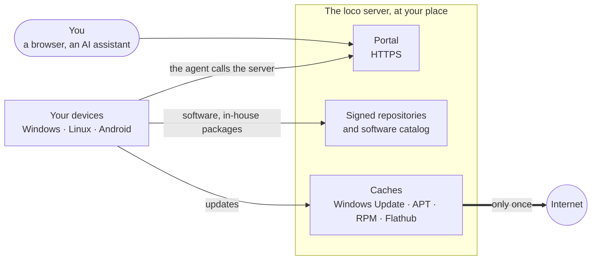

- **The devices call the server.** Never the other way around: nothing to open on the devices, nothing to expose on the Internet.
- **Everything is checked.** Signed repositories, installers verified by SHA-256 fingerprint, server authority pinned by the agents.
- **Nothing leaves.** Your inventories, your logs and your keys stay on your server.

<br>

<a id="documentation"></a>

## Documentation

<table>
<tr>
<td width="33%" valign="top">
<h4>Set up</h4>
 &nbsp;<b><a href="docs/installation.md">Installing loco</a></b><br><sub>The five installations and their options.</sub><br><br>
 &nbsp;<b><a href="docs/linux.md">Linux server in a company</a></b><br><sub>Network, GPO, proxy, Docker, LXC, Rocky, ISO.</sub><br><br>
 &nbsp;<b><a href="docs/windows.md">Windows server</a></b><br><sub>Installation, limits, sizing.</sub><br><br>
 &nbsp;<b><a href="docs/connecting-devices.md">Connecting devices</a></b><br><sub>Repositories, caches, Windows Update.</sub><br><br>
 &nbsp;<b><a href="docs/high-availability.md">High availability</a></b><br><sub>Two servers, a single address.</sub><br><br>
</td>
<td width="33%" valign="top">
<h4>Use</h4>
 &nbsp;<b><a href="docs/fleet.md">My fleet</a></b><br><sub>Agent, updates, waves, blocks, scripts.</sub><br><br>
 &nbsp;<b><a href="docs/windows-software.md">Windows software</a></b><br><sub>Catalog, groups, deployments.</sub><br><br>
 &nbsp;<b><a href="docs/remote-sessions.md">Remote sessions</a></b><br><sub>Desktop, terminal, files.</sub><br><br>
 &nbsp;<b><a href="docs/accounts.md">Accounts, profiles and SSO</a></b><br><sub>Rights, directories, appearance.</sub><br><br>
 &nbsp;<b><a href="docs/mcp.md">MCP and API</a></b><br><sub>Connect an AI assistant or a script.</sub><br><br>
 &nbsp;<b><a href="docs/android.md">Android</a></b><br><sub>Devices, applications, remote screen.</sub><br><br>
 &nbsp;<b><a href="docs/homeassistant.md">Home Assistant</a></b><br><sub>SSH link, updates, backups.</sub><br><br>
 &nbsp;<b><a href="docs/wazuh.md">Wazuh agent</a></b><br><sub>Installed on the devices, set up for your manager.</sub><br><br>
 &nbsp;<b><a href="docs/file-shares.md">File shares</a></b><br><sub>SMB folders, size limits, accounts, file manager.</sub><br><br>
</td>
<td width="33%" valign="top">
<h4>Run</h4>
 &nbsp;<b><a href="docs/operations.md">Running loco day to day</a></b><br><sub>Routine, backups, updates, incidents.</sub><br><br>
 &nbsp;<b><a href="docs/audit-log.md">Audit log and syslog</a></b><br><sub>What is recorded, where to send it.</sub><br><br>
 &nbsp;<b><a href="SECURITY.md">Security</a></b><br><sub>The model, its limits, reporting a vulnerability.</sub><br><br>
<h4>Contribute</h4>
 &nbsp;<b><a href="docs/development.md">Development</a></b><br><sub>Repository, tests, releases.</sub><br><br>
 &nbsp;<b><a href="CHANGELOG.md">Changelog</a></b><br><sub>Every release, one by one.</sub><br><br>
</td>
</tr>
</table>

<br>

## Security, in short

- **At your place** — no telemetry; nothing leaves the server unless you decided it.
- **Confined** — the portal runs without privileges; a separate agent revalidates every administration operation.
- **Signed and checked** — signed APT, RPM and Flatpak repositories, installers verified by SHA-256.
- **Hardened** — HTTPS, strict content policy, CSRF protection, blocking of sign-in attempts, filtering by network.
- **Recorded** — sign-ins, failures and changes in the audit log, with the account and the address.

The details, and what loco does not protect: **[SECURITY.md](SECURITY.md)**.

<br>

## License

[MIT](LICENSE). IBM Plex, Outfit and JetBrains Mono fonts under the SIL OFL 1.1 license (`portal/static/fonts/`); wallpaper photos credited in `portal/static/wallpapers/CREDITS.txt`.

<br>

<div align="center">
<picture>
  <source media="(prefers-color-scheme: dark)" srcset="docs/logo-dark.svg">
  
</picture>
<br>
<sub>Screenshots taken on a demo instance: the company, its devices and its accounts are made up.</sub>
</div>
