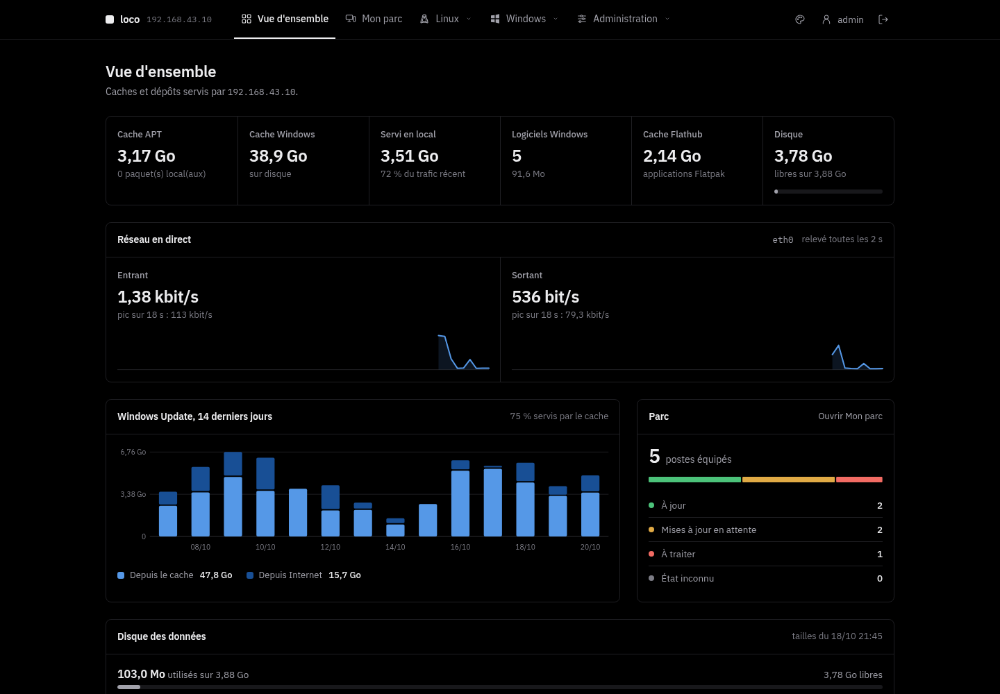
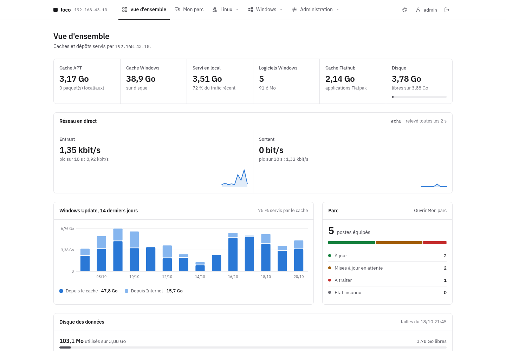
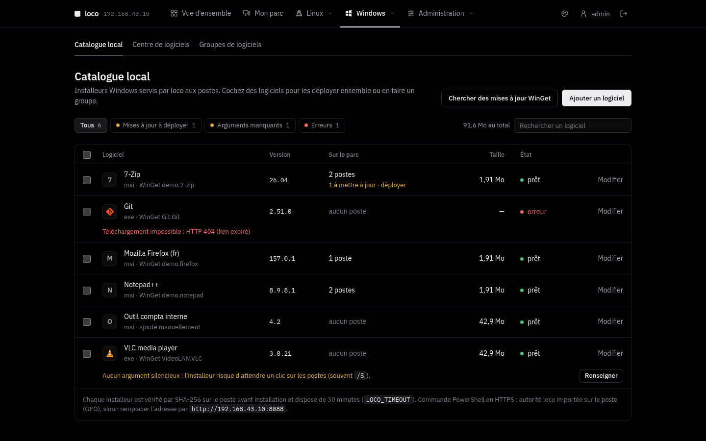
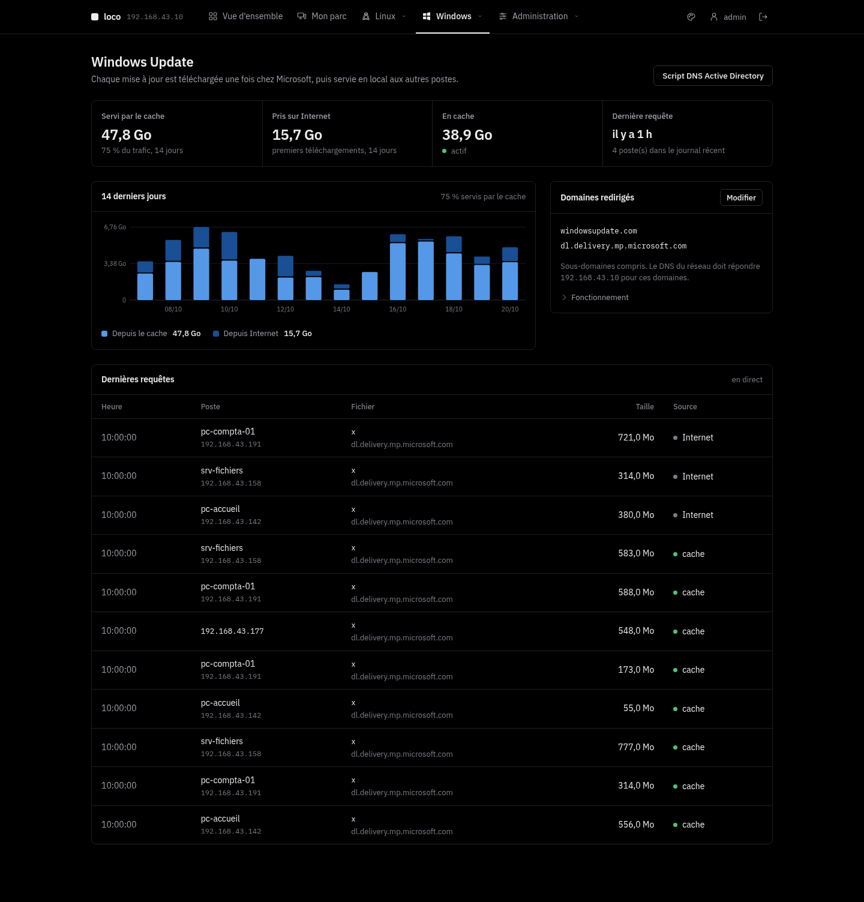

# loco

[](https://github.com/ShaNouhAr/loco/actions/workflows/ci.yml)

Serveur de dépôts et de caches pour un réseau d'entreprise, installé sur Debian, Ubuntu, Rocky Linux ou Windows
(installation native, recommandée), dans un **conteneur LXC Proxmox VE** ou avec **Docker Compose** :

- **Paquets Linux** : cache APT pour Debian / Ubuntu (apt-cacher-ng sous Linux, nginx sous Windows)
  et dépôts APT signés pour vos propres `.deb`, séparés par distribution et version.
- **Famille Red Hat** : cache des miroirs Rocky Linux, AlmaLinux et EPEL, et dépôts RPM signés par
  version majeure (`el8`, `el9`, `el10`) pour RHEL, Rocky Linux et AlmaLinux.
- **Windows Update** : cache des téléchargements de mises à jour (même principe que [lancache](https://lancache.net)).
- **Logiciels Windows** : catalogue d'installeurs (`exe`, `msi`, `msu`, `ps1`) installés en silence par PowerShell.
- **Flatpak** : cache Flathub et, sur un serveur Linux, dépôt Flatpak local signé pour les applications de l'entreprise.
- **Mon parc** : agent sur les postes Windows (service `loco-client`, installeur MSI) et Linux (systemd), avec
  voyant vert / orange / rouge par poste, mise à jour d'un poste ou de tout le parc en un clic (Windows Update,
  APT, DNF, Flatpak et logiciels du catalogue). Un poste reste rattaché quand il change d'adresse IP.
- **Catalogue winget** : recherche dans le catalogue public de Microsoft et import en un clic (installeur officiel
  vérifié par SHA-256, options silencieuses et détection des versions installées sur le parc).
- **Portail web** en HTTPS : comptes nommés, journal d'audit, supervision, sauvegardes ; thème OLED (par défaut) ou clair.

| | |
|---|---|
|  |  |
|  |  |

## Choisir son installation

| Serveur | Systèmes | Installation | Guide |
|---|---|---|---|
| **Linux natif** (recommandé) | Debian 12 / 13, Ubuntu 22.04 / 24.04 / 26.04, Rocky Linux 8 / 9 / 10 | `sudo ./install.sh` | [docs/linux.md](docs/linux.md) |
| **Windows natif** | Windows 11, Windows Server 2022 / 2025 | `windows\install.ps1` | [docs/windows.md](docs/windows.md) |
| Conteneur LXC | Proxmox VE 7 / 8 / 9 | `linux/lxc/proxmox-lxc.sh` | [docs/linux.md](docs/linux.md) |
| Appliance ISO | Alpine Linux (BusyBox), BIOS/UEFI | `linux/iso/` (assistant, réponses et portail) | [docs/linux.md](docs/linux.md) |
| Docker | Docker Engine 26+ et Compose v2 | `linux/docker/` | [docs/linux.md](docs/linux.md) |

Le portail, les dépôts et les caches sont les mêmes partout ; seul le dépôt Flatpak local demande un
serveur Linux.

```text
portal/     portail web et scripts des postes, communs à Linux et Windows
conf/       gabarits nginx communs
linux/      installateur Linux (install.sh, remove.sh), outils d'administration, Docker, conteneur LXC,
            Alpine (lib/alpine.sh) et fabrique ISO (iso/)
windows/    installateur Windows (install.ps1, remove.ps1), service Windows, composants vérifiés
docs/       guides Linux et Windows
tests/      tests unitaires et de bout en bout (VM Linux, Windows Server)
install.sh  raccourci vers linux/install.sh
```

## Serveur Linux

### Installation native (recommandée)

```bash
git clone https://github.com/ShaNouhAr/loco.git
cd loco
sudo ./install.sh
```

Debian 12 / 13, Ubuntu 22.04 / 24.04 / 26.04 et Rocky Linux 8 / 9 / 10 (validations serveur en amd64). L'installation affiche l'adresse de l'interface
(`https://<ip>:8443`), l'empreinte de l'autorité de certification et le mot de passe initial du compte
`admin` (à changer à la première connexion). Le script est relançable : il sert aussi à mettre à jour
(`git pull && sudo ./install.sh`) et à reconfigurer.

Sur Rocky Linux, la même commande détecte le système et utilise DNF avec EPEL et PowerTools (8) ou CRB (9/10). SELinux reste
actif ; les contextes et les ports nécessaires sont configurés. Si firewalld tourne déjà, une règle de
service dédiée est ajoutée ; les réseaux autorisés restent contrôlés par `--allow` et `--admin-allow`.
Rocky 10 compile le cache APT depuis une version des sources Debian avec ses correctifs, vérifiée par
SHA-256 (ce composant manque dans EPEL 10). Rocky 8 compile uniquement l’indexeur `apt-ftparchive`
2.6.1 depuis les sources Debian vérifiées ; il utilise Python 3.11 pour le portail, dans un environnement
isolé. Si nginx ne fournit pas le relais TLS requis, l’installateur sélectionne le flux nginx 1.24
d’AppStream ; un nginx préexistant est mis à jour en conservant sa configuration et reste sur ce flux
après désinstallation. La première installation prend donc plus de temps ; les relances réutilisent les outils compilés.

Options principales (toutes : `sudo ./install.sh --help`) :

| Option | Effet |
|---|---|
| `--allow "CIDR …"` | réseaux autorisés pour les postes (défaut : réseaux privés) |
| `--admin-allow "CIDR …"` | réseaux autorisés pour l'interface (défaut : comme `--allow`) |
| `--proxy http://hôte:port` | proxy d'entreprise pour sortir sur Internet |
| `--no-http` | HTTPS seul (autorité déjà déployée sur les postes) |
| `--no-wu`, `--no-flatpak`, `--no-rpm` | sans cache Windows Update, sans Flatpak, sans famille Red Hat |
| `--tls-cert F --tls-key F` | certificat d'entreprise au lieu de l'autorité locale |
| `--backup-keep N` | sauvegardes quotidiennes gardées (défaut 3, 0 = aucune) |

### Conteneur LXC sur Proxmox VE

Sur n'importe quel hôte Proxmox VE 7, 8 ou 9, en root :

```bash
curl -fsSLO https://raw.githubusercontent.com/ShaNouhAr/loco/main/linux/lxc/proxmox-lxc.sh
bash proxmox-lxc.sh                                   # DHCP, 100 Go, 2 processeurs, 2 Go de mémoire
bash proxmox-lxc.sh --ip 192.168.10.20/24 --gw 192.168.10.1 --disk 300 -- --allow "192.168.10.0/24"
```

Le script crée un conteneur Debian 13 non privilégié (Debian 12 sur Proxmox 7), choisit le stockage
(`local-lvm`, `local-zfs`…) et le pont (`vmbr0`) disponibles, télécharge la dernière version publiée
et y fait l'installation native ; les options après `--` sont celles d'`install.sh`. Il affiche ensuite
l'adresse, l'empreinte de l'autorité et le mot de passe initial. Mise à jour :
`bash proxmox-lxc.sh --ctid N --update`. Toutes les options : `bash proxmox-lxc.sh --help`.

### Avec Docker

```bash
git clone https://github.com/ShaNouhAr/loco.git
cd loco/linux/docker
cp .env.example .env          # réglages : LOCO_HOST, LOCO_ALLOW, LOCO_PROXY, LOCO_WU…
sudo ./up.sh
docker compose logs loco   # adresse, empreinte de l'autorité, mot de passe initial de « admin »
```

Même portail, mêmes fonctions et même configuration que l'installation native : au démarrage, le
conteneur applique les variables de `.env` avec `linux/install.sh --container`, puis `supervisord` lance nginx,
apt-cacher-ng, le portail et les tâches périodiques. Le conteneur utilise le **réseau de l'hôte** (ports
8443, 8088, 3142, et 80/443 pour Windows Update) : ne pas l'associer à une installation native sur la même
machine. Les données sont dans des volumes Docker (`LOCO_DATA_DIR` : dossier de l'hôte pour les dépôts et
caches). Installation et mise à jour : `sudo ./up.sh` (dans `linux/docker`, après `git pull`). Ce script
migre aussi un ancien projet Docker `local-repo`, en conservant ses volumes d'origine.

L'installation native reste recommandée en production : elle confine chaque service avec systemd
(détails dans [SECURITY.md](SECURITY.md)). Docker Engine 26 ou plus récent avec Compose v2 (validé avec
les paquets `docker.io` et `docker-compose` de Debian 13).

Déploiement en entreprise (réseau, GPO, proxy, sauvegardes, supervision, LXC, Docker, dépannage) :
**[guide Linux](docs/linux.md)**.

### Administration

```bash
sudo loco-user list | roles | add NOM [PROFIL] | set-role NOM PROFIL | passwd NOM   # comptes (accès perdu : passwd admin)
sudo loco-backup create | list | restore ARCHIVE             # sauvegardes
sudo /opt/loco/remove.sh [--purge]                           # désinstallation
```

Dans un conteneur LXC, depuis l'hôte Proxmox : `pct exec N -- loco-user list`, etc.
Avec Docker, les mêmes commandes passent par le conteneur : `docker compose exec loco loco-user list`,
`docker compose exec loco loco-backup create`. Désinstallation : `docker compose down`
(ajouter `-v` pour effacer aussi les données).

### Architecture

| Élément | Emplacement | Port |
|---|---|---|
| Portail (Flask + gunicorn, unité `loco-portal`, confinée) | `/opt/loco` | 8089, local |
| nginx : interface et fichiers des postes (HTTPS) | `/etc/nginx/sites-available/loco-portal.conf` | 8443 |
| nginx : amorçage HTTP (optionnel) | même fichier | 8088 |
| nginx : cache Windows Update, relais HTTPS (SNI) | `loco-wucache.conf`, `modules-enabled/99-loco-stream.conf` | 80, 443 |
| apt-cacher-ng | `/var/cache/apt-cacher-ng` | 3142 |
| Données : dépôts, catalogue, caches | `/srv/loco` | — |
| Base, clé GPG, statistiques | `/var/lib/loco` | — |
| Configuration, autorité et certificats | `/etc/loco` | — |

Sur Debian / Ubuntu, les dépendances viennent des dépôts officiels (`nginx`, `apt-cacher-ng`, `python3-flask`, `gunicorn`,
`gnupg`, `flatpak`, `ostree`, `createrepo-c`, `rpm`) : les correctifs de sécurité arrivent avec `apt upgrade`.
Sur Rocky, les paquets système sont suivis par `dnf upgrade` ; le runtime Python isolé et les composants
compilés sont figés et mis à jour avec les versions de loco.

## Serveur Windows

### Installation

Windows 11 Professionnel / Entreprise et Windows Server 2022 / 2025, en x64, avec PowerShell 5.1
ou supérieur. Dans une console PowerShell **administrateur**, depuis les sources du projet :

```powershell
Invoke-WebRequest https://github.com/ShaNouhAr/loco/archive/refs/heads/main.zip -OutFile loco.zip
Expand-Archive loco.zip -DestinationPath .
cd loco-main
powershell.exe -NoProfile -ExecutionPolicy Bypass -File .\windows\install.ps1
```

L'application tourne dans le service Windows `loco`, avec ses composants Windows natifs :
Python et nginx ; les dépôts sont signés par le programme lui-même (OpenPGP). Aucune VM Linux, WSL,
Hyper-V ou installation Docker n'est nécessaire.
Relancer le même script met à jour le programme en conservant les comptes, les clés et les dépôts.

Les dépôts APT/RPM signés, les caches APT/RPM/Flathub, le catalogue Windows et Windows Update
sont disponibles. Le **dépôt Flatpak local** reste réservé aux serveurs Linux. Pour un réseau important,
consulter les limites du nginx Windows et le dimensionnement dans le [guide Windows](docs/windows.md).

### Administration

Dans une console administrateur :

```powershell
$lr = "$env:ProgramFiles\loco\loco.cmd"
& $lr user list ; & $lr user passwd admin ; & $lr backup create ; & $lr status
powershell -ExecutionPolicy Bypass -File "$env:ProgramFiles\loco\windows\remove.ps1"   # -Purge : tout effacer
```

### Architecture

Service `loco` (compte `NT SERVICE\loco`) qui lance nginx et le portail
(Waitress, 8089 en local) ; programme dans `%ProgramFiles%\loco`, données, configuration et journaux
dans `%ProgramData%\loco`. Ports : 8443 (HTTPS), 8088 (amorçage HTTP), 3142 (cache APT), 80 et 443
(Windows Update). Détails : [guide Windows](docs/windows.md).

## Brancher les postes

Dans **Linux › Paquets APT**, créez d'abord les dépôts nécessaires : distribution, numéro de version
facultatif et nom de code (par exemple `debian/trixie` ou `ubuntu/noble`). Une future version s'ajoute
depuis cette page, sans modifier le code. Chaque dépôt a ses propres fichiers et index signés.

Les postes font confiance à l'autorité locale (`ca.crt`, déployée par GPO ou depuis la page
*Administration › Système*), puis :

```bash
# Debian / Ubuntu : dépôt local + cache APT
curl -fsSL https://<ip>:8443/linux/setup.sh | sudo sh
# … premier branchement, autorité pas encore importée (affiche son empreinte)
curl -fsSL http://<ip>:8088/linux/setup.sh | sudo sh -s -- --trust-ca
# Cache seul, sans dépôt local
curl -fsSL https://<ip>:8443/linux/setup.sh | sudo sh -s -- --cache-only

# Rocky Linux, AlmaLinux, RHEL 8+ : dépôt local elN + dépôts officiels via le cache (--epel : EPEL aussi)
curl -fsSL https://<ip>:8443/rpm/setup.sh | sudo sh

# Flatpak : Flathub via le cache + dépôt local « loco »
curl -fsSL https://<ip>:8443/flatpak/setup.sh | sudo sh
```

```powershell
# Windows, PowerShell administrateur : installe un ou plusieurs logiciels du catalogue
irm 'https://<ip>:8443/win/i/7-zip,vlc' | iex
```

Le script Windows vérifie le SHA-256 de chaque installeur, laisse 30 minutes à chacun (`$env:LOCO_TIMEOUT`)
et reconnaît les codes « redémarrage requis », « déjà installé » et « non applicable ».

Pour Windows Update, le DNS doit renvoyer l'IP du serveur pour les domaines de mise à jour : la page
*Windows Update* fournit le script pour un DNS Active Directory.

Le script Linux lit `/etc/os-release` et sélectionne le dépôt correspondant au poste. Si ce dépôt
n'existe pas, il s'arrête avant de remplacer la configuration. Les dérivées peuvent choisir explicitement
`--distribution ubuntu --suite noble`. Les sources APT sont au format deb822 (`loco.sources`).

**Mise à jour depuis 1.0.0** : l'ancien dépôt `/apt/` et les postes déjà branchés restent fonctionnels.
L'action *Copier vers un autre dépôt* conserve les originaux. Vérifiez la compatibilité de chaque paquet,
puis relancez le script sur les postes. `--legacy` permet de conserver explicitement l'ancien dépôt partagé.

## Store logiciels Windows

Dans **Windows → Logiciels**, les onglets **Catalogue local**, **Store WinGet**, **Groupes de logiciels** et **Déploiements** réunissent la gestion des applications. Le store utilise le catalogue communautaire Microsoft WinGet, avec recherche, catégories, fiches et logos vérifiés puis mis en cache sur loco. Une initiale remplace les logos indisponibles. Les fiches indiquent l'éditeur, la version, la licence et l'installeur silencieux disponible. **Ajouter à loco** télécharge l'installeur officiel et vérifie son empreinte SHA-256. L'index est renouvelé chaque jour ; son dernier exemplaire valide reste consultable si Internet est momentanément indisponible.

Depuis une fiche du store, **Déployer sur des appareils ou groupes** importe le logiciel si nécessaire, puis ouvre la préparation commune aux logiciels du catalogue. On peut aussi sélectionner plusieurs logiciels dans le catalogue ou créer un **groupe de logiciels** (par exemple « Socle bureautique »). Un logiciel peut appartenir à plusieurs groupes. Ajouter un logiciel à un groupe depuis le store l'importe une seule fois dans le catalogue ; les actualisations et nouvelles tentatives conservent la vérification de l'empreinte WinGet.

Dans **Mon parc → Groupes de machines**, créez les groupes et choisissez leurs membres ; la fiche d'un appareil permet aussi de modifier ses appartenances. Un appareil peut être dans plusieurs groupes. Le filtre de Mon parc affiche un groupe et limite l'action de mise à jour globale aux appareils de ce groupe.

Un déploiement peut combiner logiciels et groupes de logiciels, puis appareils individuels et groupes de machines. La prévisualisation déduplique les sélections et indique les appareils exclus : les logiciels de ce store sont destinés à Windows, tandis que les groupes de machines peuvent aussi contenir Linux. **Aucune installation ne part avant la confirmation** et la vérification des installeurs. La sélection est figée à la préparation, valable une heure : ajouter un membre à un groupe ne provoque aucune installation implicite. Une fiche, un fichier ou une cible modifiés depuis la préparation imposent une nouvelle prévisualisation.

À la confirmation, loco conserve les versions des installeurs et envoie un lot à chaque agent Windows concerné, au prochain contact du poste, y compris après une période hors ligne. Modifier ou supprimer ensuite le logiciel du catalogue ne remplace pas ces fichiers. Les versions déjà installées d'après un inventaire récent et les installations identiques déjà en attente sont ignorées ; une option permet la réinstallation explicite. **Déploiements** présente l'avancement, les exclusions et le journal de chaque poste. L'annulation arrête les commandes non transmises ; une installation déjà reçue par un agent peut se terminer. Les sauvegardes conservent les groupes, les commandes et les fichiers nécessaires ; le cache des versions sans commande active est purgé après une heure.

Les droits **Gérer les groupes de logiciels**, **Gérer les groupes de machines**, **Consulter les déploiements** et **Déployer sur des groupes ou plusieurs postes** sont distincts. Le dernier est réservé aux administrateurs par défaut ; le Technicien du parc conserve le déploiement individuel. Les droits sont revérifiés à la confirmation puis avant transmission aux agents.

## Mon parc : agent des postes

La page **Mon parc** liste les postes équipés de l'agent `loco-client`. Pour en ajouter un, copiez la commande
affichée (elle contient la clé d'inscription du serveur) :

```powershell
# Windows 10/11, Windows Server 2016+ (PowerShell administrateur) : installe le MSI, service « loco-client »
irm 'https://<ip>:8443/agent/windows.ps1?key=<clé>' | iex
```

```bash
# Debian, Ubuntu, Rocky Linux, AlmaLinux, RHEL (systemd) : agent Python et minuterie systemd
curl -fsSL 'https://<ip>:8443/agent/linux.sh?key=<clé>' | sudo sh
```

- L'agent contacte loco toutes les deux minutes et envoie l'inventaire des mises à jour (Windows Update avec les
  correctifs de sécurité, APT, DNF, Flatpak) et, sous Windows, des logiciels installés.
- **Voyants** : vert, aucune mise à jour ; orange, 1 à 9 mises à jour ; rouge, 10 mises à jour ou plus.
  Le total additionne système, Flatpak et logiciels du catalogue. Le seuil rouge est réglable dans Mon parc.
  Un inventaire manquant, incomplet ou un poste sans contact récent est gris, sans fausser le comptage.
- **Actions** : *Mettre à jour* (un poste) ou *Tout mettre à jour* (tout le parc, tous systèmes), avec redémarrage
  facultatif ; installer ou mettre à jour un logiciel du catalogue ; inventaire ; redémarrage ; retrait de l'agent.
  Ces actions utilisent une liste fermée ; les administrateurs disposent aussi du terminal interactif décrit ci-dessous.
- **Identité** : chaque poste a un identifiant et un jeton propres, indépendants de son adresse. Un poste qui change
  d'IP (DHCP, autre site, VPN) reste dans le parc ; seul *Retirer l'agent*, poussé depuis loco, le détache.
- **Sécurité** : l'autorité HTTPS de loco est épinglée par l'agent (empreinte SHA-256) sans modifier le magasin de
  certificats du poste ; installeurs vérifiés par SHA-256 ; jetons stockés hachés côté serveur.
- **Windows en masse** : distribuer `loco-client.msi` (GPO, Intune, SCCM) et définir `Server`, `Key` et `CaSha256`
  sous `HKLM\SOFTWARE\Policies\loco\Client`, ou `msiexec /i loco-client.msi SERVER=… KEY=… CA_SHA256=… /qn`.
  Le MSI est publié avec chaque version ; le serveur le télécharge depuis GitHub à la première installation
  (empreinte vérifiée) ou utilise celui déposé dans `portal/agents/`. Il n'est pas signé (pas de certificat de
  signature de code) : SmartScreen peut avertir lors d'une installation manuelle.
- **Logiciels** : dans *Logiciels Windows*, renseigner le nom affiché dans Windows et la version permet de repérer les
  postes à mettre à jour. Le *Store WinGet* importe un logiciel avec ces informations ; *Nouvelles versions*
  met à jour les logiciels issus de winget, puis les postes concernés passent en orange.

L'agent se met à jour automatiquement avec loco.

**Changer l'adresse du serveur** : annoncez d'abord la future adresse (*Mon parc › Adresse du serveur pour les agents*,
ou `sudo loco-fleet announce https://192.168.1.20:8443`), attendez que tous les postes soient prévenus
(`loco-fleet servers`), puis changez l'adresse (`install.sh --host`, ou `setup-loco` sur l'appliance qui fait l'annonce
lui-même). Les agents passent seuls à la nouvelle adresse, après vérification de l'autorité HTTPS de loco ; un poste
resté éteint pendant toute l'annonce se réinscrit avec la commande d'installation (même identité).

Sur Windows, le MSI installe aussi **loco-tray.exe**, lancé dans chaque session utilisateur. Sa pastille reprend l'état de Mon parc : vert sans mise à jour, orange de 1 à 9 mises à jour, rouge à partir de 10 (seuil réglable). Un état indisponible ou ancien est gris. Le menu et le double-clic affichent uniquement des détails : **aucune action de mise à jour n'est accessible à l'utilisateur**. Le compagnon ne contacte pas le serveur et ne lit aucun jeton ; il consulte un fichier d'état public, accessible uniquement en lecture aux utilisateurs standards. Le service privilégié reste seul responsable des actions reçues de loco.

## Sessions distantes via l’agent

Dans la fiche d’un poste de **Mon parc**, un administrateur peut ouvrir un **Terminal / PowerShell** ou le **Bureau noVNC**. Les boutons **Plein écran** et **Nouvel onglet** sont disponibles dans les deux vues ; le plein écran conserve les commandes de session et adapte le terminal ou le bureau à la place disponible. Le nouvel onglet ouvre une **console dédiée**, sans la navigation du portail : une petite barre d’outils et tout l’espace disponible pour le poste. La fiche de l’appareil reste ouverte dans son onglet ; chaque console dispose de sa connexion indépendante.

L’agent loco 2.4 ou ultérieur établit lui-même les connexions HTTPS sortantes vers loco, avec l’autorité du serveur épinglée. Aucun port entrant sur le poste, compte SSH, serveur VNC distinct ni accès Proxmox n’est nécessaire. Le terminal utilise un vrai PTY Linux ou ConPTY Windows, avec un shell **root** ou **PowerShell SYSTEM** selon le compte du service.

Le bureau propose trois modes : **Automatique** adapte la résolution transmise à la fenêtre (agent Windows et console texte Linux 2.13 ou plus récent), **Ajuster le bureau natif** conserve la résolution source et réduit uniquement son affichage, **Taille réelle (1:1)** affiche chaque pixel du flux. Le rapport de l’image est conservé, sans JPEG ni modification de la résolution physique du poste. Un ancien agent ou un bureau X11 sans redimensionnement garde l’ajustement local. Le retour à un mode natif rétablit la résolution initiale du flux. Les rectangles modifiés sont compressés sans perte ; un écran immobile n’est pas retransmis. L’ajustement réduit le bureau si nécessaire et ne l’agrandit jamais au-delà de ses pixels. **Taille réelle (1:1)** conserve la netteté native avec défilement si l’écran dépasse la fenêtre ; la résolution et le pourcentage affichés permettent de choisir. Ces options changent l’affichage de la console, pas la résolution physique du poste.

Le bureau partage la session graphique existante : session interactive sous **Windows 11 et Windows Server 2022/2025**, ou bureau **X11** sous Linux (bibliothèques X11 et XTest requises). Le bureau Wayland n’est pas pris en charge. L’agent Windows 2.13 permet également le contrôle du bureau sécurisé (UAC, connexion/verrouillage) dans la session interactive. Un Linux sans session X11 peut ouvrir la console texte décrite ci-dessous.

Les sessions nécessitent le droit **Terminal distant** ou **Bureau noVNC**, selon le type choisi, et restent liées à la connexion au portail. Le profil Administrateur possède ces droits ; les autres profils doivent les recevoir explicitement. La fermeture de l’onglet, la déconnexion, le retrait de l’agent ou la révocation des droits les coupe. Elles expirent après une heure, après une minute sans navigateur ou après une perte prolongée du contact avec l’agent. Deux sessions de chaque type peuvent coexister par poste, dans une limite de huit sessions pour le serveur. Recharger la page ferme l’ancien flux ; **Nouvelle session** permet de repartir proprement.

Sur un Linux sans session graphique X11, **Console noVNC** ouvre automatiquement une **console texte root** rendue en RFB par l'agent 2.7 ou plus récent : shell interactif, couleurs ANSI, flèches, tabulation et Ctrl+C. Aucun serveur X ni port VNC n'est nécessaire. Le droit **Terminal distant** est requis en plus du droit **Bureau noVNC** ; sans lui, aucun shell n'est lancé. Un bureau Wayland reste signalé comme non pris en charge. Cette console privée ne remplace pas le terminal physique du poste. L’écran démarre à 128 colonnes × 40 lignes (1024 × 640 pixels) et adapte le PTY et ses pixels à la fenêtre avec l’agent 2.13, avec glyphes latins et tracés de tableaux ; utilisez le terminal habituel pour la sélection/copie de texte, le défilement et les autres écritures.

Le journal conserve les ouvertures et fermetures, sans enregistrer les frappes ni le contenu des écrans. Les files de transfert sont bornées, acquittées puis effacées ; elles sont exclues des sauvegardes avec les sessions actives.

## Connexions SSO

Dans **Administration → Connexions SSO**, ajoutez une ou plusieurs applications web : Microsoft Entra ID / Microsoft 365, Google / Workspace, GitHub, GitLab, Keycloak, Authentik, Okta, Auth0, Authelia, ZITADEL, Dex, Amazon Cognito, AD FS ou tout fournisseur **OpenID Connect** compatible. Le modèle GitHub utilise son flux OAuth 2. Les modèles fournissent des exemples d'émetteurs à remplacer par les valeurs de votre annuaire ; ils ne contiennent aucun identifiant préconfiguré.

1. Créez une application web confidentielle chez le fournisseur, autorisant le flux code et PKCE S256, avec les scopes `openid profile email` (GitHub : `read:user user:email`).
2. Dans loco, indiquez l'émetteur exact, l'identifiant client et le secret. Pour Entra ID, utilisez l'UUID de votre tenant dans `https://login.microsoftonline.com/UUID/v2.0`. Choisissez HTTP Basic ou le secret dans la requête selon le fournisseur.
3. Copiez l'**URL de retour** affichée par loco dans la configuration de cette application. Le serveur loco doit joindre ses points d'accès HTTPS ; une autorité privée doit être approuvée par le système du serveur.
4. L'utilisateur choisit son fournisseur sur la connexion. Sa première connexion crée une **demande sans accès**, visible en tête de **Comptes**. Une personne disposant du droit **Approuver les demandes SSO** choisit un profil puis approuve. L'utilisateur se reconnecte ensuite par SSO.

Les droits **Gérer les fournisseurs SSO** et **Approuver les demandes SSO** sont distincts et attribués aux administrateurs par défaut. Aucune correspondance de nom ou d'e-mail ne fusionne un compte local avec une identité SSO. Les identités reposent sur le fournisseur et le sujet immuable ; une nouvelle application ou un nouvel émetteur nécessite un nouveau fournisseur et une nouvelle approbation. Les changements de groupe chez le fournisseur n'attribuent pas de droits loco.

Les secrets clients sont chiffrés avec une clé dérivée de la clé de session du serveur, conservée dans ses sauvegardes. Les jetons du fournisseur ne sont pas conservés. Les transactions de connexion expirent après dix minutes, sont à usage unique et exclues des sauvegardes. Désactiver, modifier ou supprimer un fournisseur ferme les sessions de ses utilisateurs. Une déconnexion loco ne ferme pas la session chez le fournisseur. **La connexion locale reste disponible** pour administrer loco ; les comptes SSO changent leur mot de passe chez leur fournisseur.

La validation des signatures utilise [PyJWT](https://pyjwt.readthedocs.io/en/latest/usage.html) embarqué (MIT) et cryptography. La console texte embarque les sources de [pyte](https://pyte.readthedocs.io/en/stable/) (LGPLv3), wcwidth (MIT) et font8x8 (domaine public), avec leurs licences dans `portal/agents/console` ; aucun téléchargement de dépendance n'est effectué sur le poste.

Sur Windows, l’agent 2.13 suit le bureau sécurisé lors d’une demande UAC et revient ensuite au bureau utilisateur. Le contrôle graphique s’exécute sous SYSTEM dans la session interactive ; le tray reste non privilégié. Les transitions momentanément indisponibles suspendent la capture et la saisie sans fermer la session. Aucune stratégie UAC n’est désactivée.

## Utilisateurs et profils d’accès

Dans **Administration → Comptes**, attribuez un profil à chaque utilisateur. **Profils d’accès** permet de consulter les droits, dupliquer un modèle et créer ou modifier vos propres profils. Les comptes existants conservent leur profil et leur mot de passe à la mise à jour.

| Profil intégré | Accès par défaut |
|---|---|
| Sans accès | Aucun droit ; profil initial des comptes SSO en attente. |
| Administrateur | Tous les droits actuels et futurs ; profil protégé. |
| Lecture seule | Vue d’ensemble, appareils, caches et catalogues locaux. |
| Technicien du parc | Lecture seule, inventaires, mises à jour individuelles et déploiement de logiciels. Les redémarrages, actions sur tout le parc, retraits d’agents et consoles distantes demandent leurs propres droits. |
| Gestionnaire des dépôts | Gestion des paquets et installeurs APT, RPM, Flatpak, Windows et du store ; aucun déploiement sur les appareils. |
| Auditeur | Consultation, système, comptes, profils, journal et son export JSON ; aucune modification. |

Les **54 permissions** distinguent la consultation et les actions : création, import, copie et suppression de paquets ; ajout, édition et actualisation des logiciels ; inventaire, mise à jour, déploiement, redémarrage et retrait des appareils ; action sur tout le parc ; terminal et bureau distant ; configuration, mises à jour et redémarrage du serveur ; consultation, création, modification, réinitialisation et suppression des comptes ; gestion des profils ; lecture, export et durée de conservation du journal. Elles s’appliquent aux pages, API et requêtes directes, ainsi qu’à la navigation et aux boutons visibles.

L’éditeur organise les droits par domaine avec navigation directe, recherche, filtres « accordés » et « sensibles », compteurs et sélection des droits visibles d’une catégorie. La barre d’enregistrement reste accessible en bas de page. Cocher une action sélectionne ses prérequis ; retirer un prérequis retire les actions qui en dépendent, avec indication des ajustements automatiques. Les droits de consultation nécessaires sont aussi ajoutés automatiquement à l’enregistrement côté serveur. Un profil vide laisse l’utilisateur accéder à **Mon compte** et changer son mot de passe. Les profils intégrés restent protégés ; dupliquez-les pour les adapter. Un profil personnalisé ne reçoit aucun nouveau droit automatiquement lors des futures versions.

La délégation respecte les droits de la personne qui administre : elle peut attribuer uniquement des profils dont elle possède tous les droits, et gérer uniquement des comptes dans cette limite. Seul un Administrateur complet peut attribuer le profil Administrateur ou gérer un autre administrateur. Changer son propre profil, désactiver ou supprimer son propre compte et modifier le profil qui protège son accès sont bloqués. Il doit rester au moins un administrateur local actif, y compris lors de modifications simultanées.

Changer les droits d’un profil ferme les connexions de tous ses membres et leurs sessions distantes. Changer le profil d’un compte, le désactiver ou réinitialiser/changer son mot de passe révoque aussi ses accès. Ses commandes encore en attente sur le serveur sont annulées avant transmission aux agents ; les opérations déjà transmises peuvent se terminer. Les connexions et les droits sont contrôlés à nouveau à chaque requête, et avant l’envoi d’une commande à un agent. Le journal conserve les changements de comptes, de profils et de permissions.

Ces permissions portent sur le portail et l’ensemble du parc. Les dépôts et caches destinés aux postes conservent leur contrôle d’accès par réseau.

Depuis la console d’administration :

```bash
sudo loco-user roles                         # identifiants des profils disponibles
sudo loco-user add alice viewer              # mot de passe temporaire
sudo loco-user set-role alice operator       # attribution ou récupération d’un profil
sudo loco-user passwd admin                  # récupérer l’accès au compte admin
```

Sur Windows natif, utilisez `loco user …` ; sur l’appliance Alpine, `loco-user …` en root.

## Journal

La page *Administration › Journal* trace les connexions et les actions, avec le compte et l'adresse d'origine.

- **Lecture** : événements groupés par jour, actions en clair (« Adresse du serveur annoncée aux agents ») et
  catégorie ; filtres par période (aujourd'hui, 7 jours, 30 jours, dates au choix), catégorie (connexions, parc,
  accès distant, logiciels, dépôts Linux, Windows Update, comptes, serveur), compte, échecs seulement et recherche
  dans les détails ; pages de 100 événements. Les échecs de connexion des dernières 24 heures sont signalés en tête.
- **Export JSON** de la vue filtrée, d'une période (dates incluses) ou du journal entier : serveur, période, filtres,
  auteur de l'export et événements (date, compte, adresse, action et son libellé, détail). Chaque export est
  lui-même journalisé.
- **Conservation** réglable (7 jours à 2 ans, ou sans limite), **30 jours par défaut** : les événements plus anciens
  sont supprimés au démarrage du portail puis au plus une fois par heure. Exportez-les avant de réduire la durée.
- Droits distincts : *Consulter le journal*, *Exporter le journal* (inclus dans le profil Auditeur) et *Configurer la
  conservation du journal*.

## Supervision

Supervision : `https://<ip>:8443/metrics` (Prometheus) et `/healthz`.

## Sécurité

Comptes à rôles, HTTPS, CSP stricte, CSRF, blocage des tentatives, audit, filtrage réseau, processus
confiné, dépôts signés. Détails et limites : [SECURITY.md](SECURITY.md).

## Développement

```bash
sudo apt-get install python3-flask apt-utils gnupg createrepo-c rpm
python3 -m unittest discover -s tests          # portail, dépôts APT et RPM, signatures réelles
tests/e2e.sh                                   # bout en bout, sur une machine JETABLE uniquement
tests/vm-e2e.sh debian-13                       # VM jetable ; nécessite QEMU, genisoimage, SSH et curl
tests/vm-rocky-server-e2e.sh rocky-8             # serveur Rocky 8 natif, SELinux et pare-feu actifs
tests/vm-rpm-e2e.sh rocky-9                     # serveur Debian 13 + poste Rocky 9, deux VM jetables
tests/vm-docker-e2e.sh                          # image Docker et docker compose dans une VM Debian 13 jetable
```

Le workflow CI lance `shellcheck`, `pyflakes` puis une VM QEMU pour chaque entrée de
[`tests/platforms.json`](tests/platforms.json) : Debian 12/13 et Ubuntu 22.04/24.04/26.04 ;
puis, pour chaque poste de [`tests/rpm-platforms.json`](tests/rpm-platforms.json) (Rocky Linux et
AlmaLinux 8, 9, 10), un serveur et ce poste : dépôt local, cache des dépôts officiels, EPEL et retrait ;
enfin le déploiement Docker (construction, poste client, recréation du conteneur, sauvegarde) et les
serveurs natifs Rocky 8/9/10 (installation, publication APT/RPM, caches, réinstallation, sauvegarde,
restauration et désinstallation avec SELinux et firewalld actifs).
Il fonctionne à chaque PR/push, chaque semaine et à la demande, avec conservation des journaux.
Les images des VM sont vérifiées par leur empreinte avant le démarrage.
Les tests couvrent la mise à jour depuis 1.0.0 sur les systèmes déjà pris en charge, la détection du poste,
l'isolation des paquets, Flatpak, une restauration et la désinstallation. Le workflow est publié et actif sur GitHub.
Historique : [CHANGELOG.md](CHANGELOG.md).

## Licence

MIT. Polices [IBM Plex](https://github.com/IBM/plex) sous licence SIL OFL 1.1
(`portal/static/fonts/IBMPlex-LICENSE.txt`).

Passage depuis une version local-repo : [guide de migration vers loco](docs/migration-loco.md).
