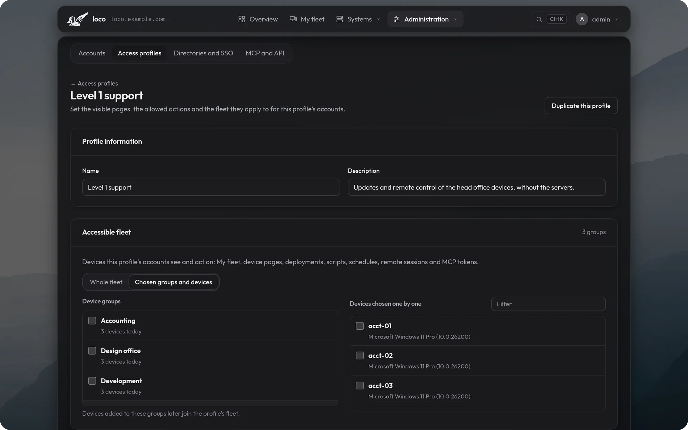
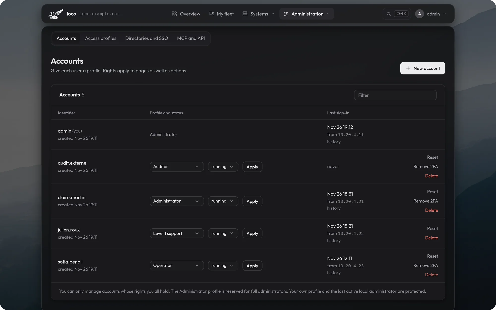

**English** · [Français](fr/accounts.md) · [Español](es/accounts.md)

# Accounts, access profiles and SSO

Who signs in, with which rights, on which part of the fleet — and with which look.



## Users and access profiles

Six built-in profiles (Administrator, Read only, Operator, Repository manager, Auditor, No access)
and **more than 60 granular permissions**; customizable profiles, **limited to part of the fleet** if needed (chosen
device groups and devices), and delegation that respects everyone's rights and fleet.

<details>
<summary><b>Read the details</b></summary>

In **Administration → Accounts**, give each user a profile. **Access profiles** lets you view the rights, duplicate a template and create or edit your own profiles. Existing accounts keep their profile and password when updating.

| Built-in profile | Default access |
|---|---|
| No access | No right; initial profile of pending directory accounts. |
| Administrator | All current and future rights; protected profile. |
| Read only | Overview, devices, caches and local catalogs. |
| Operator | Read only, inventories, individual updates and software deployment. Restarts, whole-fleet actions, agent removals and remote consoles need their own rights. |
| Repository manager | Management of the APT, RPM, Flatpak and Windows packages and installers and of the software center; no deployment to devices. |
| Auditor | Viewing, system, accounts, profiles, audit log and its JSON export; no changes. |

Permissions separate viewing and actions: creating, importing, copying and deleting packages; adding, editing and refreshing software; inventory, update, deployment, restart and removal of devices; whole-fleet actions; remote terminal and desktop; viewing, managing and running scripts; configuration, updates and restart of the server; viewing, creating, editing, resetting and deleting accounts; managing profiles and directories; reading, exporting and retention of the audit log. They apply to pages, APIs and direct requests, as well as to the navigation and the visible buttons.

The editor organizes the rights by domain with direct navigation, search, "granted" and "sensitive" filters, counters and selection of a category's visible rights. The save bar stays reachable at the bottom of the page. Ticking an action selects its prerequisites; removing a prerequisite removes the actions that depend on it, with an indication of the automatic adjustments. The viewing rights needed are also added automatically on the server side when saving. An empty profile lets the user reach **My account** and change their password. Built-in profiles stay protected; duplicate them to adapt them. A custom profile never receives a new right automatically in future versions.

Delegation respects the rights of the person administering: they can only assign profiles whose rights they all have, and only manage accounts within that limit. Only a full Administrator can assign the Administrator profile or manage another administrator. Changing your own profile, disabling or deleting your own account and editing the profile that protects your access are blocked. At least one active local administrator must remain, including during simultaneous changes.

Changing a profile's rights closes the sign-ins of all its members and their remote sessions. Changing an account's profile, disabling it or resetting/changing its password also revokes its access. Its commands still pending on the server are cancelled before being sent to the agents; operations already sent may finish. Sign-ins and rights are checked again on each request, and before a command is sent to an agent. The audit log keeps the changes of accounts, profiles and permissions.

**Accessible fleet.** Each custom profile covers **the whole fleet** (default) or **chosen groups and devices**: devices added later to a chosen group join it by themselves. Its accounts only see and target those devices, everywhere — My fleet, device page, search, overview, groups (reduced to their devices), deployments, scripts and their history, schedules, remote sessions and MCP keys, whose tools follow the fleet of the account that created them. A device outside the fleet answers "not found"; a deployment, a script run or a schedule targeting one stays invisible. A schedule applies its author's fleet at each run, and a limited profile cannot target "Whole fleet". Managing device groups and configuring the fleet (enrollment key, addresses, thresholds) are reserved for profiles that cover the whole fleet, since groups define the fleet of others. A limited manager only creates or assigns profiles whose groups and devices are within their own. Changing a profile's fleet reconnects its accounts; a remote session whose device leaves the fleet closes. Built-in profiles cover the whole fleet; the audit log stays global.

These permissions apply to the portal. The repositories and caches meant for devices keep their network-based access control.

From the administration console:

```bash
sudo loco-user roles                         # identifiers of the available profiles
sudo loco-user add alice viewer              # temporary password
sudo loco-user set-role alice operator       # assigning or restoring a profile
sudo loco-user passwd admin                  # recover access to the admin account
```

On native Windows, use `loco user …`; on the Alpine appliance, `loco-user …` as root.

</details>



## Directories and SSO

In **Administration → Directories and SSO**, add an **LDAP** directory (Active Directory, OpenLDAP, 389 DS, FreeIPA…) or a **RADIUS** server (NPS, FreeRADIUS…): users sign in with their usual username and password, **from loco's sign-in form**; a username unknown to loco is tried in the order of the active directories (**Move up** buttons). Also add an **OpenID Connect** provider (**Authentik**, Keycloak, Zitadel, Authelia, Microsoft Entra ID…): a **Sign in with …** button appears on the sign-in page.

- **LDAP**: `ldaps://` address (recommended) or `ldap://` with mandatory **StartTLS**, the password never travels in clear; certificate checked against the system's authorities or the PEM authority provided. With a **service account**, loco searches for the user (base and filter, Active Directory and OpenLDAP templates) then checks their password with a bind; without a service account, it binds directly with a template (`{username}@company.local` or `uid={username},ou=people,dc=example,dc=org`). The display name and the email are read again at each sign-in. Usernames are escaped in the filter (RFC 4515) and an empty password is refused.
- **RADIUS**: PAP authentication (RFC 2865) with the shared secret; loco sends and **requires the Message-Authenticator attribute** in the responses (BlastRADIUS protection, RFC 3579). On NPS or FreeRADIUS, declare loco as a RADIUS client and enable this attribute in the responses.
- **Authentik / OpenID Connect**: in Authentik, create an application with an **OAuth2/OpenID** provider of **Confidential** type, the redirect URL shown by loco (strict mode) and the **Authorization Code** grant type; copy into loco the issuer (`https://authentik.example.com/application/o/<slug>/`), the client ID and the client secret. "Code" flow with **PKCE** (S256), `state` and `nonce` bound to the browser; identity token checked (RSA, ECDSA or EdDSA signature with the published keys, or HS256 with the client secret when the Authentik provider has no signing key; issuer, audience, expiry). Authentik's self-signed certificate is pasted as is (it is then **pinned**), like your network's authority. No token is kept; password, two-factor authentication and access rules stay managed by the provider.
- **Configure Authentik** creates or updates the provider and the application, without duplicates, with a temporary API token that is neither stored nor logged, then registers the client. Authentik's certificate is checked before the token is sent, and a retrieved authority must be confirmed by its fingerprint. Changes are shown before being applied, and no return URL is removed without confirmation. Without a token, loco prepares a blueprint to paste.
- **Check the configuration** (OpenID Connect) checks from the server, without signing in or creating an account: name resolution, connection, certificate (missing intermediate or root), discovery, keys, client and secret, return URL and "code" flow. Each step gives its state and its fix. This check also runs when the provider is saved.
- **Test** checks the connection to the directory and an account, without creating a request; the result is logged without the password. For OpenID Connect, it is a real sign-in at the provider, which shows the identity received (proposed username, name, email, groups); it also works before enabling it.

**Profile photo**: at each sign-in through an OpenID Connect provider, loco takes the account's photo from it (`picture` claim: Authentik avatar, Gravatar…) as the profile photo — read again if it changes, at most once a day, and removed if it no longer provides one (initials avatar). An image chosen in *My account › Appearance* wins; *Use my … account photo again* goes back to the provider's one. The image is only requested from the provider itself, with the same trust as for the sign-in (authority or pinned certificate), or from a public address (Gravatar): never from an internal address nor through a redirect. Only PNG, JPEG, GIF and WebP images are taken, 2 MB at most; an unreachable photo neither delays nor prevents the sign-in.

An administrator with a local account can **link their account** to their identity at the provider, from *My account › SSO sign-in*: their password, their rights and their two-factor authentication stay in place. In an OpenID Connect provider's options, `group = profile` lines **suggest** a profile when approving a request, without granting anything on their own.

The first sign-in of an identity creates an account **with no access**, at the top of **Accounts**. A person with the **Approve directory accounts** right chooses its profile then approves it. No name or email match ever merges a local account with a directory identity, and the directory's groups grant no loco right. A directory account changes its password in the directory. **Local accounts always remain available** to administer loco.

Secrets (service account password, shared secret, client secret) are encrypted with a key derived from the server's session key, kept in its backups, and never shown again. Editing or disabling a directory closes the sessions of its accounts; deleting it disables them. The **Manage directories** and **Approve directory accounts** rights are separate and given to administrators by default.

OpenID Connect sign-ins from before 2.14 (removed then, back in 2.112 in this form) are not carried over: their accounts stay without access. In **Accounts**, **Local password** gives them a temporary password; or delete them and let the person request access again with the provider's button.

## My account and appearance

**My account** shows the profile, the account type and its dates, with four tabs: **Security** (password change with its rules checked live, **passkeys**, **two-factor authentication** with a TOTP app and backup codes), **Appearance**, **My rights** (grouped by domain) and **Recent activity** (the account's last ten actions). The **Appearance** window (account menu) offers six themes — **OLED**, **Soft dark**, **Midnight**, **Light**, **Sepia** and **Pine** —, eight **accent colors**, the **transparency** of the panels, **backgrounds** (gradients, photos, your own image) and presets; the choice is saved on the account and follows it from one browser to another.

**Passkeys**: a local account can sign in without a password, with its phone, its computer or a security key (WebAuthn/FIDO2). The key is added in *My account › Security › Passkeys* (the current password is asked again, ten keys at most per account), then the sign-in page offers **Sign in with a passkey**. The device verifies the person (fingerprint, face or PIN) at each use: the key counts as password and second factor, and loco only keeps its public part. The password remains usable. Two conditions, imposed by browsers: loco must be opened by a **name** — the one in *System › Network › Portal address*, never an IP address — and its **certificate** must be recognized by the browser (loco's authority installed on the device, or a certificate from your authority). Elsewhere, the page explains it and does not offer the button. Lost device: the person removes the key in *My account*, or an administrator does it from *Accounts* (*Remove passkeys*, or `loco-user passkeys-reset NAME`); resetting a password also removes the account's keys. Directory and SSO accounts keep their provider's rules.

**Instance appearance** (*Administration → Appearance*, *Configure the server* right): the company's identity and the frame for everyone's choices. On installation, everything is offered, as above, and the default appearance is the **Mist** preset (*Soft dark* theme, no accent color).
- **Identity**: **logo** (header, sign-in screen, tab icon), **company color** (offered as the accent color; text on it turns black or white according to its lightness) and **company background** (image offered among the backgrounds, also served on the sign-in screen).
- **Default appearance**: theme, color, background and opacity for new accounts and for the *Reset* button.
- **Sign-in screen**: it follows the default appearance or gets its own, including a theme not offered to accounts. *Apply to sign-in*, in the **Appearance** window, gives it the one you are trying.
- **Choices left to everyone**: the **offered themes** (for example only one light and one dark), the accent color and the background **free or imposed**. Nothing is deleted: an unticked theme is only hidden, and what is no longer offered is replaced on display by the default appearance, without touching the accounts' saved settings. *Original settings* restores all the choices.
- **Administrators are not bound by this frame**: an account with the *Administrator* profile (whatever its name) keeps all the themes, presets, colors and backgrounds in its **Appearance** window, and can choose its **logo** there — the company's, loco's, or an image of its own (PNG, JPEG, GIF, WebP or SVG, 2 MB at most). This logo is shown only to it: other accounts and the sign-in screen keep the instance's.

---

[← Back to the overview](../README.md) · [All the documentation](README.md)
