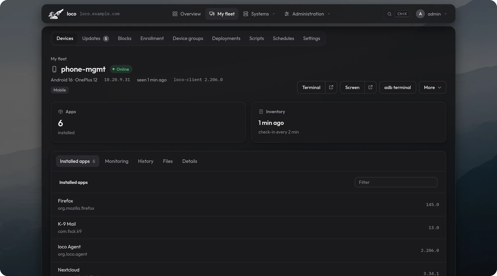

**English** · [Français](fr/android.md) · [Español](es/android.md)

# Android devices

Manage your own Android devices (phone, tablet) from loco: see and drive the screen,
browse the files, open a terminal, and let an AI assistant do the same through
MCP. Enrollment works **without a QR code**: you install an app, enter the server's address
and a key. It is an **experimental** feature, off by default.

loco also installs apps on these devices: from verified F-Droid repositories, or by opening
their Google Play page (see [Applications](#applications)). No Android system updates. Nothing
is captured outside a session you open from the portal, and each capability (screen, control,
files, installs) is turned on on the device, by hand.

## Turning the feature on

In **Administration › Features**, *Experimental* section, turn on **Android devices**. Any
account with the Administrator profile can do it. While it is off, the Android tab of
the enrollment and the app download do not exist.

## Installing the app

In **My fleet › Enrollment**, **Android** tab: download the APK and open it on the device. Android
asks to allow installing from this source; no Google account is needed. You can also
open the download link straight from the device's browser (an HTTP address is
offered for a first connection, before loco's authority has been imported). The app installs
under the name **Agent loco** and requires Android 8 (API 26) or later.

## Automatic enrollment (APK ready to enroll)

The APK offered by the enrollment carries, engraved in its **signing block**, the server's address, the enrollment
key and the fingerprint of loco's authority — exactly like the preconfigured Windows MSI. Opened
on the device, the app **enrolls on its own**: it fetches the server's authority, checks that
its fingerprint matches the engraved one, then joins *My fleet*, with nothing to enter or confirm. With a
device group chosen at enrollment, the device joins it.

The configuration is placed in the signing block, which the v2/v3 signature schemes do not cover:
**the app's signature stays valid** (no re-signing, no signing key on the server)
and the app updates normally afterwards. The APK contains the enrollment key: only share it
with the people who set up the devices. If the fingerprint received does not match the engraved one
(wrong address, interception…), automatic enrollment is **refused** and the app falls back to
manual entry.

## Connecting the device by hand

For the generic APK, folded under *Generic APK and manual entry*, open the app and enter
**the server's address** and the **enrollment key** shown on the enrollment page. The app
fetches the server's authority (CA) and shows its **SHA-256 fingerprint**: compare it with the one on the enrollment
page and only confirm if it matches. Once confirmed, the device joins *My fleet* and
keeps in touch on its own.

If the server's certificate is publicly trusted, the app connects with no fingerprint to confirm.

## What you can do

From the device's page, as for a computer:

- **Screen** — see the screen live and drive it (touch, scroll, keyboard and mouse). The
  *Back*, *Home*, *Recent apps* and *Notifications* buttons are in the toolbar; a right
  click does *Back*, a middle click *Home*, the wheel scrolls.
  The finger follows the mouse live: hold the button for a long press, drag to scroll or
  move, the screen moves during the gesture. What moves is sent as light JPEG, then the picture becomes
  sharp again as soon as the screen settles. For a smooth picture, you need **screen sharing** (see below):
  remote control alone stays limited by Android to about three frames per second.
  **Device asleep or locked** (app 2.160 or later): the screen turns back on when the
  session opens, and again at the first click or key press if it went back to sleep in the meantime. You land on
  the lock screen: **Unlock**, in the session's toolbar, opens a pad to draw the
  **pattern** (or click its dots in order), or fields for the **PIN** and the **password**;
  the loco app brings up the code entry (official request to Android, otherwise a swipe up) and
  enters the code there. You can also **type the code on your keyboard, then Enter** — for a pattern, the numbers
  of its dots, counted as on a phone keypad (1 top left, 9 bottom right). Android hides
  the code entry screen in the picture sent: it shows as black, that is normal, the input still
  goes through. Nothing is bypassed — you need to know the code, and failed attempts count as on the device.
  The app never types the code given by *Unlock* anywhere other than the code entry: if the device
  is already unlocked, it is discarded (app 2.198 or later; before that, the code is typed as on the keyboard).
  **Remember this code** keeps it for your next sessions on this device, **for you only**: *Unlock*
  then offers "Pattern remembered for you only" and unlocks in one click; *Forget* erases it, *Enter another
  code* gives a different one. The code is sealed on the server with its key and tied to your account and to the device:
  no other user, administrator included, can use it, and it is never shown — it is only handed
  to your screen session, at the moment of unlocking. The audit log notes that a code was remembered, used or
  forgotten, never the code itself. It goes away with your account or with the device, and has to be entered again after a
  restore on another server (different key).
  **Closing the session locks the phone or tablet** (app 2.199 or later, Android 9 or later):
  as soon as the last screen session ends — closed from the portal, by the AI assistant or by expiry —,
  the device locks as with the power button, so it does not stay open after the
  person driving it has left (app 2.201.1 or later; before that, it waited five seconds and a session reopened
  in the meantime prevented it). A session reopened afterwards finds it locked: *Unlock*. Nothing happens while
  loco is still driving the screen through adb; a TV is not concerned. The result is noted in Android's
  log (`loco` tag). The pattern grid is found on stock Android and on OxygenOS / ColorOS
  (OnePlus, Oppo, Realme), as well as on the skins that name it in a similar way.
- **Terminal** — a shell with the app's rights (no root). `cd` is kept from one command to
  the next; environment variables are not.
- **Files** — browse, upload, download, rename and delete in the device's storage.
- **adb terminal** — a real `adb shell` terminal, with the rights of Android's "shell" user
  (see [adb terminal](#adb-terminal)).
- **AI assistants (MCP)** — the same actions (terminal, files, screen) are offered to assistants, within
  the rights of the key and the profile, as well as the `adb_shell` tool for the adb shell and `push_file` /
  `pull_file` to send or fetch a file through adb (like `adb push` / `adb pull`, content checked), including
  straight from or to another device of the fleet.

## Always reachable

The app keeps in touch with the screen off and the device locked (app 2.200 or later):

- **on mains power**, it keeps the processor awake — the screen stays off — and Wi-Fi out of its power
  saving: contacts, persistent channel and wireless debugging carry on as with the screen on, and a session opens
  at once;
- **on battery**, Android wakes it every five minutes, even in deep sleep, for a contact and to
  reopen the channel: a session may wait for that wake-up;
- **Always reachable** (app screen) keeps it awake on battery too, at the cost of higher
  consumption.

**Battery optimization** must be lifted for loco, otherwise Android also cuts its network during sleep:
the app asks for it by itself (once per version) and keeps the *Background operation* line as long
as it is not lifted. On a device paired over adb, loco lifts it itself as soon as it comes back (setting reset,
manufacturer skin). The device's page shows *Sleep not lifted* as long as it is not.

## Granting access, on the device

Each capability is turned on from the app, on the device, and can be seen:

- **Control**: *Open accessibility settings* to allow loco to touch, scroll, go back
  and type. **Once this service is on, there is nothing left to do on the device**: loco also shows
  the screen through it at each session (Android 11 and later), even after a restart, without reopening the app.
  Android limits this reading to about three frames per second. If Android answers "access denied" (Android 13
  and later, app installed from a file): *Settings › Apps › Agent loco*, ⋮ menu,
  *Allow restricted settings*, then try again.
- **Remote screen**: *Turn on the remote screen* starts Android's screen sharing, smoother (Android shows
  its sharing indicator while it is active). Android asks again after each restart of
  the app; this button is therefore optional once control is on.
- **Allow everything once, through adb**: pair the device with loco (see *adb terminal* below). loco
  then grants screen sharing itself with no consent window, turns on control, lifts the block on
  restricted settings, and the app turns wireless debugging back on by itself when Android turns it off.

During any screen session, the device shows the **"Remote control in progress"** notification: nothing
is shown outside a session opened from the portal.

- **Files**: *Allow access to files* (access to all files).
- **Installs**: *Allow installs*, so that loco installs the apps you
  deploy. Android still asks for your confirmation for each new app.
- **Background**: *Allow background* so that the device does not put loco to sleep and does not cut
  the contact when the screen is off.

The app stays visible (permanent notification) and nothing is read or sent outside a session
opened from the portal.

## Trusted networks

In the app, the **Trusted networks** panel sets where the device stays in touch with loco. Elsewhere
the agent is **paused**: no contact with the server, open sessions close, wireless debugging is not
turned back on; the app's notification says why ("Paused · mobile data"…), and it resumes by itself as soon
as the device is back on an approved network.

| Mode | The agent is active… |
|---|---|
| **Everywhere** (default) | on any network, mobile data included |
| **No mobile data** | on any Wi-Fi or wired network, never on the mobile network |
| **Chosen Wi-Fi only** | only on the Wi-Fi networks approved by their name |

The **Chosen Wi-Fi** mode requires the **location** permission, set to "Allow all the time", and the
device's location turned on: Android only gives the name of a Wi-Fi network on that condition ("all the time" because
the agent runs in the background). loco **never reads the position**; the permission is only requested if you
choose this mode, and the app guides you step by step. Without it the Wi-Fi name cannot be read and the agent stays
paused: it is never active by default on a network it cannot name. A Wi-Fi network is approved with a button
while the device is connected to it, or by its name; the list stays on the device.

On the portal side, the device's page only shows the setting ("active off mobile data only",
"active on 2 approved Wi-Fi networks only"): that explains why it appears offline at times. The
setting belongs to the person who holds the device; it cannot be changed from the portal.

## adb terminal

The app's terminal has the rights of the loco app. The **adb terminal** is the one of a
development computer: `adb shell`, with the rights of Android's "shell" user. You can
list, install and uninstall apps there (`pm`), start an activity (`am`), change a setting
(`settings`), simulate a touch or an input (`input`), read the logs (`logcat`) or the system state
(`dumpsys`). It is a real pseudo-terminal: `top` or an editor work.

The loco server connects to it itself, over the local network: the device must be on the same network as loco.
The loco app only tells loco the state of debugging and the port to use.

### Requirements on the server

loco uses the server's `adb` tool:
- **Appliance:** included from 2.139.0.
- **Debian, Ubuntu and Docker:** `adb` package, installed by loco if available. With Debian 12 and
  Ubuntu 22.04, it is too old for wireless pairing: only the classic adb port can be used.
- **Rocky Linux:** EPEL's `android-tools` package.
- **Windows loco server:** no adb terminal.

loco starts its own adb server. Its key stays in loco's state folder, readable by loco alone, and it
listens on no network port.

### Pairing the device (wireless debugging, Android 11 and later)

On the device's page, **adb terminal** (or *More › adb debugging…*) opens the configuration:

1. **Developer options**: in *Settings › About*, tap *Build number* seven times.
2. *Developer options › Wireless debugging*: turn it on, on the same Wi-Fi network as loco.
3. *Pair device with pairing code*: enter in loco the port and the six-digit code
   shown by the device, then **Pair**.

**From the device itself** (app 2.154.0 and later): in the loco app, the *Smooth picture at
every session* panel does the same without going through the portal. **Set up** opens *Wireless debugging*; turn it on,
tap *Pair device with pairing code*, then, without closing that window, pull down the notification
shade and type the code in loco's notification. The app finds the pairing port on its own and
sends port and code to loco, which pairs with the device's address — the one the request comes from, never
another. The device must therefore be on the same network as loco (not behind a router). The pairing is recorded in the
audit log as done "from the device".

Without pairing, Android limits the remote screen read by remote control to about three frames per second;
once the device is paired, loco grants the app's screen sharing once and for all, and each
session opens with a smooth picture (about thirty frames per second measured on a OnePlus 12).

Pairing is done only once. The connection port changes each time wireless debugging is turned on:
the loco app discovers it on the device and tells loco. Android turns wireless debugging off at
restart or when the device changes network: the loco app (2.145.0 and later) turns it back on by itself, with
the right loco gives it through adb at pairing. On a new Wi-Fi network, Android still asks for
confirmation on the device.

At the first contact after pairing, loco sets once and for all, through adb, what avoids any gesture
afterwards: screen sharing with no consent window, control (accessibility) turned on, restricted settings lifted,
app exempted from sleep. The *Audit log* notes it ("parc.adb.autorisations"), and *Forget* on
adb debugging stops keeping wireless debugging on.

### Classic adb port

For a device whose adb already listens on the network (`adb tcpip 5555` run from a computer, Android TV,
virtual machine), *Classic adb port* connects to it directly. The first time, the device asks
to allow debugging from loco.

### Rights and traces

Opening an adb terminal, pairing and the assistants' commands are reserved to the **Open an
adb terminal** right, and recorded in the audit log. The pairing code is never written in a command or in the
audit log. **Forget** removes the device from loco's adb devices; also remove loco from the list of paired
devices, on the device.

## Unlocking the screen remotely

The simplest: **Unlock** in the **Screen** session (see [above](#what-you-can-do)), through
the loco app, without adb. Once the device is paired over adb, **Unlock** also exists in the toolbar of
**Control the screen**: loco wakes the screen and replays the **pattern**, the **PIN** or the **password** you
enter, through adb — without going through the app. The AI assistant has the `adb_unlock` tool.

Android's lock screen is a **secure surface**: neither `screencap` nor scrcpy can
show it (black or empty picture). Unlocking is therefore done **blind**: you know your
secret, you enter it in loco, and loco injects it.

- **Pattern** — you draw it on a 3×3 pad in the portal. Once the code entry is open, loco looks for
  the grid in the description of the screen Android gives (`uiautomator`): on most devices, including
  OxygenOS, it finds it and draws the pattern exactly on it, whatever the orientation. Otherwise, the 9 dots
  are **computed** from the screen's resolution; a **manufacturer profile** (Pixel/AOSP, Samsung, Xiaomi,
  OnePlus, Vivo, Motorola…) serves as a starting point. If the pattern does not go through, open **Grid calibration**: choose
  the brand, or adjust the center and the spacing (as fractions of the screen), then test — the setting is remembered
  for this device. The injection is replayed up to three times (a touch gesture is not always caught the
  first time), well under Android's lockout threshold.
- **PIN** and **password** — typed and confirmed with the keys, **with no calibration** (no coordinates).

The secret entered (pattern, code, password) is **never** written to the audit log. Remote unlocking
falls under the same **Open an adb terminal** right: adb access already allows injecting these gestures.

**"the device no longer recognizes loco"**: the device's adb port answers, but it refuses loco's key
(pairing forgotten on the device, debugging authorizations revoked). Pair it again. Before saying so,
loco checks that its own adb server is indeed running with its key: another program of the loco account that
borrows it and starts it first (when the server boots, for example) would start it with another key; loco
then stops it and starts its own again. Such a program must set `HOME` to the folder of loco's key
(`/var/lib/loco/adb` on the appliance).

## Controlling the screen remotely

Once the device is **unlocked**, **Control the screen** (on its page) streams its screen to the browser and
drives it, through adb — **with no MediaProjection dialog**.

The stream is **low latency**: loco starts *scrcpy-server* (video only, included in loco, Apache 2.0 license) on
the device and relays the **raw H.264**; the browser decodes it with **WebCodecs** (hardware decoding, nothing to
transcode on the server). If the browser does not have WebCodecs, or if scrcpy fails, loco **switches automatically**
to an **MJPEG** stream (`adb screenrecord` converted by **ffmpeg**, needed on the server for this fallback).

- **Clicking** on the screen = touching; **dragging** = swiping. The coordinates are fractions of the screen: it
  works whatever the resolution.
- Toolbar: **Back**, **Home**, **Recent apps**, **Power/sleep**, and a field to **type
  text**.
- The **lock** screen is not shown (secure surface): unlock first (above).

**Visible safeguard**: as long as loco drives the screen, the device shows a **"Remote control in
progress"** notification and contacts loco more often, so that the indicator appears and disappears quickly. The agent stays
visible and the access relies on the wireless debugging you allowed.

## Applications

The portal's **Android** menu gathers three pages: *Catalog*, *F-Droid repositories* and *Sources*.

### Sources: the F-Droid repositories

loco reads the index of the enabled F-Droid repositories every day. **F-Droid** (thousands of free apps,
built by F-Droid from their source code) and **IzzyOnDroid** (free apps published by their
developers) are offered from the start. Nine vendor repositories can be added in one click from *Sources verified
by loco*: Guardian Project (Orbot), Bitwarden, Brave, Molly, Session, Threema Libre, KDE, NewPipe and microG.
Their key has been checked: the one that signs the index is identical to the one the vendor publishes.

Each index is signed. loco checks the signature with the source's key, whose fingerprint is recorded
when it is added, then the SHA-256 fingerprint of the whole index. It also refuses an index older than the last one
verified, so that a compromised repository or an intermediary cannot serve old versions again.

**Another F-Droid repository** is added by its address (`https://…/fdroid/repo`): loco reads the key that signs its
index and shows its fingerprint. Compare it with the one the vendor publishes, on its website, before confirming.
A source is a trusted key: only add repositories whose vendor you know.

A source that has apps in the catalog cannot be removed; it can be disabled.

### Catalog

In *F-Droid repositories*, look for an app by its name, or browse the *Discover* selection and the
categories, then **Add**. An app present in several sources is offered from the
first one, in the order of the *Sources* page. Its page gives the version, the minimum Android, the processors,
the size, the license, the signing key, and F-Droid's warnings (ads, tracking, non-free online
service…).

Choose **a single source per app**: each repository signs its APKs with its own key, and Android
refuses to update an app with an APK signed by another key.

### Google Play

Google does not allow any third-party tool to install an app from the Play Store, and loco downloads nothing
from Google Play. In *Catalog*, **Add from Google Play** takes the link of the app's page
(`https://play.google.com/store/apps/details?id=…`) or its package name. At deployment,
the device opens the page in the Play Store and you tap **Install**. Google Play then takes care of the
updates. On a device without the Play Store, the page opens in the installed store or, failing that,
in the browser.

### Deploying

From the catalog (**Deploy**), a device's page (*More › Install apps…*) or
*My fleet › Deployments* (*New deployment › Android apps*). As for the other
deployments, you choose devices or device groups, check the preparation, then
confirm. Waves are available.

Each device receives the version compatible with its Android and its processor. An app already up to date
is skipped, except with *Reinstall even if this version is already there*. The device must have
the loco app **2.139.0 or later**.

### On the device

1. loco downloads the APK from the source and checks its SHA-256 fingerprint, recorded in the signed index.
2. The loco app fetches it from loco, checks in turn the fingerprint, the app's name and
   its signing key, then hands it to Android.
3. **A first installation is confirmed on the device**: Android shows its *Install* window. It
   opens directly if the loco app is in the foreground or if control (accessibility) is active;
   otherwise, an *Install …?* notification opens it. You can also tap it from the remote screen.
4. **Updates happen without asking anything** on Android 12 or later, for the apps that
   loco installed itself. An app installed by Google Play or another store stays updated
   by that store, and loco does not offer to update it.

An installation not confirmed within six hours is recorded as failed. The deployment shows the device's
report (installed, refused, incompatible…), and the device's page the installed version of each
catalog app, the store that installed it and the available version.

### The loco app itself

From 2.139.0, the loco app **updates itself** from loco when the server moves to a
newer version, outside an ongoing remote session. After an update, the remote screen has to be
turned on again: Android does not keep the capture permission. It **starts again by itself** after a restart
of the device or an update. 2.138.0 could not update itself: install 2.139.0 once by
hand, from the enrollment, over the old one.

**On a device paired over adb** (loco 2.155.0 and later), loco installs the update itself through adb, as
from a computer: no confirmation window, no scan offered by Play Protect on the device.
The app does not try it itself in the meantime. If the installation through adb fails (device off the
network, wireless debugging off), the app takes over at the next contact and updates itself, as
on an unpaired device. Never during an open remote session; each installation is recorded in the
audit log ("App update through adb").

### Registering the app with Google

Android is gradually requiring that an app installed outside the Play Store come from a developer registered
with Google (Android developer verification: a few countries from September 2026, the whole world in
2027). The loco app is signed by the project's key: registration is done **only once, by the
holder of that key**, and applies to every loco instance — none has a Google account to link.

1. On the [Android Developer Console](https://developer.android.com/developer-verification/guides/android-developer-console),
   create the account (limited or full distribution) and have it verified.
2. In *Packages*, register the package name `org.loco.agent` and the SHA-256 fingerprint of the signing
   certificate: `95:68:93:B5:58:F2:E1:69:D7:27:88:C8:96:50:39:57:E4:03:80:2C:5C:56:4C:B1:A7:C0:E3:FF:0F:99:44:4B`.
3. The console gives a proof token: save it in `adi-registration.properties`, **next to the signing
   key** (`LOCO_KEYSTORE_DIR` folder, `~/android-keystore` by default). `android/client/build.sh` then embeds it
   in the release APK (`assets/adi-registration.properties`); send that APK to the console to prove
   you hold the key.

The update can also **be installed from the app**, without waiting: as soon as loco offers one,
the app's screen shows *App update* with the available version and the
**Install the update** button. Opening the app asks loco right away. If the permission to install
apps is missing, the button leads there first. Android closes the app to replace it; it
starts again by itself, an *App updated* notification confirms it, and the screen reopens when Android
allows it. What prevented the installation (loco unreachable, refusal on the device…) is written under the button.
At the bottom of the screen, the version line says *up to date* or the available version. Outside its trusted
networks, the device does not contact loco and the button is not offered.

## Removing a device

In the app, *Leave loco*: the device is removed from the server and the agent stops. You can
enroll it again later. Uninstalling the app has the same effect on the device side. From the portal,
*Remove the agent* (device page) does the same at the next contact; the app stays installed.

## Limits

- No Android system updates. No installation from Google Play by loco: only the page
  opened on the device.
- The adb terminal requires the device to be on loco's local network, and wireless debugging turned on (turned off
  by Android at each restart).
- A first installation always requires a confirmation on the device: without Android enterprise
  management (Device Owner), Android does not allow installing without it.
- **Google's developer verification**: since 30 September 2026 in Brazil, Indonesia,
  Singapore and Thailand, and everywhere in 2027, a certified device no longer installs an app whose
  developer is not registered with Google. The loco app, signed by your key, and the
  apps signed by F-Droid are concerned. You will need to turn on once, on each device, Google's
  "advanced flow" (developer mode, restart, then a day's wait), or register
  the loco app with Google (free account with limited distribution).
- Driving the screen goes through an accessibility service; some sensitive apps (banking…)
  hide their content during capture.
- **OxygenOS / ColorOS** (OnePlus, Oppo, Realme) protect the screen sharing granted once and for all by
  adb pairing: apps stay black there, only the system bars show. The loco
  app (2.198 or later) detects it, stops that sharing and shows the screen through accessibility, about three frames per
  second. For a smooth picture on these devices: **Control the screen**, through adb.
- The app is signed with loco's release key; updating the APK from the same source
  keeps the installation (a different signature would require uninstalling first).

---

[← Back to the overview](../README.md) · [All the documentation](README.md)
