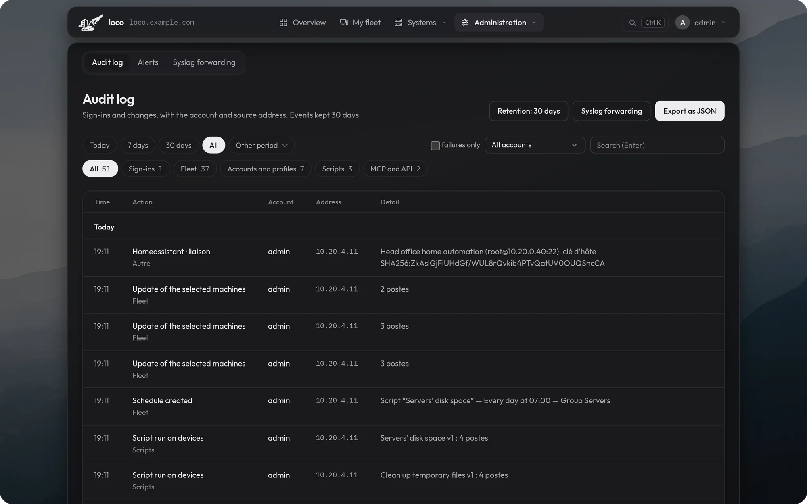

**English** · [Français](fr/audit-log.md) · [Español](es/audit-log.md)

# Audit log

The *Administration › Audit log* page records sign-ins and actions, with the account and the source address.

- **Reading**: events grouped by day, actions in plain words ("Server address announced to the agents") and
  category; filters by period (today, 7 days, 30 days, chosen dates), category (sign-ins, fleet,
  remote access, software, Linux repositories, Windows Update, scripts, accounts and directories, server), account, failures only and search
  in the details; pages of 100 events. Sign-in failures of the last 24 hours are flagged at the top.
- **JSON export** of the filtered view, of a period (dates included) or of the whole log: server, period, filters,
  author of the export and events (date, account, address, action and its label, details). Each export is
  itself logged.
- **Retention** you can set (7 days to 2 years, or no limit), **30 days by default**: older events
  are deleted when the portal starts and then at most once an hour. Export them before reducing the duration.
- Separate rights: *View the audit log*, *Export the audit log* (included in the Auditor profile) and *Configure
  audit log retention*.

## Forwarding to a syslog server

*Administration › Syslog forwarding* sends to your syslog server or your SIEM, as you choose, **loco's audit log**, the **devices'
logs**, or both. RFC 5424 format, over TLS (recommended), TCP or UDP, with a button to send a test message.

- **loco's audit log**: everything shown on the Audit log page, from the moment it is enabled (not the history). Each event
  carries the account, the address, the action and its category; a failure goes out as a warning, the rest as information.
- **Devices' logs**: journald on Linux, System and Application event logs on Windows, at the minimum level you choose
  (errors, warnings, notices or information). *Always include security* adds, on Linux, the authentication
  messages and, on Windows, the audit failures of the Security log (the successes too from the Information
  level). Forwarding can be limited to device groups. Agents 2.124.0 and later (they update themselves).
- **Devices go through loco**: they do not need to reach the syslog server, only loco as usual. The host
  of the message is the name loco knows for the device. Logs come up at each agent check-in, every 2 to 3 minutes.
- **If the syslog server is away**, forwarding resumes where it stopped: nothing is stored on the loco server, the
  delay is caught up as long as the original log still has the lines. Syslog has no acknowledgment: an event
  may arrive twice after an outage, a hard cut may lose a few, and UDP never guarantees delivery.
- The page shows the last send, the last failure and each device's state; the *Syslog forwarding failed* alert rule
  warns after 5 minutes. Right *Send logs to a syslog server*, reserved for profiles that cover the whole fleet.
  In high availability, only the primary sends, and the setting follows replication.

---

[← Back to the overview](../README.md) · [All the documentation](README.md)
