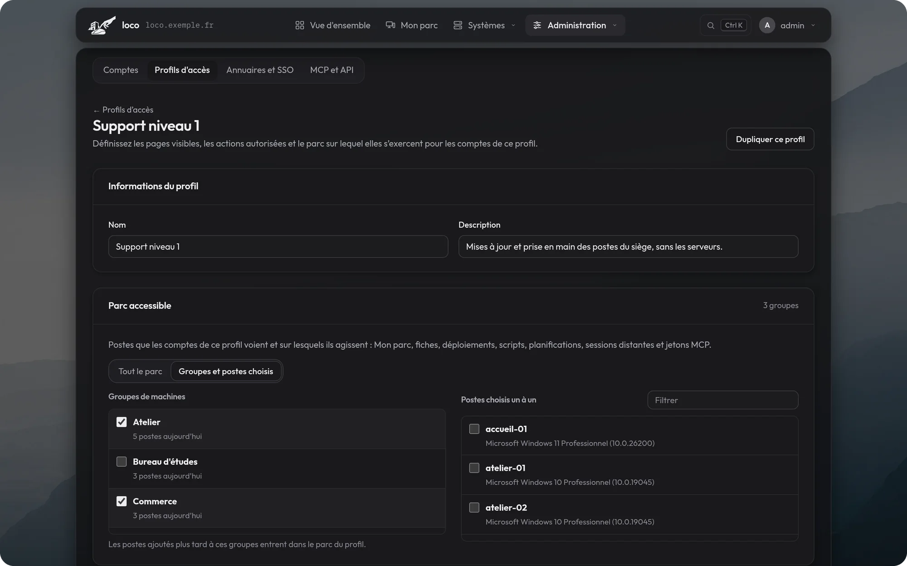
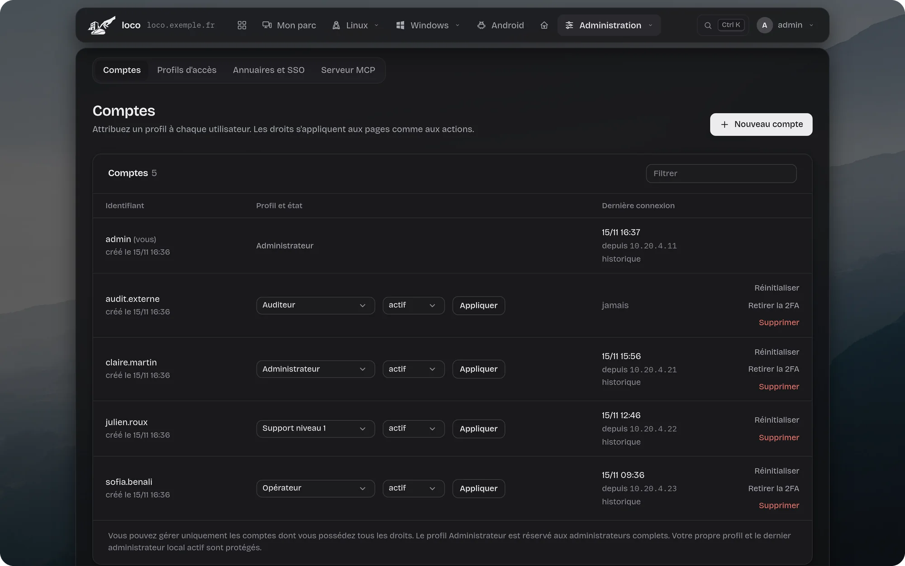

# Comptes, profils d’accès et SSO

Qui se connecte, avec quels droits, sur quelle partie du parc — et avec quelle apparence.



## Utilisateurs et profils d’accès

Six profils intégrés (Administrateur, Lecture seule, Opérateur, Gestionnaire des dépôts, Auditeur, Sans accès)
et **plus de 60 permissions** granulaires ; profils personnalisables, **limités à une partie du parc** si besoin (groupes de
machines et postes choisis), et délégation qui respecte les droits et le parc de chacun.

<details>
<summary><b>Lire le détail</b></summary>

Dans **Administration → Comptes**, attribuez un profil à chaque utilisateur. **Profils d’accès** permet de consulter les droits, dupliquer un modèle et créer ou modifier vos propres profils. Les comptes existants conservent leur profil et leur mot de passe à la mise à jour.

| Profil intégré | Accès par défaut |
|---|---|
| Sans accès | Aucun droit ; profil initial des comptes d’annuaire en attente. |
| Administrateur | Tous les droits actuels et futurs ; profil protégé. |
| Lecture seule | Vue d’ensemble, appareils, caches et catalogues locaux. |
| Opérateur | Lecture seule, inventaires, mises à jour individuelles et déploiement de logiciels. Les redémarrages, actions sur tout le parc, retraits d’agents et consoles distantes demandent leurs propres droits. |
| Gestionnaire des dépôts | Gestion des paquets et installeurs APT, RPM, Flatpak, Windows et du centre de logiciels ; aucun déploiement sur les appareils. |
| Auditeur | Consultation, système, comptes, profils, journal et son export JSON ; aucune modification. |

Les permissions distinguent la consultation et les actions : création, import, copie et suppression de paquets ; ajout, édition et actualisation des logiciels ; inventaire, mise à jour, déploiement, redémarrage et retrait des appareils ; action sur tout le parc ; terminal et bureau distant ; consultation, gestion et exécution des scripts ; configuration, mises à jour et redémarrage du serveur ; consultation, création, modification, réinitialisation et suppression des comptes ; gestion des profils et des annuaires ; lecture, export et durée de conservation du journal. Elles s’appliquent aux pages, API et requêtes directes, ainsi qu’à la navigation et aux boutons visibles.

L’éditeur organise les droits par domaine avec navigation directe, recherche, filtres « accordés » et « sensibles », compteurs et sélection des droits visibles d’une catégorie. La barre d’enregistrement reste accessible en bas de page. Cocher une action sélectionne ses prérequis ; retirer un prérequis retire les actions qui en dépendent, avec indication des ajustements automatiques. Les droits de consultation nécessaires sont aussi ajoutés automatiquement à l’enregistrement côté serveur. Un profil vide laisse l’utilisateur accéder à **Mon compte** et changer son mot de passe. Les profils intégrés restent protégés ; dupliquez-les pour les adapter. Un profil personnalisé ne reçoit aucun nouveau droit automatiquement lors des futures versions.

La délégation respecte les droits de la personne qui administre : elle peut attribuer uniquement des profils dont elle possède tous les droits, et gérer uniquement des comptes dans cette limite. Seul un Administrateur complet peut attribuer le profil Administrateur ou gérer un autre administrateur. Changer son propre profil, désactiver ou supprimer son propre compte et modifier le profil qui protège son accès sont bloqués. Il doit rester au moins un administrateur local actif, y compris lors de modifications simultanées.

Changer les droits d’un profil ferme les connexions de tous ses membres et leurs sessions distantes. Changer le profil d’un compte, le désactiver ou réinitialiser/changer son mot de passe révoque aussi ses accès. Ses commandes encore en attente sur le serveur sont annulées avant transmission aux agents ; les opérations déjà transmises peuvent se terminer. Les connexions et les droits sont contrôlés à nouveau à chaque requête, et avant l’envoi d’une commande à un agent. Le journal conserve les changements de comptes, de profils et de permissions.

**Parc accessible.** Chaque profil personnalisé couvre **tout le parc** (par défaut) ou des **groupes et postes choisis** : les postes ajoutés plus tard à un groupe choisi y entrent d’eux-mêmes. Ses comptes ne voient et ne visent que ces postes, partout — Mon parc, fiche, recherche, vue d’ensemble, groupes (réduits à leurs postes), déploiements, scripts et leur historique, planifications, sessions distantes et jetons MCP, dont les outils suivent le parc du compte qui les a créés. Un poste hors parc répond « introuvable » ; un déploiement, une exécution de script ou une planification qui en vise un reste invisible. Une planification applique à chaque occurrence le parc de son auteur, et un profil limité ne peut pas viser « Tout le parc ». Gérer les groupes de machines et configurer le parc (clé d’inscription, adresses, seuils) sont réservés aux profils qui couvrent tout le parc, puisque les groupes définissent le parc des autres. Un gérant limité ne crée ou n’attribue que des profils dont les groupes et postes sont dans les siens. Changer le parc d’un profil reconnecte ses comptes ; une session distante dont le poste sort du parc se ferme. Les profils intégrés couvrent tout le parc ; le journal reste global.

Ces permissions portent sur le portail. Les dépôts et caches destinés aux postes conservent leur contrôle d’accès par réseau.

Depuis la console d’administration :

```bash
sudo loco-user roles                         # identifiants des profils disponibles
sudo loco-user add alice viewer              # mot de passe temporaire
sudo loco-user set-role alice operator       # attribution ou récupération d’un profil
sudo loco-user passwd admin                  # récupérer l’accès au compte admin
```

Sur Windows natif, utilisez `loco user …` ; sur l’appliance Alpine, `loco-user …` en root.

</details>



## Annuaires et SSO

Dans **Administration → Annuaires et SSO**, ajoutez un annuaire **LDAP** (Active Directory, OpenLDAP, 389 DS, FreeIPA…) ou un serveur **RADIUS** (NPS, FreeRADIUS…) : les utilisateurs se connectent avec leur identifiant et leur mot de passe habituels, **depuis le formulaire de connexion de loco** ; un identifiant inconnu de loco est essayé dans l’ordre des annuaires actifs (boutons **Monter**). Ajoutez aussi un fournisseur **OpenID Connect** (**Authentik**, Keycloak, Zitadel, Authelia, Microsoft Entra ID…) : un bouton **Se connecter avec …** apparaît sur la page de connexion.

- **LDAP** : adresse `ldaps://` (recommandé) ou `ldap://` avec **StartTLS** obligatoire, le mot de passe ne circule jamais en clair ; certificat vérifié avec les autorités du système ou l’autorité PEM fournie. Avec un **compte de service**, loco recherche l’utilisateur (base et filtre, modèles Active Directory et OpenLDAP) puis vérifie son mot de passe par une liaison ; sans compte de service, il se lie directement avec un modèle (`{username}@entreprise.local` ou `uid={username},ou=people,dc=exemple,dc=org`). Le nom affiché et le courriel sont relus à chaque connexion. Les identifiants sont échappés dans le filtre (RFC 4515) et un mot de passe vide est refusé.
- **RADIUS** : authentification PAP (RFC 2865) avec le secret partagé ; loco envoie et **exige l’attribut Message-Authenticator** dans les réponses (protection BlastRADIUS, RFC 3579). Sur NPS ou FreeRADIUS, déclarez loco comme client RADIUS et activez cet attribut dans les réponses.
- **Authentik / OpenID Connect** : dans Authentik, créez une application avec un fournisseur **OAuth2/OpenID** de type **Confidentiel**, l’URL de redirection affichée par loco (mode strict) et le type d’autorisation **Authorization Code** ; recopiez dans loco l’émetteur (`https://authentik.exemple.fr/application/o/<slug>/`), l’identifiant et le secret client. Flux « code » avec **PKCE** (S256), `state` et `nonce` liés au navigateur ; jeton d’identité vérifié (signature RSA, ECDSA ou EdDSA par les clés publiées, ou HS256 avec le secret client quand le fournisseur Authentik n’a pas de clé de signature ; émetteur, audience, expiration). Le certificat auto-signé d’Authentik se colle tel quel (il est alors **épinglé**), comme l’autorité de votre réseau. Aucun jeton n’est conservé ; mot de passe, double authentification et règles d’accès restent gérés par le fournisseur.
- **Configurer Authentik** crée ou met à jour le fournisseur et l’application, sans doublon, avec un jeton API temporaire qui n’est ni stocké ni journalisé, puis enregistre le client. Le certificat d’Authentik est vérifié avant l’envoi du jeton, et une autorité récupérée doit être confirmée par son empreinte. Les changements sont montrés avant d’être appliqués, et aucune URL de retour n’est supprimée sans confirmation. Sans jeton, loco prépare un blueprint à coller.
- **Vérifier la configuration** (OpenID Connect) contrôle depuis le serveur, sans connexion ni compte créé : résolution du nom, connexion, certificat (intermédiaire ou racine manquants), découverte, clés, client et secret, URL de retour et flux « code ». Chaque étape donne son état et sa correction. Ce contrôle part aussi à l’enregistrement du fournisseur.
- **Tester** vérifie la connexion à l’annuaire et un compte, sans créer de demande ; le résultat est journalisé sans le mot de passe. Pour OpenID Connect, c’est une vraie connexion chez le fournisseur, qui affiche l’identité reçue (identifiant proposé, nom, courriel, groupes) ; elle fonctionne aussi avant l’activation.

Un administrateur à compte local peut **lier son compte** à son identité chez le fournisseur, depuis *Mon compte › Connexion SSO* : son mot de passe, ses droits et sa double authentification restent en place. Dans les options d’un fournisseur OpenID Connect, des lignes `groupe = profil` **proposent** un profil à l’approbation d’une demande, sans rien accorder seules.

La première connexion d’une identité crée un compte **sans accès**, en tête de **Comptes**. Une personne disposant du droit **Approuver les comptes d’annuaire** choisit son profil puis l’approuve. Aucune correspondance de nom ou de courriel ne fusionne un compte local avec une identité d’annuaire, et les groupes de l’annuaire n’attribuent aucun droit loco. Un compte d’annuaire change son mot de passe dans l’annuaire. **Les comptes locaux restent toujours disponibles** pour administrer loco.

Les secrets (mot de passe du compte de service, secret partagé, secret client) sont chiffrés avec une clé dérivée de la clé de session du serveur, conservée dans ses sauvegardes, et ne sont jamais réaffichés. Modifier ou désactiver un annuaire ferme les sessions de ses comptes ; le supprimer les désactive. Les droits **Gérer les annuaires** et **Approuver les comptes d’annuaire** sont distincts et attribués aux administrateurs par défaut.

Les connexions OpenID Connect d’avant la 2.14 (retirées alors, revenues en 2.112 sous cette forme) ne sont pas reprises : leurs comptes restent sans accès. Dans **Comptes**, **Mot de passe local** leur donne un mot de passe temporaire ; ou supprimez-les et laissez la personne refaire une demande avec le bouton du fournisseur.

## Mon compte et apparence

**Mon compte** présente le profil, le type de compte et ses dates, avec quatre onglets : **Sécurité** (changement du mot de passe avec ses règles vérifiées en direct, **clés d’accès**, **double authentification** par application TOTP avec codes de secours), **Apparence**, **Mes droits** (regroupés par domaine) et **Activité récente** (dix dernières actions du compte). La fenêtre **Apparence** (menu du compte) propose six thèmes — **OLED**, **Sombre doux**, **Minuit**, **Clair**, **Sépia** et **Sapin** —, huit **couleurs d’accent**, la **transparence** des panneaux, des **fonds** (dégradés, photos, image personnelle) et des presets ; le choix est enregistré sur le compte et le suit d’un navigateur à l’autre.

**Clés d’accès (passkeys)** : un compte local peut se connecter sans mot de passe, avec son téléphone, son ordinateur ou une clé de sécurité (WebAuthn/FIDO2). La clé s’ajoute dans *Mon compte › Sécurité › Clés d’accès* (le mot de passe actuel est redemandé, dix clés au plus par compte), puis la page de connexion propose **Se connecter avec une clé d’accès**. L’appareil vérifie la personne (empreinte, visage ou code) à chaque usage : la clé vaut mot de passe et second facteur, et loco n’en garde que la partie publique. Le mot de passe reste utilisable. Deux conditions, imposées par les navigateurs : loco doit être ouvert par un **nom** — celui de *Système › Réseau › Adresse du portail*, jamais une adresse IP — et son **certificat** doit être reconnu par le navigateur (autorité de loco installée sur l’appareil, ou certificat de votre autorité). Ailleurs, la page l’explique et ne propose pas le bouton. Appareil perdu : la personne retire la clé dans *Mon compte*, ou un administrateur le fait depuis *Comptes* (*Retirer les clés d’accès*, ou `loco-user passkeys-reset NOM`) ; réinitialiser un mot de passe retire aussi les clés du compte. Les comptes d’annuaire et SSO gardent les règles de leur fournisseur.

**Apparence de l’instance** (*Administration → Apparence*, droit *Configurer le serveur*) : l’identité de l’entreprise et le cadre des choix de chacun. À l’installation, tout est proposé, comme ci-dessus, et l’apparence par défaut est le preset **Brume** (thème *Sombre doux*, sans couleur d’accent).
- **Identité** : **logo** (en-tête, écran de connexion, icône de l’onglet), **couleur de l’entreprise** (proposée comme couleur d’accent ; le texte posé dessus passe en noir ou en blanc selon sa clarté) et **fond de l’entreprise** (image proposée dans les fonds, servie aussi à l’écran de connexion).
- **Apparence par défaut** : thème, couleur, fond et opacité des nouveaux comptes et du bouton *Réinitialiser*.
- **Écran de connexion** : il suit l’apparence par défaut ou reçoit la sienne, y compris un thème non proposé aux comptes. *Appliquer à la connexion*, dans la fenêtre **Apparence**, lui donne celle que vous êtes en train d’essayer.
- **Choix laissés à chacun** : les **thèmes proposés** (par exemple un clair et un sombre seulement), la couleur d’accent et le fond **au choix ou imposés**. Rien n’est supprimé : un thème décoché est seulement masqué, et ce qui n’est plus proposé est remplacé à l’affichage par l’apparence par défaut, sans toucher aux réglages enregistrés des comptes. *Réglages d’origine* rétablit tous les choix.

---

[← Retour à la présentation](../README.md) · [Toute la documentation](README.md)
