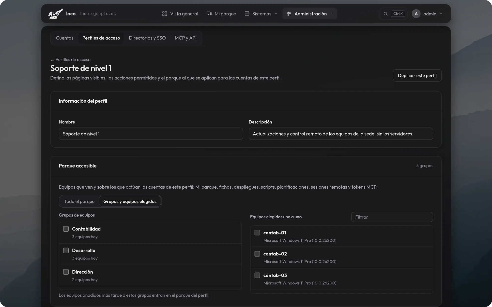
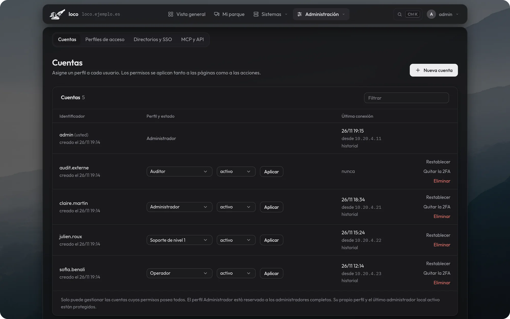

[English](../accounts.md) · [Français](../fr/accounts.md) · **Español**

# Cuentas, perfiles de acceso y SSO

Quién inicia sesión, con qué permisos, en qué parte del parque — y con qué apariencia.



## Usuarios y perfiles de acceso

Seis perfiles integrados (Administrador, Solo lectura, Operador, Gestor de repositorios, Auditor, Sin acceso)
y **más de 60 permisos** granulares; perfiles personalizables, **limitados a una parte del parque** si hace falta (grupos de
equipos y equipos elegidos), y delegación que respeta los permisos y el parque de cada uno.

<details>
<summary><b>Leer el detalle</b></summary>

En **Administración → Cuentas**, asigne un perfil a cada usuario. **Perfiles de acceso** permite consultar los permisos, duplicar un modelo y crear o modificar sus propios perfiles. Las cuentas existentes conservan su perfil y su contraseña al actualizar.

| Perfil integrado | Acceso por defecto |
|---|---|
| Sin acceso | Ningún permiso; perfil inicial de las cuentas de directorio pendientes. |
| Administrador | Todos los permisos actuales y futuros; perfil protegido. |
| Solo lectura | Vista general, dispositivos, cachés y catálogos locales. |
| Operador | Solo lectura, inventarios, actualizaciones individuales y despliegue de software. Los reinicios, las acciones sobre todo el parque, las retiradas de agentes y las consolas remotas requieren sus propios permisos. |
| Gestor de repositorios | Gestión de los paquetes e instaladores APT, RPM, Flatpak, Windows y del centro de software; ningún despliegue en los dispositivos. |
| Auditor | Consulta, sistema, cuentas, perfiles, diario y su exportación JSON; ninguna modificación. |

Los permisos distinguen la consulta y las acciones: creación, importación, copia y eliminación de paquetes; adición, edición y actualización del software; inventario, actualización, despliegue, reinicio y retirada de los dispositivos; acción sobre todo el parque; terminal y escritorio remoto; consulta, gestión y ejecución de los scripts; configuración, actualizaciones y reinicio del servidor; consulta, creación, modificación, restablecimiento y eliminación de las cuentas; gestión de los perfiles y de los directorios; lectura, exportación y duración de conservación del diario. Se aplican a las páginas, API y peticiones directas, así como a la navegación y a los botones visibles.

El editor organiza los permisos por ámbito con navegación directa, búsqueda, filtros «concedidos» y «sensibles», contadores y selección de los permisos visibles de una categoría. La barra de guardado sigue accesible al pie de la página. Marcar una acción selecciona sus requisitos previos; retirar un requisito previo retira las acciones que dependen de él, indicando los ajustes automáticos. Los permisos de consulta necesarios también se añaden automáticamente al guardar, del lado del servidor. Un perfil vacío deja al usuario acceder a **Mi cuenta** y cambiar su contraseña. Los perfiles integrados siguen protegidos; duplíquelos para adaptarlos. Un perfil personalizado no recibe ningún permiso nuevo automáticamente en las futuras versiones.

La delegación respeta los permisos de la persona que administra: solo puede asignar perfiles de los que posee todos los permisos, y solo gestionar cuentas dentro de ese límite. Solo un Administrador completo puede asignar el perfil Administrador o gestionar a otro administrador. Cambiar el propio perfil, desactivar o eliminar la propia cuenta y modificar el perfil que protege el propio acceso están bloqueados. Debe quedar al menos un administrador local activo, incluso ante modificaciones simultáneas.

Cambiar los permisos de un perfil cierra las sesiones de todos sus miembros y sus sesiones remotas. Cambiar el perfil de una cuenta, desactivarla o restablecer/cambiar su contraseña también revoca sus accesos. Sus comandos aún pendientes en el servidor se anulan antes de transmitirse a los agentes; las operaciones ya transmitidas pueden terminar. Las sesiones y los permisos se vuelven a comprobar en cada petición, y antes de enviar un comando a un agente. El diario conserva los cambios de cuentas, perfiles y permisos.

**Parque accesible.** Cada perfil personalizado cubre **todo el parque** (por defecto) o **grupos y equipos elegidos**: los equipos añadidos más tarde a un grupo elegido entran en él solos. Sus cuentas solo ven y apuntan a esos equipos, en todas partes — Mi parque, ficha, búsqueda, vista general, grupos (reducidos a sus equipos), despliegues, scripts y su historial, programaciones, sesiones remotas y claves MCP, cuyas herramientas siguen el parque de la cuenta que las creó. Un equipo fuera del parque responde «no encontrado»; un despliegue, una ejecución de script o una programación que apunte a uno permanece invisible. Una programación aplica en cada ocurrencia el parque de su autor, y un perfil limitado no puede apuntar a «Todo el parque». Gestionar los grupos de equipos y configurar el parque (clave de inscripción, direcciones, umbrales) está reservado a los perfiles que cubren todo el parque, ya que los grupos definen el parque de los demás. Un gestor limitado solo crea o asigna perfiles cuyos grupos y equipos están dentro de los suyos. Cambiar el parque de un perfil vuelve a conectar sus cuentas; una sesión remota cuyo equipo sale del parque se cierra. Los perfiles integrados cubren todo el parque; el diario sigue siendo global.

Estos permisos se refieren al portal. Los repositorios y cachés destinados a los equipos conservan su control de acceso por red.

Desde la consola de administración:

```bash
sudo loco-user roles                         # identificadores de los perfiles disponibles
sudo loco-user add alice viewer              # contraseña temporal
sudo loco-user set-role alice operator       # asignación o recuperación de un perfil
sudo loco-user passwd admin                  # recuperar el acceso a la cuenta admin
```

En Windows nativo, use `loco user …`; en la appliance Alpine, `loco-user …` como root.

</details>



## Directorios y SSO

En **Administración → Directorios y SSO**, añada un directorio **LDAP** (Active Directory, OpenLDAP, 389 DS, FreeIPA…) o un servidor **RADIUS** (NPS, FreeRADIUS…): los usuarios inician sesión con su identificador y su contraseña habituales, **desde el formulario de inicio de sesión de loco**; un identificador desconocido para loco se prueba en el orden de los directorios activos (botones **Subir**). Añada también un proveedor **OpenID Connect** (**Authentik**, Keycloak, Zitadel, Authelia, Microsoft Entra ID…): aparece un botón **Iniciar sesión con …** en la página de inicio de sesión.

- **LDAP**: dirección `ldaps://` (recomendada) o `ldap://` con **StartTLS** obligatorio, la contraseña nunca circula en claro; certificado comprobado con las autoridades del sistema o la autoridad PEM proporcionada. Con una **cuenta de servicio**, loco busca al usuario (base y filtro, modelos Active Directory y OpenLDAP) y luego comprueba su contraseña mediante un enlace; sin cuenta de servicio, se enlaza directamente con un modelo (`{username}@empresa.local` o `uid={username},ou=people,dc=ejemplo,dc=org`). El nombre visible y el correo se vuelven a leer en cada inicio de sesión. Los identificadores se escapan en el filtro (RFC 4515) y se rechaza una contraseña vacía.
- **RADIUS**: autenticación PAP (RFC 2865) con el secreto compartido; loco envía y **exige el atributo Message-Authenticator** en las respuestas (protección BlastRADIUS, RFC 3579). En NPS o FreeRADIUS, declare loco como cliente RADIUS y active este atributo en las respuestas.
- **Authentik / OpenID Connect**: en Authentik, cree una aplicación con un proveedor **OAuth2/OpenID** de tipo **Confidencial**, la URL de redirección que muestra loco (modo estricto) y el tipo de autorización **Authorization Code**; copie en loco el emisor (`https://authentik.ejemplo.es/application/o/<slug>/`), el identificador y el secreto del cliente. Flujo «code» con **PKCE** (S256), `state` y `nonce` ligados al navegador; token de identidad verificado (firma RSA, ECDSA o EdDSA con las claves publicadas, o HS256 con el secreto del cliente cuando el proveedor Authentik no tiene clave de firma; emisor, audiencia, caducidad). El certificado autofirmado de Authentik se pega tal cual (queda entonces **fijado**), como la autoridad de su red. No se conserva ningún token; contraseña, doble autenticación y reglas de acceso siguen gestionadas por el proveedor.
- **Configurar Authentik** crea o actualiza el proveedor y la aplicación, sin duplicados, con un token de API temporal que ni se guarda ni se registra, y luego registra el cliente. El certificado de Authentik se comprueba antes de enviar el token, y una autoridad recuperada debe confirmarse por su huella. Los cambios se muestran antes de aplicarse, y no se elimina ninguna URL de retorno sin confirmación. Sin token, loco prepara un blueprint que pegar.
- **Comprobar la configuración** (OpenID Connect) controla desde el servidor, sin iniciar sesión ni crear cuenta: resolución del nombre, conexión, certificado (intermedio o raíz que faltan), descubrimiento, claves, cliente y secreto, URL de retorno y flujo «code». Cada paso da su estado y su corrección. Este control también se lanza al guardar el proveedor.
- **Probar** comprueba la conexión con el directorio y una cuenta, sin crear ninguna solicitud; el resultado se registra sin la contraseña. Para OpenID Connect, es un verdadero inicio de sesión en el proveedor, que muestra la identidad recibida (identificador propuesto, nombre, correo, grupos); también funciona antes de la activación.

**Foto de perfil**: en cada inicio de sesión mediante un proveedor OpenID Connect, loco toma de él la foto de la cuenta (claim `picture`: avatar de Authentik, Gravatar…) como foto de perfil — vuelta a leer si cambia, como mucho una vez al día, y retirada si ya no da ninguna (avatar con iniciales). Una imagen elegida en *Mi cuenta › Apariencia* tiene prioridad; *Recuperar la foto de mi cuenta …* vuelve a la del proveedor. La imagen solo se pide al propio proveedor, con la misma confianza que para el inicio de sesión (autoridad o certificado fijado), o a una dirección pública (Gravatar): nunca a una dirección interna ni a través de una redirección. Solo se toman imágenes PNG, JPEG, GIF y WebP, de 2 MB como máximo; una foto inaccesible no retrasa ni impide el inicio de sesión.

Un administrador con cuenta local puede **vincular su cuenta** a su identidad en el proveedor, desde *Mi cuenta › Inicio de sesión SSO*: su contraseña, sus permisos y su doble autenticación siguen en su sitio. En las opciones de un proveedor OpenID Connect, unas líneas `grupo = perfil` **proponen** un perfil al aprobar una solicitud, sin conceder nada por sí solas.

El primer inicio de sesión de una identidad crea una cuenta **sin acceso**, al principio de **Cuentas**. Una persona con el permiso **Aprobar las cuentas de directorio** elige su perfil y luego la aprueba. Ninguna coincidencia de nombre o de correo fusiona una cuenta local con una identidad de directorio, y los grupos del directorio no asignan ningún permiso de loco. Una cuenta de directorio cambia su contraseña en el directorio. **Las cuentas locales siguen siempre disponibles** para administrar loco.

Los secretos (contraseña de la cuenta de servicio, secreto compartido, secreto del cliente) se cifran con una clave derivada de la clave de sesión del servidor, conservada en sus copias de seguridad, y nunca se vuelven a mostrar. Modificar o desactivar un directorio cierra las sesiones de sus cuentas; eliminarlo las desactiva. Los permisos **Gestionar los directorios** y **Aprobar las cuentas de directorio** son distintos y se asignan por defecto a los administradores.

Los inicios de sesión OpenID Connect anteriores a la 2.14 (retirados entonces, de vuelta en la 2.112 con esta forma) no se recuperan: sus cuentas siguen sin acceso. En **Cuentas**, **Contraseña local** les da una contraseña temporal; o elimínelas y deje que la persona vuelva a hacer una solicitud con el botón del proveedor.

## Mi cuenta y apariencia

**Mi cuenta** presenta el perfil, el tipo de cuenta y sus fechas, con cuatro pestañas: **Seguridad** (cambio de contraseña con sus reglas comprobadas en directo, **claves de acceso**, **doble autenticación** con aplicación TOTP y códigos de respaldo), **Apariencia**, **Mis permisos** (agrupados por ámbito) y **Actividad reciente** (las diez últimas acciones de la cuenta). La ventana **Apariencia** (menú de la cuenta) propone seis temas — **OLED**, **Oscuro suave**, **Medianoche**, **Claro**, **Sepia** y **Abeto** —, ocho **colores de acento**, la **transparencia** de los paneles, **fondos** (degradados, fotos, imagen propia) y ajustes predefinidos; la elección se guarda en la cuenta y la sigue de un navegador a otro.

**Claves de acceso (passkeys)**: una cuenta local puede iniciar sesión sin contraseña, con su teléfono, su ordenador o una llave de seguridad (WebAuthn/FIDO2). La clave se añade en *Mi cuenta › Seguridad › Claves de acceso* (se vuelve a pedir la contraseña actual, diez claves como máximo por cuenta), y luego la página de inicio de sesión propone **Iniciar sesión con una clave de acceso**. El dispositivo verifica a la persona (huella, rostro o código) en cada uso: la clave vale como contraseña y segundo factor, y loco solo guarda su parte pública. La contraseña sigue siendo utilizable. Dos condiciones, impuestas por los navegadores: loco debe abrirse por un **nombre** — el de *Sistema › Red › Dirección del portal*, nunca una dirección IP — y su **certificado** debe ser reconocido por el navegador (autoridad de loco instalada en el dispositivo, o certificado de su autoridad). En otros casos, la página lo explica y no propone el botón. Dispositivo perdido: la persona retira la clave en *Mi cuenta*, o un administrador lo hace desde *Cuentas* (*Retirar las claves de acceso*, o `loco-user passkeys-reset NOMBRE`); restablecer una contraseña también retira las claves de la cuenta. Las cuentas de directorio y SSO conservan las reglas de su proveedor.

**Apariencia de la instancia** (*Administración → Apariencia*, permiso *Configurar el servidor*): la identidad de la empresa y el marco de las elecciones de cada uno. Al instalar, todo se ofrece, como arriba, y la apariencia por defecto es el ajuste predefinido **Bruma** (tema *Oscuro suave*, sin color de acento).
- **Identidad**: **logotipo** (cabecera, pantalla de inicio de sesión, icono de la pestaña), **color de la empresa** (propuesto como color de acento; el texto sobre él pasa a negro o a blanco según su claridad) y **fondo de la empresa** (imagen propuesta entre los fondos, servida también en la pantalla de inicio de sesión).
- **Apariencia por defecto**: tema, color, fondo y opacidad de las nuevas cuentas y del botón *Restablecer*.
- **Pantalla de inicio de sesión**: sigue la apariencia por defecto o recibe la suya, incluido un tema no ofrecido a las cuentas. *Aplicar al inicio de sesión*, en la ventana **Apariencia**, le da la que usted está probando.
- **Elecciones dejadas a cada uno**: los **temas ofrecidos** (por ejemplo solo uno claro y uno oscuro), el color de acento y el fondo **a elegir o impuestos**. No se elimina nada: un tema desmarcado solo se oculta, y lo que ya no se ofrece se sustituye al mostrarse por la apariencia por defecto, sin tocar los ajustes guardados de las cuentas. *Ajustes de origen* restablece todas las elecciones.
- **Los administradores no están sujetos a este marco**: una cuenta con el perfil *Administrador* (sea cual sea su nombre) conserva todos los temas, ajustes predefinidos, colores y fondos en su ventana **Apariencia**, y puede elegir allí su **logotipo** — el de la empresa, el de loco, o una imagen propia (PNG, JPEG, GIF, WebP o SVG, 2 MB como máximo). Este logotipo solo se le muestra a ella: las demás cuentas y la pantalla de inicio de sesión conservan el de la instancia.

---

[← Volver a la presentación](../../README.es.md) · [Toda la documentación](README.md)
