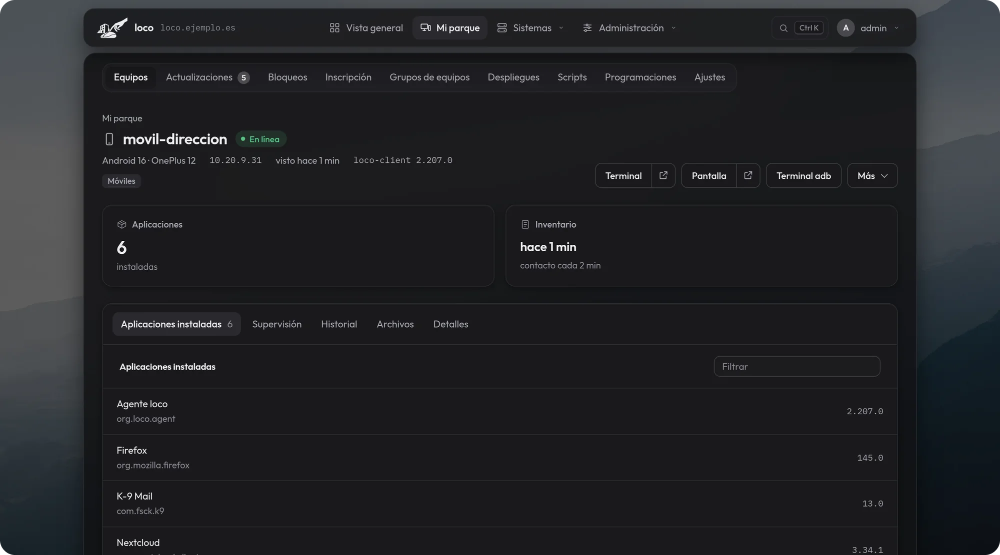

[English](../android.md) · [Français](../fr/android.md) · **Español**

# Dispositivos Android

Gestione sus propios dispositivos Android (teléfono, tableta) desde loco: ver y controlar la pantalla,
explorar los archivos, abrir un terminal, y dejar que un asistente de IA haga lo mismo a través del
MCP. La inscripción se hace **sin código QR**: se instala una aplicación, se introduce la dirección del servidor
y una clave. Es una función **experimental**, desactivada por defecto.

loco también instala aplicaciones en estos dispositivos: desde repositorios F-Droid verificados, o abriendo
su ficha de Google Play (vea [Aplicaciones](#aplicaciones)). Sin actualizaciones del sistema Android. No se
captura nada fuera de una sesión que usted abra desde el portal, y cada capacidad (pantalla, control,
archivos, instalaciones) se activa en el dispositivo, a mano.

## Activar la función

En **Administración › Funciones**, sección *Experimental*, active **Dispositivos Android**. Cualquier
cuenta con el perfil Administrador puede hacerlo. Mientras esté desactivada, la pestaña Android de
la inscripción y la descarga de la aplicación no existen.

## Instalar la aplicación

En **Mi parque › Inscripción**, pestaña **Android**: descargue el APK y ábralo en el dispositivo. Android
pide autorizar la instalación desde este origen; no hace falta ninguna cuenta de Google. También se puede
abrir directamente el enlace de descarga desde el navegador del dispositivo (se ofrece una dirección HTTP
para una primera conexión, antes de haber importado la autoridad de loco). La aplicación se instala
con el nombre **Agent loco** y requiere Android 8 (API 26) o posterior.

## Inscripción automática (APK listo para inscribirse)

El APK que ofrece la inscripción lleva, grabadas en su **bloque de firma**, la dirección del servidor, la clave
de inscripción y la huella de la autoridad de loco — exactamente como el MSI de Windows preconfigurado. Abierta
en el dispositivo, la aplicación **se inscribe sola**: obtiene la autoridad del servidor, comprueba que
su huella coincide con la grabada y luego se une a *Mi parque*, sin nada que introducir ni confirmar. Con un
grupo de equipos elegido en la inscripción, el dispositivo se une a él.

La configuración se coloca en el bloque de firma, que los esquemas de firma v2/v3 no cubren:
**la firma de la aplicación sigue siendo válida** (sin volver a firmar, sin clave de firma en el servidor)
y la aplicación se actualiza normalmente después. El APK contiene la clave de inscripción: compártalo solo
con las personas que instalan los dispositivos. Si la huella recibida no coincide con la grabada
(dirección equivocada, interceptación…), la inscripción automática se **rechaza** y la aplicación vuelve a la
introducción manual.

## Conectar el dispositivo a mano

Para el APK genérico, plegado bajo *APK genérico e introducción manual*, abra la aplicación e introduzca
**la dirección del servidor** y la **clave de inscripción** que muestra la página de inscripción. La aplicación
obtiene la autoridad (CA) del servidor y muestra su **huella SHA-256**: compárela con la de la página
de inscripción y confirme solo si coincide. Una vez confirmada, el dispositivo se une a *Mi parque* y
mantiene el contacto solo.

Si el certificado del servidor es de confianza pública, la aplicación se conecta sin huella que confirmar.

## Lo que puede hacer

Desde la ficha del dispositivo, como para un equipo:

- **Pantalla** — ver la pantalla en directo y controlarla (tocar, desplazar, teclado y ratón). Los botones
  *Atrás*, *Inicio*, *Aplicaciones recientes* y *Notificaciones* están en la barra de herramientas; un clic
  derecho hace *Atrás*, un clic central *Inicio*, la rueda desplaza.
  El dedo sigue al ratón en directo: mantenga pulsado el botón para una pulsación larga, arrastre para desplazar o
  mover, la pantalla se mueve durante el gesto. Lo que se mueve se transmite en JPEG, ligero, y luego la imagen vuelve a
  ser nítida en cuanto la pantalla se detiene. Para una imagen fluida, hace falta **compartir la pantalla** (vea más abajo): el
  control remoto solo queda limitado por Android a unas tres imágenes por segundo.
  **Dispositivo en reposo o bloqueado** (aplicación 2.160 o posterior): la pantalla se vuelve a encender al abrir la
  sesión, y de nuevo con el primer clic o la primera tecla si se ha vuelto a dormir mientras tanto. Llega a
  la pantalla de bloqueo: **Desbloquear**, en la barra de herramientas de la sesión, abre un panel donde trazar el
  **patrón** (o hacer clic en sus puntos en orden), o campos para el **PIN** y la **contraseña**;
  la aplicación loco hace aparecer la introducción del código (petición oficial a Android, si no un deslizamiento hacia arriba) y
  escribe allí el código. También puede **escribir el código en su teclado y luego Intro** — para un patrón, los números
  de sus puntos, contados como en el teclado de un teléfono (1 arriba a la izquierda, 9 abajo a la derecha). Android oculta
  la pantalla de introducción del código en la imagen transmitida: se muestra en negro, es normal, la introducción funciona
  igualmente. No se elude nada — hay que conocer el código, y los intentos fallidos cuentan como en el dispositivo.
  La aplicación nunca escribe el código dado por *Desbloquear* en otro lugar que la introducción del código: si el dispositivo
  ya está desbloqueado, se descarta (aplicación 2.198 o posterior; antes, el código se escribe como con el teclado).
  **Recordar este código** lo guarda para sus próximas sesiones en este dispositivo, **solo para usted**: *Desbloquear*
  ofrece entonces «Patrón recordado solo para usted» y desbloquea con un clic; *Olvidar* lo borra, *Introducir otro
  código* da otro. El código se sella en el servidor con su clave y queda vinculado a su cuenta y al dispositivo:
  ningún otro usuario, administrador incluido, puede usarlo, y nunca se muestra — solo se entrega
  a su sesión de pantalla, en el momento de desbloquear. El diario anota que se ha recordado, usado u
  olvidado un código, nunca el código en sí. Desaparece con su cuenta o con el dispositivo, y se vuelve a introducir tras una
  restauración en otro servidor (clave diferente).
  **Cerrar la sesión bloquea el teléfono o la tableta** (aplicación 2.199 o posterior, Android 9 o posterior):
  en cuanto termina la última sesión de pantalla — cerrada desde el portal, por el asistente de IA o por caducidad —,
  el dispositivo se bloquea como con el botón de encendido, para no quedarse abierto después de que se vaya la
  persona que lo controlaba (aplicación 2.201.1 o posterior; antes, esperaba cinco segundos y una sesión reabierta
  mientras tanto lo impedía). Una sesión abierta después lo encuentra bloqueado: *Desbloquear*. No ocurre nada mientras
  loco siga controlando la pantalla por adb; un televisor no está afectado. El resultado queda anotado en el registro
  de Android (etiqueta `loco`). La cuadrícula del patrón se encuentra en Android de serie y en OxygenOS / ColorOS
  (OnePlus, Oppo, Realme), así como en las capas que la nombran de forma parecida.
- **Terminal** — un shell con los permisos de la aplicación (sin root). `cd` se conserva de un comando a
  otro; las variables de entorno, no.
- **Archivos** — explorar, subir, descargar, renombrar y eliminar en el almacenamiento del dispositivo.
- **Terminal adb** — un verdadero terminal `adb shell`, con los permisos del usuario «shell» de Android
  (vea [Terminal adb](#terminal-adb)).
- **Asistentes de IA (MCP)** — las mismas acciones (terminal, archivos, pantalla) se ofrecen a los asistentes, dentro
  del límite de los permisos de la clave y del perfil, así como la herramienta `adb_shell` para el shell adb y `push_file` /
  `pull_file` para enviar o recuperar un archivo por adb (como `adb push` / `adb pull`, contenido comprobado), incluso
  directamente desde o hacia otro equipo del parque.

## Siempre accesible

La aplicación mantiene el contacto con la pantalla apagada y el dispositivo bloqueado (aplicación 2.200 o posterior):

- **enchufada**, mantiene el procesador despierto — la pantalla sigue apagada — y el Wi-Fi fuera de su ahorro
  de energía: contactos, canal persistente y depuración inalámbrica continúan como con la pantalla encendida, y una sesión se abre
  de inmediato;
- **con batería**, Android la despierta cada cinco minutos, incluso en reposo profundo, para un contacto y para
  reabrir el canal: una sesión puede esperar a ese despertar;
- **Siempre accesible** (pantalla de la aplicación) la mantiene despierta también con batería, a costa de un consumo
  mayor.

Hace falta que la **optimización de la batería** esté desactivada para loco; si no, Android corta también su red en reposo:
la aplicación la pide por sí misma (una vez por versión) y mantiene la línea *Funcionamiento en segundo plano* mientras
no lo esté. En un dispositivo emparejado por adb, loco la desactiva él mismo en cuanto vuelve (ajuste restablecido,
capa del fabricante). La ficha del dispositivo muestra *Reposo no desactivado* mientras no lo esté.

## Conceder los accesos, en el dispositivo

Cada capacidad se activa desde la aplicación, en el dispositivo, y se ve:

- **Control**: *Abrir los ajustes de accesibilidad* para autorizar a loco a tocar, desplazar, volver
  y escribir. **Una vez activado este servicio, no hay nada más que hacer en el dispositivo**: loco también muestra
  la pantalla a través de él en cada sesión (Android 11 y posterior), incluso tras un reinicio, sin volver a abrir la aplicación.
  Android limita esta lectura a unas tres imágenes por segundo. Si Android responde «acceso denegado» (Android 13
  y posterior, aplicación instalada desde un archivo): *Ajustes › Aplicaciones › Agent loco*, menú ⋮,
  *Permitir ajustes restringidos*, y vuelva a empezar.
- **Pantalla remota**: *Activar la pantalla remota* lanza la función de compartir pantalla de Android, más fluida (Android muestra
  su indicador de compartición mientras está activa). Android la vuelve a pedir tras cada reinicio de
  la aplicación; este botón es por tanto opcional en cuanto el control está activado.
- **Autorizarlo todo una sola vez, por adb**: empareje el dispositivo con loco (vea *Terminal adb* más abajo). loco
  autoriza entonces él mismo la compartición de pantalla sin ventana de consentimiento, activa el control, levanta el bloqueo de los
  ajustes restringidos, y la aplicación vuelve a encender sola la depuración inalámbrica cuando Android la apaga.

Durante toda sesión de pantalla, el dispositivo muestra la notificación **«Control remoto en curso»**: no
se muestra nada fuera de una sesión abierta desde el portal.

- **Archivos**: *Permitir el acceso a los archivos* (acceso a todos los archivos).
- **Instalaciones**: *Permitir las instalaciones*, para que loco instale las aplicaciones que usted
  despliega. Android pide aun así su confirmación para cada aplicación nueva.
- **Segundo plano**: *Permitir segundo plano* para que el dispositivo no ponga a loco en reposo ni corte
  el contacto cuando la pantalla está apagada.

La aplicación sigue visible (notificación permanente) y no se lee ni se envía nada fuera de una sesión
abierta desde el portal.

## Redes de confianza

En la aplicación, el panel **Redes de confianza** ajusta dónde el dispositivo permanece en contacto con loco. En otros lugares
el agente está **en pausa**: ningún contacto con el servidor, las sesiones abiertas se cierran, la depuración inalámbrica no se
vuelve a encender; la notificación de la aplicación explica por qué («En pausa · datos móviles»…), y se reanuda sola en cuanto
el dispositivo vuelve a una red aprobada.

| Modo | El agente está activo… |
|---|---|
| **En todas partes** (por defecto) | en cualquier red, datos móviles incluidos |
| **Sin datos móviles** | en cualquier Wi-Fi o red cableada, nunca en la red móvil |
| **Solo Wi-Fi elegidas** | únicamente en las Wi-Fi aprobadas por su nombre |

El modo **Wi-Fi elegidas** requiere el permiso de **ubicación**, ajustado en «Permitir todo el tiempo», y la
ubicación del dispositivo activada: Android solo da el nombre de una Wi-Fi con esa condición («todo el tiempo» porque
el agente funciona en segundo plano). loco **nunca lee la posición**; el permiso solo se pide si usted
elige este modo, y la aplicación le guía paso a paso. Sin él, el nombre de la Wi-Fi no se puede leer y el agente sigue
en pausa: nunca está activo por defecto en una red que no sabe nombrar. Una Wi-Fi se aprueba con un botón
cuando el dispositivo está conectado a ella, o por su nombre; la lista se queda en el dispositivo.

En el portal, la ficha del dispositivo solo indica el ajuste («activo solo sin datos móviles»,
«activo solo en 2 Wi-Fi aprobadas»): eso explica que aparezca desconectado a ratos. El
ajuste pertenece a la persona que tiene el dispositivo; no se cambia desde el portal.

## Terminal adb

El terminal de la aplicación tiene los permisos de la aplicación loco. El **terminal adb** es el de un
ordenador de desarrollo: `adb shell`, con los permisos del usuario «shell» de Android. Se puede
listar, instalar y desinstalar aplicaciones (`pm`), lanzar una actividad (`am`), cambiar un ajuste
(`settings`), simular un toque o una entrada (`input`), leer los registros (`logcat`) o el estado del sistema
(`dumpsys`). Es un verdadero pseudoterminal: `top` o un editor funcionan.

El servidor loco se conecta a él por sí mismo, en la red local: el dispositivo debe estar en la misma red que loco.
La aplicación loco solo indica a loco el estado de la depuración y el puerto que usar.

### Requisitos en el servidor

loco usa la herramienta `adb` del servidor:
- **Appliance:** incluida a partir de la 2.139.0.
- **Debian, Ubuntu y Docker:** paquete `adb`, instalado por loco si está disponible. Con Debian 12 y
  Ubuntu 22.04, es demasiado antiguo para el emparejamiento inalámbrico: solo se puede usar el puerto adb clásico.
- **Rocky Linux:** paquete `android-tools` de EPEL.
- **Servidor loco Windows:** sin terminal adb.

loco lanza su propio servidor adb. Su clave se queda en la carpeta de estado de loco, legible solo por él, y no
escucha en ningún puerto de red.

### Emparejar el dispositivo (depuración inalámbrica, Android 11 y posterior)

En la ficha del dispositivo, **Terminal adb** (o *Más › Depuración adb…*) abre la configuración:

1. **Opciones para desarrolladores**: en *Ajustes › Información del teléfono*, toque siete veces *Número de compilación*.
2. *Opciones para desarrolladores › Depuración inalámbrica*: actívela, en la misma red Wi-Fi que loco.
3. *Vincular dispositivo con código de sincronización*: introduzca en loco el puerto y el código de seis cifras
   que muestra el dispositivo, y luego **Emparejar**.

**Desde el propio dispositivo** (aplicación 2.154.0 y posterior): en la aplicación loco, el panel *Imagen fluida en
cada sesión* hace lo mismo sin pasar por el portal. **Configurar** abre *Depuración inalámbrica*; actívela,
toque *Vincular dispositivo con código de sincronización* y, sin cerrar esa ventana, baje el panel de
notificaciones y escriba el código en la notificación de loco. La aplicación encuentra sola el puerto de vinculación y
transmite puerto y código a loco, que empareja con la dirección del dispositivo — la de donde viene la petición, nunca
otra. El dispositivo debe estar por tanto en la misma red que loco (no detrás de un router). El emparejamiento queda inscrito en el
diario como hecho «desde el dispositivo».

Sin emparejamiento, Android limita la pantalla remota leída por el control remoto a unas tres imágenes por segundo;
una vez emparejado el dispositivo, loco autoriza la compartición de pantalla de la aplicación de una vez por todas, y cada
sesión se abre con una imagen fluida (unas treinta imágenes por segundo medidas en un OnePlus 12).

El emparejamiento se hace una sola vez. El puerto de conexión cambia cada vez que se activa la depuración inalámbrica:
la aplicación loco lo descubre en el dispositivo y se lo indica a loco. Android apaga la depuración inalámbrica al
reiniciar o cuando el dispositivo cambia de red: la aplicación loco (2.145.0 y posterior) la vuelve a encender sola, con
el permiso que loco le da por adb en el emparejamiento. En una red Wi-Fi nueva, Android todavía pide
confirmar en el dispositivo.

En el primer contacto tras el emparejamiento, loco deja configurado de una vez por todas, por adb, lo que evita cualquier gesto
después: compartición de pantalla sin ventana de consentimiento, control (accesibilidad) activado, ajustes restringidos levantados,
aplicación exenta del reposo. El *Diario* lo anota («parc.adb.autorisations»), y *Olvidar* en la
depuración adb deja de mantener encendida la depuración inalámbrica.

### Puerto adb clásico

Para un dispositivo cuyo adb ya escucha en la red (`adb tcpip 5555` lanzado desde un ordenador, Android TV,
máquina virtual), *Puerto adb clásico* se conecta a él directamente. La primera vez, el dispositivo pide
autorizar la depuración desde loco.

### Permisos y rastros

La apertura de un terminal adb, el emparejamiento y los comandos de los asistentes están reservados al permiso **Abrir un
terminal adb**, e inscritos en el diario. El código de emparejamiento nunca se escribe en un comando ni en el
diario. **Olvidar** retira el dispositivo de los dispositivos adb de loco; retire también loco de la lista de dispositivos
vinculados, en el dispositivo.

## Desbloquear la pantalla a distancia

Lo más sencillo: **Desbloquear** en la sesión **Pantalla** (vea [más arriba](#lo-que-puede-hacer)), a través de
la aplicación loco, sin adb. Una vez emparejado el dispositivo por adb, **Desbloquear** existe también en la barra de
**Controlar la pantalla**: loco despierta la pantalla y reproduce el **patrón**, el **PIN** o la **contraseña** que usted
introduce, por adb — sin pasar por la aplicación. El asistente de IA dispone de la herramienta `adb_unlock`.

La pantalla de bloqueo de Android es una **superficie segura**: ni `screencap` ni scrcpy pueden
mostrarla (imagen negra o vacía). El desbloqueo se hace por tanto **a ciegas**: usted conoce su
secreto, lo introduce en loco, y loco lo inyecta.

- **Patrón** — lo traza en un panel de 3×3 en el portal. Una vez abierta la introducción del código, loco busca
  la cuadrícula en la descripción de la pantalla que da Android (`uiautomator`): en la mayoría de los dispositivos, incluido
  OxygenOS, la encuentra y traza el patrón exactamente sobre ella, sea cual sea la orientación. Si no, los 9 puntos
  se **calculan** a partir de la resolución de la pantalla; un **perfil por fabricante** (Pixel/AOSP, Samsung, Xiaomi,
  OnePlus, Vivo, Motorola…) sirve de punto de partida. Si el patrón no pasa, abra **Calibración de la cuadrícula**: elija
  la marca, o ajuste el centro y la separación (en fracciones de la pantalla), y luego pruebe — el ajuste se memoriza
  para este dispositivo. La inyección se repite hasta tres veces (un gesto táctil no siempre se capta a la
  primera), muy por debajo del umbral de bloqueo de Android.
- **PIN** y **contraseña** — introducidos y validados con las teclas, **sin ninguna calibración** (ninguna coordenada).

El secreto introducido (patrón, código, contraseña) **nunca** se escribe en el diario. El desbloqueo a distancia
depende del mismo permiso **Abrir un terminal adb**: el acceso adb ya permite inyectar esos gestos.

**«el dispositivo ya no reconoce a loco»**: el puerto adb del dispositivo responde, pero rechaza la clave de loco
(emparejamiento olvidado en el dispositivo, autorizaciones de depuración revocadas). Vuelva a emparejarlo. Antes de decirlo,
loco comprueba que su propio servidor adb funciona con su clave: otro programa de la cuenta loco que
lo tome prestado y lo arranque primero (al arrancar el servidor, por ejemplo) lo lanzaría con otra clave; loco
lo detiene entonces y relanza el suyo. Un programa así debe definir `HOME` en la carpeta de la clave de loco
(`/var/lib/loco/adb` en la appliance).

## Controlar la pantalla a distancia

Una vez **desbloqueado** el dispositivo, **Controlar la pantalla** (en su ficha) difunde su pantalla en el navegador y
la controla, por adb — **sin diálogo de MediaProjection**.

El flujo es **de baja latencia**: loco lanza *scrcpy-server* (solo vídeo, incluido en loco, licencia Apache 2.0) en
el dispositivo y retransmite el **H.264 en bruto**; el navegador lo decodifica con **WebCodecs** (decodificación por hardware, nada que
transcodificar en el servidor). Si el navegador no tiene WebCodecs, o si scrcpy falla, loco **cambia automáticamente**
a un flujo **MJPEG** (`adb screenrecord` convertido por **ffmpeg**, necesario en el servidor para este respaldo).

- **Hacer clic** en la pantalla = tocar; **arrastrar** = deslizar. Las coordenadas son fracciones de la pantalla: funciona
  sea cual sea la resolución.
- Barra de herramientas: **Atrás**, **Inicio**, **Aplicaciones recientes**, **Encendido/reposo**, y un campo para **escribir
  texto**.
- La pantalla de **bloqueo** no se muestra (superficie segura): desbloquee primero (arriba).

**Salvaguarda visible**: mientras loco controla la pantalla, el dispositivo muestra una notificación **«Control remoto en
curso»** y contacta con loco más a menudo, para que el indicador aparezca y desaparezca rápido. El agente sigue
visible y el acceso se apoya en la depuración inalámbrica que usted ha autorizado.

## Aplicaciones

El menú **Android** del portal reúne tres páginas: *Catálogo*, *Repositorios F-Droid* y *Fuentes*.

### Fuentes: los repositorios F-Droid

loco lee cada día el índice de los repositorios F-Droid activados. **F-Droid** (miles de aplicaciones libres,
compiladas por F-Droid a partir de su código fuente) e **IzzyOnDroid** (aplicaciones libres publicadas por sus
desarrolladores) se ofrecen de entrada. Nueve repositorios de editores se añaden con un clic desde *Fuentes verificadas
por loco*: Guardian Project (Orbot), Bitwarden, Brave, Molly, Session, Threema Libre, KDE, NewPipe y microG.
Su clave se ha comprobado: la que firma el índice es idéntica a la que publica el editor.

Cada índice está firmado. loco comprueba la firma con la clave de la fuente, cuya huella se registra
al añadirla, y luego la huella SHA-256 del índice completo. También rechaza un índice más antiguo que el último
verificado, para que un repositorio comprometido o un intermediario no pueda volver a servir versiones antiguas.

**Otro repositorio F-Droid** se añade por su dirección (`https://…/fdroid/repo`): loco lee la clave que firma su
índice y muestra su huella. Compárela con la que publica el editor, en su sitio web, antes de confirmar.
Una fuente es una clave de confianza: añada solo repositorios cuyo editor conozca.

Una fuente con aplicaciones en el catálogo no se puede retirar; se puede desactivar.

### Catálogo

En *Repositorios F-Droid*, busque una aplicación por su nombre, o recorra la selección *Por descubrir* y las
categorías, y luego **Añadir**. Una aplicación presente en varias fuentes se ofrece desde la
primera, en el orden de la página *Fuentes*. Su ficha da la versión, el Android mínimo, los procesadores,
el tamaño, la licencia, la clave de firma, y las advertencias de F-Droid (publicidad, rastreo, servicio en
línea no libre…).

Elija **una sola fuente por aplicación**: cada repositorio firma sus APK con su propia clave, y Android
se niega a actualizar una aplicación con un APK firmado por otra clave.

### Google Play

Google no permite a ninguna herramienta de terceros instalar una aplicación de Play Store, y loco no descarga nada
de Google Play. En *Catálogo*, **Añadir desde Google Play** toma el enlace de la página de
la aplicación (`https://play.google.com/store/apps/details?id=…`) o su nombre de paquete. En el despliegue,
el dispositivo abre la ficha en Play Store y usted toca **Instalar**. Google Play se encarga después de las
actualizaciones. En un dispositivo sin Play Store, la ficha se abre en la tienda instalada o, en su defecto,
en el navegador.

### Desplegar

Desde el catálogo (**Desplegar**), la ficha de un dispositivo (*Más › Instalar aplicaciones…*) o
*Mi parque › Despliegues* (*Nuevo despliegue › Aplicaciones Android*). Como para los demás
despliegues, se eligen dispositivos o grupos de equipos, se comprueba la preparación y luego se
confirma. Las oleadas están disponibles.

Cada dispositivo recibe la versión compatible con su Android y su procesador. Una aplicación ya actualizada
se omite, salvo con *Reinstalar aunque la versión ya esté presente*. El dispositivo debe tener
la aplicación loco **2.139.0 o posterior**.

### En el dispositivo

1. loco descarga el APK desde la fuente y comprueba su huella SHA-256, inscrita en el índice firmado.
2. La aplicación loco lo obtiene de loco, comprueba a su vez la huella, el nombre de la aplicación y
   su clave de firma, y luego se lo confía a Android.
3. **Una primera instalación se confirma en el dispositivo**: Android muestra su ventana *Instalar*. Se
   abre directamente si la aplicación loco está en primer plano o si el control (accesibilidad) está activo;
   si no, una notificación *¿Instalar …?* la abre. También puede tocarla desde la pantalla remota.
4. **Las actualizaciones se hacen sin pedir nada** en Android 12 o posterior, para las aplicaciones que
   loco ha instalado él mismo. Una aplicación instalada por Google Play u otra tienda sigue actualizándose
   a través de esta, y loco no propone actualizarla.

Una instalación no confirmada en seis horas se anota como fallida. El despliegue muestra el informe
del dispositivo (instalada, rechazada, incompatible…), y la ficha del dispositivo la versión instalada de cada
aplicación del catálogo, la tienda que la instaló y la versión disponible.

### La propia aplicación loco

A partir de la 2.139.0, la aplicación loco **se actualiza sola** desde loco cuando el servidor pasa a una
versión más reciente, fuera de una sesión remota en curso. Tras una actualización, hay que volver a activar
la pantalla remota: Android no conserva el permiso de captura. **Vuelve a arrancar sola** tras un reinicio
del dispositivo o una actualización. La 2.138.0 no sabía actualizarse: instale la 2.139.0 una vez a
mano, desde la inscripción, encima de la anterior.

**En un dispositivo emparejado por adb** (loco 2.155.0 y posterior), loco instala él mismo la actualización por adb, como
desde un ordenador: ni ventana de confirmación, ni análisis propuesto por Play Protect en el dispositivo.
La aplicación no lo intenta ella misma mientras tanto. Si la instalación por adb falla (dispositivo fuera de la
red, depuración inalámbrica apagada), la aplicación retoma el control en el contacto siguiente y se actualiza sola, como
en un dispositivo no emparejado. Nunca durante una sesión remota abierta; cada instalación queda inscrita en el
diario («Actualización de la aplicación por adb»).

### Registrar la aplicación ante Google

Android exige poco a poco que una aplicación instalada fuera de Play Store venga de un desarrollador registrado
ante Google (verificación de desarrolladores de Android: algunos países desde septiembre de 2026, el mundo entero en
2027). La aplicación loco está firmada por la clave del proyecto: el registro se hace **una sola vez, por el
titular de esa clave**, y vale para todas las instancias de loco — ninguna tiene una cuenta de Google que vincular.

1. En la [Android Developer Console](https://developer.android.com/developer-verification/guides/android-developer-console),
   cree la cuenta (distribución limitada o completa) y hágala verificar.
2. En *Packages*, registre el nombre de paquete `org.loco.agent` y la huella SHA-256 del certificado de
   firma: `95:68:93:B5:58:F2:E1:69:D7:27:88:C8:96:50:39:57:E4:03:80:2C:5C:56:4C:B1:A7:C0:E3:FF:0F:99:44:4B`.
3. La consola da un token de prueba: guárdelo en `adi-registration.properties`, **junto a la clave de
   firma** (carpeta `LOCO_KEYSTORE_DIR`, por defecto `~/android-keystore`). `android/client/build.sh` lo incorpora
   entonces en el APK de release (`assets/adi-registration.properties`); envíe ese APK a la consola para demostrar
   que posee la clave.

La actualización también puede **instalarse desde la aplicación**, sin esperar: en cuanto loco propone una,
la pantalla de la aplicación muestra *Actualización de la aplicación* con la versión disponible y el botón
**Instalar la actualización**. Abrir la aplicación consulta a loco de inmediato. Si falta el permiso para instalar
aplicaciones, el botón lleva primero allí. Android cierra la aplicación para sustituirla; vuelve a
arrancar sola, una notificación *Aplicación actualizada* lo confirma, y la pantalla se vuelve a abrir cuando Android lo
permite. Lo que impidió la instalación (loco inaccesible, rechazo en el dispositivo…) se escribe bajo el botón.
Abajo de la pantalla, la línea de versión indica *actualizada* o la versión disponible. Fuera de sus redes de
confianza, el dispositivo no contacta con loco y el botón no se ofrece.

## Retirar un dispositivo

En la aplicación, *Salir de loco*: el dispositivo se retira del servidor y el agente se detiene. Se puede
volver a inscribir más tarde. Desinstalar la aplicación tiene el mismo efecto en el dispositivo. Desde el portal,
*Retirar el agente* (ficha del dispositivo) hace lo mismo en el próximo contacto; la aplicación sigue instalada.

## Límites

- Sin actualizaciones del sistema Android. Sin instalación desde Google Play por loco: solo la ficha
  abierta en el dispositivo.
- El terminal adb exige que el dispositivo esté en la red local de loco, y la depuración inalámbrica activada (Android
  la apaga en cada reinicio).
- Una primera instalación siempre pide una confirmación en el dispositivo: sin gestión empresarial de
  Android (Device Owner), Android no permite instalar sin ella.
- **Verificación de desarrolladores de Google**: desde el 30 de septiembre de 2026 en Brasil, Indonesia,
  Singapur y Tailandia, y en todas partes en 2027, un dispositivo certificado ya no instala una aplicación cuyo
  desarrollador no esté registrado ante Google. La aplicación loco, firmada por su clave, y las
  aplicaciones firmadas por F-Droid están afectadas. Habrá que activar una vez, en cada dispositivo, el
  «flujo avanzado» de Google (modo desarrollador, reinicio y luego un día de espera), o registrar
  la aplicación loco ante Google (cuenta gratuita con distribución limitada).
- El control de la pantalla pasa por un servicio de accesibilidad; algunas aplicaciones sensibles (banca…)
  ocultan su contenido durante la captura.
- **OxygenOS / ColorOS** (OnePlus, Oppo, Realme) protegen la compartición de pantalla concedida de una vez por todas por
  el emparejamiento adb: las aplicaciones se quedan en negro, solo se muestran las barras del sistema. La aplicación
  loco (2.198 o posterior) lo detecta, detiene esa compartición y muestra la pantalla por accesibilidad, unas tres imágenes por
  segundo. Para una imagen fluida en estos dispositivos: **Controlar la pantalla**, por adb.
- La aplicación está firmada con la clave de release de loco; actualizar el APK desde el mismo origen
  conserva la instalación (una firma diferente obligaría a desinstalar primero).

---

[← Volver a la presentación](../../README.es.md) · [Toda la documentación](README.md)
