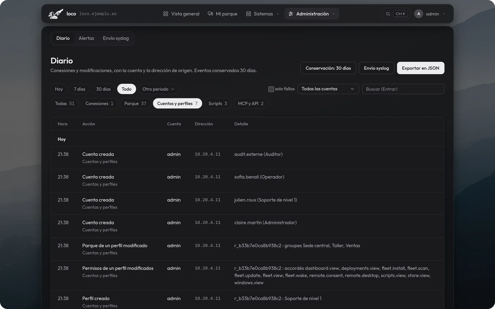

[English](../audit-log.md) · [Français](../fr/audit-log.md) · **Español**

# Diario

La página *Administración › Diario* registra los inicios de sesión y las acciones, con la cuenta y la dirección de origen.

- **Lectura**: eventos agrupados por día, acciones en claro («Dirección del servidor anunciada a los agentes») y
  categoría; filtros por período (hoy, 7 días, 30 días, fechas a elegir), categoría (inicios de sesión, parque,
  acceso remoto, software, repositorios Linux, Windows Update, scripts, cuentas y directorios, servidor), cuenta, solo fallos y búsqueda
  en los detalles; páginas de 100 eventos. Los fallos de inicio de sesión de las últimas 24 horas se señalan arriba.
- **Exportación JSON** de la vista filtrada, de un período (fechas incluidas) o del diario completo: servidor, período, filtros,
  autor de la exportación y eventos (fecha, cuenta, dirección, acción y su etiqueta, detalle). Cada exportación
  queda a su vez registrada.
- **Conservación** ajustable (de 7 días a 2 años, o sin límite), **30 días por defecto**: los eventos más antiguos
  se eliminan al arrancar el portal y luego como mucho una vez por hora. Expórtelos antes de reducir la duración.
- Permisos distintos: *Consultar el diario*, *Exportar el diario* (incluido en el perfil Auditor) y *Configurar la
  conservación del diario*.

## Envío a un servidor syslog

*Administración › Envío syslog* envía a su servidor syslog o a su SIEM, a elegir, el **diario de loco**, los **registros
de los equipos**, o ambos. Formato RFC 5424, en TLS (recomendado), TCP o UDP, con un botón para enviar un mensaje de prueba.

- **Diario de loco**: todo lo que aparece en la página Diario, a partir de la activación (no el historial). Cada evento
  lleva la cuenta, la dirección, la acción y su categoría; un fallo sale como advertencia, el resto como información.
- **Registros de los equipos**: journald en Linux, registros de eventos System y Application en Windows, al nivel mínimo elegido
  (errores, advertencias, avisos o información). *Incluir siempre la seguridad* añade, en Linux, los mensajes
  de autenticación y, en Windows, los fallos de auditoría del registro Seguridad (también los aciertos a partir del nivel
  Información). El envío puede limitarse a grupos de equipos. Agentes 2.124.0 y posteriores (se actualizan solos).
- **Los equipos pasan por loco**: no necesitan alcanzar el servidor syslog, solo loco como de costumbre. El host
  del mensaje es el nombre que loco conoce del equipo. Los registros suben en cada contacto del agente, cada 2 a 3 minutos.
- **Si el servidor syslog no está**, el envío se reanuda donde se había detenido: no se guarda nada en el servidor loco, el
  retraso se recupera mientras el registro de origen conserve las líneas. Syslog no tiene acuse de recibo: un evento
  puede llegar por duplicado tras una avería, un corte brusco puede perder algunos, y UDP nunca garantiza la llegada.
- La página muestra el último envío, el último fallo y el estado de cada equipo; la regla de alerta *Envío syslog fallido*
  avisa al cabo de 5 minutos. Permiso *Enviar los registros a un servidor syslog*, reservado a los perfiles que cubren todo el parque.
  En alta disponibilidad, solo envía el principal y el ajuste sigue la replicación.

---

[← Volver a la presentación](../../README.es.md) · [Toda la documentación](README.md)
