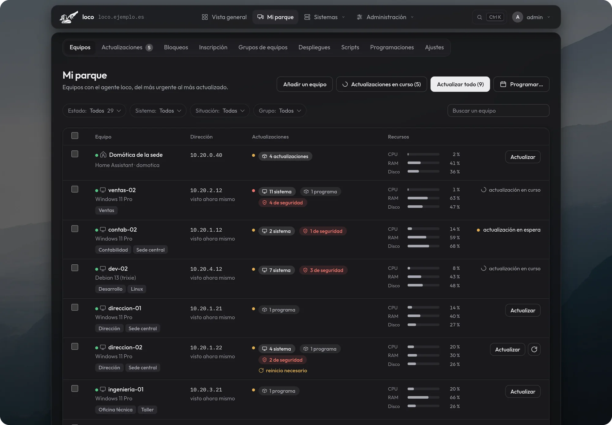
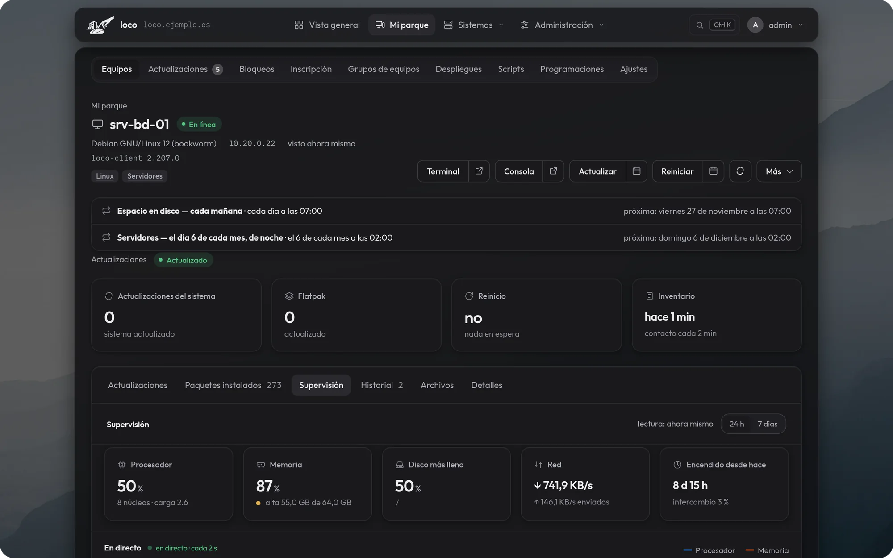
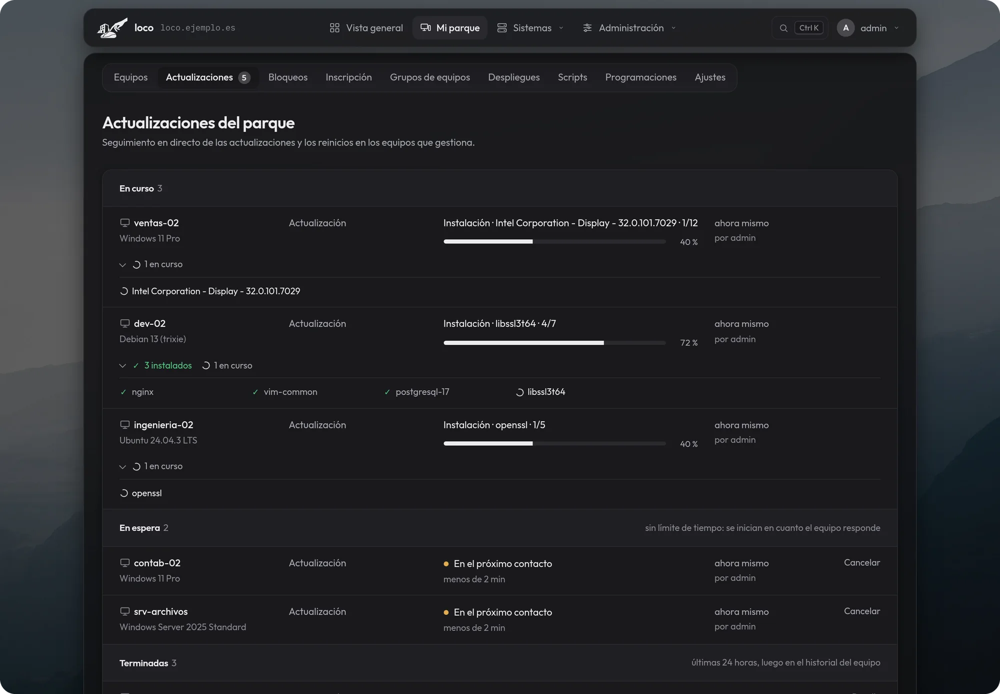
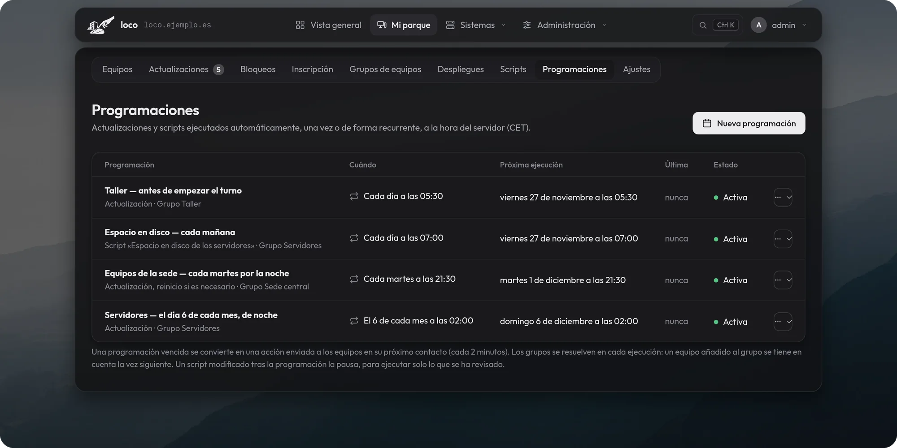
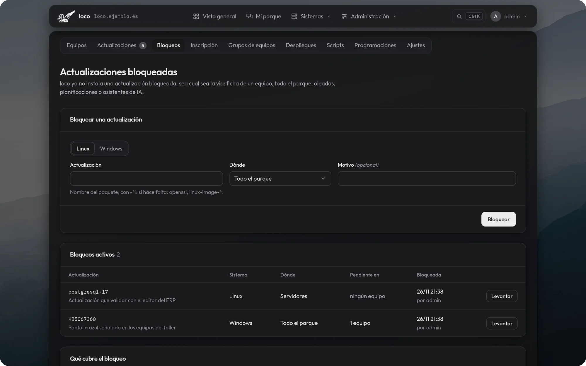
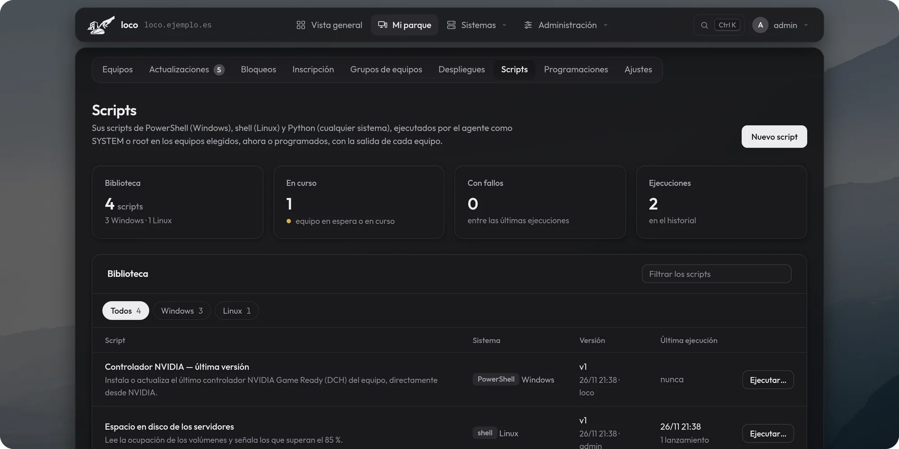

[English](../fleet.md) · [Français](../fr/fleet.md) · **Español**

# Mi parque: el agente de los equipos



El agente `loco-client` (Windows y Linux) envía el inventario de los equipos y ejecuta las acciones recibidas de loco —
actualizaciones, programas, scripts, reinicio. Un equipo sigue vinculado aunque cambie su dirección IP.

La página **Mi parque** lista los equipos que tienen el agente `loco-client`. Para añadir uno, abra **Inscripción**
(barra de navegación, o *Añadir un equipo* en Mi parque): una pestaña por sistema (Windows; Debian, Ubuntu;
Rocky, AlmaLinux, RHEL) con el instalador del agente que descargar — **MSI**, paquete **.deb** o **.rpm** — y su
comando de instalación, y luego la configuración de los repositorios y cachés (APT, DNF, Flatpak) y, en Windows, los
programas del catálogo. Los archivos y comandos del agente contienen la clave de inscripción del servidor. Sin
paquete, el comando sigue disponible:

```powershell
# Windows 10/11, Windows Server 2016+ (PowerShell de administrador): instala el MSI, servicio «loco-client»
irm 'https://<ip>:8443/agent/windows.ps1?key=<clave>' | iex
```

En un equipo que todavía no tiene la autoridad de loco, este comando falla («No se puede establecer una relación de
confianza para el canal seguro SSL/TLS»). El de la página *Inscripción* va por tanto precedido de una comprobación que reconoce
el certificado de loco por su huella SHA-256: funciona sin importar nada antes, y rechaza cualquier otro
certificado (interceptación). Ejecútelo en **Windows PowerShell** (no PowerShell 7).

```bash
# Debian, Ubuntu, Rocky Linux, AlmaLinux, RHEL (systemd): agente Python y temporizador systemd
curl -fsSL 'https://<ip>:8443/agent/linux.sh?key=<clave>' | sudo sh
```

**Nombre DNS, luego IP.** Cuando loco tiene un nombre DNS — la dirección del portal o, en su defecto, el nombre de su certificado
de empresa —, los comandos, el script de Linux, los paquetes, el MSI y el APK preconfigurados prueban primero ese nombre,
y luego la IP del servidor. Un nombre DNS suele presentar el certificado de una autoridad de empresa, que no todos los equipos
reconocen (equipo nuevo o fuera del dominio, conjunto de autoridades de los agentes sin ella); la IP presenta el certificado
de loco, reconocido por la huella de su autoridad. El equipo se inscribe por la primera dirección que responde, y el agente
guarda la otra como respaldo. La página *Inscripción* indica las direcciones y su orden. Para un MSI desplegado a mano o
por GPO, `SERVER` (o el valor `Server` del registro) acepta igualmente varias direcciones separadas por comas:
`SERVER=https://loco.empresa.lan:8443,https://192.168.1.10:8443`.

**Inscribir directamente en un grupo**: arriba de la página Inscripción, *Inscribir los equipos en el grupo* cambia
el MSI, los paquetes .deb/.rpm, los comandos y el comando de despliegue masivo (GPO, Intune) a la **clave del
grupo** (`g<id>-…`): un equipo inscrito con ellos se une a ese grupo (un equipo ya inscrito también se une, sin
dejar los suyos). Ningún agente que actualizar: la clave de grupo ocupa el lugar de la clave del servidor. Por defecto,
ningún grupo; *Inscribir equipos en este grupo* (menú ⋯ de un grupo) abre la página en él. Una cuenta limitada a
una parte del parque solo inscribe en los grupos asignados a su perfil (nunca sin grupo: el equipo saldría de
su parque). *Cambiar la clave de este grupo* (permiso *Configurar el parque*) invalida sus archivos y comandos ya
distribuidos; eliminar el grupo también.

- El agente contacta con loco cada dos minutos en reposo — y cada diez segundos mientras hay una acción
  pendiente o acaba de ejecutarse, para que salga casi de inmediato — y envía el inventario de las actualizaciones
  (Windows Update con los parches de seguridad, APT, DNF, Flatpak). También se envía el inventario de los programas instalados,
  en Windows (programas instalados) como en Linux (paquetes APT/RPM con versión, arquitectura y tamaño,
  aplicaciones Flatpak); se muestra en la ficha del equipo en Mi parque. En Linux como en Windows, la sección
  *Características* (pestaña *Detalles*) muestra también el procesador (núcleos físicos y procesadores lógicos), la
  memoria, el disco del sistema, la versión del núcleo o de Windows, la virtualización y la configuración de hardware:
  máquina y número de serie, placa base, BIOS, módulos de memoria (ranura, tamaño, tipo, velocidad, fabricante)
  y discos físicos (modelo, tamaño, SSD o disco mecánico — «—» cuando el equipo no lo sabe, en una máquina
  virtual por ejemplo), tarjetas gráficas (nombre, memoria de vídeo, versión del controlador).
- **Controlador NVIDIA (Windows)**: la pestaña *Actualizaciones* de un equipo con una tarjeta NVIDIA compara su controlador con el
  último *Game Ready* publicado por NVIDIA para esa tarjeta; *Actualizar el controlador* hace que el agente lo descargue
  de download.nvidia.com (1 GB aproximadamente), lo compruebe (firma de NVIDIA) y lo instale sin ventana ni reinicio —
  la pantalla parpadea unos segundos. Nunca incluido en *Actualizar* ni en *Actualizar todo*. Permiso: *Actualizar un
  equipo*. En Linux, el controlador es un paquete del sistema. Al inscribirse un equipo Linux, sus programas y características
  se muestran desde el primer contacto, y el recuento de actualizaciones llega cuando termina el primer análisis de red.
- **Indicadores**: verde, ninguna actualización; naranja, de 1 a 9 actualizaciones; rojo, 10 actualizaciones o más.
  El total suma sistema, Flatpak y programas (catálogo de loco, y winget en Windows). El umbral rojo se
  ajusta en Mi parque.
  Un inventario ausente o incompleto, o un equipo sin contacto reciente, aparece en gris, sin falsear el recuento.
- **Acciones**: *Actualizar* (un equipo) o *Actualizar todo* (todo el parque, todos los sistemas), con reinicio
  opcional; instalar o actualizar un programa del catálogo; inventario; reinicio; retirada del agente.
  Estas acciones usan una lista cerrada; los administradores disponen además del terminal interactivo descrito más abajo.
- **Equipos marcados en Mi parque**: una barra indica cuántos equipos están seleccionados (en todas las páginas) y ofrece
  *Despertar*, *Reiniciar* y *Actualizar*; el menú *Más* añade *Actualizar y luego reiniciar si es necesario* y
  *Activar el encendido remoto*. Un equipo que ya se está reiniciando o cambiando de versión del sistema, o un dispositivo Android,
  se deja aparte y se cuenta. Permisos: los de cada acción sobre un equipo.
- **Home Assistant y Proxmox** (funciones opcionales, una vez enlazados): sus filas se comportan como
  las de los equipos. *Actualizar todo* y la programación de todo el parque también los actualizan (Home
  Assistant con una copia de seguridad antes) y el número del botón los cuenta; *Actualizar este grupo* no los toca,
  no son miembros de ningún grupo. Se pueden marcar, siguen los filtros (*Estado*, *Sistema › Home Assistant* o
  *Proxmox VE*, *Situación*), la búsqueda (Ctrl K incluido) y la actualización en directo, cuentan en los números
  de la página y en el anillo de la vista general, y sus tareas aparecen en *Actualizaciones*. Un servidor
  Proxmox también se reinicia con una selección, *Actualizar y luego reiniciar si es necesario* o el botón de su fila
  cuando se requiere un reinicio — pero solo después de que terminen las actualizaciones en curso en los equipos del parque (una
  hora como máximo), ya que todas sus máquinas se detienen con él. Permisos: los de Home Assistant y de Proxmox.
- **Nombre personalizado**: la ficha de un equipo (menú *Más → Nombre personalizado…*) permite darle un nombre más
  claro, mostrado en lugar de su nombre de host en Mi parque y en la búsqueda; el nombre de host sigue visible.
  Permiso *Nombrar los dispositivos* (Administrador y Operador).
- **Páginas seguidas en directo**: Mi parque, la ficha de un equipo y la página Wazuh se actualizan en el sitio cuando un equipo
  o una acción cambia, sin recargar; no se sustituye nada mientras usted actúa (ventana o menú abiertos, escritura,
  casillas marcadas, texto seleccionado), y un registro desplegado sigue desplegado. Un error pasajero (loco reiniciándose) se ignora
  hasta la siguiente lectura.
- **Actualizaciones una a una, en directo**: en la ficha de un equipo, la pestaña *Actualizaciones* permite marcar
  algunas actualizaciones del sistema (paquetes APT/RPM, aplicaciones Flatpak o actualizaciones de Windows) y lanzar
  *Actualizar la selección*; *Actualizar* sigue haciéndolo todo. Durante la ejecución, la ficha sigue el avance
  sin recargarse: etapa (preparación, descarga, instalación), paquete o actualización en curso, barra de
  progreso, y en la tabla los elementos terminados (✓) y el que está en curso. En Windows, las actualizaciones
  se instalan una a una (pila de mantenimiento primero) y un error ya no detiene las siguientes. Agentes 2.120.0 y
  posteriores (se actualizan solos); la herramienta MCP `update_device` acepta la misma selección (`updates`, `flatpak`).
- **Programas fuera del catálogo (Windows)**: los programas instalados que winget sabe seguir (7-Zip, Notepad++, VLC,
  Remote Desktop Manager…) se muestran en la pestaña *Actualizaciones*, junto a las actualizaciones de Windows, con su
  versión instalada y la nueva («25.01 → 26.06»), sin entrar en el catálogo de loco. El agente obtiene los
  programas instalados con `winget export` (cuenta SYSTEM, con el winget del paquete App Installer de Microsoft); loco
  compara sus versiones con su índice winget, renovado cada día. Se marcan como las actualizaciones de Windows, y
  *Actualizar* (un equipo, todo el parque, programaciones) los actualiza todos; el agente lanza `winget upgrade` para
  cada uno, en silencio, y la descarga viene del editor, como con winget. Un programa también presente en el
  catálogo de loco sigue la vía del catálogo. Un programa publicado solo en inglés también se actualiza en un Windows
  en francés (el agente vuelve a intentarlo aceptando el instalador en inglés). Lo que winget no sabe actualizar en un
  equipo se deja aparte, con su motivo, mientras su versión no cambie; los componentes que Windows o su editor
  mantienen al día (App Installer, Edge, WebView2, Teams, OneDrive, Terminal) nunca se proponen. Límites: los
  programas instalados para un solo usuario (en su perfil) no los ve la cuenta SYSTEM; sin App Installer (algunas ediciones de Windows Server), la ficha
  lo indica y solo quedan las actualizaciones de Windows. Agentes 2.175.0 y posteriores.
- **Actualizar a una nueva versión del sistema**: cuando se publica la siguiente versión principal, la ficha del
  equipo lo indica («Actualizar a Debian 13 (trixie)», junto al nombre del sistema y al principio de la pestaña *Actualizaciones*),
  igual que Mi parque, que también tiene el filtro *Situación › Actualización a una nueva versión*. El indicador no
  cambia: es una información. El botón lanza el paso, que siempre termina con un reinicio:
  - **Debian**: la versión siguiente, en cuanto el archivo del equipo la publica como versión estable. El agente primero
    actualiza la versión actual, se niega a empezar si quedan paquetes retenidos (incluidos los bloqueos de loco) o
    paquetes incoherentes, y luego pasa los repositorios a la nueva versión (`bookworm`, `-updates`, `-security`,
    `-backports` → `trixie`…, incluido el repositorio de loco) y guarda una copia de los archivos anteriores. Un repositorio de terceros que
    todavía no publica la nueva versión se desactiva (comentado, nunca eliminado), y el informe lo nombra. El espacio
    en disco se comprueba antes de instalar nada; si los nuevos repositorios no se pueden leer o falta espacio, los repositorios
    se dejan como estaban. Después `apt-get upgrade` y `full-upgrade`, sin preguntas (se conservan los archivos de configuración
    modificados), y reinicio.
  - **Ubuntu**: la versión que propone `do-release-upgrade` según el ajuste del equipo (solo LTS por defecto). La
    versión actual se actualiza primero; si requiere un reinicio, el equipo se reinicia y la actualización
    continúa sola. La herramienta oficial de Ubuntu hace el resto, sin preguntas, y luego se vuelve a poner el repositorio de loco para la
    nueva versión.
  - **Fedora**: la versión siguiente en cuanto se publica; `dnf system-upgrade` la descarga, luego el equipo se reinicia
    para instalarla sin conexión, y loco comprueba la versión a su vuelta.
  - **Windows**: la nueva versión que propone Windows Update (Windows 11 desde Windows 10, 24H2 → 25H2…). Ya no
    sale con *Actualizar*: solo con este botón, y Windows la termina en el reinicio.
  - Rocky Linux, AlmaLinux y RHEL no están afectados: pasar de una versión principal a otra requiere allí Leapp
    o ELevate y comprobaciones a mano.

  En Linux, la actualización se ejecuta en su propio servicio, fuera del agente: sobrevive a un reinicio del agente y
  no tiene límite de duración (loco la da por fallida sin resultado tras 24 h). Su avance se muestra en directo
  (etapa, paquetes) y su registro completo queda en el equipo (`/var/lib/loco-client/os-upgrade/upgrade.log`). Mientras
  tanto, loco no envía nada más al equipo. Permisos: *Actualizar un equipo* y *Reiniciar los equipos*. Agentes
  2.171.0 y posteriores.
- **Seguimiento de las actualizaciones** (*Mi parque → Actualizaciones*): las actualizaciones y reinicios de su parque, en directo. **En curso**:
  etapa, barra y paquetes o actualizaciones de Windows uno a uno (instalado, en curso, fallido). **En espera**: lo que cada fila
  espera realmente (próximo contacto, programación, equipo desconectado); una acción en espera no caduca, sale cuando vuelve el
  equipo, y *Cancelar* la retira. **Terminadas**: 24 horas en esta página, los fallos primero con su motivo, y luego en el historial del equipo.
- **Programaciones** (*Mi parque → Programaciones*): actualizaciones, reinicios y scripts lanzados **una vez, cada día, cada
  semana** (días a elegir) **o cada mes** (día fijo o último día), a la hora del servidor, en todo el parque, en
  grupos (miembros resueltos en cada ejecución) o en equipos. También se programa en contexto: botón de calendario junto a
  *Actualizar* y a *Reiniciar* en la ficha de un equipo, *Programar…* junto a *Actualizar todo*, y la opción «Ahora /
  Programar» al ejecutar un script. Un resumen en lenguaje claro («Cada martes y jueves a las 02:00 · próxima ejecución…»)
  acompaña la entrada; la ficha de un equipo lista las programaciones que le afectan. Una programación vencida se convierte en
  una acción enviada en el próximo contacto de los agentes; una ocurrencia perdida no se recupera. Pausa, reanudación y
  eliminación desde la lista. Un script modificado después de su programación la pone en pausa (solo se ejecuta lo que se ha
  revisado); una acción todavía en cola se cancela desde la ficha del equipo. Permisos: los de la acción programada (actualizar,
  todo el parque, reiniciar, ejecutar scripts), comprobados de nuevo al enviarla a los equipos; reiniciar un grupo o todo
  el parque también requiere el permiso «todo el parque». Los dispositivos Android no se reinician mediante programación.
- **Identidad**: cada equipo tiene un identificador y un token propios, independientes de su dirección. Un equipo que cambia
  de IP (DHCP, otro sitio, VPN) sigue en el parque; solo *Retirar el agente*, enviado desde loco, lo desvincula. Reinstalar
  el agente conserva la ficha del equipo: el agente demuestra que posee su token, sin presentarlo. La clave de inscripción
  sola no permite por tanto apropiarse de un equipo: quien presenta el identificador de un equipo ya inscrito sin esa prueba
  (disco restaurado, clon, equipo retirado) queda inscrito como un equipo nuevo, y el diario lo anota.
- **Seguridad**: el agente fija la autoridad HTTPS de loco (huella SHA-256) sin modificar el almacén de
  certificados del equipo; instaladores comprobados por SHA-256; tokens almacenados como hash en el servidor.
- **Paquetes .deb y .rpm**: producidos por loco para este servidor (dirección, autoridad fijada y clave incluidas),
  se instalan con `sudo apt install ./loco-client_<version>+depots_all.deb` o
  `sudo dnf install ./loco-client-<version>-1.depots.noarch.rpm` e inscriben el equipo de inmediato. Esta variante
  recomendada configura también los repositorios y la caché de loco (autoridad confiada al sistema); la variante
  «solo agente» (`loco-client_<version>_all.deb`, `loco-client-<version>-1.noarch.rpm`) no toca los repositorios.
  Pasar del agente solo al paquete completo es una actualización que conserva la inscripción; desinstalar el paquete
  retira el agente (y, en el paquete completo, la configuración de los repositorios). El paquete solo contiene los scripts
  de instalación: después el agente se actualiza solo. También se descargan desde el equipo, por HTTPS o por
  el puerto HTTP de arranque (`/agent/loco-client.deb?key=…`, `&depots=1` para la variante completa).
- **Windows, MSI descargado**: la página *Inscripción* ofrece el MSI en descarga directa (enlace público, que también
  se puede abrir desde el navegador del equipo) y el comando `msiexec` que lanzar como administrador con la dirección, la clave
  y la huella del servidor; un simple doble clic instala el servicio sin inscribirlo.
- **Windows a gran escala**: distribuya `loco-client.msi` (GPO, Intune, SCCM) y defina `Server`, `Key` y `CaSha256`
  en `HKLM\SOFTWARE\Policies\loco\Client`, o `msiexec /i loco-client.msi SERVER=… KEY=… CA_SHA256=… /qn`.
  El MSI se publica con cada versión; el servidor lo descarga de GitHub en la primera instalación
  (huella comprobada) o usa el que se haya dejado en `portal/agents/`. No está firmado (sin certificado de
  firma de código): SmartScreen puede avisar durante una instalación manual.
- **Programas**: en *Programas Windows*, indicar el nombre mostrado en Windows y la versión permite localizar los
  equipos que actualizar. El *Centro de software* importa un programa con esa información; *Buscar actualizaciones de WinGet*
  actualiza los programas procedentes de winget, y entonces los equipos afectados pasan a naranja.

El agente se actualiza automáticamente con loco. En Windows, el instalador coloca la nueva versión completa antes
de retirar la anterior: un equipo apagado de golpe en plena actualización conserva un agente que funciona (el anterior o el
nuevo) y la retoma más tarde. Solo el instalador de la versión en marcha queda en caché
(`C:\ProgramData\loco-client`), y el registro de la actualización (`update.log`) se escribe allí línea a línea.





**Cambiar la dirección del servidor**: anuncie primero la futura dirección (*Mi parque › Dirección del servidor para los agentes*,
o `sudo loco-fleet announce https://192.168.1.20:8443`), espere a que todos los equipos estén avisados
(`loco-fleet servers`), y luego cambie la dirección (`install.sh --host`, o `setup-loco` en la appliance, que hace el anuncio
él mismo). Los agentes pasan solos a la nueva dirección, tras comprobar la autoridad HTTPS de loco; un equipo
que haya estado apagado durante todo el anuncio se vuelve a inscribir con el comando de instalación (misma identidad). Los agentes Linux
actualizan también su proxy APT y sus repositorios; un equipo configurado con `setup.sh` sin agente debe volver a ejecutarlo.



**Desplegar por oleadas**: en *Actualizar todo* y al confirmar un despliegue, elija *Por oleadas*, el número
de equipos por oleada, la espera entre dos oleadas, el umbral de fallos y, si hace falta, un grupo piloto. Una oleada solo sale
si la anterior tiene al menos un éxito y menos fallos que el umbral; si no, todo se pone en pausa, la vista
general lo señala, se envía una notificación, y usted decide qué hacer. Un equipo apagado no bloquea. Las
programaciones y las acciones sobre equipos marcados siempre salen de una vez.

**Aprobación del usuario antes del escritorio remoto** (desactivada por defecto): exigida en un equipo (ficha, pestaña *Detalles*) o en todos
los equipos de un grupo (*Grupos de equipos*, menú del grupo), o solicitada para una sesión (menú *Más* de la ficha). La persona que está delante del equipo acepta o rechaza en una ventana,
antes de cualquier captura. Sin respuesta en un minuto, o con la pantalla bloqueada, es un rechazo. Si no hay nadie conectado, el escritorio
se abre sin pregunta. En Linux, hace falta zenity o kdialog. El terminal y los archivos no están afectados.



**Bloquear una actualización**: pestaña *Bloqueos* de Mi parque, o *Bloquear* en su fila en la ficha de un equipo. Un paquete (Linux)
o un KB o un título (Windows), con «*» como comodín, en todo el parque o en un grupo. loco ya no lo instala, sea cual sea el
camino: equipo, todo el parque, oleadas, programaciones, asistentes de IA. En el equipo, Debian y Ubuntu retienen el paquete
(`apt-mark hold`), lo que vale también para sus actualizaciones automáticas, y Windows oculta la actualización, salvo las que
impone. Con DNF, solo se ven afectadas las actualizaciones lanzadas por loco. Un programa actualizado por winget (Windows) se bloquea
por su nombre o su identificador winget («VLC*», «7zip.*»). Flatpak y los programas del catálogo de loco no están afectados.

**Despertar un equipo apagado** (Wake-on-LAN): botón *Despertar* en Mi parque y en la ficha del equipo. Solo aparece si
el equipo tenía una tarjeta Ethernet conectada en su último contacto, nunca por Wi-Fi, y si el servidor o un equipo encendido está en la
misma red: un paquete de activación no atraviesa los routers. La ficha indica las tarjetas del equipo y, si no, por qué la
activación no está disponible. *Activar la activación remota* (ficha del equipo, o selección) pide al agente que la active en sus tarjetas
Ethernet y la mantenga: en Linux, la vuelve a aplicar en cada contacto, porque un reinicio suele restablecerla. También debe
estar permitida en la BIOS, algo que el agente no puede hacer.

**Cambiar el puerto de la interfaz**: *Sistema › Red › Puerto de la interfaz web*. El nuevo puerto se abre junto al
anterior, así que no se corta nada. Los agentes lo aprenden en su próximo contacto y la página cuenta los que lo
conocen. Abra después la interfaz en el nuevo puerto y cierre el anterior desde él: los agentes cambian
solos, incluidos sus repositorios HTTPS. Piense en el cortafuegos delante del servidor, en los favoritos, en los clientes MCP, en la supervisión
y, con SSO, en la dirección de retorno declarada en el proveedor de identidad. En línea de comandos: `install.sh
--https-port N --https-old-ports "ANTERIOR"`, y luego `--https-old-ports ""` para cerrar. Con Docker (`LOCO_HTTPS_PORT`) y en
un servidor Windows (`install.ps1 -HttpsPort`), anuncie primero la nueva dirección a los agentes: no hay doble escucha.

**Abrir loco por su nombre**: *Sistema › Red › Dirección del portal*. Es la dirección de los navegadores y del retorno SSO;
los agentes y la inscripción conservan la suya, así que nada cambia para el parque. El certificado debe cubrir ese nombre: para un
certificado de loco, marque *Añadir este nombre al certificado de loco*; para un certificado de empresa, pida uno que lo
cubra. La página lista las URL de retorno que volver a declarar en los proveedores SSO. En línea de comandos: `loco-config
portal-url https://loco.ejemplo.lan:8443 [--add-to-certificate]`, y `--default` para volver a la dirección de los agentes. Con
Docker: `LOCO_PORTAL_URL`. En un servidor Windows: `install.ps1 -PortalUrl`.

**Nombres que el DNS del servidor no resuelve**: *Sistema › Red › Nombres internos*, o directamente desde *Comprobar la
configuración* de un proveedor SSO. Van en un bloque dedicado de `/etc/hosts`, rehecho tras una actualización o
`setup-loco`. Los DNS de la caché de Windows Update (`--resolvers`) no cambian. Con Docker: `extra_hosts`.

En Windows, el MSI instala también **loco-tray.exe**, lanzado en cada sesión de usuario. Su indicador refleja el estado de Mi parque: verde sin actualizaciones, naranja de 1 a 9 actualizaciones, rojo a partir de 10 (umbral ajustable). Un estado no disponible o antiguo aparece en gris. El menú y el doble clic solo muestran detalles: **el usuario no tiene acceso a ninguna acción de actualización**. El acompañante no contacta con el servidor y no lee ningún token; consulta un archivo de estado público, que los usuarios estándar solo pueden leer. El servicio privilegiado sigue siendo el único responsable de las acciones recibidas de loco.

## Scripts



**Mi parque → Scripts** reúne una biblioteca de scripts **PowerShell** (Windows) y **shell** (Linux) con su descripción, su autor y su versión: cada cambio de contenido o de sistema crea una nueva versión. **Ejecutar** abre la selección de equipos y grupos de equipos; solo se conservan los equipos activos del sistema correcto. La versión revisada debe ser la ejecutada: un script modificado mientras tanto obliga a revisarlo de nuevo.

El contenido enviado queda fijado en la ejecución con su huella SHA-256, que el agente comprueba antes de lanzar el script como **SYSTEM** (PowerShell sin perfil) o **root** (`/bin/sh`, o el intérprete de la primera línea `#!`), con un límite de 30 minutos. La página de la ejecución sigue cada equipo en directo: estado, código de retorno, salida estándar y errores. Los equipos que aún no han recibido el script se pueden cancelar; un script ya transmitido llega hasta el final. Los resultados siguen consultables después de eliminar el script.

Los permisos **Consultar los scripts**, **Gestionar los scripts** y **Ejecutar un script en equipos** son distintos; los dos últimos son sensibles y están reservados por defecto a los administradores. El permiso de ejecución se vuelve a comprobar antes de la transmisión al agente. Agentes Windows y Linux 2.14 o posteriores.

---

[← Volver a la presentación](../../README.es.md) · [Toda la documentación](README.md)
