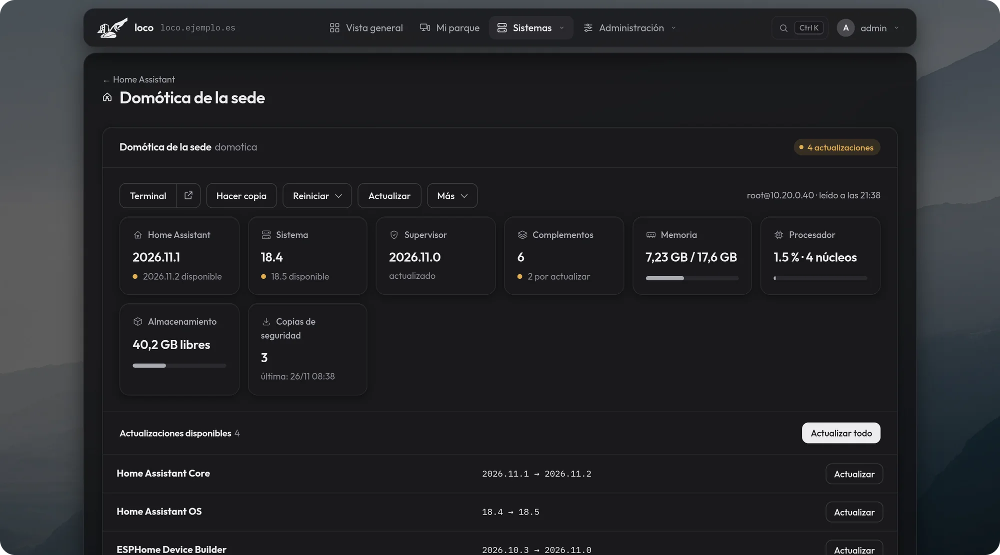

[English](../homeassistant.md) · [Français](../fr/homeassistant.md) · **Español**

# Home Assistant

Seguir y mantener su Home Assistant desde loco: versiones del núcleo, del sistema y del Supervisor,
actualizaciones (una a una o todas, con copia de seguridad previa), complementos, copias de seguridad, estado de
salud, registro, reinicios y terminal. Es una función **opcional**, desactivada por defecto.

loco no pide **ningún token** a Home Assistant. Entra por su complemento SSH, con una clave
propia, y maneja el comando `ha` — el que usted mismo usaría en ese terminal. Hace falta por tanto una
instalación que tenga un Supervisor (Home Assistant OS o Supervised) y un complemento SSH.

## Activar la función

En **Administración › Funciones**, sección *Opcional*, active **Home Assistant**. Cualquier cuenta con el
perfil Administrador puede hacerlo. La entrada **Home Assistant** aparece entonces en la barra superior.

## Vincular una instancia

En **Mi parque › Inscripción**, pestaña **Home Assistant** (con el permiso de vincular instancias), tres pasos:

1. **Un complemento SSH en Home Assistant** — «Advanced SSH & Web Terminal» o «Terminal & SSH», con un
   puerto abierto en la red (pestaña Configuración › Red del complemento).
2. **Autorizar la clave de loco** — copie la clave pública mostrada en `authorized_keys`, en la
   configuración del complemento, y luego reinicie el complemento. La clave privada se crea en el servidor loco la primera vez
   que se muestra la página (`homeassistant/id_ed25519` en la carpeta de estado, legible solo por la cuenta del
   portal) y nunca sale de él.
3. **La dirección** — nombre o dirección IP, puerto SSH, usuario del complemento (`root` para «Terminal & SSH», el que
   haya elegido para «Advanced SSH & Web Terminal»).

loco lee entonces la **clave de host** que presenta esa dirección y muestra su huella. No se
guarda ni se intercambia nada hasta que usted la haya confirmado; para compararla, lance en el terminal del
complemento (desde la interfaz de Home Assistant) el comando que propone la página. Después, loco solo acepta
esa clave: si cambia (complemento reinstalado), el vínculo se detiene y **Más › Volver a leer la clave
de host** vuelve a pedir una confirmación.

Pueden vincularse hasta ocho instancias.

## Lo que muestra la página

- **Mosaicos**: Home Assistant (núcleo), sistema, Supervisor, complementos, almacenamiento, copias de seguridad — con la versión
  pendiente cuando la hay.
- **Señalado por Home Assistant**: los problemas que detecta su Supervisor (ninguna copia de seguridad reciente, disco
  casi lleno, instalación degradada o no compatible…).
- **Actualizaciones disponibles**: cada una con su botón, y **Actualizar todo**, que las encadena en
  el orden aconsejado — el Supervisor, los complementos, Home Assistant y luego el sistema (que reinicia la máquina).
  La ventana de confirmación propone **crear una copia de seguridad antes** (marcada por defecto; vale para el
  núcleo y los complementos).
- **Actividad**: las doce últimas tareas, su estado y su salida. Una tarea lanzada se muestra «en
  curso» y no se vuelve a lanzar; las tareas de una instancia pasan una a una.
- **Complementos** y **Copias de seguridad** (las ocho más recientes). Para copiar estas copias de seguridad a
  un NAS o a un almacenamiento externo, a petición o programado: [Copias de seguridad](backups.md).
- **Registro de Home Assistant**: sus 200 últimas líneas, leídas al abrir el panel.

La lectura se rehace sola mientras la página está visible (cada dos minutos) y después de cada tarea;
**Actualizar** la rehace al instante. La vista general señala en «Por tratar» un vínculo fallido, una
instalación degradada y las actualizaciones disponibles.

En **Mi parque**, una instancia es una fila como un equipo: recursos de su anfitrión (disco; memoria y
procesador en Home Assistant OS), *Actualizar* en su fila, casilla que marcar (*Actualizar*, *Reiniciar* el
sistema), y queda incluida en *Actualizar todo* y en la programación de todo el parque. Desde Mi parque, sus
actualizaciones se hacen siempre con una copia de seguridad previa (núcleo y complementos), como propone su página. Permisos:
*Actualizar Home Assistant* para actualizarla, *Reiniciar Home Assistant* para reiniciarla.

## Acciones

| Acción | Comando lanzado en Home Assistant |
|---|---|
| Actualizar Home Assistant | `ha core update [--backup]` |
| Actualizar el sistema | `ha os update` |
| Actualizar el Supervisor | `ha supervisor update` |
| Actualizar un complemento | `ha apps update <complemento> [--backup]` (`ha addons update` con un comando `ha` más antiguo) |
| Hacer copia de seguridad | `ha backups new --name "loco AAAA-MM-DD HH:MM"` (copia completa, guardada en Home Assistant) |
| Reiniciar › Home Assistant | `ha core restart` |
| Reiniciar › El sistema | `ha host reboot` |

Cuando el sistema se reinicia (actualización del sistema, reinicio solicitado), el vínculo cae: loco espera su
vuelta hasta un cuarto de hora, y la tarea solo tiene éxito si vuelve a responder.

## Terminal

**Terminal** abre el shell del complemento SSH en la página de sesión habitual de loco (pantalla completa, nueva
pestaña, tamaño del texto). La sesión la mantiene el servidor loco, queda registrada en el diario, limitada a una hora y a
dos por instancia. Necesita la función **Acceso remoto** y un servidor loco en Linux.

## Permisos

El grupo **Home Assistant** de los perfiles de acceso separa: consultar, actualizar, hacer copias de seguridad, reiniciar,
abrir un terminal, vincular instancias. Ningún perfil incluido los recibe, salvo Administrador.

## Retirar una instancia

**Más › Retirar de loco** olvida la instancia y el historial de sus tareas. No se cambia nada en Home
Assistant: retire allí la clave de loco de `authorized_keys` para cerrar el acceso.

## Límites

- Instalaciones sin Supervisor (Container, Core): sin comando `ha`, por tanto sin vínculo.
- loco copia las copias de seguridad a un destino externo si usted lo configura ([Copias de seguridad](backups.md)), pero no las restaura.
- El servidor loco necesita el cliente SSH (`ssh`): presente en la appliance, instalado con loco en los demás casos.

---

[← Volver a la presentación](../../README.es.md) · [Toda la documentación](README.md)
