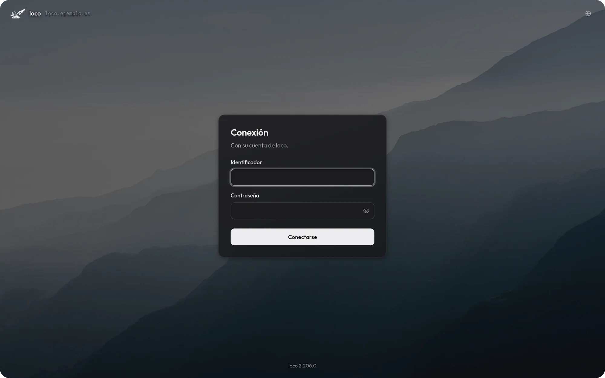

[English](../installation.md) · [Français](../fr/installation.md) · **Español**

# Instalar loco

Un servidor, cinco formas de instalarlo. El portal, los repositorios y las cachés son los mismos en todas partes; solo el repositorio Flatpak local requiere un servidor Linux.



## Elegir la instalación

| Servidor | Sistemas | Instalación | Guía |
|---|---|---|---|
| **Linux nativo** (recomendado) | Debian 12 / 13, Ubuntu 22.04 / 24.04 / 26.04, Rocky Linux 8 / 9 / 10 | `sudo ./install.sh` | [docs/linux.md](linux.md) |
| **Windows nativo** | Windows 11, Windows Server 2022 / 2025 | `windows\install.ps1` | [docs/windows.md](windows.md) |
| Contenedor LXC | Proxmox VE 7 / 8 / 9 | `linux/lxc/proxmox-lxc.sh` | [docs/linux.md](linux.md) |
| Appliance ISO | Alpine Linux (BusyBox), BIOS/UEFI | `linux/iso/` (asistente, respuestas y portal) | [docs/linux.md](linux.md) |
| Docker | Docker Engine 26+ y Compose v2 | `linux/docker/` | [docs/linux.md](linux.md) |

## Servidor Linux

### Instalación nativa (recomendada)

```bash
git clone https://github.com/ShaNouhAr/loco.git
cd loco
sudo ./install.sh
```

Debian 12 / 13, Ubuntu 22.04 / 24.04 / 26.04 y Rocky Linux 8 / 9 / 10 (validaciones de servidor en amd64). La instalación muestra la dirección de la interfaz
(`https://<ip>:8443`), la huella de la autoridad de certificación y la contraseña inicial de la cuenta
`admin` (que cambiar en el primer inicio de sesión). El script puede volver a lanzarse: también sirve para actualizar
(`git pull && sudo ./install.sh`) y para reconfigurar.

En Rocky Linux, el mismo comando detecta el sistema y usa DNF con EPEL y PowerTools (8) o CRB (9/10). SELinux sigue
activo; se configuran los contextos y los puertos necesarios. Si firewalld ya está en marcha, se añade una regla de
servicio dedicada; las redes autorizadas siguen controladas por `--allow` y `--admin-allow`.
Rocky 10 compila la caché APT a partir de una versión de las fuentes de Debian con sus parches, comprobada por
SHA-256 (este componente falta en EPEL 10). Rocky 8 solo compila el indexador `apt-ftparchive`
2.6.1 a partir de las fuentes de Debian verificadas; usa Python 3.11 para el portal, en un entorno
aislado. Si nginx no proporciona el relé TLS necesario, el instalador selecciona el flujo nginx 1.24
de AppStream; un nginx preexistente se actualiza conservando su configuración y permanece en ese flujo
tras la desinstalación. La primera instalación tarda por tanto más; los relanzamientos reutilizan las herramientas compiladas.

Opciones principales (todas: `sudo ./install.sh --help`):

| Opción | Efecto |
|---|---|
| `--allow "CIDR …"` | redes autorizadas para los equipos (por defecto: redes privadas) |
| `--admin-allow "CIDR …"` | redes autorizadas para la interfaz (por defecto: como `--allow`) |
| `--proxy http://host:puerto` | proxy de empresa para salir a Internet |
| `--no-http` | solo HTTPS (autoridad ya desplegada en los equipos) |
| `--no-wu`, `--no-flatpak`, `--no-rpm` | sin caché de Windows Update, sin Flatpak, sin la familia Red Hat |
| `--wu-proxy-port P` | puerto del proxy-caché de Windows Update (Squid, sin DNS; 3128 por defecto) |
| `--tls-cert F --tls-key F` | certificado de empresa en lugar de la autoridad local |
| `--backup-keep N` | copias de seguridad diarias conservadas (por defecto 3, 0 = ninguna) |

### Contenedor LXC en Proxmox VE

En cualquier anfitrión Proxmox VE 7, 8 o 9, como root:

```bash
curl -fsSLO https://raw.githubusercontent.com/ShaNouhAr/loco/main/linux/lxc/proxmox-lxc.sh
bash proxmox-lxc.sh                                   # DHCP, 100 GB, 2 procesadores, 2 GB de memoria
bash proxmox-lxc.sh --ip 192.168.10.20/24 --gw 192.168.10.1 --disk 300 -- --allow "192.168.10.0/24"
```

El script crea un contenedor Debian 13 sin privilegios (Debian 12 en Proxmox 7), elige el almacenamiento
(`local-lvm`, `local-zfs`…) y el puente (`vmbr0`) disponibles, descarga la última versión publicada
y hace en él la instalación nativa; las opciones tras `--` son las de `install.sh`. Muestra después
la dirección, la huella de la autoridad y la contraseña inicial. Actualización:
`bash proxmox-lxc.sh --ctid N --update`. Todas las opciones: `bash proxmox-lxc.sh --help`.

### Con Docker

Sin clonar el proyecto — la imagen `ghcr.io/shanouhar/loco` se publica con cada versión:

```bash
mkdir loco && cd loco
curl -fsSLO https://raw.githubusercontent.com/ShaNouhAr/loco/main/linux/docker/docker-compose.yml
curl -fsSL https://raw.githubusercontent.com/ShaNouhAr/loco/main/linux/docker/.env.example -o .env   # opcional: LOCO_HOST, LOCO_ALLOW, LOCO_PROXY, LOCO_WU…
docker compose up -d
docker compose logs loco   # dirección, huella de la autoridad, contraseña inicial de «admin»
```

Actualización: `docker compose pull && docker compose up -d`. Para quedarse en una versión concreta:
`LOCO_IMAGE=ghcr.io/shanouhar/loco:2.165.0` en `.env`.

Desde las fuentes — la imagen se construye en el sitio:

```bash
git clone https://github.com/ShaNouhAr/loco.git
cd loco/linux/docker
cp .env.example .env
sudo ./up.sh               # construye la imagen, arranca loco y espera a que esté sano
```

Mismo portal, mismas funciones y misma configuración que la instalación nativa: al arrancar, el
contenedor aplica las variables de `.env` con `linux/install.sh --container`, y luego `supervisord` lanza nginx,
apt-cacher-ng, el portal y las tareas periódicas. El contenedor usa la **red del anfitrión** (puertos
8443, 8088, 3142, y 80/443 para Windows Update): no lo combine con una instalación nativa en la misma
máquina. Los datos están en volúmenes Docker (`LOCO_DATA_DIR`: carpeta del anfitrión para los repositorios y las
cachés). Desde las fuentes, instalación y actualización: `sudo ./up.sh` (en `linux/docker`, tras `git pull`).

La instalación nativa sigue siendo la recomendada en producción: confina cada servicio con systemd
(detalles en [SECURITY.md](../../SECURITY.es.md)). Docker Engine 26 o posterior con Compose v2 (validado con
los paquetes `docker.io` y `docker-compose` de Debian 13).

Despliegue en la empresa (red, GPO, proxy, copias de seguridad, supervisión, LXC, Docker, resolución de problemas):
**[guía de Linux](linux.md)**.

### Administración

```bash
sudo loco-user list | roles | add NOMBRE [PERFIL] | set-role NOMBRE PERFIL | passwd NOMBRE   # cuentas (acceso perdido: passwd admin)
sudo loco-backup create | list | restore ARCHIVO             # copias de seguridad
sudo /opt/loco/remove.sh [--purge]                           # desinstalación
```

En un contenedor LXC, desde el anfitrión Proxmox: `pct exec N -- loco-user list`, etc.
Con Docker, los mismos comandos pasan por el contenedor: `docker compose exec loco loco-user list`,
`docker compose exec loco loco-backup create`. Desinstalación: `docker compose down`
(añadir `-v` para borrar también los datos).

### Arquitectura

| Elemento | Ubicación | Puerto |
|---|---|---|
| Portal (Flask + gunicorn, unidad `loco-portal`, confinada) | `/opt/loco` | 8089, local |
| Relé de las sesiones remotas (conexiones persistentes, en el proceso del portal) | `/opt/loco/portal/loco/relay.py` | 8090, local |
| nginx: interfaz y archivos de los equipos (HTTPS) | `/etc/nginx/sites-available/loco-portal.conf` | 8443 |
| nginx: arranque HTTP (opcional) | mismo archivo | 8088 |
| nginx: caché de Windows Update, relé HTTPS (SNI) | `loco-wucache.conf`, `modules-enabled/99-loco-stream.conf` | 80, 443 |
| squid: proxy-caché de Windows Update (sin DNS) | `/etc/squid/squid.conf`, caché `/srv/loco/wuproxy` | 3128 |
| apt-cacher-ng | `/var/cache/apt-cacher-ng` | 3142 |
| Datos: repositorios, catálogo, cachés | `/srv/loco` | — |
| Base de datos, clave GPG, estadísticas | `/var/lib/loco` | — |
| Configuración, autoridad y certificados | `/etc/loco` | — |

En Debian / Ubuntu, las dependencias vienen de los repositorios oficiales (`nginx`, `apt-cacher-ng`, `python3-flask`, `gunicorn`,
`gnupg`, `flatpak`, `ostree`, `createrepo-c`, `rpm`): los parches de seguridad llegan con `apt upgrade`, o
desde el portal (**Administración → Actualizaciones**: parches de seguridad, núcleo, reinicio).
En Rocky, los paquetes del sistema siguen `dnf upgrade`; el runtime de Python aislado y los componentes
compilados están fijados y se actualizan con las versiones de loco.

## Servidor Windows

### Instalación

Windows 11 Pro / Enterprise y Windows Server 2022 / 2025, en x64, con PowerShell 5.1
o posterior. En una consola PowerShell de **administrador**, desde las fuentes del proyecto:

```powershell
Invoke-WebRequest https://github.com/ShaNouhAr/loco/archive/refs/heads/main.zip -OutFile loco.zip
Expand-Archive loco.zip -DestinationPath .
cd loco-main
powershell.exe -NoProfile -ExecutionPolicy Bypass -File .\windows\install.ps1
```

La aplicación funciona en el servicio Windows `loco`, con sus componentes Windows nativos:
Python y nginx; los repositorios los firma el propio programa (OpenPGP). No hace falta ninguna VM Linux, WSL,
Hyper-V ni instalación de Docker.
Volver a lanzar el mismo script actualiza el programa conservando las cuentas, las claves y los repositorios.

Los repositorios APT/RPM firmados, las cachés APT/RPM/Flathub, el catálogo de Windows y Windows Update
están disponibles. El **repositorio Flatpak local** sigue reservado a los servidores Linux. Para una red grande,
consulte los límites del nginx de Windows y el dimensionamiento en la [guía de Windows](windows.md).

### Administración

En una consola de administrador:

```powershell
$lr = "$env:ProgramFiles\loco\loco.cmd"
& $lr user list ; & $lr user passwd admin ; & $lr backup create ; & $lr status
powershell -ExecutionPolicy Bypass -File "$env:ProgramFiles\loco\windows\remove.ps1"   # -Purge: borrarlo todo
```

### Arquitectura

Servicio `loco` (cuenta `NT SERVICE\loco`) que lanza nginx y el portal
(Waitress, 8089 en local, y su relé de las sesiones remotas en el puerto vecino 8090); programa en `%ProgramFiles%\loco`, datos, configuración y registros
en `%ProgramData%\loco`. Puertos: 8443 (HTTPS), 8088 (arranque HTTP), 3142 (caché APT), 80 y 443
(Windows Update). Detalles: [guía de Windows](windows.md).

---

[← Volver a la presentación](../../README.es.md) · [Toda la documentación](README.md)
