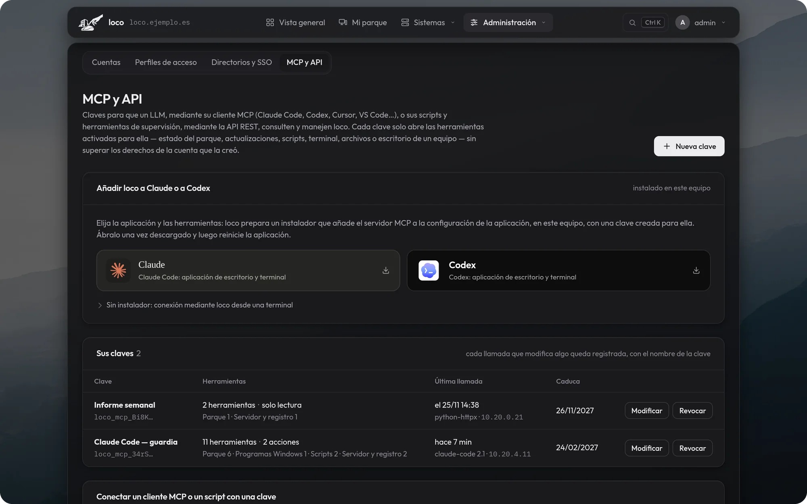

[English](../mcp.md) · [Français](../fr/mcp.md) · **Español**

# MCP y API



loco expone un **servidor MCP** (Model Context Protocol, el protocolo con el que un LLM llama a herramientas): un LLM consulta y maneja loco desde su **cliente MCP** — Claude Code, Cursor, VS Code o cualquier cliente que acepte una cabecera de autenticación. En **Administración → MCP y API**, añada loco a **Claude** o a **Codex** con un instalador (vea más abajo), o cree una **clave** por cliente y active una a una las herramientas que abre. El LLM puede entonces responder a «¿qué equipos esperan actualizaciones?», lanzarlas, leer un registro del sistema o abrir el terminal de un equipo, dentro de los límites de la clave. Las mismas claves abren la [API REST](#api-rest-http), para sus scripts. Los clientes que se conectan desde la nube de su editor (claude.ai, ChatGPT) no alcanzan un loco instalado en una red local.

- **Herramienta por herramienta**: cada clave solo abre las herramientas activadas (listar o consultar los equipos, buscar un programa instalado, pedir un inventario, actualizar, reiniciar, instalar un programa del catálogo, anular una acción pendiente, leer y lanzar los scripts de la biblioteca, ejecutar comandos escritos por el LLM, shell adb de un dispositivo Android, estado del servidor, diario…). La ventana de la clave las ordena por ámbito, con su nombre MCP (`list_devices`, `terminal_run`…) y una marca **acción** o **sensible**; ajustes predefinidos **Solo lectura**, **Todo lo que puedo** o **Nada**.
- **Acceso remoto en directo**, mediante las mismas sesiones que la interfaz (permisos **Abrir un terminal remoto**, **Gestionar los archivos del equipo**, **Abrir el escritorio noVNC**):
  - **terminal** (`terminal_run`): comando o script (hasta 64 KB) en el bash root (Linux) o el PowerShell SYSTEM (Windows) del equipo, salida y código de salida en unos segundos.
    - **Plazo** (hasta 5 min): más allá, el comando se **detiene definitivamente** — su shell y todos los procesos que lanzó se cierran (`killed`), y la llamada siguiente abre un shell nuevo. Un shell que sigue **ocupado** por un comando anterior se detecta en lugar de hacer caducar los siguientes: se cierra con lo que ejecutaba, el comando sale en un shell nuevo, y la respuesta lo dice (`note`). `fresh` pide un shell nuevo.
    - **Segundo plano**: `background` lanza el comando separado del terminal (sobrevive al cierre de la sesión) y devuelve al instante un número de tarea; `terminal_job` da su estado (en curso, terminada, detenida, perdida), el código de salida y la salida, o la detiene con todo lo que lanzó. La salida y el estado se quedan una semana en el equipo (`/var/tmp/loco-jobs`, `%ProgramData%\loco\jobs` reservado a SYSTEM y a los administradores).
    - **Salida limitada**: `max_output` caracteres (24 000 por defecto, por debajo del límite de los clientes MCP); más allá, se conservan el principio y el final con el recuento de lo omitido. El propio comando nunca se devuelve: en Linux y en el shell adb, el eco y la edición de línea de este shell reservado al asistente están desactivados, y un script largo sale en líneas cortas.
    - **Windows**: un `exit 3` devuelve su código sin cerrar la sesión; un error de PowerShell da el código 1.
  - **terminal interactivo** (`terminal_interact`): el LLM escribe y pulsa teclas (`{enter}`, `{ctrl+c}`, `{esc}`, flechas…) y lee la pantalla del terminal (120 × 40), para vim, top, las preguntas sí/no o PowerShell; la sesión conserva su estado de una llamada a otra; `reset` la sustituye por un shell nuevo — la vía de rescate si un programa se queda bloqueado;
  - **archivos**: recorrer, leer (texto o base64), escribir (sustitución atómica), crear una carpeta, copiar, mover, renombrar, cambiar los permisos, eliminar — herramientas distintas para la lectura, la escritura, la organización y la eliminación. `write_file` escribe el texto en **UTF-8 sin BOM** por defecto, en todas partes; `charset` (utf-8-bom, ascii, utf-16le-bom) y `newline` (lf, crlf) si hace falta. Para depositar código o una configuración, es mejor que el terminal: `Set-Content -Encoding UTF8` de PowerShell 5.1 añade un BOM (y entonces javac falla);
  - **archivos por adb** (Android emparejado): `push_file` y `pull_file` envían y recuperan un archivo como `adb push` / `adb pull`, con los permisos del usuario *shell* de Android (`/data/local/tmp`…). El contenido viaja en el cuerpo de la petición (hasta ~6 MB por llamada, en varias partes más allá), nunca en una línea de comandos, o va **directamente de un equipo a otro** (`from_device` / `to_device`, hasta 64 MB) — un `.dex` construido en un PC llega así a la tableta sin pasar por el asistente; se comprueba en el dispositivo (tamaño y SHA-256). Allí donde la aplicación loco no tiene acceso, `write_file` y `read_file` pasan solos por adb si la clave también tiene las herramientas adb;
  - **escritorio**: captura de pantalla devuelta como imagen al LLM (escritorio Windows o Linux, incluido GNOME con Wayland, pantalla de bloqueo, consola de texto de un equipo sin pantalla; zoom en una zona), clic, escritura de texto, teclas y atajos (Ctrl+Alt+Supr incluido), rueda — cada acción devuelve una nueva captura.

  Una sesión por clave, equipo y tipo se reutiliza de una llamada a otra y se cierra tras 5 minutos sin llamadas (2 para el escritorio); revocar o modificar la clave la cierra al instante. Una persona pasa antes que el cliente MCP: si se alcanza el límite de sesiones del equipo, abrir una sesión desde la interfaz cierra primero las sesiones MCP inactivas. Un equipo al que apunta una llamada MCP se «precalienta» un minuto (sondeo cada 2 s) para que la sesión siguiente se abra rápido, y el agente espacia sus sondeos cuando una sesión permanece en silencio. Tras la primera captura, solo transitan las zonas modificadas de la pantalla; la escritura de texto sigue la distribución real del teclado del equipo (AZERTY, teclas muertas, AltGr). Cada comando, escritura, eliminación y acción en el escritorio entra en el diario (el texto escrito no aparece).
- **Herramientas nuevas**: una clave que tenía `terminal_run` recibe también `terminal_job`, una clave que tenía `adb_shell` recibe `push_file` y `pull_file` (mismos permisos); desmárquelas si hace falta.
- **Nunca más que su creador**: una clave está ligada a la cuenta que la crea; sus permisos efectivos son, en cada llamada, las herramientas activadas **y** permitidas por el perfil actual de esa cuenta. Cuenta desactivada, eliminada o por finalizar, directorio desactivado, clave caducada o revocada: rechazo inmediato. El agente del equipo también vuelve a comprobar los permisos de la cuenta antes de ejecutar.
- **Clave mostrada una sola vez** (loco solo guarda una huella), con el comando `claude mcp add` y la configuración JSON ya rellenados. Caducidad a elegir (30 días, 90 días, 1 año, nunca).
- **Trazabilidad**: cada acción pasa por las mismas funciones que la interfaz y entra en el diario con el nombre de la clave («· MCP «Claude Code»»); un comando escrito por el LLM se conserva tal cual en el historial de los scripts («MCP: …»). La lista de claves muestra la última llamada de cada una (fecha, dirección, cliente).
- **Cada cuenta ve sus claves**: la página muestra primero *Sus claves*; una cuenta que puede gestionar otras cuentas ve aparte sus claves, con la cuenta que las tiene, y puede revocarlas — no cambiar sus herramientas. Una cuenta que ya no tiene el permiso de crearlas sigue viendo y revocando las suyas.
- **Protocolo**: `https://<servidor>:8443/mcp`, transporte HTTP «Streamable HTTP» sin sesión, cabecera `Authorization: Bearer <clave>`. loco responde a las dos generaciones de MCP: el saludo `initialize` (de 2025-03-26 a 2025-11-25) y la generación 2026-07-28 (`server/discover`, metadatos por petición). Servido solo en HTTPS, detrás de las mismas redes autorizadas que la interfaz; se rechaza una página web de otro origen. Los clientes Node.js que no conocen el certificado de loco lo aceptan con `NODE_EXTRA_CA_CERTS=ca.crt` (autoridad descargable en `/ca.crt`).

## Añadir loco a Claude o a Codex

Ni Claude ni Codex aceptan que un enlace añada un servidor MCP. El bloque **Añadir loco a Claude o a Codex** de la
página MCP y API prepara por tanto un **instalador** para el ordenador en el que funciona la aplicación:

1. Haga clic en **Claude** o **Codex**. En la ventana: nombre de la clave, duración, sistema del ordenador (deducido del
   navegador) y herramientas — la consulta viene marcada por defecto, el acceso remoto (archivos, pantalla, terminal) nunca.
2. **Descargar el instalador** crea la clave y devuelve un archivo que la contiene:
   - **Windows** — `anadir-loco-a-claude.cmd`: ábralo (Windows puede pedir *Más información* y luego
     *Ejecutar de todas formas*: el archivo no está firmado);
   - **macOS** y **Linux** — `anadir-loco-a-claude.command` / `.sh`: en el Terminal, `sh` seguido del archivo.
3. El instalador escribe la configuración MCP de la aplicación y luego se borra:
   - **Claude Code** (comando `claude` y pestaña *Code* de la aplicación de escritorio): entrada `loco` de tipo `http`,
     con la cabecera de la clave, en `~/.claude.json`;
   - **Codex** (aplicación de escritorio y comando `codex`): sección `[mcp_servers.loco]` (`url`, `http_headers`) en
     `~/.codex/config.toml` — se sustituye una sección `loco` antigua.

   El resto de estos archivos se conserva, y se deja una copia del archivo anterior al lado (`….avant-loco`).
4. Reinicie la aplicación: loco aparece entre sus servidores MCP. La clave figura entre sus claves en loco («obtenida por
   el instalador Claude»); modifique sus herramientas o revóquela como las demás.

**Certificado.** Si el equipo no reconoce el certificado de loco y fue la autoridad de loco quien lo firmó,
el instalador lo muestra con su huella SHA-256 y pregunta si hay que confiar en él: almacén del usuario
en Windows (Windows también pide confirmación), llavero de sesión en macOS; en Linux, ajuste
`NODE_EXTRA_CA_CERTS` de Claude Code (`~/.claude/settings.json`) y, para Codex, almacén del sistema (`sudo`).

La clave no pasa ni por una conversación ni por una línea de comandos: está en el archivo descargado, y luego en
la configuración de la aplicación.

### Sin instalador: conexión a través de loco

Un cliente MCP también puede conectarse **sin clave preparada**, mediante OAuth 2.1 (especificación de autorización MCP):

```bash
claude mcp add --scope user --transport http loco https://<servidor>:8443/mcp && claude mcp login loco
codex mcp add loco --url https://<servidor>:8443/mcp && codex mcp login loco
```

El comando `login` abre loco en el navegador, en **Autorizar Claude Code** (o Codex): nombre, duración y herramientas de la
clave, y luego **Autorizar**. El cliente descubre loco (`/.well-known/…`), se registra solo (cliente público) y recibe la
clave tras intercambiar el código con PKCE; el código solo vuelve a una aplicación del ordenador (bucle local o esquema
propio de una aplicación). *Sign out* de Claude Code (`claude mcp logout loco`) también retira la clave de loco.

Codex rechaza esta conexión cuando se alcanza loco por una dirección IP privada: necesita un nombre, que declarar en
*Sistema › Red › Dirección del portal* (al instalador no le afecta).

El permiso **Crear claves MCP y API** (administradores por defecto) permite crear las propias claves y revocar las de las cuentas que se gestionan. Función desactivable en **Funciones** («MCP y API»).

## API REST (HTTP)

Las mismas claves abren una **API REST**: cada herramienta del servidor MCP es una ruta HTTP ordinaria, para un script, una
supervisión (Zabbix, un panel de Grafana, un cron) u otro programa — sin cliente MCP. Base `https://<servidor>:8443/api/v1`,
cabecera `Authorization: Bearer <clave>`. Una clave solo da allí las herramientas marcadas, con los permisos de su cuenta, en el
parque de su perfil; cada acción entra en el diario con su nombre («· API «nombre de la clave»»).

- **Lecturas con GET**, argumentos en la dirección: `GET /api/v1/resources`, `GET /api/v1/devices`, `GET /api/v1/devices/{id}`,
  `GET /api/v1/groups`, `GET /api/v1/software?name=firefox`, `GET /api/v1/catalog`, `GET /api/v1/scripts`, `GET /api/v1/runs`,
  `GET /api/v1/overview`, `GET /api/v1/server`, `GET /api/v1/journal`.
- **Recursos de las máquinas** (procesador, memoria, discos, red, tiempo desde el arranque):
  - `GET /api/v1/devices/{id}/resources` — un equipo, en bytes y porcentajes; `?history=1h|24h|7d` añade la curva;
  - `GET /api/v1/resources?sort=memory&os=linux` — todo el parque, ordenable por `cpu`, `memory` o `disk` (el más cargado primero).

  Un equipo se designa por su **número** o su **nombre exacto**. Ejemplo:

  ```bash
  curl --cacert ca.crt -H "Authorization: Bearer $LOCO_KEY" \
       "https://<servidor>:8443/api/v1/resources?sort=memory"
  ```

- **Acciones con POST o DELETE**, argumentos en JSON: `POST /api/v1/devices/{id}/scan` (inventario), `…/update`, `…/reboot`,
  `…/wake`, `…/install`, `POST /api/v1/updates` (varios equipos), `DELETE /api/v1/devices/{id}/actions/{action}` (anular),
  `POST /api/v1/scripts/{id}/run`. Como con el servidor MCP, una acción queda **en cola**: el agente la ejecuta en su
  próximo contacto; vuelva a leer el estado con `GET /api/v1/devices/{id}` en lugar de suponerlo.
- **Respuestas JSON.** Un error es `{"error": "…"}` con el código adecuado: 400 (argumento), 401 (clave — cabecera
  `WWW-Authenticate: Bearer`), 403 (herramienta no marcada u origen rechazado), 404 (no encontrado), 405 (método), 413 (petición
  demasiado grande), 503 (función desactivada o servidor de reserva).
- **Descripción OpenAPI 3.1** servida **sin clave** en `GET /api/v1/openapi.json` (para importar en Insomnia, Postman o un
  generador de clientes); `GET /api/v1` lista las rutas e indica las que la clave puede llamar. La API sigue los mismos
  ajustes que el servidor MCP (misma casilla **MCP y API** en **Funciones**, mismas redes autorizadas, rechazo de una
  página web de otro origen).

---

[← Volver a la presentación](../../README.es.md) · [Toda la documentación](README.md)
