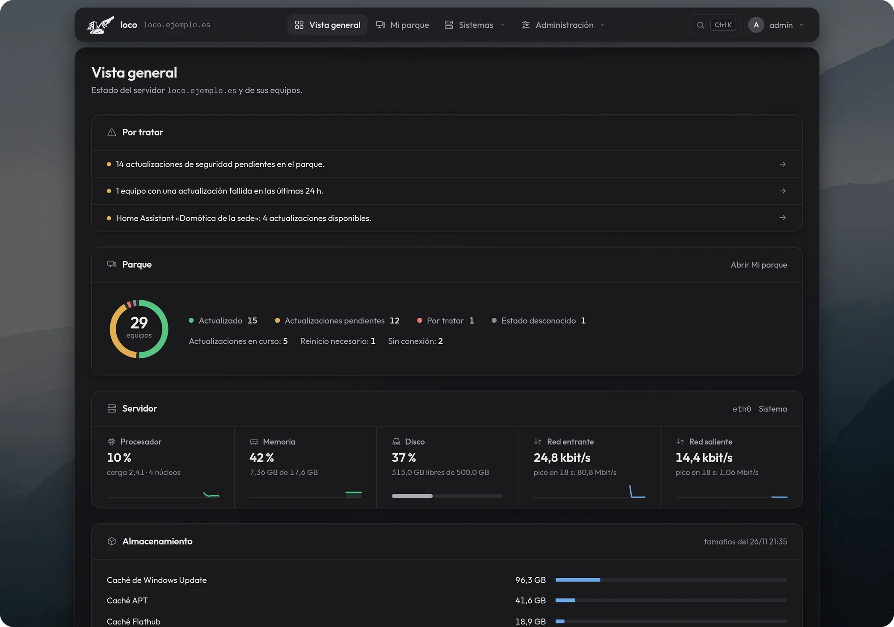

[English](../operations.md) · [Français](../fr/operations.md) · **Español**

# Operar loco en el día a día

Esta guía está pensada para la persona que hace funcionar loco, una vez terminada la instalación:
qué vigilar, qué respaldar, cómo actualizar y qué hacer cuando algo se atasca.

Para instalar: [Instalar loco](installation.md). Para el despliegue en la empresa (redes, GPO, proxy):
[servidor Linux](linux.md) y [servidor Windows](windows.md).



**Índice** —
[Referencias](#1-referencias) ·
[La rutina](#2-la-rutina) ·
[Supervisar](#3-supervisar) ·
[Copias de seguridad y restauración](#4-copias-de-seguridad-y-restauración) ·
[Actualizar](#5-actualizar) ·
[Certificados](#6-certificados) ·
[Cuentas y accesos perdidos](#7-cuentas-y-accesos-perdidos) ·
[Registros](#8-registros) ·
[Cambiar sin romper](#9-cambiar-sin-romper) ·
[Funciones](#10-activar-o-desactivar-una-función) ·
[Incidentes](#11-incidentes-por-dónde-empezar) ·
[Detener, trasladar, retirar](#12-detener-trasladar-retirar)

---

## 1. Referencias

### Dónde lanzar los comandos

Las mismas herramientas existen en todas partes; solo cambia la forma de llamarlas.

| Instalación | Ejemplo |
|---|---|
| Linux nativo | `sudo loco-user list` |
| Contenedor LXC (desde el anfitrión Proxmox) | `pct exec N -- loco-user list` |
| Docker (en la carpeta de `docker-compose.yml`) | `docker compose exec loco loco-user list` |
| Appliance ISO | consola root: `loco-user list` |
| Windows (PowerShell de administrador) | `& "$env:ProgramFiles\loco\loco.cmd" user list` |

A continuación, los comandos están escritos para Linux nativo.

### Lo que se ejecuta

| Servicio (Linux nativo) | Función |
|---|---|
| `loco-portal` | el portal y los scripts de los equipos (sin privilegios) |
| `nginx` | HTTPS, archivos, caché de Windows Update |
| `apt-cacher-ng` | caché de los paquetes Debian y Ubuntu |
| `squid` | proxy-caché de Windows Update, sin DNS (si está instalado) |
| `loco-agent` | ejecuta como root las operaciones pedidas por el portal, después de volver a validarlas |
| `loco-backup.timer` | copia de seguridad diaria, a las 03:30 |
| `loco-stats.timer` | tamaño de las cachés, cada 15 minutos |
| `loco-nginx.path` | recarga nginx cuando cambia la lista de dominios |

En la appliance, OpenRC y supervisord sustituyen a systemd (servicios `loco` y `loco-agent`). Con Docker, supervisord
lanza todo en el contenedor. En Windows, un solo servicio: `loco`.

La página **Administración › Sistema** muestra el estado de cada uno.

### Los puertos

| Puerto | Sirve para | Quién se conecta |
|---|---|---|
| 8443/tcp | portal, repositorios, instaladores, agentes (HTTPS) | equipos y administradores |
| 8088/tcp | arranque HTTP de los equipos (opcional) | equipos |
| 3142/tcp | caché APT | equipos Linux |
| 80 y 443/tcp | caché de Windows Update | equipos Windows, por el DNS |
| 3128/tcp | proxy-caché de Windows Update, sin DNS | equipos Windows gestionados |
| 8089 y 8090 | portal y relé de las sesiones remotas | el propio servidor, en local |

### Dónde están las cosas

| Qué | Linux | Windows |
|---|---|---|
| Programa | `/opt/loco` | `%ProgramFiles%\loco` |
| Repositorios, catálogo, cachés | `/srv/loco` | `%ProgramData%\loco` |
| Base de datos, clave GPG, estadísticas | `/var/lib/loco` | `%ProgramData%\loco` |
| Configuración, autoridad, certificados | `/etc/loco` | `%ProgramData%\loco` |
| Copias de seguridad | `/var/backups/loco` | carpeta elegida en la instalación (`-BackupPath`) |

---

## 2. La rutina

Nada de esto lleva mucho tiempo. Lo esencial cabe en la vista general.

**Cada día — un minuto**

- [ ] Abrir la **vista general**: ¿está vacío el bloque **Por tratar**?
- [ ] ¿Un fallo en **Mi parque › Actualizaciones**? Su motivo está en la fila.

**Cada semana**

- [ ] **Administración › Actualizaciones**: instalar los parches de seguridad del servidor, reiniciar si la página lo pide.
- [ ] **Administración › Sistema**: la última copia de seguridad tiene menos de un día, el disco tiene margen.
- [ ] Los equipos «sin contacto reciente»: ¿apagados u olvidados?

**Cada mes**

- [ ] **Restaurar una copia de seguridad** en una máquina de prueba (vea [§ 4](#4-copias-de-seguridad-y-restauración)). Una copia de seguridad nunca restaurada no es más que una esperanza.
- [ ] Revisar las **cuentas** y las **claves MCP y API**: retirar lo que ya no se usa.
- [ ] Comprobar la fecha de caducidad del **certificado** (página Sistema).

**Con cada nueva versión de loco**

- [ ] Leer el [registro de cambios](../../CHANGELOG.es.md).
- [ ] Crear una copia de seguridad: `sudo loco-backup create`.
- [ ] Actualizar (vea [§ 5](#5-actualizar)), y luego abrir la vista general.

> **Lo más sencillo es no tener que pensar en ello**: configure las [alertas](#las-alertas) una vez, y loco le escribe cuando
> algo requiere su atención.

---

## 3. Supervisar

### En el portal

- **Vista general** — *Por tratar* reúne lo que importa: parches de seguridad pendientes, actualizaciones fallidas,
  despliegue en pausa, servicio detenido, copia de seguridad atrasada.
- **Administración › Sistema** — servicios, certificado, disco, última copia de seguridad, versión.
- **Mi parque** — la ficha de cada equipo tiene su pestaña **Supervisión**: procesador, memoria, red y discos, en directo
  y luego en 24 horas o 7 días.

### Las alertas

**Administración › Diario › Alertas**: un interruptor por condición, un botón *Probar*. Envío por **correo electrónico** (SMTP) o
**webhook**. Cada alerta tiene su plazo de repetición: sin ráfagas.

| Alerta | Se activa cuando |
|---|---|
| Servicio detenido | nginx, una caché, el portal o el agente ya no está activo |
| Certificado HTTPS que caduca | quedan menos de 21 días (ajustable) |
| Copia de seguridad atrasada | se ha omitido la copia de seguridad diaria |
| Copia externa fallida | la última copia al almacenamiento externo ha fallado |
| Envío syslog con fallos | los registros no llegan desde hace 5 minutos |
| Disco casi lleno | el almacenamiento de datos supera el 90 % (ajustable) |
| Inicios de sesión fallidos | más de 10 fallos en 24 horas (ajustable) |
| Actualizaciones de seguridad pendientes | hay equipos con parches de seguridad que instalar |
| Equipos sin contacto | hay equipos que no han contactado con loco recientemente |
| Despliegue por oleadas en pausa | una oleada ha fallado, las siguientes esperan |
| Disco, memoria o procesador de un equipo | se supera el umbral (media de 15 minutos para la memoria y el procesador) |

### Desde su supervisión

Dos direcciones:

- `https://SERVIDOR:8443/healthz` responde `ok` — la comprobación más sencilla.
- `https://SERVIDOR:8443/metrics`, en formato Prometheus, reservada a las redes de administración (`--admin-allow`).

| Métrica | Indica |
|---|---|
| `loco_info` | versión instalada |
| `loco_service_up` | si cada servicio está activo |
| `loco_disk_bytes` | disco de los datos |
| `loco_cache_bytes` | tamaño de cada caché |
| `loco_wu_recent_bytes` | volumen reciente de Windows Update, servido desde la caché u obtenido de Internet |
| `loco_tls_cert_expiry_days` | días antes de que caduque el certificado |
| `loco_backup_last_timestamp_seconds` | fecha de la última copia de seguridad |
| `loco_devices` | equipos del parque, por indicador (al día, en espera, por tratar) |
| `loco_deb_packages`, `loco_rpm_packages`, `loco_windows_apps` | contenido de los repositorios y del catálogo |

Ejemplo de recogida:

```yaml
scrape_configs:
  - job_name: loco
    scheme: https
    metrics_path: /metrics
    tls_config:
      ca_file: /etc/prometheus/loco-ca.crt      # la autoridad de loco (página Sistema)
    static_configs:
      - targets: ["loco.ejemplo.lan:8443"]
```

---

## 4. Copias de seguridad y restauración

### Qué se respalda

Cada noche a las 03:30, se escribe un archivo en `/var/backups/loco`. Se conservan los tres más recientes
(ajustable: página Sistema, o `--backup-keep`).

| En el archivo | Fuera del archivo |
|---|---|
| configuración, cuentas, diario | las cachés — se reconstruyen |
| claves: autoridad HTTPS, clave GPG de los repositorios | las sesiones remotas en curso |
| repositorios APT, RPM y Flatpak, catálogo de Windows | |

> ⚠️ **Un archivo contiene claves privadas.** Guárdelo como un secreto.

### Los gestos

```bash
sudo loco-backup create       # ahora mismo
sudo loco-backup list
```

En el portal, **Administración › Copias de seguridad**, pestaña *loco*: descargar un archivo, ajustar el número de archivos
conservados, restaurar (servidor Linux nativo y appliance).

### Sacar las copias de seguridad del servidor

Una copia de seguridad guardada en el servidor que protege no protege gran cosa.
En la misma página, la pestaña **Destino** envía cada noche el último archivo a:

- un almacenamiento **compatible con S3** (nube, MinIO);
- un servidor **SFTP**;
- una **carpeta** o un punto de montaje.

Con una frase de contraseña, el archivo sale **cifrado**. Sin ella, sale tal cual — claves incluidas.
Un fallo activa la alerta «Copia externa fallida».

El mismo destino recibe también, si lo desea, las copias de seguridad de sus Home Assistant; y las máquinas
Proxmox se respaldan desde loco en un almacenamiento de Proxmox: vea [Copias de seguridad](backups.md).

### Restaurar

**En el mismo servidor** — página Copias de seguridad, pestaña *loco*, *Restaurar*, o:

```bash
sudo loco-backup restore loco-NOMBRE-AAAAMMDD-HHMMSS.tar.gz
```

**En un servidor nuevo** — tres comandos:

```bash
sudo ./install.sh                                              # 1. instalar loco, como la primera vez
sudo loco-backup restore loco-ANTIGUO-AAAAMMDD-HHMMSS.tar.gz   # 2. recuperar cuentas, claves, repositorios
sudo ./install.sh                                              # 3. rehacer servicios y certificado para esta máquina
```

La autoridad se restaura: **los equipos no tienen nada que rehacer**. Se conservan la dirección, los puertos y las redes del nuevo
servidor. Si la dirección cambia, actualice el DNS de Windows Update — y avise a los agentes *antes* del traslado
(vea [§ 9](#9-cambiar-sin-romper)).

En Windows: `& $lr backup restore 'D:\…\loco-….tar.gz'`. Las copias de seguridad de Windows y de Linux no son intercambiables.

### El ejercicio mensual

1. Instalar loco en una máquina de prueba, fuera de la red de los equipos.
2. Restaurar en ella el último archivo.
3. Iniciar sesión, abrir Mi parque y un repositorio: ¿está todo?
4. Apagar la máquina de prueba.

---

## 5. Actualizar

### El propio loco

Cree una copia de seguridad y luego:

| Instalación | Comando |
|---|---|
| Linux nativo | `git pull && sudo ./install.sh` |
| Contenedor LXC | `bash proxmox-lxc.sh --ctid N --update` (en el anfitrión Proxmox) |
| Docker | `docker compose pull && docker compose up -d` — o, desde las fuentes, `git pull && sudo ./up.sh` |
| Appliance ISO | **Administración › Actualizaciones**, o `loco-update loco` |
| Windows | obtener las fuentes, volver a lanzar `windows\install.ps1` |

Las migraciones de la base de datos son automáticas. En la appliance, una actualización que falla se anula sola:
vuelven la configuración, la base de datos y la versión anterior.

### El sistema del servidor

**Administración › Actualizaciones** lista los paquetes pendientes, con los parches de seguridad primero, e indica si hace falta un reinicio
y por qué. En consola:

```bash
sudo loco-update status      # en qué punto estamos
sudo loco-update check       # volver a comprobar ahora
sudo loco-update security    # solo los parches de seguridad (Debian, Ubuntu, Rocky Linux)
sudo loco-update system      # todos los paquetes, núcleo incluido
sudo loco-update reboot
```

En un contenedor LXC, el núcleo es el del anfitrión: se actualiza en Proxmox. Con Docker y en Windows,
el sistema se actualiza por sus medios habituales.

### Los agentes

Nada que hacer: **los agentes se actualizan solos** cuando el servidor cambia de versión. ¿Un equipo rezagado?
Su ficha ofrece *Más › Actualizar el agente*.

---

## 6. Certificados

En la instalación, loco crea su propia autoridad (válida 10 años) y firma el certificado del servidor (825 días).

- **Renovación** — `install.sh` rehace el certificado si caduca en menos de 30 días o si la dirección cambia.
  Desde el portal (servidor Linux nativo y appliance): **Sistema › Certificado**.
- **Supervisión** — la alerta «Certificado HTTPS que caduca» y la métrica `loco_tls_cert_expiry_days`.
- **Certificado de empresa** — `sudo ./install.sh --tls-cert servidor.crt --tls-key servidor.key`, o la página Sistema ›
  Certificado (solicitud de firma, importación). La solicitud solo contiene **nombres DNS**, nunca una dirección IP: cuando los
  agentes llegan a loco por una IP, conservan el certificado de la autoridad de loco, y el de la empresa se presenta a
  quien llega por nombre (SNI). Una autoridad que restringe las direcciones IP (restricciones de nombres) haría si no que los clientes
  BoringSSL, como Claude Code, rechazaran toda la cadena («unsupported name constraint type»), aunque OpenSSL la valide.
  La página Sistema señala un certificado en servicio que caería en este caso: haga una nueva solicitud y luego importe el
  certificado emitido.
- **Confiar en la autoridad** — por GPO en un dominio, o con los comandos de la página Sistema.
  Compare siempre la huella SHA-256 que muestra la instalación.

Los agentes no necesitan el almacén de certificados del equipo: fijan la autoridad de loco.

---

## 7. Cuentas y accesos perdidos

| Situación | Comando (root) |
|---|---|
| Contraseña de `admin` perdida | `sudo loco-user passwd admin` — muestra una contraseña temporal |
| Teléfono de doble autenticación perdido | `sudo loco-user mfa-reset NOMBRE` |
| Clave de acceso (passkey) perdida | `sudo loco-user passkeys-reset NOMBRE` |
| Ya no queda ningún administrador | `sudo loco-user roles` y luego `sudo loco-user set-role NOMBRE PERFIL` |
| Bloquear una cuenta de inmediato | `sudo loco-user disable NOMBRE` (`enable` para reabrirla) |
| Ver las cuentas | `sudo loco-user list` |

Tras 5 fallos en una cuenta en 15 minutos (o 20 desde una misma dirección), el inicio de sesión queda bloqueado 15 minutos.
Una sesión inactiva durante 8 horas se cierra. Cambiar una contraseña cierra las demás sesiones de la cuenta.

El resto — perfiles, alcance del parque, directorios, SSO — se configura en el portal: [Cuentas, perfiles y SSO](accounts.md).

---

## 8. Registros

### El diario del portal

**Administración › Diario**: inicios de sesión, fallos, modificaciones, con la cuenta y la dirección de origen.
Filtros por periodo, por cuenta, por categoría; exportación en JSON; duración de conservación ajustable.
Puede enviarse a su **servidor syslog** (RFC 5424, TLS, TCP o UDP), con los registros de los equipos si lo desea:
[Diario y syslog](audit-log.md).

Las sesiones remotas anotan su apertura y su cierre — nunca las pulsaciones ni el contenido de las pantallas.

### Los registros del sistema

| Instalación | Dónde mirar |
|---|---|
| Linux nativo | `journalctl -u loco-portal -u nginx -u apt-cacher-ng`, `/var/log/nginx/loco-*.log`, `/var/log/loco-install.log` |
| Appliance ISO | `/var/log/loco/`, `/var/lib/loco-agent/jobs/` |
| Docker | `docker compose logs loco` |
| Windows | `%ProgramData%\loco\logs` |

---

## 9. Cambiar sin romper

Tres cambios merecen prepararse. Cada uno tiene su procedimiento, sin corte para el parque.

| Usted quiere | El principio | El detalle |
|---|---|---|
| **Cambiar la dirección del servidor** | anunciar la futura dirección a los agentes, esperar a que la conozcan y luego cambiar | [Mi parque](fleet.md) — «Cambiar la dirección del servidor» |
| **Cambiar el puerto del portal** | abrir el nuevo puerto junto al anterior, dejar que los agentes lo aprendan, cerrar el anterior | [Mi parque](fleet.md) — «Cambiar el puerto de la interfaz» |
| **Abrir loco por un nombre** | ajustar la dirección del portal, sin tocar la de los agentes | [Mi parque](fleet.md) — «Abrir loco por su nombre» |

El anuncio de una nueva dirección, en consola:

```bash
sudo loco-fleet announce https://192.168.1.20:8443     # los agentes la reciben en dos minutos
sudo loco-fleet servers                                # cuántos equipos están avisados
sudo loco-fleet forget https://192.168.1.20:8443       # anular el anuncio
```

En la appliance, `setup-loco` (consola) cambia la red, el nombre, las contraseñas y el acceso SSH, y hace el anuncio
él mismo. `loco-config show` y `loco-config set CLAVE=VALOR` ajustan las redes autorizadas, las funciones y el tamaño
de las cachés.

---

## 10. Activar o desactivar una función

**Administración → Funciones**, reservado a las cuentas con el perfil **Administrador** (cualquier administrador, sea cual sea su nombre o su origen), activa o desactiva partes enteras de loco: paquetes APT, RPM y Flatpak, caché de Windows Update, Mi parque y agentes, programas Windows, acceso remoto, scripts, directorios, alertas, MCP y API. Una función desactivada desaparece de la navegación, de los botones y de la vista general; sus páginas y su API se rechazan con un mensaje explícito y sus permisos dejan de tener efecto. Los agentes reciben «vuelva a intentarlo más tarde» cuando el parque está desactivado; instalaciones y scripts esperan a la reactivación. Se aplican las dependencias (acceso remoto y scripts siguen al parque). En la appliance, las cachés de Windows Update, RPM y Flatpak también se detienen o se vuelven a lanzar. Los datos se conservan y cada cambio queda inscrito en el diario.

Dos secciones aparte, desactivadas por defecto: **Experimental** (lo que todavía está madurando, como los dispositivos Android) y **Opcional** (lo que está terminado pero no afecta a todo el mundo, como Home Assistant).

---

## 11. Incidentes: por dónde empezar

### El servidor

| Lo que ve | Lo que hay que mirar |
|---|---|
| El portal ya no responde | `systemctl status loco-portal nginx`, y luego `journalctl -u loco-portal -n 50` |
| Portal: error 403 | su dirección no está en las redes de administración (`--admin-allow`) |
| «Servicio detenido» en la vista general | página Sistema: ¿cuál? `systemctl restart EL-SERVICIO`, y luego su registro |
| Disco casi lleno | página de cada caché: *Vaciar la caché*; reducir el número de copias de seguridad conservadas |
| «Copia de seguridad atrasada» | `systemctl status loco-backup.timer`, `sudo loco-backup create` para ver el error |
| «el puerto N ya está en uso» en la instalación | liberar el puerto, o `--https-port` / `--http-port`; `--no-wu` libera el 80 y el 443 |
| La instalación se detiene | el mensaje da la línea; detalles en `/var/log/loco-install.log` |
| Certificado caducado | volver a lanzar `sudo ./install.sh`, o página Sistema › Certificado |

### Los equipos

| Lo que ve | Lo que hay que mirar |
|---|---|
| Un equipo aparece en gris, «sin contacto reciente» | está apagado, fuera de la red, o su agente está detenido (`loco-client`) |
| Una acción sigue «en espera» | normal mientras el equipo está ausente: no caduca y sale a su vuelta |
| Una actualización ha fallado | su motivo está en la fila de **Mi parque › Actualizaciones**, la salida completa en el historial del equipo |
| Un despliegue por oleadas está en pausa | demasiados fallos en la oleada: mire por qué y luego *Lanzar la siguiente oleada* o cancele, desde su página |
| El escritorio remoto no se abre | quizá se exige la aprobación del usuario y se ha rechazado; si no, vea [Sesiones remotas](remote-sessions.md) |
| Equipo Linux: error de certificado | la autoridad no está importada: `setup.sh … --trust-ca`, o GPO |
| Windows: `irm` falla en HTTPS | falta la autoridad en las «Entidades de certificación raíz de confianza» de la máquina |
| Programa Windows que no se instala | falta el argumento silencioso (a menudo `/S`); plazo: `$env:LOCO_TIMEOUT` |
| Equipo Red Hat: «Repositorio elN no disponible» | crear la versión en *Linux › Paquetes*, o `--no-local` |

Más casos, por plataforma: [solución de problemas del servidor Linux](linux.md#10-solución-de-problemas) y [guía de Windows](windows.md).

### Último recurso

Desde **Administración › Sistema › Shell root** (servidor Linux nativo y appliance), un administrador puede abrir un terminal
root del servidor en el portal — hay que activarlo primero, con la contraseña de una cuenta local de administrador. Práctico cuando la
consola no está a mano.

---

## 12. Detener, trasladar, retirar

- **Trasladar loco a otra máquina** — es una restauración en un servidor nuevo ([§ 4](#4-copias-de-seguridad-y-restauración)),
  precedida del anuncio de la nueva dirección ([§ 9](#9-cambiar-sin-romper)).
- **Duplicar el servidor** — dos servidores, una dirección, conmutación automática: [Alta disponibilidad](high-availability.md).
- **Retirar el agente de un equipo** — desde su ficha: *Más › Retirar el agente*. El equipo sale del parque limpiamente.
- **Desinstalar loco**:

```bash
sudo /opt/loco/remove.sh             # conserva los datos
sudo /opt/loco/remove.sh --purge     # lo borra todo, salvo las copias de seguridad
```

Con Docker: `docker compose down` (`-v` para borrar también los datos). En Windows: `windows\remove.ps1` (`-Purge` para borrarlo todo).

---

[← Volver a la presentación](../../README.es.md) · [Toda la documentación](README.md)
