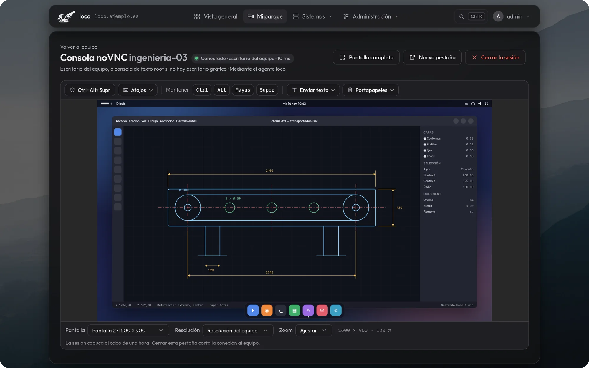
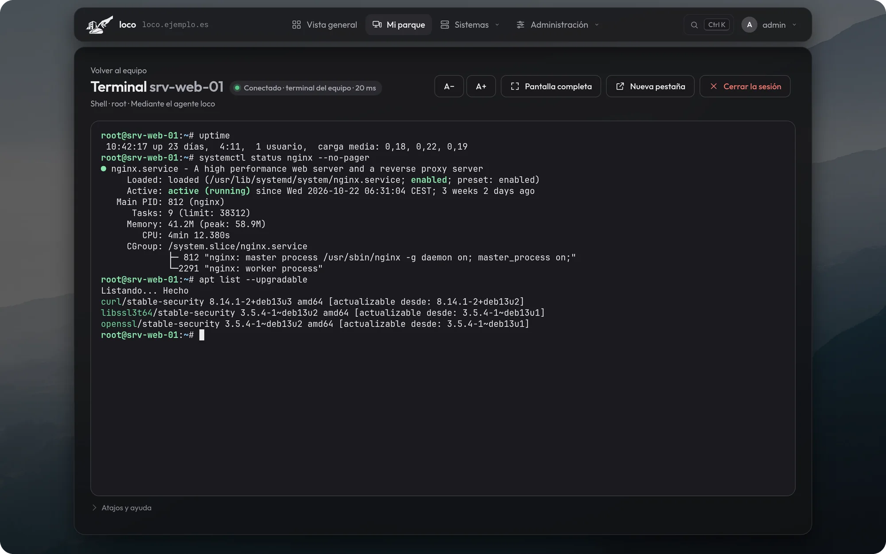
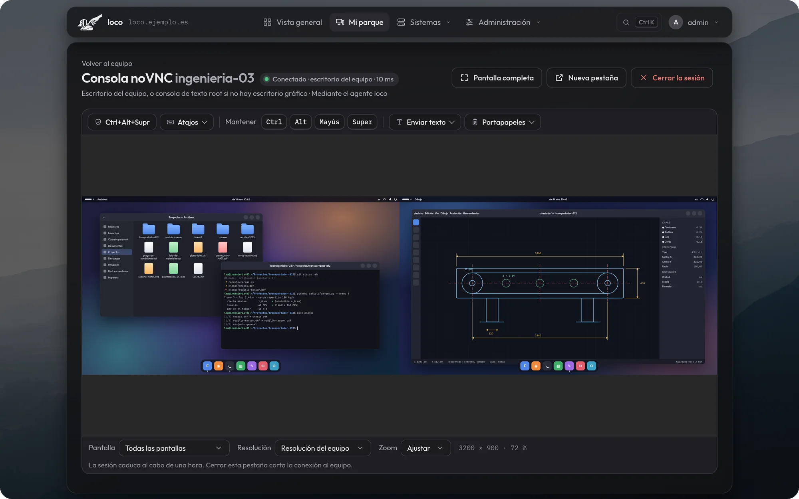

[English](../remote-sessions.md) · [Français](../fr/remote-sessions.md) · **Español**

# Sesiones remotas a través del agente

Terminal, escritorio noVNC y gestor de archivos de un equipo, manejados por el agente a través de un relé HTTPS
saliente — ningún puerto de entrada, servidor VNC ni cuenta SSH en el equipo.

**Experimental — Android**: la misma pantalla, el mismo terminal y los mismos archivos están disponibles en sus propios dispositivos
Android, mediante una aplicación que instalar (sin código QR), detrás de *Funciones › Experimental*. Un catálogo
de aplicaciones instala APK de repositorios F-Droid verificados (F-Droid, IzzyOnDroid…) y abre las fichas de Google Play
en el dispositivo, y un terminal adb (depuración inalámbrica) da un verdadero `adb shell` desde el portal. Cada acceso
se concede en el dispositivo. Vea [docs/android.md](android.md).

En la ficha de un equipo de **Mi parque**, un administrador puede abrir un **Terminal / PowerShell** o el **Escritorio noVNC**. Los botones **Pantalla completa** y **Nueva pestaña** están disponibles en ambas vistas. En **pantalla completa del escritorio**, la imagen ocupa toda la pantalla y los controles (resolución, zoom, Ctrl+Alt+Supr, atajos, teclas mantenidas, envío de texto, portapapeles, cierre) pasan a un **carril lateral izquierdo retráctil**: un tirador en el borde de la pantalla lo despliega o lo pliega. El cursor del equipo sigue visible y alineado en pantalla completa como al volver. La nueva pestaña abre una **consola dedicada**, sin la navegación del portal: una pequeña barra de herramientas y todo el espacio disponible para el equipo. La ficha del dispositivo sigue abierta en su pestaña; cada consola tiene su conexión independiente.

El agente loco 2.4 o posterior establece él mismo las conexiones HTTPS salientes hacia loco, con la autoridad del servidor fijada. No hace falta ningún puerto de entrada en el equipo, cuenta SSH, servidor VNC aparte ni acceso a Proxmox. A partir de la versión **2.158**, el agente y el navegador mantienen una **conexión persistente** (WebSocket, en el mismo puerto HTTPS) con loco: el servidor les avisa en cuanto se pide una sesión, se pulsa una tecla o el equipo responde, en lugar de esperar a su próximo sondeo — una sesión se abre al instante, la escritura responde más rápido y ya no sale ninguna petición vacía. Nada que abrir ni ajustar: si esta conexión no es posible (agente más antiguo, equipo de red que la corta, puerto local 8090 del servidor ya ocupado), la sesión pasa por idas y vueltas HTTPS como antes, sin corte. El terminal usa un verdadero PTY Linux o ConPTY Windows, con un shell **root** o **PowerShell SYSTEM** según la cuenta del servicio.

El escritorio se ajusta con dos menús independientes, memorizados por el navegador. **Resolución**: *Ajustada a la ventana* (por defecto) cambia la resolución del escritorio Windows para llenar la ventana, **sin barras de desplazamiento nunca**: si el controlador impone un modo algo distinto, la imagen se ajusta; *Resolución del equipo* conserva — y restablece — la resolución de origen. **Zoom**: *Ajustar*, o del 50 al 200 %. Con la resolución ajustada, el zoom agranda la interfaz del equipo (como el escalado de Windows) sin dejar de llenar la ventana; con la resolución del equipo, agranda la imagen, con desplazamiento más allá de la ventana (100 %: un píxel del equipo por píxel de la pantalla). La resolución y el porcentaje obtenidos siguen mostrándose, y el cursor del equipo sigue la misma escala. A partir del agente Windows **2.13.1**, la resolución ajustada reconfigura temporalmente el escritorio según los modos del controlador y restaura la resolución inicial al cerrar; una sola sesión la modifica, los equipos con varios monitores conservan su configuración y una petición hecha durante UAC espera la vuelta al escritorio. Con el adaptador VGA estándar de una máquina virtual (una sola resolución), es preferible VirtIO-GPU y su controlador virtio-win. Un agente antiguo o un escritorio X11 conservan el ajuste local; la consola de texto Linux 2.13 o posterior adapta realmente el PTY.

**Varias pantallas**: cuando el equipo tiene más de una, aparece una lista **Pantalla** junto a *Resolución* — *Todas las pantallas* (una al lado de otra, como antes) o una sola, designada por su número, su tamaño y la mención *principal*. La imagen toma el tamaño de la pantalla elegida, el ratón y el teclado siguen siendo precisos, y la elección se recuerda por equipo en el navegador: la sesión siguiente vuelve a abrirse en la misma pantalla. En Windows, los números son los de la configuración de pantalla, y una sola pantalla se lee por duplicación DXGI como un equipo de una pantalla. Disponible a partir del agente **2.162.0** en Windows y en un escritorio Linux X11, **2.163.0** en KDE Plasma con Wayland; una pantalla desconectada durante la sesión devuelve la vista a todas las pantallas. En KDE Plasma, la lista aparece cuando el uso compartido concedido en el equipo es **Espacio de trabajo completo** (primer mosaico de la ventana «Compartir pantalla»): loco recorta entonces cada pantalla de esa imagen. Si solo se concedió una pantalla, loco solo muestra esa — ratón en su sitio, incluso junto a otras pantallas; para cambiar de opinión, borre `~/.config/loco/portal-token` en el equipo: la sesión siguiente vuelve a pedir el consentimiento. GNOME con Wayland muestra su pantalla principal.

Una insignia indica el estado de la sesión y la latencia hacia el servidor; una superposición acompaña la apertura y propone, al final de la sesión, abrir una nueva en un clic. A partir del agente Windows **2.17**, la pantalla se lee por **duplicación DXGI**: solo cuando cambia, con las zonas modificadas, y la petición de imagen queda en espera mientras nada se mueve (ni tráfico ni cálculo en un escritorio inmóvil). GDI toma el relevo en el escritorio seguro, con varias pantallas o con un controlador sin duplicación. Las zonas de interfaz (texto, colores planos, iconos) se transmiten **sin pérdida** (Tight zlib), las zonas complejas (fotos, degradados, fondos de pantalla) en **JPEG**; una pantalla inmóvil no se vuelve a transmitir. En las máquinas cuyo controlador de pantalla no tiene cursor por hardware (VM, adaptador básico), Windows dibuja su cursor en la imagen: el agente lo reconoce y el navegador solo muestra entonces un punto de referencia, en lugar de una segunda flecha desplazada. El **portapapeles de texto** se comparte en ambos sentidos (agente Windows 2.15) mediante el panel *Portapapeles*: el texto copiado en el equipo aparece en el navegador (y, si este lo permite, en el portapapeles local); *Enviar al equipo* coloca un texto en el portapapeles del equipo. Una opción envía automáticamente el portapapeles local al equipo con cada clic en el escritorio. Solo en el escritorio del usuario, nunca en el escritorio seguro; loco no conserva nada.

El escritorio comparte la sesión gráfica existente: sesión interactiva en **Windows 11 y Windows Server 2022/2025**, o escritorio gráfico en Linux: **X11** (bibliotecas X11 y XTest necesarias), **GNOME con Wayland** (escritorio remoto de Mutter, imágenes por PipeWire y GStreamer; GNOME muestra su indicador de uso compartido de pantalla durante la sesión), compositor Wayland **wlroots** como Sway o Hyprland (`grim`, incluido en el paquete `.deb` del agente — presente por tanto incluso en un equipo sin conexión —, y `/dev/uinput`), o **KDE Plasma con Wayland** (portal `xdg-desktop-portal`: captura por ScreenCast/PipeWire y entrada por `/dev/uinput`; se pide un consentimiento de uso compartido de pantalla en el equipo la primera vez, y luego se recuerda para las sesiones siguientes). Los demás compositores Wayland no son compatibles. El agente Windows 2.13 también permite controlar el escritorio seguro (UAC, inicio de sesión/bloqueo) en la sesión interactiva. Un Linux sin sesión gráfica puede abrir la consola de texto descrita más abajo.

En la misma ficha, la pestaña **Archivos** abre un **gestor de archivos** del equipo (agente loco **2.23** o posterior) — el mismo que el de los [recursos compartidos](file-shares.md#abrir-un-recurso-compartido-en-el-navegador): recorrer el árbol (ruta de navegación, carpetas anterior y siguiente, atajos hacia la raíz y la carpeta personal, ordenación, filtro, archivos ocultos, espacio en disco en Linux y Windows), subir archivos o carpetas enteras (botón o arrastrar y soltar), descargar, vista previa de fotos, PDF, sonido y vídeos (leídos desde el equipo, 64 MB como máximo), editor de texto, nueva carpeta o nuevo archivo, renombrar, copiar, cortar y pegar, mover arrastrando sobre una carpeta, eliminar y, en Linux y Android, ajustar los permisos (octal). Selección múltiple con una barra en la parte inferior de la pantalla, clic derecho, atajos de teclado; un nombre ya usado se consulta antes del envío o del pegado. Lo que el agente de un equipo no sabe hacer no aparece: archivo ZIP de una carpeta, búsqueda en las subcarpetas. Como el terminal y el escritorio, todo pasa por el mismo relé HTTPS saliente: el agente ejecuta cada operación como **root** (SYSTEM en Windows) y el servidor nunca se conecta al equipo. La actualización automática de la ficha queda en suspenso mientras la pestaña siga abierta, para no interrumpir una transferencia o una edición.

Las sesiones necesitan el permiso **Terminal remoto**, **Escritorio noVNC** o **Gestionar los archivos del equipo**, según el tipo elegido, y siguen ligadas a la sesión en el portal. El perfil Administrador tiene estos permisos; los demás perfiles deben recibirlos explícitamente. Cerrar la pestaña, cerrar la sesión, retirar el agente o revocar los permisos las corta. Caducan al cabo de una hora, de un minuto sin navegador o tras una pérdida prolongada del contacto con el agente. Pueden coexistir dos sesiones de cada tipo por equipo, dentro de un límite de ocho sesiones para el servidor. Recargar la página cierra el flujo anterior; **Nueva sesión** permite empezar de nuevo limpiamente.

En un Linux sin sesión gráfica, o detenido en la pantalla de inicio de sesión de GNOME, **Consola noVNC** abre automáticamente una **consola de texto root** representada en RFB por el agente 2.7 o posterior: shell interactivo, colores ANSI, flechas, tabulación y Ctrl+C. No hace falta ningún servidor X ni puerto VNC. El permiso **Terminal remoto** es necesario además del permiso **Escritorio noVNC**; sin él, no se lanza ningún shell. Esta consola privada no sustituye al terminal físico del equipo. La pantalla arranca con 128 columnas × 40 líneas (1024 × 640 píxeles) y adapta el PTY y sus píxeles a la ventana con el agente 2.13, con glifos latinos y trazos de tablas; use el terminal habitual para seleccionar/copiar texto, desplazarse y las demás escrituras.

La consola de texto incluye las fuentes de [pyte](https://pyte.readthedocs.io/en/stable/) (LGPLv3), wcwidth (MIT) y font8x8 (dominio público), con sus licencias en `portal/agents/console`; no se descarga ninguna dependencia en el equipo.

En Windows, el agente 2.13 sigue el escritorio seguro durante una petición UAC y luego vuelve al escritorio del usuario. El control gráfico se ejecuta como SYSTEM en la sesión interactiva; la bandeja sigue sin privilegios. Las transiciones momentáneamente no disponibles suspenden la captura y la entrada sin cerrar la sesión. No se desactiva ninguna directiva UAC.

El **panel de comandos** de la consola noVNC envía **Ctrl+Alt+Supr** y los atajos habituales (menú Inicio, Ejecutar, Explorador, Mostrar el escritorio, Bloquear, Administrador de tareas, Alt+Tab, Alt+F4, Esc, Impr Pant, menú contextual). Las teclas Ctrl, Alt, Mayús y Win pueden mantenerse hasta el siguiente clic. **Enviar texto** escribe un texto carácter a carácter, sea cual sea la distribución del teclado del equipo (contraseñas, comandos); no se conserva nada. En Windows, la secuencia segura solo se acepta desde un servicio: el compañero de escritorio la señala al servicio loco-client, que solo la envía durante una sesión de escritorio remoto (agente 2.14).

El diario conserva las aperturas y los cierres, sin registrar las pulsaciones ni el contenido de las pantallas. Las colas de transferencia están acotadas, acusadas y luego borradas; se excluyen de las copias de seguridad junto con las sesiones activas.

## Equipo reservado

Una cuenta que tiene el permiso **Reservarse un dispositivo** (el perfil Administrador lo tiene) puede, desde *Más › Reservar este
equipo…* en la ficha de un dispositivo, reservarlo con una contraseña que elige. Las **demás cuentas** — incluso con el
perfil Administrador — deben entonces introducir esa contraseña para abrir su **terminal**, su **escritorio remoto**
(consola incluida) y sus **archivos**, para **reiniciarlo** (reinicio, actualización seguida de un reinicio, actualización
a una nueva versión del sistema), y en Android para su **terminal adb**, su **pantalla** y su
**desbloqueo**.
Una vez introducida, el acceso sigue abierto **media hora**, para esa cuenta y en ese navegador (*Volver a cerrar* lo cierra
antes); cinco intentos fallidos bloquean esa cuenta un cuarto de hora en ese equipo. **Todo lo demás les sigue abierto**,
según sus permisos: inventario, actualizaciones sin reinicio, despliegues, scripts, retirada del agente, olvido del
equipo.

- Desde la lista de Mi parque, *Reiniciar* deja de lado los equipos que otra cuenta ha reservado, y *Actualizar
  y luego reiniciar* o *Actualizar todo* los actualiza sin reiniciarlos — salvo aquellos cuya contraseña ya se ha
  introducido. Una actualización por oleadas nunca los reinicia. Una programación solo reinicia un equipo reservado si su autor es su propietario: no se
  puede programar el reinicio de un equipo reservado por otra cuenta, y la de un grupo o de todo el parque
  lo deja de lado — su resultado lo dice (*1 reservado, sin reiniciar*). La contraseña introducida en el navegador solo
  vale para lo que uno hace allí mismo, nunca para una programación o una oleada que sale más tarde.
- La ficha muestra *Reservado por …* (o *Reservado para usted*), y Mi parque un candado junto al nombre. El propietario cambia
  la contraseña o libera el equipo desde *Más*; nadie más puede.
- Reservar un equipo, o cambiar su contraseña, **cierra las sesiones ya abiertas** por las demás cuentas en ese
  equipo, y vuelve a cerrar los accesos abiertos con la contraseña anterior. Reservar también anula los reinicios que habían
  pedido y que aún no han salido hacia el equipo (una actualización pendiente se mantiene, sin reinicio).
- Las **herramientas MCP y la API** de las demás cuentas se rechazan en un equipo reservado: solo una persona puede introducir la
  contraseña, en el portal. Las del propietario funcionan como antes.
- La contraseña solo se guarda cifrada con hash: loco nunca puede mostrarla. **Contraseña perdida**: un administrador
  olvida el equipo y luego lo vuelve a inscribir, sin reserva. La reserva también desaparece si se elimina la cuenta que la
  tiene.
- Cada reserva, cambio, liberación, introducción correcta o fallida queda inscrita en el diario.

La reserva protege el acceso directo al equipo, no el control de un administrador: un script o un despliegue,
que siguen permitidos, se ejecutan como root (SYSTEM en Windows), y reiniciar el hipervisor Proxmox que lo aloja
también detiene el equipo, junto con sus demás máquinas.

---

[← Volver a la presentación](../../README.es.md) · [Toda la documentación](README.md)
