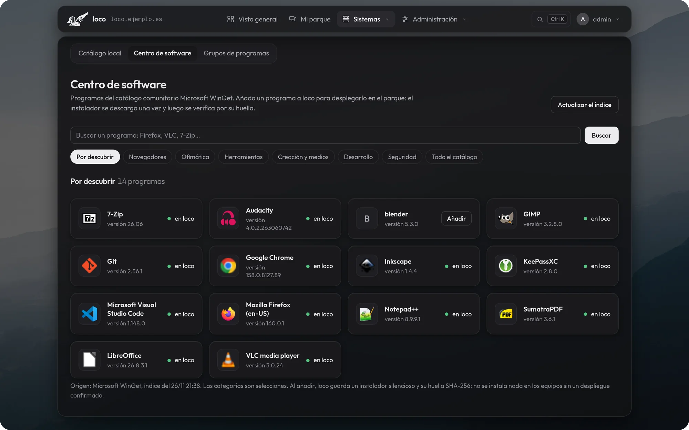
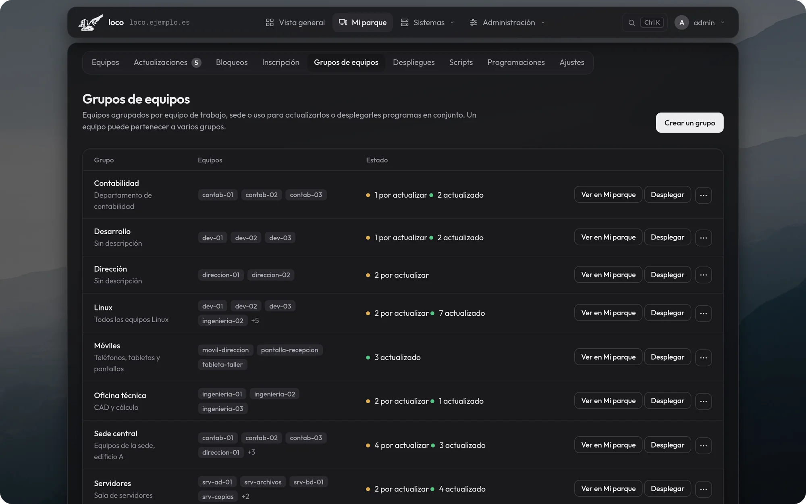
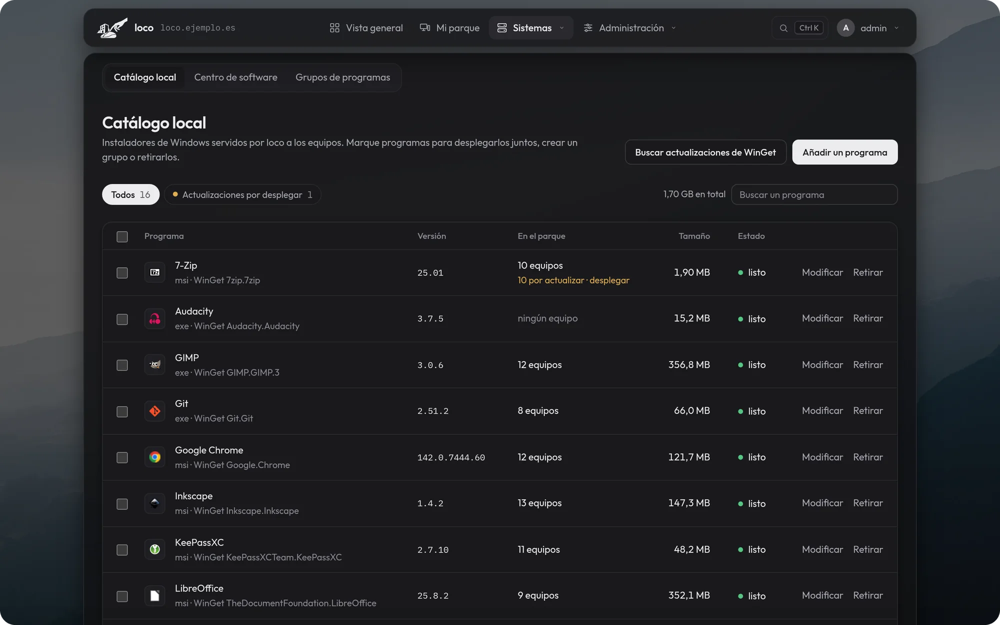

[English](../windows-software.md) · [Français](../fr/windows-software.md) · **Español**

# Centro de software de Windows

En **Windows → Software**, las pestañas **Catálogo local**, **Centro de software** y **Grupos de software** reúnen las aplicaciones; sus botones *Desplegar* abren la preparación de un despliegue, que se sigue en **Mi parque → Despliegues** (una acción sobre los dispositivos, como los scripts). El centro de software usa el catálogo comunitario WinGet de Microsoft, con búsqueda, categorías, fichas y logotipos verificados y luego guardados en caché en loco. Una inicial sustituye a los logotipos no disponibles. Las fichas indican el editor, la versión, la licencia y el instalador silencioso disponible. **Añadir a loco** descarga el instalador oficial y comprueba su huella SHA-256. El índice se renueva cada día; su último ejemplar válido sigue consultable si Internet no está disponible momentáneamente. Un programa se retira del catálogo desde su fila, o varios marcándolos, incluidos aquellos cuya descarga ha fallado; no se desinstala nada de los equipos.

Desde una ficha del centro de software, **Desplegar en dispositivos o grupos** importa el programa si hace falta y luego abre la preparación común a los programas del catálogo. También se pueden seleccionar varios programas en el catálogo o crear un **grupo de software** (por ejemplo «Base ofimática»). Un programa puede pertenecer a varios grupos. Añadir un programa a un grupo desde el centro de software lo importa una sola vez en el catálogo; las actualizaciones y los nuevos intentos conservan la comprobación de la huella WinGet.

En **Mi parque → Grupos de equipos**, cree los grupos y elija sus miembros; la ficha de un dispositivo también permite modificar sus pertenencias. Un dispositivo puede estar en varios grupos. El filtro de Mi parque muestra un grupo y limita la acción de actualización global a los dispositivos de ese grupo.

Un despliegue puede combinar programas y grupos de software, y luego dispositivos individuales y grupos de equipos. La vista previa elimina duplicados e indica los dispositivos excluidos: los programas de esta tienda son para Windows, mientras que los grupos de equipos también pueden contener Linux. **Ninguna instalación sale antes de la confirmación** y de la verificación de los instaladores. La selección queda fijada en la preparación, válida una hora: añadir un miembro a un grupo no provoca ninguna instalación implícita. Una ficha, un archivo o un destino modificados desde la preparación obligan a una nueva vista previa.

Al confirmar, loco conserva las versiones de los instaladores y envía un lote a cada agente Windows afectado, en el próximo contacto del equipo, incluso tras un período sin conexión. Modificar o eliminar después el programa del catálogo no sustituye esos archivos. Las versiones ya instaladas según un inventario reciente y las instalaciones idénticas ya pendientes se omiten; una opción permite la reinstalación explícita. **Mi parque → Despliegues** presenta el avance, las exclusiones y el registro de cada equipo. La cancelación detiene los comandos no transmitidos; una instalación ya recibida por un agente puede terminar. Las copias de seguridad conservan los grupos, los comandos y los archivos necesarios; la caché de las versiones sin comando activo se purga al cabo de una hora.

Los permisos **Gestionar los grupos de software**, **Gestionar los grupos de equipos**, **Consultar los despliegues** y **Desplegar en grupos o en varios equipos** son distintos. El último está reservado a los administradores por defecto; el Operador conserva el despliegue individual. Los permisos se vuelven a comprobar en la confirmación y antes de la transmisión a los agentes.

---

[← Volver a la presentación](../../README.es.md) · [Toda la documentación](README.md)
