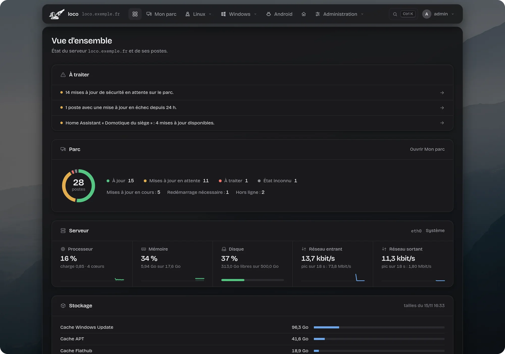

# Exploiter loco au quotidien

Ce guide s'adresse à la personne qui fait tourner loco, une fois l'installation terminée :
ce qu'il faut regarder, ce qu'il faut sauvegarder, comment mettre à jour et quoi faire quand quelque chose coince.

Pour installer : [Installer loco](installation.md). Pour le déploiement en entreprise (réseaux, GPO, proxy) :
[serveur Linux](linux.md) et [serveur Windows](windows.md).



**Sommaire** —
[Repères](#1-repères) ·
[La routine](#2-la-routine) ·
[Surveiller](#3-surveiller) ·
[Sauvegarder et restaurer](#4-sauvegarder-et-restaurer) ·
[Mettre à jour](#5-mettre-à-jour) ·
[Certificats](#6-certificats) ·
[Comptes et accès perdus](#7-comptes-et-accès-perdus) ·
[Journaux](#8-journaux) ·
[Changer sans casser](#9-changer-sans-casser) ·
[Fonctionnalités](#10-activer-ou-couper-une-fonctionnalité) ·
[Incidents](#11-incidents--par-où-commencer) ·
[Arrêter, déplacer, retirer](#12-arrêter-déplacer-retirer)

---

## 1. Repères

### Où lancer les commandes

Les mêmes outils existent partout ; seule la façon de les appeler change.

| Installation | Exemple |
|---|---|
| Linux natif | `sudo loco-user list` |
| Conteneur LXC (depuis l'hôte Proxmox) | `pct exec N -- loco-user list` |
| Docker (dans le dossier de `docker-compose.yml`) | `docker compose exec loco loco-user list` |
| Appliance ISO | console root : `loco-user list` |
| Windows (PowerShell administrateur) | `& "$env:ProgramFiles\loco\loco.cmd" user list` |

Dans la suite, les commandes sont écrites pour Linux natif.

### Ce qui tourne

| Service (Linux natif) | Rôle |
|---|---|
| `loco-portal` | le portail et les scripts des postes (sans privilèges) |
| `nginx` | HTTPS, fichiers, cache Windows Update |
| `apt-cacher-ng` | cache des paquets Debian et Ubuntu |
| `squid` | proxy-cache Windows Update, sans DNS (s'il est installé) |
| `loco-agent` | exécute en root les opérations demandées par le portail, après les avoir revalidées |
| `loco-backup.timer` | sauvegarde quotidienne, à 03:30 |
| `loco-stats.timer` | taille des caches, toutes les 15 minutes |
| `loco-nginx.path` | recharge nginx quand la liste des domaines change |

Sur l'appliance, OpenRC et supervisord remplacent systemd (services `loco` et `loco-agent`). Avec Docker, supervisord
lance le tout dans le conteneur. Sous Windows, un seul service : `loco`.

La page **Administration › Système** montre l'état de chacun.

### Les ports

| Port | Sert à | Qui s'y connecte |
|---|---|---|
| 8443/tcp | portail, dépôts, installeurs, agents (HTTPS) | postes et administrateurs |
| 8088/tcp | amorçage HTTP des postes (facultatif) | postes |
| 3142/tcp | cache APT | postes Linux |
| 80 et 443/tcp | cache Windows Update | postes Windows, par le DNS |
| 3128/tcp | proxy-cache Windows Update, sans DNS | postes Windows gérés |
| 8089 et 8090 | portail et relais des sessions distantes | le serveur lui-même, en local |

### Où sont les choses

| Quoi | Linux | Windows |
|---|---|---|
| Programme | `/opt/loco` | `%ProgramFiles%\loco` |
| Dépôts, catalogue, caches | `/srv/loco` | `%ProgramData%\loco` |
| Base, clé GPG, statistiques | `/var/lib/loco` | `%ProgramData%\loco` |
| Configuration, autorité, certificats | `/etc/loco` | `%ProgramData%\loco` |
| Sauvegardes | `/var/backups/loco` | dossier choisi à l'installation (`-BackupPath`) |

---

## 2. La routine

Rien de tout cela n'est long. L'essentiel tient sur la vue d'ensemble.

**Chaque jour — une minute**

- [ ] Ouvrir la **vue d'ensemble** : le bloc **À traiter** est-il vide ?
- [ ] Un échec dans **Mon parc › Mises à jour** ? Son motif est sur la ligne.

**Chaque semaine**

- [ ] **Administration › Mises à jour** : installer les correctifs de sécurité du serveur, redémarrer si la page le demande.
- [ ] **Administration › Système** : la dernière sauvegarde date de moins d'un jour, le disque a de la marge.
- [ ] Les postes « sans contact récent » : éteints, ou oubliés ?

**Chaque mois**

- [ ] **Restaurer une sauvegarde** sur une machine d'essai (voir [§ 4](#4-sauvegarder-et-restaurer)). Une sauvegarde jamais restaurée n'est qu'un espoir.
- [ ] Relire les **comptes** et les **jetons MCP** : retirer ceux qui ne servent plus.
- [ ] Vérifier la date d'expiration du **certificat** (page Système).

**À chaque nouvelle version de loco**

- [ ] Lire le [changelog](../CHANGELOG.md).
- [ ] Créer une sauvegarde : `sudo loco-backup create`.
- [ ] Mettre à jour (voir [§ 5](#5-mettre-à-jour)), puis ouvrir la vue d'ensemble.

> **Le plus simple est de ne pas avoir à y penser** : réglez les [alertes](#les-alertes) une fois, et loco vous écrit quand
> quelque chose demande votre attention.

---

## 3. Surveiller

### Dans le portail

- **Vue d'ensemble** — *À traiter* rassemble ce qui compte : correctifs de sécurité en attente, mises à jour en échec,
  déploiement en pause, service arrêté, sauvegarde en retard.
- **Administration › Système** — services, certificat, disque, dernière sauvegarde, version.
- **Mon parc** — la fiche de chaque poste a son onglet **Supervision** : processeur, mémoire, réseau et disques, en direct
  puis sur 24 heures ou 7 jours.

### Les alertes

**Administration › Journal › Alertes** : un interrupteur par condition, un bouton *Tester*. Envoi par **e-mail** (SMTP) ou
**webhook**. Chaque alerte a son délai de répétition : pas de rafale.

| Alerte | Se déclenche quand |
|---|---|
| Service arrêté | nginx, un cache, le portail ou l'agent n'est plus actif |
| Certificat HTTPS qui expire | il reste moins de 21 jours (réglable) |
| Sauvegarde en retard | la sauvegarde quotidienne a manqué |
| Copie hors-site en échec | la dernière copie vers le stockage externe a échoué |
| Envoi syslog en échec | les journaux n'arrivent plus depuis 5 minutes |
| Disque presque plein | le stockage des données dépasse 90 % (réglable) |
| Échecs de connexion | plus de 10 échecs en 24 heures (réglable) |
| Mises à jour de sécurité en attente | des postes ont des correctifs de sécurité à installer |
| Postes hors contact | des postes n'ont pas contacté loco récemment |
| Déploiement par vagues en pause | une vague a échoué, les suivantes attendent |
| Disque, mémoire ou processeur d'un poste | le seuil est dépassé (15 minutes en moyenne pour la mémoire et le processeur) |

### Depuis votre supervision

Deux adresses :

- `https://SERVEUR:8443/healthz` répond `ok` — le contrôle le plus simple.
- `https://SERVEUR:8443/metrics`, au format Prometheus, réservée aux réseaux d'administration (`--admin-allow`).

| Métrique | Dit quoi |
|---|---|
| `loco_info` | version installée |
| `loco_service_up` | chaque service est-il actif |
| `loco_disk_bytes` | disque des données |
| `loco_cache_bytes` | taille de chaque cache |
| `loco_wu_recent_bytes` | volume Windows Update récent, servi depuis le cache ou pris sur Internet |
| `loco_tls_cert_expiry_days` | jours avant l'expiration du certificat |
| `loco_backup_last_timestamp_seconds` | date de la dernière sauvegarde |
| `loco_devices` | postes du parc, par voyant (à jour, en attente, à traiter) |
| `loco_deb_packages`, `loco_rpm_packages`, `loco_windows_apps` | contenu des dépôts et du catalogue |

Exemple de collecte :

```yaml
scrape_configs:
  - job_name: loco
    scheme: https
    metrics_path: /metrics
    tls_config:
      ca_file: /etc/prometheus/loco-ca.crt      # l'autorité de loco (page Système)
    static_configs:
      - targets: ["loco.exemple.lan:8443"]
```

---

## 4. Sauvegarder et restaurer

### Ce qui est sauvegardé

Chaque nuit à 03:30, une archive est écrite dans `/var/backups/loco`. Les trois plus récentes sont gardées
(réglable : page Système, ou `--backup-keep`).

| Dans l'archive | Pas dans l'archive |
|---|---|
| configuration, comptes, journal | les caches — ils se reconstruisent |
| clés : autorité HTTPS, clé GPG des dépôts | les sessions distantes en cours |
| dépôts APT, RPM et Flatpak, catalogue Windows | |

> ⚠️ **Une archive contient des clés privées.** Gardez-la comme un secret.

### Les gestes

```bash
sudo loco-backup create       # tout de suite
sudo loco-backup list
```

Dans le portail, **Administration › Système › Sauvegardes** : télécharger une archive, régler le nombre d'archives gardées,
restaurer (serveur Linux natif et appliance).

### Sortir les sauvegardes du serveur

Une sauvegarde rangée sur le serveur qu'elle protège ne protège pas grand-chose.
Sur la même page, **Copie hors-site** envoie chaque nuit la dernière archive vers :

- un stockage **compatible S3** (cloud, MinIO) ;
- un serveur **SFTP** ;
- un **dossier** ou un point de montage.

Avec une phrase de passe, l'archive part **chiffrée**. Sans elle, elle part telle quelle — clés comprises.
Un échec déclenche l'alerte « Copie hors-site en échec ».

La même destination reçoit aussi, si vous le voulez, les sauvegardes de vos Home Assistant ; et les machines
Proxmox se sauvegardent depuis loco sur un stockage de Proxmox : voir [Sauvegardes](sauvegardes.md).

### Restaurer

**Sur le même serveur** — page Système › Sauvegardes › *Restaurer*, ou :

```bash
sudo loco-backup restore loco-NOM-AAAAMMJJ-HHMMSS.tar.gz
```

**Sur un nouveau serveur** — trois commandes :

```bash
sudo ./install.sh                                              # 1. installer loco, comme la première fois
sudo loco-backup restore loco-ANCIEN-AAAAMMJJ-HHMMSS.tar.gz    # 2. reprendre comptes, clés, dépôts
sudo ./install.sh                                              # 3. refaire services et certificat pour cette machine
```

L'autorité est restaurée : **les postes n'ont rien à refaire**. L'adresse, les ports et les réseaux du nouveau serveur sont
gardés. Si l'adresse change, mettez à jour le DNS de Windows Update — et prévenez les agents *avant* le déménagement
(voir [§ 9](#9-changer-sans-casser)).

Sous Windows : `& $lr backup restore 'D:\…\loco-….tar.gz'`. Les sauvegardes Windows et Linux ne sont pas interchangeables.

### L'exercice mensuel

1. Installer loco sur une machine d'essai, hors du réseau des postes.
2. Y restaurer la dernière archive.
3. Se connecter, ouvrir Mon parc et un dépôt : tout est là ?
4. Éteindre la machine d'essai.

---

## 5. Mettre à jour

### loco lui-même

Créez une sauvegarde, puis :

| Installation | Commande |
|---|---|
| Linux natif | `git pull && sudo ./install.sh` |
| Conteneur LXC | `bash proxmox-lxc.sh --ctid N --update` (sur l'hôte Proxmox) |
| Docker | `docker compose pull && docker compose up -d` — ou, depuis les sources, `git pull && sudo ./up.sh` |
| Appliance ISO | **Administration › Mises à jour**, ou `loco-update loco` |
| Windows | récupérer les sources, relancer `windows\install.ps1` |

Les migrations de la base sont automatiques. Sur l'appliance, une mise à jour qui échoue est annulée d'elle-même :
configuration, base et version précédente reviennent.

### Le système du serveur

**Administration › Mises à jour** liste les paquets en attente, correctifs de sécurité en tête, dit si un redémarrage
est nécessaire et pourquoi. En console :

```bash
sudo loco-update status      # où en est-on
sudo loco-update check       # revérifier maintenant
sudo loco-update security    # les seuls correctifs de sécurité (Debian, Ubuntu, Rocky Linux)
sudo loco-update system      # tous les paquets, noyau compris
sudo loco-update reboot
```

Dans un conteneur LXC, le noyau est celui de l'hôte : il se met à jour sur Proxmox. Avec Docker et sous Windows,
le système se met à jour par ses moyens habituels.

### Les agents

Rien à faire : **les agents se mettent à jour seuls** quand le serveur change de version. Un poste resté en arrière ?
Sa fiche propose *Plus › Mettre à jour l'agent*.

---

## 6. Certificats

À l'installation, loco crée sa propre autorité (valable 10 ans) et signe le certificat du serveur (825 jours).

- **Renouvellement** — `install.sh` refait le certificat s'il expire dans moins de 30 jours ou si l'adresse change.
  Depuis le portail (serveur Linux natif et appliance) : **Système › Certificat**.
- **Surveillance** — l'alerte « Certificat HTTPS qui expire » et la métrique `loco_tls_cert_expiry_days`.
- **Certificat d'entreprise** — `sudo ./install.sh --tls-cert serveur.crt --tls-key serveur.key`, ou la page Système ›
  Certificat (demande de signature, import). La demande ne contient que des **noms DNS**, jamais d'adresse IP : quand les
  agents joignent loco par une IP, ils gardent le certificat de l'autorité loco, et celui de l'entreprise est présenté à
  qui vient par nom (SNI). Une autorité qui restreint les adresses IP (contraintes de noms) ferait sinon refuser toute la
  chaîne par les clients BoringSSL, comme Claude Code (« unsupported name constraint type »), même si OpenSSL la valide.
  La page Système signale un certificat en service qui tomberait dans ce cas : refaites une demande, puis importez le
  certificat émis.
- **Faire confiance à l'autorité** — par GPO sur un domaine, ou avec les commandes de la page Système.
  Toujours comparer l'empreinte SHA-256 affichée par l'installation.

Les agents n'ont pas besoin du magasin de certificats du poste : ils épinglent l'autorité de loco.

---

## 7. Comptes et accès perdus

| Situation | Commande (root) |
|---|---|
| Mot de passe d'`admin` perdu | `sudo loco-user passwd admin` — affiche un mot de passe temporaire |
| Téléphone de double authentification perdu | `sudo loco-user mfa-reset NOM` |
| Clé d'accès (passkey) perdue | `sudo loco-user passkeys-reset NOM` |
| Plus aucun administrateur | `sudo loco-user roles` puis `sudo loco-user set-role NOM PROFIL` |
| Bloquer un compte tout de suite | `sudo loco-user disable NOM` (`enable` pour le rouvrir) |
| Voir les comptes | `sudo loco-user list` |

Après 5 échecs sur un compte en 15 minutes (ou 20 depuis une même adresse), la connexion est bloquée 15 minutes.
Une session inactive pendant 8 heures est fermée. Changer un mot de passe ferme les autres sessions du compte.

Le reste — profils, périmètre du parc, annuaires, SSO — se règle dans le portail : [Comptes, profils et SSO](comptes.md).

---

## 8. Journaux

### Le journal du portail

**Administration › Journal** : connexions, échecs, modifications, avec le compte et l'adresse d'origine.
Filtres par période, par compte, par catégorie ; export en JSON ; durée de conservation réglable.
Il peut partir vers votre **serveur syslog** (RFC 5424, TLS, TCP ou UDP), avec les journaux des postes si vous le voulez :
[Journal et syslog](journal.md).

Les sessions distantes notent leur ouverture et leur fermeture — jamais les frappes ni le contenu des écrans.

### Les journaux du système

| Installation | Où regarder |
|---|---|
| Linux natif | `journalctl -u loco-portal -u nginx -u apt-cacher-ng`, `/var/log/nginx/loco-*.log`, `/var/log/loco-install.log` |
| Appliance ISO | `/var/log/loco/`, `/var/lib/loco-agent/jobs/` |
| Docker | `docker compose logs loco` |
| Windows | `%ProgramData%\loco\logs` |

---

## 9. Changer sans casser

Trois changements méritent d'être préparés. Chacun a sa procédure, sans coupure pour le parc.

| Vous voulez | Le principe | Le détail |
|---|---|---|
| **Changer l'adresse du serveur** | annoncer la future adresse aux agents, attendre qu'ils la connaissent, puis basculer | [Mon parc](parc.md) — « Changer l'adresse du serveur » |
| **Changer le port du portail** | ouvrir le nouveau port à côté de l'ancien, laisser les agents l'apprendre, fermer l'ancien | [Mon parc](parc.md) — « Changer le port de l'interface » |
| **Ouvrir loco par un nom** | régler l'adresse du portail, sans toucher à celle des agents | [Mon parc](parc.md) — « Ouvrir loco par son nom » |

L'annonce d'une nouvelle adresse, en console :

```bash
sudo loco-fleet announce https://192.168.1.20:8443     # les agents la reçoivent en deux minutes
sudo loco-fleet servers                                # combien de postes sont prévenus
sudo loco-fleet forget https://192.168.1.20:8443       # annuler l'annonce
```

Sur l'appliance, `setup-loco` (console) change le réseau, le nom, les mots de passe et l'accès SSH, et fait l'annonce
lui-même. `loco-config show` et `loco-config set CLÉ=VALEUR` règlent les réseaux autorisés, les fonctions et la taille
des caches.

---

## 10. Activer ou couper une fonctionnalité

**Administration → Fonctionnalités**, réservé aux comptes au profil **Administrateur** (tout administrateur, quel que soit son nom ou son origine), active ou désactive des pans entiers de loco : paquets APT, RPM et Flatpak, cache Windows Update, Mon parc et agents, logiciels Windows, accès distant, scripts, annuaires, alertes et serveur MCP. Une fonctionnalité désactivée disparaît de la navigation, des boutons et de la vue d’ensemble ; ses pages et API sont refusées avec un message explicite et ses droits deviennent inopérants. Les agents reçoivent « réessayer plus tard » quand le parc est coupé ; installations et scripts attendent la réactivation. Les dépendances sont appliquées (accès distant et scripts suivent le parc). Sur l’appliance, les caches Windows Update, RPM et Flatpak sont aussi arrêtés ou relancés. Les données sont conservées et chaque changement est inscrit au journal.

Deux sections à part, coupées par défaut : **Expérimental** (ce qui est encore en maturation, comme les appareils Android) et **Facultatif** (ce qui est abouti mais ne concerne pas tout le monde, comme Home Assistant).

---

## 11. Incidents : par où commencer

### Le serveur

| Ce que vous voyez | Ce qu'il faut regarder |
|---|---|
| Le portail ne répond plus | `systemctl status loco-portal nginx`, puis `journalctl -u loco-portal -n 50` |
| Portail : erreur 403 | votre adresse n'est pas dans les réseaux d'administration (`--admin-allow`) |
| « Service arrêté » sur la vue d'ensemble | page Système : lequel ? `systemctl restart LE-SERVICE`, puis son journal |
| Disque presque plein | page de chaque cache : *Vider le cache* ; réduire le nombre de sauvegardes gardées |
| « Sauvegarde en retard » | `systemctl status loco-backup.timer`, `sudo loco-backup create` pour voir l'erreur |
| « le port N est déjà utilisé » à l'installation | libérer le port, ou `--https-port` / `--http-port` ; `--no-wu` libère 80 et 443 |
| L'installation s'arrête | le message donne la ligne ; détails dans `/var/log/loco-install.log` |
| Certificat expiré | relancer `sudo ./install.sh`, ou page Système › Certificat |

### Les postes

| Ce que vous voyez | Ce qu'il faut regarder |
|---|---|
| Un poste est gris, « sans contact récent » | il est éteint, hors réseau, ou son agent est arrêté (`loco-client`) |
| Une action reste « en attente » | normal tant que le poste est absent : elle n'expire pas et part à son retour |
| Une mise à jour est en échec | son motif est sur la ligne de **Mon parc › Mises à jour**, la sortie complète dans l'historique du poste |
| Un déploiement par vagues est en pause | trop d'échecs dans la vague : regarder pourquoi, puis *Lancer la vague suivante* ou annuler, depuis sa page |
| Le bureau distant ne s'ouvre pas | l'accord de l'utilisateur est peut-être exigé et refusé ; sinon voir [Sessions distantes](sessions-distantes.md) |
| Poste Linux : erreur de certificat | l'autorité n'est pas importée : `setup.sh … --trust-ca`, ou GPO |
| Windows : `irm` échoue en HTTPS | l'autorité manque dans les « Racines de confiance » de la machine |
| Logiciel Windows qui ne s'installe pas | argument silencieux absent (souvent `/S`) ; délai : `$env:LOCO_TIMEOUT` |
| Poste Red Hat : « Dépôt elN indisponible » | créer la version dans *Linux › Paquets*, ou `--no-local` |

Plus de cas, par plateforme : [dépannage du serveur Linux](linux.md#10-dépannage) et [guide Windows](windows.md).

### Dernier recours

Depuis **Administration › Système › Shell root** (serveur Linux natif et appliance), un administrateur peut ouvrir un terminal
root du serveur dans le portail — à activer d'abord, avec le mot de passe d'un compte local administrateur. Pratique quand la
console n'est pas à portée de main.

---

## 12. Arrêter, déplacer, retirer

- **Déplacer loco sur une autre machine** — c'est une restauration sur un nouveau serveur ([§ 4](#4-sauvegarder-et-restaurer)),
  précédée de l'annonce de la nouvelle adresse ([§ 9](#9-changer-sans-casser)).
- **Doubler le serveur** — deux serveurs, une adresse, bascule automatique : [Haute disponibilité](haute-disponibilite.md).
- **Retirer l'agent d'un poste** — depuis sa fiche : *Plus › Retirer l'agent*. Le poste quitte le parc proprement.
- **Désinstaller loco** :

```bash
sudo /opt/loco/remove.sh             # garde les données
sudo /opt/loco/remove.sh --purge     # efface tout, sauf les sauvegardes
```

Avec Docker : `docker compose down` (`-v` pour effacer aussi les données). Sous Windows : `windows\remove.ps1` (`-Purge` pour tout effacer).

---

[← Retour à la présentation](../README.md) · [Toute la documentation](README.md)
