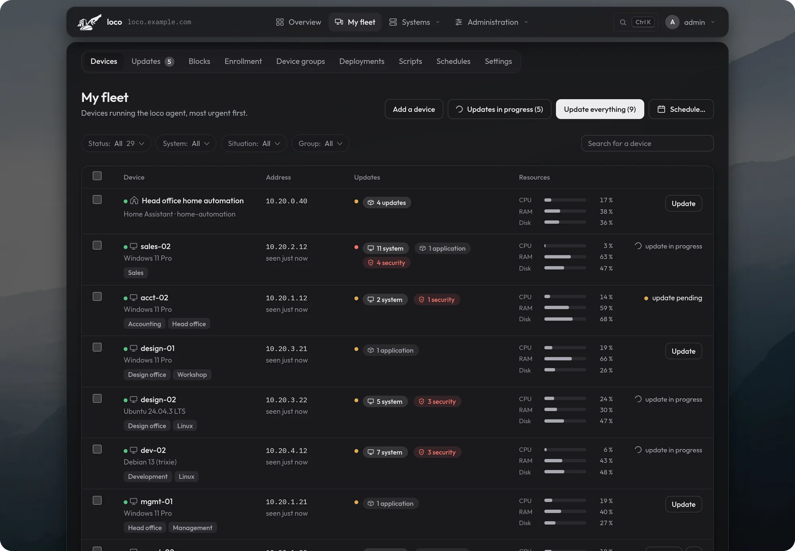
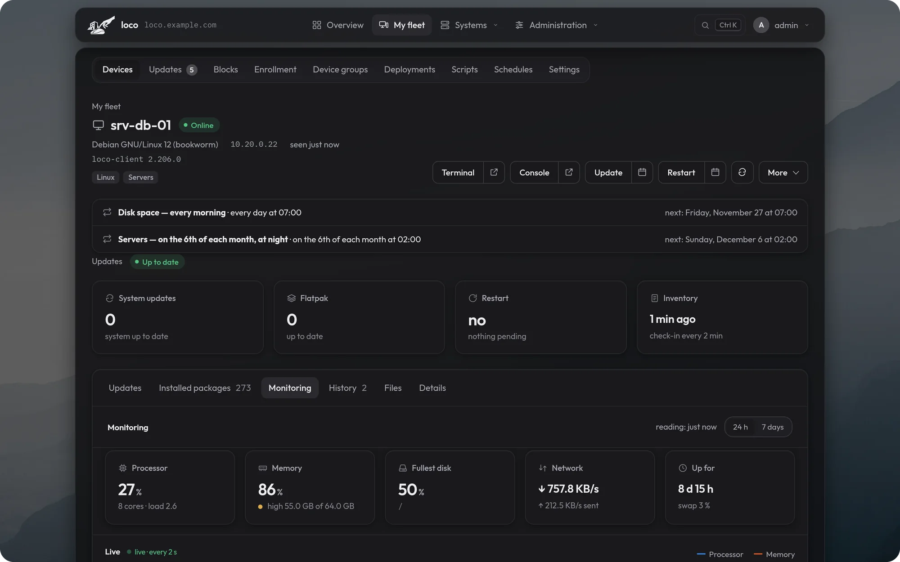
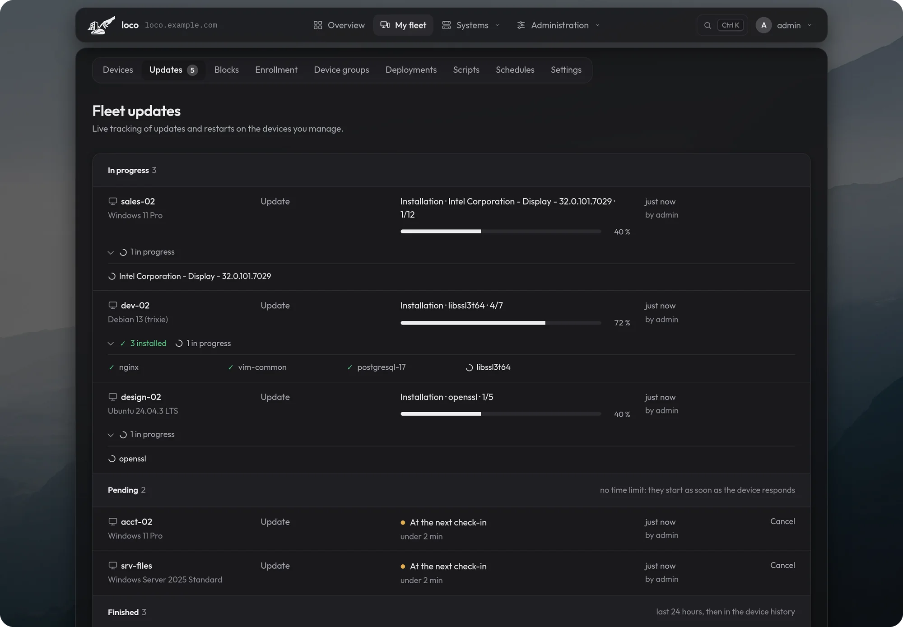
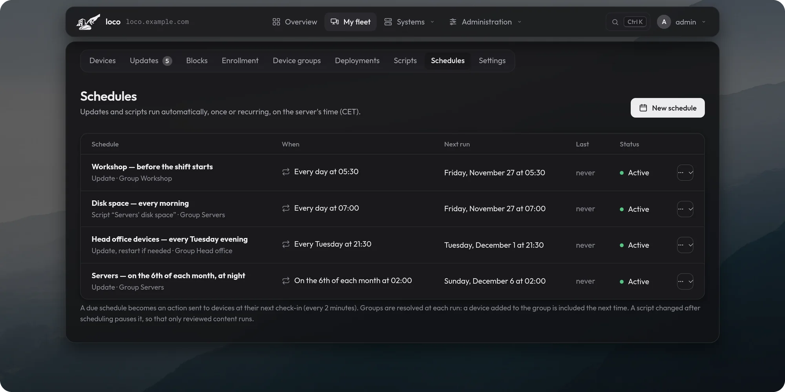
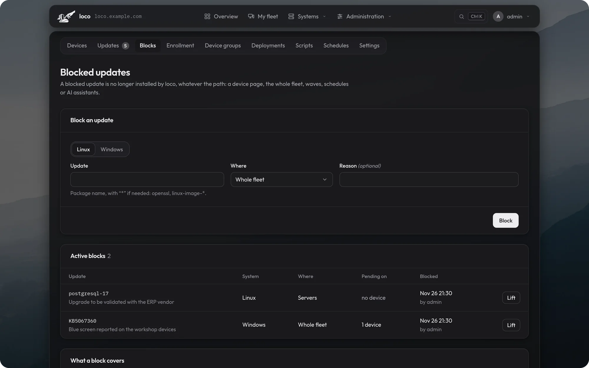
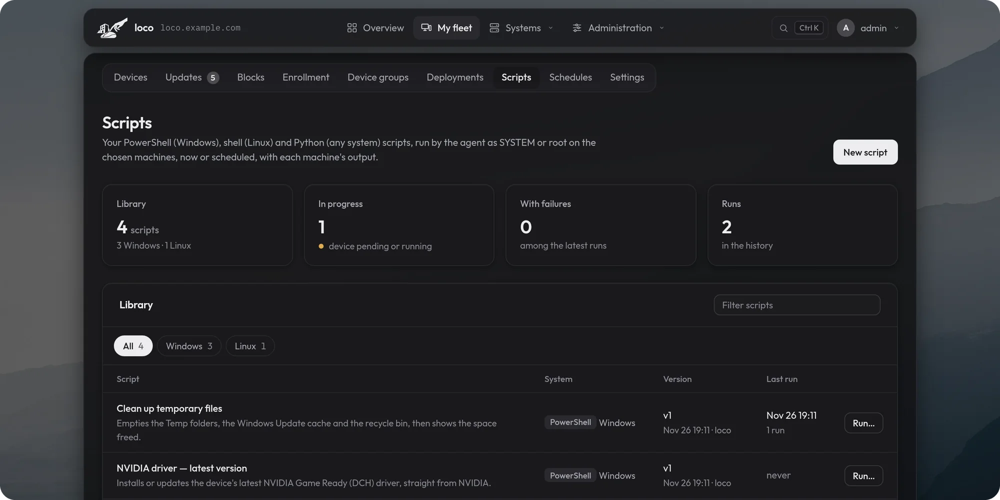

**English** · [Français](fr/fleet.md) · [Español](es/fleet.md)

# My fleet: the device agent



The `loco-client` agent (Windows and Linux) reports the devices' inventory and runs the actions it receives from loco —
updates, software, scripts, restarts. A device stays attached even when its IP address changes.

The **My fleet** page lists the devices that have the `loco-client` agent. To add one, open **Enrollment**
(navigation bar, or *Add a device* in My fleet): one tab per system (Windows; Debian, Ubuntu;
Rocky, AlmaLinux, RHEL) with the agent installer to download — **MSI**, **.deb** or **.rpm** package — and its
installation command, then the configuration of the repositories and caches (APT, DNF, Flatpak) and, on Windows, the
software of the catalog. The agent's files and commands contain the server's enrollment key. Without a
package, the command is still available:

```powershell
# Windows 10/11, Windows Server 2016+ (administrator PowerShell): installs the MSI, "loco-client" service
irm 'https://<ip>:8443/agent/windows.ps1?key=<key>' | iex
```

On a device that does not have loco's authority yet, this command fails ("Could not establish trust relationship for
the SSL/TLS secure channel"). The one on the *Enrollment* page therefore starts with a check that recognizes
loco's certificate by its SHA-256 fingerprint: it works without importing anything first, and refuses any other
certificate (interception). Run it in **Windows PowerShell** (not PowerShell 7).

```bash
# Debian, Ubuntu, Rocky Linux, AlmaLinux, RHEL (systemd): Python agent and systemd timer
curl -fsSL 'https://<ip>:8443/agent/linux.sh?key=<key>' | sudo sh
```

**DNS name, then IP.** When loco has a DNS name — the portal address, or failing that the name of its enterprise
certificate —, the preconfigured commands, Linux script, packages, MSI and APK try that name first,
then the server's IP. A DNS name often presents the certificate of an enterprise authority, which not every device
recognizes (new or off-domain device, agents' bundle without that authority); the IP presents loco's certificate,
recognized by the fingerprint of its authority. The device enrolls through the first address that answers, and the agent
keeps the other one as a fallback. The *Enrollment* page shows the addresses and their order. For an MSI deployed by hand or
by GPO, `SERVER` (or the `Server` registry value) likewise accepts several comma-separated addresses:
`SERVER=https://loco.company.lan:8443,https://192.168.1.10:8443`.

**Enroll straight into a group**: at the top of the Enrollment page, *Enroll devices into the group* switches
the MSI, the .deb/.rpm packages, the commands and the mass-deployment command (GPO, Intune) to the **group
key** (`g<id>-…`): a device enrolled with them joins that group (a device already enrolled joins it too, without
leaving its own). No agent to update: the group key takes the place of the server key. By default,
no group; *Enroll devices into this group* (⋯ menu of a group) opens the page on it. An account limited to
part of the fleet only enrolls into the groups assigned to its profile (never without a group: the device would leave
its fleet). *Change this group's key* (*Configure the fleet* right) voids its files and commands already
handed out; deleting the group does too.

- The agent contacts loco every two minutes when idle — and every ten seconds while an action is
  pending or has just run, so that it starts almost at once — and sends the inventory of the updates
  (Windows Update with the security fixes, APT, DNF, Flatpak). The inventory of the installed software is also
  reported, on Windows (installed programs) as on Linux (APT/RPM packages with version, architecture and size,
  Flatpak applications); it is shown on the device page in My fleet. On Linux as on Windows, the
  *Specifications* section (*Details* tab) also shows the processor (physical cores and logical processors), the
  memory, the system disk, the kernel or Windows version, virtualization, and the hardware configuration:
  machine and serial number, motherboard, BIOS, memory modules (slot, size, type, speed, manufacturer)
  and physical disks (model, size, SSD or hard drive — "—" when the device does not know, on a virtual
  machine for example), graphics cards (name, video memory, driver version).
- **NVIDIA driver (Windows)**: the *Updates* tab of a device with an NVIDIA card compares its driver with the
  latest *Game Ready* driver NVIDIA published for that card; *Update the driver* has the agent download it
  from download.nvidia.com (about 1 GB), check it (NVIDIA signature) and install it with no window and no restart —
  the screen flickers for a few seconds. Never included in *Update* or *Update everything*. Right: *Update a
  device*. On Linux, the driver is a system package. When a Linux device enrolls, its software and specifications
  show from the first contact, and the count of updates follows once the first network scan is done.
- **Status lights**: green, no updates; orange, 1 to 9 updates; red, 10 updates or more.
  The total adds up system, Flatpak and software (loco's catalog, and winget on Windows). The red threshold can be
  set in My fleet.
  A missing or incomplete inventory, or a device without recent contact, is grey, without skewing the count.
- **Actions**: *Update* (one device) or *Update everything* (the whole fleet, all systems), with an optional
  restart; install or update a catalog application; inventory; restart; agent removal.
  These actions use a closed list; administrators also have the interactive terminal described below.
- **Devices ticked in My fleet**: a bar says how many devices are selected (across all pages) and offers
  *Wake*, *Restart* and *Update*; the *More* menu adds *Update, then restart if needed* and
  *Turn on remote wake*. A device that is already restarting or changing its system version, or an Android device, is
  left out and counted. Rights: those of each action on a device.
- **Home Assistant and Proxmox** (optional features, once linked): their rows behave like
  the devices'. *Update everything* and the whole-fleet schedule update them too (Home
  Assistant with a backup first) and the button's number counts them; *Update this group* does not touch them,
  they belong to no group. They can be ticked, follow the filters (*Status*, *System › Home Assistant* or
  *Proxmox VE*, *Situation*), the search (Ctrl K included) and the live refresh, count in the page's numbers
  and in the overview ring, and their tasks appear in *Updates*. A Proxmox server
  also restarts with a selection, *Update, then restart if needed* or the button on its row
  when a restart is required — but only after the updates in progress on the fleet's devices have finished (an
  hour at most), since all its machines stop with it. Rights: those of Home Assistant and Proxmox.
- **Custom name**: a device's page (*More → Custom name…* menu) lets you give it a more
  meaningful name, shown instead of its hostname in My fleet and in the search; the hostname stays visible.
  *Name devices* right (Administrator and Operator).
- **Pages followed live**: My fleet, a device's page and the Wazuh page refresh in place when a device
  or an action changes, without reloading; nothing is replaced while you are acting (dialog or menu open, typing,
  ticked boxes, selected text), and an expanded log stays expanded. A transient error (loco restarting) is ignored
  until the next reading.
- **Updates one by one, live**: on a device's page, the *Updates* tab lets you tick
  some system updates (APT/RPM packages, Flatpak applications, or Windows updates) and start
  *Update the selection*; *Update* still does everything. While it runs, the page follows the progress
  without reloading: step (preparation, download, installation), package or update in progress, progress
  bar, and in the table the finished items (✓) and the one in progress. On Windows, the updates
  install one by one (servicing stack first) and an error no longer stops the next ones. Agents 2.120.0 and
  later (they update themselves); the MCP tool `update_device` accepts the same selection (`updates`, `flatpak`).
- **Software outside the catalog (Windows)**: the installed programs that winget can track (7-Zip, Notepad++, VLC,
  Remote Desktop Manager…) show in the *Updates* tab, next to the Windows updates, with their
  installed version and the new one ("25.01 → 26.06"), without entering loco's catalog. The agent lists the
  installed programs with `winget export` (SYSTEM account, with the winget of Microsoft's App Installer package); loco
  compares their versions with its winget index, renewed every day. They can be ticked like Windows updates, and
  *Update* (one device, the whole fleet, schedules) updates them all; the agent runs `winget upgrade` for
  each, silently, and the download comes from the vendor, as with winget. An application also present in
  loco's catalog follows the catalog's path. An application published only in English also updates on a Windows
  in French (the agent tries again accepting the English installer). What winget cannot update on a
  device is set aside, with its reason, as long as its version does not change; the components that Windows or their vendor
  keep up to date (App Installer, Edge, WebView2, Teams, OneDrive, Terminal) are never offered. Limits: the
  programs installed for a single user (in their profile) are not seen by the SYSTEM account; without App Installer (some editions of Windows Server), the page
  says so and only the Windows updates remain. Agents 2.175.0 and later.
- **Update to a new version of the system**: when the next major version is published, the device's
  page says so ("Update to Debian 13 (trixie)", next to the system's name and at the top of the *Updates*
  tab), as does My fleet, which also has the *Situation › Update to a new version* filter. The status light does not
  change: it is information. The button starts the upgrade, which always ends with a restart:
  - **Debian**: the next version, as soon as the device's archive publishes it as the stable version. The agent first
    updates the current version, refuses to start if there are held packages left (including loco's blocks) or
    inconsistent packages, then switches the repositories to the new version (`bookworm`, `-updates`, `-security`,
    `-backports` → `trixie`…, loco's repository included) and keeps a copy of the old files. A third-party repository that does not
    publish the new version yet is disabled (commented out, never deleted), and the report names it. The disk space
    is checked before installing anything; if the new repositories cannot be read or space is short, the repositories
    are put back as they were. Then `apt-get upgrade` and `full-upgrade`, with no questions (modified configuration
    files kept), and a restart.
  - **Ubuntu**: the version that `do-release-upgrade` offers according to the device's setting (LTS only by default). The
    current version is updated first; if it requires a restart, the device restarts and the upgrade
    resumes on its own. Ubuntu's official tool does the rest, with no questions, then loco's repository is put back for the
    new version.
  - **Fedora**: the next version as soon as it is published; `dnf system-upgrade` downloads it, then the device restarts
    to install it offline, and loco checks the version when it is back.
  - **Windows**: the new version that Windows Update offers (Windows 11 from Windows 10, 24H2 → 25H2…). It no longer
    goes with *Update*: only through this button, then Windows finishes it at the restart.
  - Rocky Linux, AlmaLinux and RHEL are not concerned: moving from one major version to the next there requires Leapp
    or ELevate and manual checks.

  On Linux, the upgrade runs in its own service, outside the agent: it survives an agent restart and
  has no time limit (loco reports it as failed with no result after 24 h). Its progress shows live
  (step, packages) and its full log stays on the device (`/var/lib/loco-client/os-upgrade/upgrade.log`). In the
  meantime, loco sends nothing else to the device. Rights: *Update a device* and *Restart devices*. Agents
  2.171.0 and later.
- **Following the updates** (*My fleet → Updates*): the updates and restarts of your fleet, live. **In progress**:
  step, bar and packages or Windows updates one by one (installed, in progress, failed). **Pending**: what each row
  is really waiting for (next contact, schedule, device offline); a pending action does not expire, it goes when the
  device is back, and *Cancel* removes it. **Finished**: 24 hours on this page, failures first with their reason, then in the device's history.
- **Schedules** (*My fleet → Schedules*): updates, restarts and scripts started **once, every day, every
  week** (days of your choice) **or every month** (fixed day or last day), in the server's time, on the whole fleet,
  groups (members resolved at each run) or devices. You can also schedule in context: calendar button next to
  *Update* and *Restart* on a device's page, *Schedule…* next to *Update everything*, and a "Now /
  Schedule" choice when running a script. A plain-language summary ("Every Tuesday and Thursday at 02:00 · next run…")
  goes with the input; a device's page lists the schedules that concern it. A schedule that is due becomes
  an action sent at the agents' next contact; a missed occurrence is not caught up. Pause, resume and
  deletion from the list. A script modified after it was scheduled pauses the schedule (only what was
  reviewed runs); an action still queued can be cancelled from the device's page. Rights: those of the scheduled action (update,
  whole fleet, restart, run scripts), checked again when sending to the devices; restarting a group or the whole
  fleet also requires the "whole fleet" right. Android devices do not restart on a schedule.
- **Identity**: each device has its own identifier and token, independent of its address. A device that changes
  IP (DHCP, another site, VPN) stays in the fleet; only *Remove the agent*, pushed from loco, detaches it. Reinstalling
  the agent keeps the device's page: the agent proves it holds its token, without presenting it. The enrollment key
  alone therefore cannot take over a device: whoever presents the identifier of an already enrolled device without that proof
  (restored disk, clone, removed device) is enrolled as a new device, and the audit log notes it.
- **Security**: loco's HTTPS authority is pinned by the agent (SHA-256 fingerprint) without changing the device's
  certificate store; installers checked by SHA-256; tokens stored hashed on the server.
- **.deb and .rpm packages**: produced by loco for this server (address, pinned authority and key included), they
  install with `sudo apt install ./loco-client_<version>+depots_all.deb` or
  `sudo dnf install ./loco-client-<version>-1.depots.noarch.rpm` and enroll the device at once. This
  recommended variant also configures loco's repositories and cache (authority entrusted to the system); the
  "agent only" variant (`loco-client_<version>_all.deb`, `loco-client-<version>-1.noarch.rpm`) leaves the repositories alone.
  Moving from the agent only to the full package is an update that keeps the enrollment; uninstalling the package
  removes the agent (and, for the full package, the repository configuration). The package only contains the installation
  scripts: the agent then updates itself. They can also be downloaded from the device, over HTTPS or through
  the bootstrap HTTP port (`/agent/loco-client.deb?key=…`, `&depots=1` for the full variant).
- **Windows, downloaded MSI**: the *Enrollment* page offers the MSI as a direct download (public link, which can also
  be opened from the device's browser) and the `msiexec` command to run as administrator with the server's address, key
  and fingerprint; a simple double-click installs the service without enrolling it.
- **Windows at scale**: hand out `loco-client.msi` (GPO, Intune, SCCM) and set `Server`, `Key` and `CaSha256`
  under `HKLM\SOFTWARE\Policies\loco\Client`, or `msiexec /i loco-client.msi SERVER=… KEY=… CA_SHA256=… /qn`.
  The MSI is published with each version; the server downloads it from GitHub at the first installation
  (fingerprint checked) or uses the one placed in `portal/agents/`. It is not signed (no code-signing
  certificate): SmartScreen may warn during a manual installation.
- **Software**: in *Windows software*, filling in the name shown in Windows and the version lets loco spot the
  devices to update. The *Software center* imports an application with this information; *Check for WinGet updates*
  updates the applications that come from winget, then the devices concerned turn orange.

The agent updates itself along with loco. On Windows, the installer lays down the whole new version before
removing the old one: a device switched off abruptly in the middle of an update keeps a working agent (the old one or the
new one) and resumes it later. Only the installer of the running version stays cached
(`C:\ProgramData\loco-client`), and the update's log (`update.log`) is written there line by line.





**Changing the server's address**: first announce the future address (*My fleet › Server address for agents*,
or `sudo loco-fleet announce https://192.168.1.20:8443`), wait until every device has been told
(`loco-fleet servers`), then change the address (`install.sh --host`, or `setup-loco` on the appliance, which makes the announcement
itself). The agents move to the new address on their own, after checking loco's HTTPS authority; a device
left off during the whole announcement re-enrolls with the installation command (same identity). The Linux agents
also update their APT proxy and their repositories; a device configured by `setup.sh` without an agent must run it again.



**Deploying in waves**: in *Update everything* and when confirming a deployment, choose *In waves*, the number
of devices per wave, the wait between two waves, the failure threshold and, if needed, a pilot group. A wave only goes
if the previous one has at least one success and fewer failures than the threshold; otherwise everything pauses, the
overview flags it, a notification goes out, and you decide what comes next. A device that is off does not block. The
schedules and the actions on ticked devices always go all at once.

**User approval before the remote desktop** (off by default): required on a device (device page, *Details* tab) or on all
the devices of a group (*Device groups*, group menu), or requested for one session (*More* menu of the device page). The person in front of the device accepts or refuses in a window,
before any capture. No answer within a minute, or a locked screen, counts as a refusal. If nobody is signed in, the desktop
opens without asking. On Linux, zenity or kdialog is needed. The terminal and the files are not concerned.



**Blocking an update**: *Blocks* tab of My fleet, or *Block* on its row in a device's page. A package (Linux)
or a KB or a title (Windows), with "*" as a wildcard, on the whole fleet or a group. loco no longer installs it, whatever the
path: device, whole fleet, waves, schedules, AI assistants. On the device, Debian and Ubuntu hold the package
(`apt-mark hold`), which also applies to their automatic updates, and Windows hides the update, except those it
enforces. With DNF, only the updates started by loco are concerned. An application updated by winget (Windows) is blocked
by its name or its winget identifier ("VLC*", "7zip.*"). Flatpak and loco's catalog software are not concerned.

**Waking a device that is off** (Wake-on-LAN): *Wake* button in My fleet and on the device's page. It only appears if
the device had a connected Ethernet card at its last contact, never over Wi-Fi, and if the server or a device that is on is on the
same network: a wake-up packet does not cross routers. The device's page shows its cards and, otherwise, why
wake is not available. *Enable wake* (device page, or selection) asks the agent to turn it on for its Ethernet
cards and keep it on: on Linux, it applies it again at each contact, because a restart often resets it. It must
also be allowed in the BIOS, which the agent cannot do.

**Changing the interface port**: *System › Network › Web interface port*. The new port opens next to
the old one, so nothing is cut off. The agents learn it at their next contact and the page counts those that
know it. Then open the interface on the new port and close the old one from there: the agents switch
on their own, HTTPS repositories included. Think of the firewall in front of the server, the bookmarks, the MCP clients, the monitoring
and, with SSO, the redirect address declared at the identity provider. On the command line: `install.sh
--https-port N --https-old-ports "OLD"`, then `--https-old-ports ""` to close. Under Docker (`LOCO_HTTPS_PORT`) and on
a Windows server (`install.ps1 -HttpsPort`), first announce the new address to the agents: there is no dual listening.

**Opening loco by its name**: *System › Network › Portal address*. It is the address of the browsers and of the SSO redirect;
the agents and the enrollment keep theirs, so nothing changes for the fleet. The certificate must cover this name: for a
loco certificate, tick *Add this name to loco's certificate*; for an enterprise certificate, request one that
covers it. The page lists the redirect URLs to declare again at the SSO providers. On the command line: `loco-config
portal-url https://loco.example.lan:8443 [--add-to-certificate]`, and `--default` to go back to the agents' address. Under
Docker: `LOCO_PORTAL_URL`. On a Windows server: `install.ps1 -PortalUrl`.

**Names the server's DNS does not resolve**: *System › Network › Internal names*, or directly from *Check
configuration* of an SSO provider. They go in a dedicated block of `/etc/hosts`, rebuilt after an update or
`setup-loco`. The DNS servers of the Windows Update cache (`--resolvers`) do not change. Under Docker: `extra_hosts`.

On Windows, the MSI also installs **loco-tray.exe**, started in each user session. Its dot mirrors the state in My fleet: green with no updates, orange from 1 to 9 updates, red from 10 (adjustable threshold). An unavailable or outdated state is grey. The menu and the double-click only show details: **no update action is available to the user**. The companion does not contact the server and reads no token; it reads a public state file, which standard users can only read. The privileged service alone is responsible for the actions received from loco.

## Scripts



**My fleet → Scripts** gathers a library of **PowerShell** (Windows) and **shell** (Linux) scripts with their description, their author and their version: each change of content or system creates a new version. **Run** opens the selection of devices and device groups; only the active devices of the right system are kept. The reviewed version must be the one that runs: a script modified in the meantime has to be reviewed again.

The content sent is frozen at run time with its SHA-256 fingerprint, checked by the agent before running the script as **SYSTEM** (PowerShell without a profile) or **root** (`/bin/sh`, or the interpreter of the first `#!` line), with a 30-minute time limit. The run's page follows each device live: state, exit code, standard output and errors. The devices that have not received the script yet can be cancelled; a script already sent runs to the end. The results can still be viewed after the script is deleted.

The rights **View scripts**, **Manage scripts** and **Run a script on devices** are separate; the last two are sensitive and reserved to administrators by default. The run right is checked again before sending to the agent. Windows and Linux agents 2.14 or later.

---

[← Back to the overview](../README.md) · [All the documentation](README.md)
