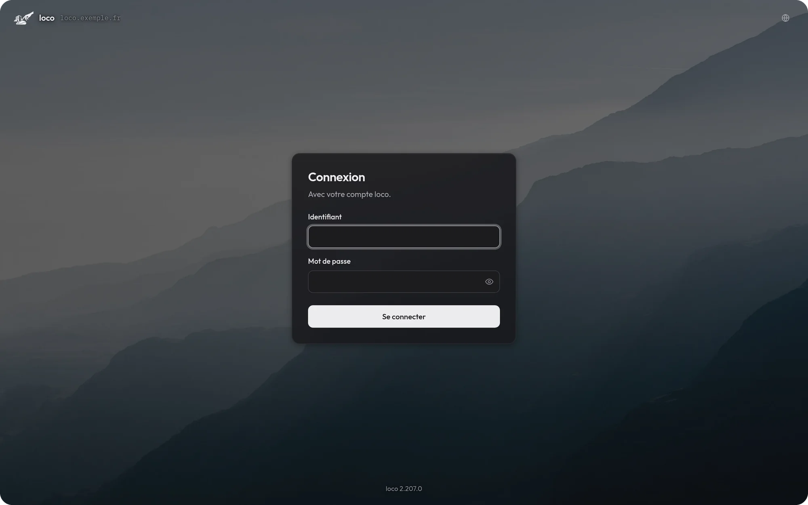

[English](../installation.md) · **Français** · [Español](../es/installation.md)

# Installer loco

Un serveur, cinq façons de l'installer. Le portail, les dépôts et les caches sont les mêmes partout ; seul le dépôt Flatpak local demande un serveur Linux.



## Choisir son installation

| Serveur | Systèmes | Installation | Guide |
|---|---|---|---|
| **Linux natif** (recommandé) | Debian 12 / 13, Ubuntu 22.04 / 24.04 / 26.04, Rocky Linux 8 / 9 / 10 | `sudo ./install.sh` | [docs/linux.md](linux.md) |
| **Windows natif** | Windows 11, Windows Server 2022 / 2025 | `windows\install.ps1` | [docs/windows.md](windows.md) |
| Conteneur LXC | Proxmox VE 7 / 8 / 9 | `linux/lxc/proxmox-lxc.sh` | [docs/linux.md](linux.md) |
| Appliance ISO | Alpine Linux (BusyBox), BIOS/UEFI | `linux/iso/` (assistant, réponses et portail) | [docs/linux.md](linux.md) |
| Docker | Docker Engine 26+ et Compose v2 | `linux/docker/` | [docs/linux.md](linux.md) |

## Serveur Linux

### Installation native (recommandée)

```bash
git clone https://github.com/ShaNouhAr/loco.git
cd loco
sudo ./install.sh
```

Debian 12 / 13, Ubuntu 22.04 / 24.04 / 26.04 et Rocky Linux 8 / 9 / 10 (validations serveur en amd64). L'installation affiche l'adresse de l'interface
(`https://<ip>:8443`), l'empreinte de l'autorité de certification et le mot de passe initial du compte
`admin` (à changer à la première connexion). Le script est relançable : il sert aussi à mettre à jour
(`git pull && sudo ./install.sh`) et à reconfigurer.

Sur Rocky Linux, la même commande détecte le système et utilise DNF avec EPEL et PowerTools (8) ou CRB (9/10). SELinux reste
actif ; les contextes et les ports nécessaires sont configurés. Si firewalld tourne déjà, une règle de
service dédiée est ajoutée ; les réseaux autorisés restent contrôlés par `--allow` et `--admin-allow`.
Rocky 10 compile le cache APT depuis une version des sources Debian avec ses correctifs, vérifiée par
SHA-256 (ce composant manque dans EPEL 10). Rocky 8 compile uniquement l’indexeur `apt-ftparchive`
2.6.1 depuis les sources Debian vérifiées ; il utilise Python 3.11 pour le portail, dans un environnement
isolé. Si nginx ne fournit pas le relais TLS requis, l’installateur sélectionne le flux nginx 1.24
d’AppStream ; un nginx préexistant est mis à jour en conservant sa configuration et reste sur ce flux
après désinstallation. La première installation prend donc plus de temps ; les relances réutilisent les outils compilés.

Options principales (toutes : `sudo ./install.sh --help`) :

| Option | Effet |
|---|---|
| `--allow "CIDR …"` | réseaux autorisés pour les postes (défaut : réseaux privés) |
| `--admin-allow "CIDR …"` | réseaux autorisés pour l'interface (défaut : comme `--allow`) |
| `--proxy http://hôte:port` | proxy d'entreprise pour sortir sur Internet |
| `--no-http` | HTTPS seul (autorité déjà déployée sur les postes) |
| `--no-wu`, `--no-flatpak`, `--no-rpm` | sans cache Windows Update, sans Flatpak, sans famille Red Hat |
| `--wu-proxy-port P` | port du proxy-cache Windows Update (Squid, sans DNS ; 3128 par défaut) |
| `--tls-cert F --tls-key F` | certificat d'entreprise au lieu de l'autorité locale |
| `--backup-keep N` | sauvegardes quotidiennes gardées (défaut 3, 0 = aucune) |

### Conteneur LXC sur Proxmox VE

Sur n'importe quel hôte Proxmox VE 7, 8 ou 9, en root :

```bash
curl -fsSLO https://raw.githubusercontent.com/ShaNouhAr/loco/main/linux/lxc/proxmox-lxc.sh
bash proxmox-lxc.sh                                   # DHCP, 100 Go, 2 processeurs, 2 Go de mémoire
bash proxmox-lxc.sh --ip 192.168.10.20/24 --gw 192.168.10.1 --disk 300 -- --allow "192.168.10.0/24"
```

Le script crée un conteneur Debian 13 non privilégié (Debian 12 sur Proxmox 7), choisit le stockage
(`local-lvm`, `local-zfs`…) et le pont (`vmbr0`) disponibles, télécharge la dernière version publiée
et y fait l'installation native ; les options après `--` sont celles d'`install.sh`. Il affiche ensuite
l'adresse, l'empreinte de l'autorité et le mot de passe initial. Mise à jour :
`bash proxmox-lxc.sh --ctid N --update`. Toutes les options : `bash proxmox-lxc.sh --help`.

### Avec Docker

Sans cloner le projet — l'image `ghcr.io/shanouhar/loco` est publiée avec chaque version :

```bash
mkdir loco && cd loco
curl -fsSLO https://raw.githubusercontent.com/ShaNouhAr/loco/main/linux/docker/docker-compose.yml
curl -fsSL https://raw.githubusercontent.com/ShaNouhAr/loco/main/linux/docker/.env.example -o .env   # facultatif : LOCO_HOST, LOCO_ALLOW, LOCO_PROXY, LOCO_WU…
docker compose up -d
docker compose logs loco   # adresse, empreinte de l'autorité, mot de passe initial de « admin »
```

Mise à jour : `docker compose pull && docker compose up -d`. Pour rester sur une version précise :
`LOCO_IMAGE=ghcr.io/shanouhar/loco:2.165.0` dans `.env`.

Depuis les sources — l'image est construite sur place :

```bash
git clone https://github.com/ShaNouhAr/loco.git
cd loco/linux/docker
cp .env.example .env
sudo ./up.sh               # construit l'image, démarre loco et attend qu'il soit sain
```

Même portail, mêmes fonctions et même configuration que l'installation native : au démarrage, le
conteneur applique les variables de `.env` avec `linux/install.sh --container`, puis `supervisord` lance nginx,
apt-cacher-ng, le portail et les tâches périodiques. Le conteneur utilise le **réseau de l'hôte** (ports
8443, 8088, 3142, et 80/443 pour Windows Update) : ne pas l'associer à une installation native sur la même
machine. Les données sont dans des volumes Docker (`LOCO_DATA_DIR` : dossier de l'hôte pour les dépôts et
caches). Depuis les sources, installation et mise à jour : `sudo ./up.sh` (dans `linux/docker`, après `git pull`).

L'installation native reste recommandée en production : elle confine chaque service avec systemd
(détails dans [SECURITY.md](../../SECURITY.fr.md)). Docker Engine 26 ou plus récent avec Compose v2 (validé avec
les paquets `docker.io` et `docker-compose` de Debian 13).

Déploiement en entreprise (réseau, GPO, proxy, sauvegardes, supervision, LXC, Docker, dépannage) :
**[guide Linux](linux.md)**.

### Administration

```bash
sudo loco-user list | roles | add NOM [PROFIL] | set-role NOM PROFIL | passwd NOM   # comptes (accès perdu : passwd admin)
sudo loco-backup create | list | restore ARCHIVE             # sauvegardes
sudo /opt/loco/remove.sh [--purge]                           # désinstallation
```

Dans un conteneur LXC, depuis l'hôte Proxmox : `pct exec N -- loco-user list`, etc.
Avec Docker, les mêmes commandes passent par le conteneur : `docker compose exec loco loco-user list`,
`docker compose exec loco loco-backup create`. Désinstallation : `docker compose down`
(ajouter `-v` pour effacer aussi les données).

### Architecture

| Élément | Emplacement | Port |
|---|---|---|
| Portail (Flask + gunicorn, unité `loco-portal`, confinée) | `/opt/loco` | 8089, local |
| Relais des sessions distantes (connexions persistantes, dans le processus du portail) | `/opt/loco/portal/loco/relay.py` | 8090, local |
| nginx : interface et fichiers des postes (HTTPS) | `/etc/nginx/sites-available/loco-portal.conf` | 8443 |
| nginx : amorçage HTTP (optionnel) | même fichier | 8088 |
| nginx : cache Windows Update, relais HTTPS (SNI) | `loco-wucache.conf`, `modules-enabled/99-loco-stream.conf` | 80, 443 |
| squid : proxy-cache Windows Update (sans DNS) | `/etc/squid/squid.conf`, cache `/srv/loco/wuproxy` | 3128 |
| apt-cacher-ng | `/var/cache/apt-cacher-ng` | 3142 |
| Données : dépôts, catalogue, caches | `/srv/loco` | — |
| Base, clé GPG, statistiques | `/var/lib/loco` | — |
| Configuration, autorité et certificats | `/etc/loco` | — |

Sur Debian / Ubuntu, les dépendances viennent des dépôts officiels (`nginx`, `apt-cacher-ng`, `python3-flask`, `gunicorn`,
`gnupg`, `flatpak`, `ostree`, `createrepo-c`, `rpm`) : les correctifs de sécurité arrivent avec `apt upgrade`, ou
depuis le portail (**Administration → Mises à jour** : correctifs de sécurité, noyau, redémarrage).
Sur Rocky, les paquets système sont suivis par `dnf upgrade` ; le runtime Python isolé et les composants
compilés sont figés et mis à jour avec les versions de loco.

## Serveur Windows

### Installation

Windows 11 Professionnel / Entreprise et Windows Server 2022 / 2025, en x64, avec PowerShell 5.1
ou supérieur. Dans une console PowerShell **administrateur**, depuis les sources du projet :

```powershell
Invoke-WebRequest https://github.com/ShaNouhAr/loco/archive/refs/heads/main.zip -OutFile loco.zip
Expand-Archive loco.zip -DestinationPath .
cd loco-main
powershell.exe -NoProfile -ExecutionPolicy Bypass -File .\windows\install.ps1
```

L'application tourne dans le service Windows `loco`, avec ses composants Windows natifs :
Python et nginx ; les dépôts sont signés par le programme lui-même (OpenPGP). Aucune VM Linux, WSL,
Hyper-V ou installation Docker n'est nécessaire.
Relancer le même script met à jour le programme en conservant les comptes, les clés et les dépôts.

Les dépôts APT/RPM signés, les caches APT/RPM/Flathub, le catalogue Windows et Windows Update
sont disponibles. Le **dépôt Flatpak local** reste réservé aux serveurs Linux. Pour un réseau important,
consulter les limites du nginx Windows et le dimensionnement dans le [guide Windows](windows.md).

### Administration

Dans une console administrateur :

```powershell
$lr = "$env:ProgramFiles\loco\loco.cmd"
& $lr user list ; & $lr user passwd admin ; & $lr backup create ; & $lr status
powershell -ExecutionPolicy Bypass -File "$env:ProgramFiles\loco\windows\remove.ps1"   # -Purge : tout effacer
```

### Architecture

Service `loco` (compte `NT SERVICE\loco`) qui lance nginx et le portail
(Waitress, 8089 en local, et son relais des sessions distantes sur le port voisin 8090) ; programme dans `%ProgramFiles%\loco`, données, configuration et journaux
dans `%ProgramData%\loco`. Ports : 8443 (HTTPS), 8088 (amorçage HTTP), 3142 (cache APT), 80 et 443
(Windows Update). Détails : [guide Windows](windows.md).

---

[← Retour à la présentation](../../README.fr.md) · [Toute la documentation](README.md)
