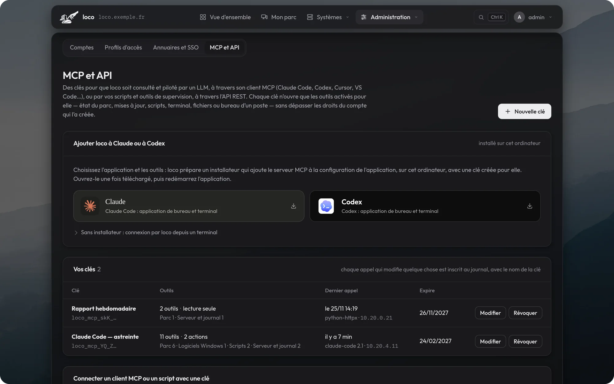

[English](../mcp.md) · **Français** · [Español](../es/mcp.md)

# MCP et API



loco expose un **serveur MCP** (Model Context Protocol, le protocole par lequel un LLM appelle des outils) : un LLM consulte et pilote loco depuis son **client MCP** — Claude Code, Cursor, VS Code ou tout client qui accepte un en-tête d’authentification. Dans **Administration → MCP et API**, ajoutez loco à **Claude** ou à **Codex** par un installateur (voir ci-dessous), ou créez une **clé** par client et activez un à un les outils qu’elle ouvre. Le LLM peut alors répondre à « quels postes attendent des mises à jour ? », lancer celles-ci, lire un journal système ou ouvrir le terminal d’un poste, dans les limites de la clé. Les mêmes clés ouvrent l’[API REST](#api-rest-http), pour vos scripts. Les clients qui se connectent depuis le cloud de leur éditeur (claude.ai, ChatGPT) ne joignent pas un loco installé sur un réseau local.

- **Outil par outil** : chaque clé n’ouvre que les outils activés (lister ou consulter les postes, rechercher un logiciel installé, demander un inventaire, mettre à jour, redémarrer, installer un logiciel du catalogue, annuler une action en attente, lire et lancer les scripts de la bibliothèque, exécuter des commandes écrites par le LLM, shell adb d’un appareil Android, état du serveur, journal…). La fenêtre de la clé les range par domaine, avec leur nom MCP (`list_devices`, `terminal_run`…) et un repère **action** ou **sensible** ; préréglages **Lecture seule**, **Tout ce que je peux** ou **Rien**.
- **Accès distant en direct**, par les mêmes sessions que l’interface (droits **Ouvrir un terminal distant**, **Gérer les fichiers du poste**, **Ouvrir le bureau noVNC**) :
  - **terminal** (`terminal_run`) : commande ou script (jusqu’à 64 Ko) dans le bash root (Linux) ou le PowerShell SYSTEM (Windows) du poste, sortie et code de sortie en quelques secondes.
    - **Délai** (jusqu’à 5 min) : au-delà, la commande est **arrêtée pour de bon** — son shell et tous les processus qu’elle a lancés sont fermés (`killed`), et l’appel suivant ouvre un shell neuf. Un shell resté **occupé** par une commande d’avant est repéré au lieu de faire expirer les suivantes : il est fermé avec ce qu’il faisait tourner, la commande part dans un shell neuf, et la réponse le dit (`note`). `fresh` demande un shell neuf.
    - **Arrière-plan** : `background` lance la commande détachée du terminal (elle survit à la fermeture de la session) et rend aussitôt un numéro de tâche ; `terminal_job` en donne l’état (en cours, terminée, arrêtée, perdue), le code de sortie et la sortie, ou l’arrête avec tout ce qu’elle a lancé. Sortie et état restent une semaine sur le poste (`/var/tmp/loco-jobs`, `%ProgramData%\loco\jobs` réservé à SYSTEM et aux administrateurs).
    - **Sortie plafonnée** : `max_output` caractères (24 000 par défaut, sous la limite des clients MCP) ; au-delà, le début et la fin sont gardés avec le compte de ce qui a sauté. La commande elle-même n’est jamais renvoyée : sous Linux et dans le shell adb, l’écho et l’édition de ligne de ce shell réservé à l’assistant sont coupés, et un long script part par lignes courtes.
    - **Windows** : un `exit 3` rend son code sans fermer la session ; une erreur PowerShell donne le code 1.
  - **terminal interactif** (`terminal_interact`) : le LLM tape et appuie sur des touches (`{enter}`, `{ctrl+c}`, `{esc}`, flèches…) et lit l’écran du terminal (120 × 40), pour vim, top, les invites oui/non ou PowerShell ; la session garde son état d’un appel à l’autre ; `reset` la remplace par un shell neuf — la voie de secours si un programme reste bloqué ;
  - **fichiers** : parcourir, lire (texte ou base64), écrire (remplacement atomique), créer un dossier, copier, déplacer, renommer, changer les droits, supprimer — outils distincts pour la lecture, l’écriture, l’organisation et la suppression. `write_file` écrit le texte en **UTF-8 sans BOM** par défaut, partout ; `charset` (utf-8-bom, ascii, utf-16le-bom) et `newline` (lf, crlf) au besoin. Pour déposer du code ou une configuration, il vaut mieux que le terminal : `Set-Content -Encoding UTF8` de PowerShell 5.1 ajoute un BOM (javac échoue alors) ;
  - **fichiers par adb** (Android appairé) : `push_file` et `pull_file` envoient et récupèrent un fichier comme `adb push` / `adb pull`, avec les droits de l’utilisateur *shell* d’Android (`/data/local/tmp`…). Le contenu passe dans le corps de la requête (jusqu’à ~6 Mo par appel, en plusieurs parties au-delà), jamais dans une ligne de commande, ou va **directement d’un poste à l’autre** (`from_device` / `to_device`, jusqu’à 64 Mo) — un `.dex` construit sur un PC part ainsi sur la tablette sans passer par l’assistant ; il est vérifié sur l’appareil (taille et SHA-256). Là où l’application loco n’a pas accès, `write_file` et `read_file` passent d’eux-mêmes par adb si la clé a aussi les outils adb ;
  - **bureau** : capture d’écran renvoyée en image au LLM (bureau Windows ou Linux, y compris GNOME en Wayland, écran de verrouillage, console texte d’un poste sans affichage ; zoom sur une zone), clic, saisie de texte, touches et raccourcis (Ctrl+Alt+Suppr compris), molette — chaque action renvoie une nouvelle capture.

  Une session par clé, poste et type est réutilisée d’un appel à l’autre et se ferme après 5 minutes sans appel (2 pour le bureau) ; révoquer ou modifier la clé la ferme aussitôt. Une personne passe avant le client MCP : si la limite de sessions du poste est atteinte, ouvrir une session depuis l’interface ferme d’abord les sessions MCP inactives. Un poste visé par un appel MCP est « préchauffé » une minute (relevé toutes les 2 s) pour que la session suivante s’ouvre vite, et l’agent espace ses relevés quand une session reste silencieuse. Après la première capture, seules les zones modifiées de l’écran transitent ; la saisie de texte suit la disposition réelle du clavier du poste (AZERTY, touches mortes, AltGr). Chaque commande, écriture, suppression et action sur le bureau entre au journal (le texte saisi n’y figure pas).
- **Nouveaux outils** : une clé qui avait `terminal_run` reçoit aussi `terminal_job`, une clé qui avait `adb_shell` reçoit `push_file` et `pull_file` (mêmes droits) ; décochez-les au besoin.
- **Jamais plus que son créateur** : une clé est rattachée au compte qui la crée ; ses droits effectifs sont, à chaque appel, les outils activés **et** permis par le profil actuel de ce compte. Compte désactivé, supprimé ou à finaliser, annuaire coupé, clé expirée ou révoquée : refus immédiat. L’agent du poste revérifie aussi les droits du compte avant d’exécuter.
- **Clé montrée une seule fois** (loco n’en garde qu’une empreinte), avec la commande `claude mcp add` et la configuration JSON déjà remplies. Expiration au choix (30 jours, 90 jours, 1 an, jamais).
- **Traçabilité** : chaque action passe par les mêmes fonctions que l’interface et entre au journal avec le nom de la clé (« · MCP « Claude Code » ») ; une commande écrite par le LLM est gardée telle quelle dans l’historique des scripts (« MCP : … »). La liste des clés montre le dernier appel de chacune (date, adresse, client).
- **Chaque compte voit ses clés** : la page montre d’abord *Vos clés* ; un compte qui peut gérer d’autres comptes voit à part leurs clés, avec le compte qui les tient, et peut les révoquer — pas changer leurs outils. Un compte qui n’a plus le droit d’en créer voit et révoque quand même les siennes.
- **Protocole** : `https://<serveur>:8443/mcp`, transport HTTP « Streamable HTTP » sans session, en-tête `Authorization: Bearer <clé>`. loco répond aux deux générations de MCP : la poignée de main `initialize` (2025-03-26 à 2025-11-25) et la génération 2026-07-28 (`server/discover`, métadonnées par requête). Servi uniquement en HTTPS, derrière les mêmes réseaux autorisés que l’interface ; une page web d’une autre origine est refusée. Les clients Node.js qui ne connaissent pas le certificat de loco l’acceptent avec `NODE_EXTRA_CA_CERTS=ca.crt` (autorité téléchargeable sur `/ca.crt`).

## Ajouter loco à Claude ou à Codex

Ni Claude ni Codex n’acceptent qu’un lien ajoute un serveur MCP. Le bloc **Ajouter loco à Claude ou à Codex** de la
page MCP et API prépare donc un **installateur** pour l’ordinateur où tourne l’application :

1. Cliquez sur **Claude** ou **Codex**. Dans la fenêtre : nom de la clé, durée, système de l’ordinateur (deviné d’après
   le navigateur) et outils — la consultation est cochée d’office, l’accès distant (fichiers, écran, terminal) jamais.
2. **Télécharger l’installateur** crée la clé et renvoie un fichier qui la contient :
   - **Windows** — `ajouter-loco-a-claude.cmd` (le nom suit la langue de la page) : ouvrez-le (Windows peut demander *Informations complémentaires*, puis
     *Exécuter quand même* : le fichier n’est pas signé) ;
   - **macOS** et **Linux** — `ajouter-loco-a-claude.command` / `.sh` : dans le Terminal, `sh` suivi du fichier.
3. L’installateur écrit la configuration MCP de l’application, puis s’efface :
   - **Claude Code** (commande `claude` et onglet *Code* de l’application de bureau) : entrée `loco` de type `http`,
     avec l’en-tête de la clé, dans `~/.claude.json` ;
   - **Codex** (application de bureau et commande `codex`) : section `[mcp_servers.loco]` (`url`, `http_headers`) dans
     `~/.codex/config.toml` — une ancienne section `loco` est remplacée.

   Le reste de ces fichiers est gardé, et une copie de l’ancien fichier est laissée à côté (`….avant-loco`).
4. Redémarrez l’application : loco apparaît dans ses serveurs MCP. La clé figure parmi vos clés dans loco (« obtenu par
   l’installateur Claude ») ; modifiez ses outils ou révoquez-la comme les autres.

**Certificat.** Si le poste ne reconnaît pas le certificat de loco et que c’est l’autorité de loco qui l’a signé,
l’installateur l’affiche avec son empreinte SHA-256 et demande s’il faut lui faire confiance : magasin de l’utilisateur
sous Windows (Windows demande aussi confirmation), trousseau de session sous macOS ; sous Linux, réglage
`NODE_EXTRA_CA_CERTS` de Claude Code (`~/.claude/settings.json`) et, pour Codex, magasin du système (`sudo`).

La clé ne passe ni par une conversation ni par une ligne de commande : elle est dans le fichier téléchargé, puis dans
la configuration de l’application.

### Sans installateur : connexion par loco

Un client MCP peut aussi se connecter **sans clé préparée**, par OAuth 2.1 (spécification d’autorisation MCP) :

```bash
claude mcp add --scope user --transport http loco https://<serveur>:8443/mcp && claude mcp login loco
codex mcp add loco --url https://<serveur>:8443/mcp && codex mcp login loco
```

La commande `login` ouvre loco dans le navigateur, sur **Autoriser Claude Code** (ou Codex) : nom, durée et outils de la
clé, puis **Autoriser**. Le client découvre loco (`/.well-known/…`), s’enregistre seul (client public) et reçoit la
clé après échange du code avec PKCE ; le code ne revient qu’à une application de l’ordinateur (boucle locale ou schéma
propre à une application). *Sign out* de Claude Code (`claude mcp logout loco`) retire aussi la clé de loco.

Codex refuse cette connexion quand loco est joint par une adresse IP privée : il lui faut un nom, à déclarer dans
*Système › Réseau › Adresse du portail* (l’installateur, lui, n’est pas concerné).

Le droit **Créer des clés MCP et API** (administrateurs par défaut) permet de créer ses propres clés et de révoquer celles des comptes que l’on gère. Fonction désactivable dans **Fonctionnalités** (« MCP et API »).

## API REST (HTTP)

Les mêmes clés ouvrent une **API REST** : chaque outil du serveur MCP est une route HTTP ordinaire, pour un script, une
supervision (Zabbix, un tableau Grafana, un cron) ou un autre programme — sans client MCP. Base `https://<serveur>:8443/api/v1`,
en-tête `Authorization: Bearer <clé>`. Une clé n’y donne que les outils cochés, avec les droits de son compte, sur le
parc de son profil ; chaque action entre au journal avec son nom (« · API « nom de la clé » »).

- **Lectures en GET**, arguments dans l’adresse : `GET /api/v1/resources`, `GET /api/v1/devices`, `GET /api/v1/devices/{id}`,
  `GET /api/v1/groups`, `GET /api/v1/software?name=firefox`, `GET /api/v1/catalog`, `GET /api/v1/scripts`, `GET /api/v1/runs`,
  `GET /api/v1/overview`, `GET /api/v1/server`, `GET /api/v1/journal`.
- **Ressources des machines** (processeur, mémoire, disques, réseau, durée depuis le démarrage) :
  - `GET /api/v1/devices/{id}/resources` — un poste, en octets et pourcentages ; `?history=1h|24h|7d` ajoute la courbe ;
  - `GET /api/v1/resources?sort=memory&os=linux` — tout le parc, triable par `cpu`, `memory` ou `disk` (le plus chargé d’abord).

  Un poste se désigne par son **numéro** ou son **nom exact**. Exemple :

  ```bash
  curl --cacert ca.crt -H "Authorization: Bearer $LOCO_KEY" \
       "https://<serveur>:8443/api/v1/resources?sort=memory"
  ```

- **Actions en POST ou DELETE**, arguments en JSON : `POST /api/v1/devices/{id}/scan` (inventaire), `…/update`, `…/reboot`,
  `…/wake`, `…/install`, `POST /api/v1/updates` (plusieurs postes), `DELETE /api/v1/devices/{id}/actions/{action}` (annuler),
  `POST /api/v1/scripts/{id}/run`. Comme pour le serveur MCP, une action est **mise en file** : l’agent l’exécute à son
  prochain contact ; relisez l’état avec `GET /api/v1/devices/{id}` plutôt que de le supposer.
- **Réponses JSON.** Une erreur est `{"error": "…"}` avec le bon code : 400 (argument), 401 (clé — en-tête
  `WWW-Authenticate: Bearer`), 403 (outil non coché ou origine refusée), 404 (introuvable), 405 (méthode), 413 (requête
  trop grande), 503 (fonction coupée ou serveur de secours).
- **Description OpenAPI 3.1** servie **sans clé** sur `GET /api/v1/openapi.json` (à importer dans Insomnia, Postman ou un
  générateur de client) ; `GET /api/v1` liste les routes et indique celles que la clé peut appeler. L’API suit les mêmes
  réglages que le serveur MCP (même case **MCP et API** dans **Fonctionnalités**, mêmes réseaux autorisés, refus d’une
  page web d’une autre origine).

---

[← Retour à la présentation](../../README.fr.md) · [Toute la documentation](README.md)
