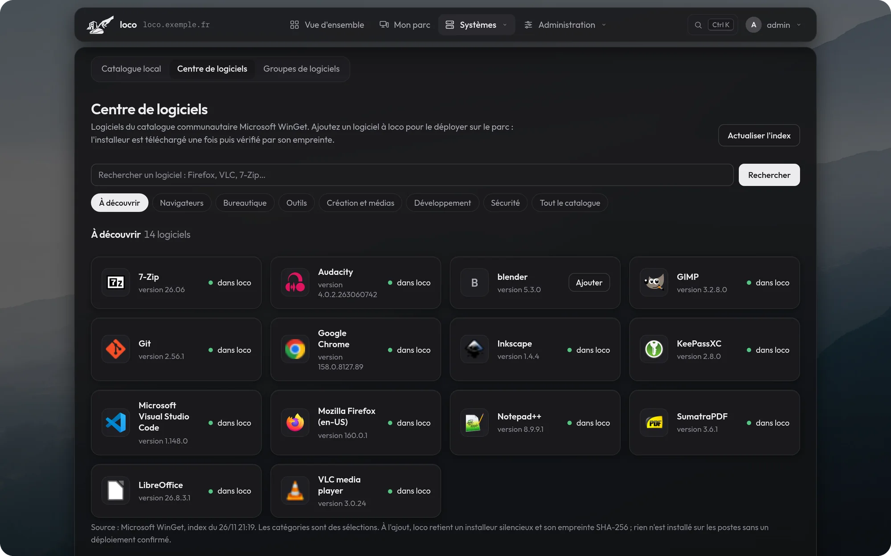
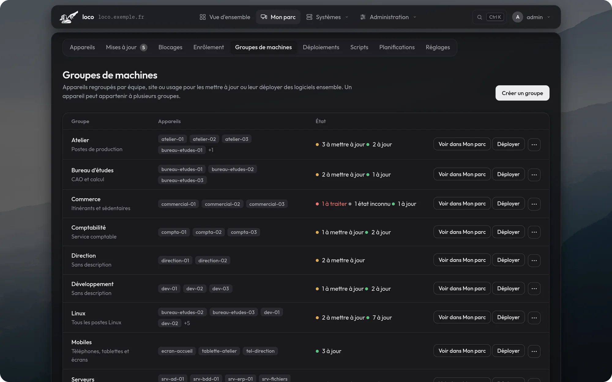
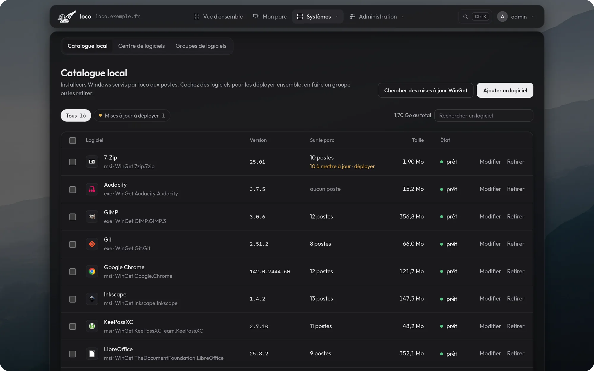

[English](../windows-software.md) · **Français** · [Español](../es/windows-software.md)

# Centre de logiciels Windows

Dans **Windows → Logiciels**, les onglets **Catalogue local**, **Centre de logiciels** et **Groupes de logiciels** réunissent les applications ; leurs boutons *Déployer* ouvrent la préparation d'un déploiement, qui se suit dans **Mon parc → Déploiements** (une action sur les appareils, comme les scripts). Le centre de logiciels utilise le catalogue communautaire Microsoft WinGet, avec recherche, catégories, fiches et logos vérifiés puis mis en cache sur loco. Une initiale remplace les logos indisponibles. Les fiches indiquent l'éditeur, la version, la licence et l'installeur silencieux disponible. **Ajouter à loco** télécharge l'installeur officiel et vérifie son empreinte SHA-256. L'index est renouvelé chaque jour ; son dernier exemplaire valide reste consultable si Internet est momentanément indisponible. Un logiciel se retire du catalogue depuis sa ligne, ou plusieurs en les cochant, y compris ceux dont le téléchargement a échoué ; rien n'est désinstallé des postes.

Depuis une fiche du centre de logiciels, **Déployer sur des appareils ou groupes** importe le logiciel si nécessaire, puis ouvre la préparation commune aux logiciels du catalogue. On peut aussi sélectionner plusieurs logiciels dans le catalogue ou créer un **groupe de logiciels** (par exemple « Socle bureautique »). Un logiciel peut appartenir à plusieurs groupes. Ajouter un logiciel à un groupe depuis le centre de logiciels l'importe une seule fois dans le catalogue ; les actualisations et nouvelles tentatives conservent la vérification de l'empreinte WinGet.

Dans **Mon parc → Groupes de machines**, créez les groupes et choisissez leurs membres ; la fiche d'un appareil permet aussi de modifier ses appartenances. Un appareil peut être dans plusieurs groupes. Le filtre de Mon parc affiche un groupe et limite l'action de mise à jour globale aux appareils de ce groupe.

Un déploiement peut combiner logiciels et groupes de logiciels, puis appareils individuels et groupes de machines. La prévisualisation déduplique les sélections et indique les appareils exclus : les logiciels de ce store sont destinés à Windows, tandis que les groupes de machines peuvent aussi contenir Linux. **Aucune installation ne part avant la confirmation** et la vérification des installeurs. La sélection est figée à la préparation, valable une heure : ajouter un membre à un groupe ne provoque aucune installation implicite. Une fiche, un fichier ou une cible modifiés depuis la préparation imposent une nouvelle prévisualisation.

À la confirmation, loco conserve les versions des installeurs et envoie un lot à chaque agent Windows concerné, au prochain contact du poste, y compris après une période hors ligne. Modifier ou supprimer ensuite le logiciel du catalogue ne remplace pas ces fichiers. Les versions déjà installées d'après un inventaire récent et les installations identiques déjà en attente sont ignorées ; une option permet la réinstallation explicite. **Mon parc → Déploiements** présente l'avancement, les exclusions et le journal de chaque poste. L'annulation arrête les commandes non transmises ; une installation déjà reçue par un agent peut se terminer. Les sauvegardes conservent les groupes, les commandes et les fichiers nécessaires ; le cache des versions sans commande active est purgé après une heure.

Les droits **Gérer les groupes de logiciels**, **Gérer les groupes de machines**, **Consulter les déploiements** et **Déployer sur des groupes ou plusieurs postes** sont distincts. Le dernier est réservé aux administrateurs par défaut ; l'Opérateur conserve le déploiement individuel. Les droits sont revérifiés à la confirmation puis avant transmission aux agents.

---

[← Retour à la présentation](../../README.fr.md) · [Toute la documentation](README.md)
