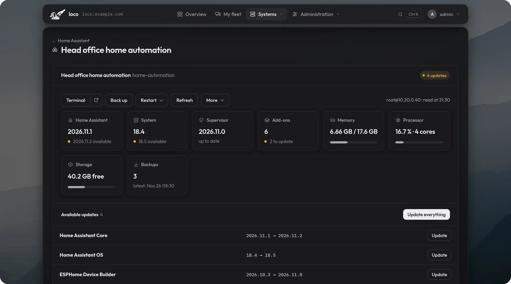

**English** · [Français](fr/homeassistant.md) · [Español](es/homeassistant.md)

# Home Assistant

Follow and maintain your Home Assistant from loco: versions of the core, the operating system and the Supervisor,
updates (one by one or all, with a backup first), add-ons, backups, health
status, log, restarts and terminal. It is an **optional** feature, off by default.

loco asks Home Assistant for **no token**. It comes in through its SSH add-on, with a key of its
own, and drives the `ha` command — the one you would use yourself in that terminal. You therefore need an
installation that has a Supervisor (Home Assistant OS or Supervised) and an SSH add-on.

## Enabling the feature

In **Administration › Features**, *Optional* section, enable **Home Assistant**. Any account with the
Administrator profile can do it. The **Home Assistant** entry then appears in the top bar.

## Linking an instance

In **My fleet › Enrollment**, **Home Assistant** tab (with the right to link instances), three steps:

1. **An SSH add-on in Home Assistant** — "Advanced SSH & Web Terminal" or "Terminal & SSH", with a
   port open on the network (the add-on's Configuration › Network tab).
2. **Authorize loco's key** — copy the public key shown into `authorized_keys`, in the
   add-on's configuration, then restart the add-on. The private key is created on the loco server the first time
   the page is shown (`homeassistant/id_ed25519` in the state folder, readable only by the portal's
   account) and never leaves it.
3. **The address** — name or IP address, SSH port, user of the add-on (`root` for "Terminal & SSH", the one
   you chose for "Advanced SSH & Web Terminal").

loco then reads the **host key** that this address presents and shows its fingerprint. Nothing is
saved or exchanged until you have confirmed it; to compare it, run in the add-on's terminal
(from the Home Assistant interface) the command the page suggests. Afterwards, loco only accepts
that key: if it changes (add-on reinstalled), the link stops and **More › Read the host key
again** asks for a new confirmation.

Up to eight instances can be linked.

## What the page shows

- **Tiles**: Home Assistant (core), operating system, Supervisor, add-ons, storage, backups — with the version
  waiting when there is one.
- **Reported by Home Assistant**: the problems its Supervisor raises (no recent backup, disk
  almost full, degraded or unsupported installation…).
- **Available updates**: each with its button, and **Update all**, which chains them in
  the recommended order — the Supervisor, the add-ons, Home Assistant, then the operating system (which restarts the machine).
  The confirmation window offers to **create a backup first** (ticked by default; it applies to the
  core and the add-ons).
- **Activity**: the last twelve tasks, their state and their output. A task that has started shows as "in
  progress" and cannot be started again; an instance's tasks run one at a time.
- **Add-ons** and **Backups** (the eight most recent). To copy these backups to
  a NAS or an external storage, on demand or scheduled: [Backups](backups.md).
- **Home Assistant log**: its last 200 lines, read when the panel opens.

The reading is refreshed automatically while the page is displayed (every two minutes) and after each task;
**Refresh** does it right away. The overview reports in "To handle" a failed link, a
degraded installation and the available updates.

In **My fleet**, an instance is a row like a device: resources of its host (disk; memory and
processor on Home Assistant OS), *Update* on its row, a checkbox (*Update*, *Restart* the
system), and it is included in *Update all* and the whole-fleet schedule. From My fleet, its
updates are always done with a backup first (core and add-ons), as its page suggests. Rights:
*Update Home Assistant* to update it, *Restart Home Assistant* to restart it.

## Actions

| Action | Command run on Home Assistant |
|---|---|
| Update Home Assistant | `ha core update [--backup]` |
| Update the operating system | `ha os update` |
| Update the Supervisor | `ha supervisor update` |
| Update an add-on | `ha apps update <add-on> [--backup]` (`ha addons update` with an older `ha` command) |
| Back up | `ha backups new --name "loco YYYY-MM-DD HH:MM"` (full backup, kept in Home Assistant) |
| Restart › Home Assistant | `ha core restart` |
| Restart › The system | `ha host reboot` |

When the system restarts (operating system update, requested restart), the link drops: loco waits for it to
come back for up to a quarter of an hour, and the task only succeeds if it answers again.

## Terminal

**Terminal** opens the SSH add-on's shell in loco's usual session page (full screen, new
tab, text size). The session is held by the loco server, recorded in the audit log, limited to one hour and to
two per instance. It needs the **Remote access** feature and a loco server on Linux.

## Rights

The **Home Assistant** group of the access profiles separates: view, update, back up, restart,
open a terminal, link instances. No shipped profile receives them, except Administrator.

## Removing an instance

**More › Remove from loco** forgets the instance and the history of its tasks. Nothing is changed in Home
Assistant: remove loco's key from `authorized_keys` there to close the access.

## Limits

- Installations without a Supervisor (Container, Core): no `ha` command, so no link.
- loco copies the backups to an external destination if you set it up ([Backups](backups.md)), but does not restore them.
- The loco server needs the SSH client (`ssh`): present on the appliance, installed with loco elsewhere.

---

[← Back to the overview](../README.md) · [All the documentation](README.md)
