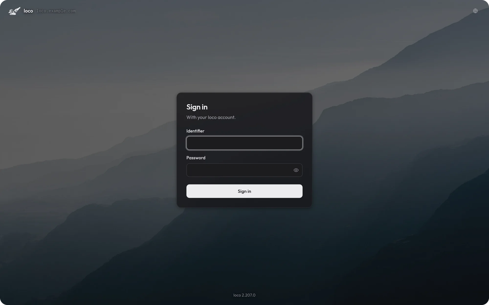

**English** · [Français](fr/installation.md) · [Español](es/installation.md)

# Installing loco

One server, five ways to install it. The portal, the repositories and the caches are the same everywhere; only the local Flatpak repository needs a Linux server.



## Choosing your installation

| Server | Systems | Installation | Guide |
|---|---|---|---|
| **Native Linux** (recommended) | Debian 12 / 13, Ubuntu 22.04 / 24.04 / 26.04, Rocky Linux 8 / 9 / 10 | `sudo ./install.sh` | [docs/linux.md](linux.md) |
| **Native Windows** | Windows 11, Windows Server 2022 / 2025 | `windows\install.ps1` | [docs/windows.md](windows.md) |
| LXC container | Proxmox VE 7 / 8 / 9 | `linux/lxc/proxmox-lxc.sh` | [docs/linux.md](linux.md) |
| ISO appliance | Alpine Linux (BusyBox), BIOS/UEFI | `linux/iso/` (wizard, answers and portal) | [docs/linux.md](linux.md) |
| Docker | Docker Engine 26+ and Compose v2 | `linux/docker/` | [docs/linux.md](linux.md) |

## Linux server

### Native installation (recommended)

```bash
git clone https://github.com/ShaNouhAr/loco.git
cd loco
sudo ./install.sh
```

Debian 12 / 13, Ubuntu 22.04 / 24.04 / 26.04 and Rocky Linux 8 / 9 / 10 (server validations on amd64). The installation shows the interface's address
(`https://<ip>:8443`), the fingerprint of the certificate authority and the initial password of the
`admin` account (to change at the first sign-in). The script can be run again: it is also used to update
(`git pull && sudo ./install.sh`) and to reconfigure.

On Rocky Linux, the same command detects the system and uses DNF with EPEL and PowerTools (8) or CRB (9/10). SELinux stays
on; the contexts and ports needed are configured. If firewalld is already running, a dedicated
service rule is added; the allowed networks stay controlled by `--allow` and `--admin-allow`.
Rocky 10 builds the APT cache from a version of the Debian sources with its patches, checked by
SHA-256 (this component is missing from EPEL 10). Rocky 8 only builds the `apt-ftparchive` indexer
2.6.1 from the verified Debian sources; it uses Python 3.11 for the portal, in an isolated
environment. If nginx does not provide the required TLS relay, the installer selects AppStream's nginx 1.24
stream; a pre-existing nginx is updated while keeping its configuration and stays on that stream
after uninstallation. The first installation therefore takes longer; re-runs reuse the built tools.

Main options (all of them: `sudo ./install.sh --help`):

| Option | Effect |
|---|---|
| `--allow "CIDR …"` | networks allowed for the devices (default: private networks) |
| `--admin-allow "CIDR …"` | networks allowed for the interface (default: same as `--allow`) |
| `--proxy http://host:port` | company proxy to go out to the Internet |
| `--no-http` | HTTPS only (authority already deployed on the devices) |
| `--no-wu`, `--no-flatpak`, `--no-rpm` | without the Windows Update cache, without Flatpak, without the Red Hat family |
| `--wu-proxy-port P` | port of the Windows Update caching proxy (Squid, no DNS; 3128 by default) |
| `--tls-cert F --tls-key F` | company certificate instead of the local authority |
| `--backup-keep N` | daily backups kept (default 3, 0 = none) |

### LXC container on Proxmox VE

On any Proxmox VE 7, 8 or 9 host, as root:

```bash
curl -fsSLO https://raw.githubusercontent.com/ShaNouhAr/loco/main/linux/lxc/proxmox-lxc.sh
bash proxmox-lxc.sh                                   # DHCP, 100 GB, 2 processors, 2 GB of memory
bash proxmox-lxc.sh --ip 192.168.10.20/24 --gw 192.168.10.1 --disk 300 -- --allow "192.168.10.0/24"
```

The script creates an unprivileged Debian 13 container (Debian 12 on Proxmox 7), chooses the available storage
(`local-lvm`, `local-zfs`…) and bridge (`vmbr0`), downloads the latest published release
and performs the native installation in it; the options after `--` are those of `install.sh`. It then shows
the address, the authority's fingerprint and the initial password. Update:
`bash proxmox-lxc.sh --ctid N --update`. All the options: `bash proxmox-lxc.sh --help`.

### With Docker

Without cloning the project — the `ghcr.io/shanouhar/loco` image is published with every release:

```bash
mkdir loco && cd loco
curl -fsSLO https://raw.githubusercontent.com/ShaNouhAr/loco/main/linux/docker/docker-compose.yml
curl -fsSL https://raw.githubusercontent.com/ShaNouhAr/loco/main/linux/docker/.env.example -o .env   # optional: LOCO_HOST, LOCO_ALLOW, LOCO_PROXY, LOCO_WU…
docker compose up -d
docker compose logs loco   # address, authority fingerprint, initial password of "admin"
```

Update: `docker compose pull && docker compose up -d`. To stay on a specific version:
`LOCO_IMAGE=ghcr.io/shanouhar/loco:2.165.0` in `.env`.

From the sources — the image is built on site:

```bash
git clone https://github.com/ShaNouhAr/loco.git
cd loco/linux/docker
cp .env.example .env
sudo ./up.sh               # builds the image, starts loco and waits until it is healthy
```

Same portal, same features and same configuration as the native installation: at startup, the
container applies the `.env` variables with `linux/install.sh --container`, then `supervisord` starts nginx,
apt-cacher-ng, the portal and the periodic tasks. The container uses the **host network** (ports
8443, 8088, 3142, and 80/443 for Windows Update): do not combine it with a native installation on the same
machine. The data is in Docker volumes (`LOCO_DATA_DIR`: host folder for the repositories and
caches). From the sources, installation and update: `sudo ./up.sh` (in `linux/docker`, after `git pull`).

The native installation remains recommended in production: it confines each service with systemd
(details in [SECURITY.md](../SECURITY.md)). Docker Engine 26 or later with Compose v2 (validated with
Debian 13's `docker.io` and `docker-compose` packages).

Company deployment (network, GPO, proxy, backups, monitoring, LXC, Docker, troubleshooting):
**[Linux guide](linux.md)**.

### Administration

```bash
sudo loco-user list | roles | add NAME [PROFILE] | set-role NAME PROFILE | passwd NAME   # accounts (lost access: passwd admin)
sudo loco-backup create | list | restore ARCHIVE             # backups
sudo /opt/loco/remove.sh [--purge]                           # uninstallation
```

In an LXC container, from the Proxmox host: `pct exec N -- loco-user list`, etc.
With Docker, the same commands go through the container: `docker compose exec loco loco-user list`,
`docker compose exec loco loco-backup create`. Uninstallation: `docker compose down`
(add `-v` to also erase the data).

### Architecture

| Component | Location | Port |
|---|---|---|
| Portal (Flask + gunicorn, `loco-portal` unit, confined) | `/opt/loco` | 8089, local |
| Remote sessions relay (persistent connections, inside the portal's process) | `/opt/loco/portal/loco/relay.py` | 8090, local |
| nginx: interface and device files (HTTPS) | `/etc/nginx/sites-available/loco-portal.conf` | 8443 |
| nginx: HTTP bootstrap (optional) | same file | 8088 |
| nginx: Windows Update cache, HTTPS relay (SNI) | `loco-wucache.conf`, `modules-enabled/99-loco-stream.conf` | 80, 443 |
| squid: Windows Update caching proxy (no DNS) | `/etc/squid/squid.conf`, cache `/srv/loco/wuproxy` | 3128 |
| apt-cacher-ng | `/var/cache/apt-cacher-ng` | 3142 |
| Data: repositories, catalog, caches | `/srv/loco` | — |
| Database, GPG key, statistics | `/var/lib/loco` | — |
| Configuration, authority and certificates | `/etc/loco` | — |

On Debian / Ubuntu, the dependencies come from the official repositories (`nginx`, `apt-cacher-ng`, `python3-flask`, `gunicorn`,
`gnupg`, `flatpak`, `ostree`, `createrepo-c`, `rpm`): security fixes arrive with `apt upgrade`, or
from the portal (**Administration → Updates**: security fixes, kernel, restart).
On Rocky, the system packages follow `dnf upgrade`; the isolated Python runtime and the built
components are pinned and updated with loco's releases.

## Windows server

### Installation

Windows 11 Pro / Enterprise and Windows Server 2022 / 2025, x64, with PowerShell 5.1
or later. In an **administrator** PowerShell console, from the project's sources:

```powershell
Invoke-WebRequest https://github.com/ShaNouhAr/loco/archive/refs/heads/main.zip -OutFile loco.zip
Expand-Archive loco.zip -DestinationPath .
cd loco-main
powershell.exe -NoProfile -ExecutionPolicy Bypass -File .\windows\install.ps1
```

The application runs in the `loco` Windows service, with its native Windows components:
Python and nginx; the repositories are signed by the program itself (OpenPGP). No Linux VM, WSL,
Hyper-V or Docker installation is needed.
Running the same script again updates the program while keeping the accounts, the keys and the repositories.

Signed APT/RPM repositories, the APT/RPM/Flathub caches, the Windows catalog and Windows Update
are available. The **local Flatpak repository** remains reserved for Linux servers. For a large network,
see the limits of nginx for Windows and the sizing in the [Windows guide](windows.md).

### Administration

In an administrator console:

```powershell
$lr = "$env:ProgramFiles\loco\loco.cmd"
& $lr user list ; & $lr user passwd admin ; & $lr backup create ; & $lr status
powershell -ExecutionPolicy Bypass -File "$env:ProgramFiles\loco\windows\remove.ps1"   # -Purge: erase everything
```

### Architecture

`loco` service (account `NT SERVICE\loco`) that starts nginx and the portal
(Waitress, 8089 locally, and its remote sessions relay on the neighboring port 8090); program in `%ProgramFiles%\loco`, data, configuration and logs
in `%ProgramData%\loco`. Ports: 8443 (HTTPS), 8088 (HTTP bootstrap), 3142 (APT cache), 80 and 443
(Windows Update). Details: [Windows guide](windows.md).

---

[← Back to the overview](../README.md) · [All the documentation](README.md)
