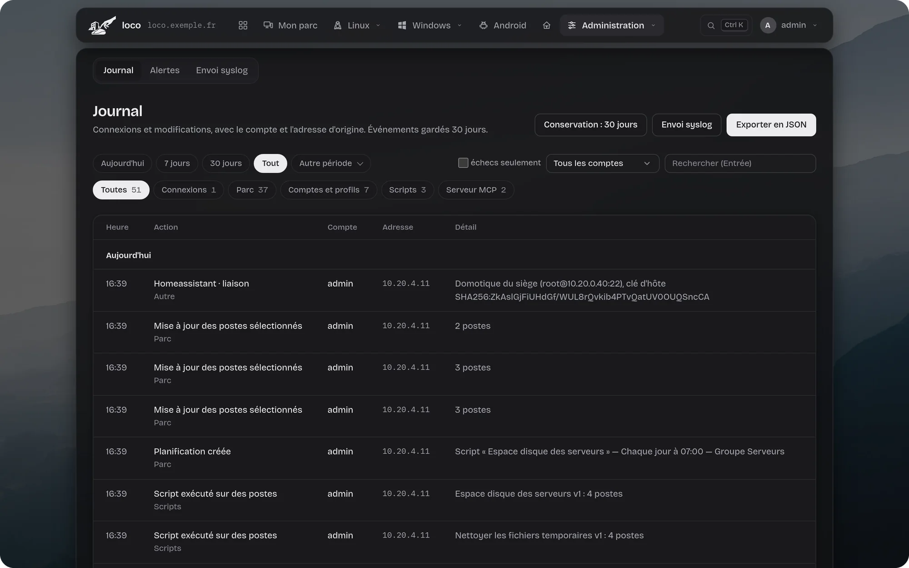

# Journal

La page *Administration › Journal* trace les connexions et les actions, avec le compte et l'adresse d'origine.

- **Lecture** : événements groupés par jour, actions en clair (« Adresse du serveur annoncée aux agents ») et
  catégorie ; filtres par période (aujourd'hui, 7 jours, 30 jours, dates au choix), catégorie (connexions, parc,
  accès distant, logiciels, dépôts Linux, Windows Update, scripts, comptes et annuaires, serveur), compte, échecs seulement et recherche
  dans les détails ; pages de 100 événements. Les échecs de connexion des dernières 24 heures sont signalés en tête.
- **Export JSON** de la vue filtrée, d'une période (dates incluses) ou du journal entier : serveur, période, filtres,
  auteur de l'export et événements (date, compte, adresse, action et son libellé, détail). Chaque export est
  lui-même journalisé.
- **Conservation** réglable (7 jours à 2 ans, ou sans limite), **30 jours par défaut** : les événements plus anciens
  sont supprimés au démarrage du portail puis au plus une fois par heure. Exportez-les avant de réduire la durée.
- Droits distincts : *Consulter le journal*, *Exporter le journal* (inclus dans le profil Auditeur) et *Configurer la
  conservation du journal*.

## Envoi vers un serveur syslog

*Administration › Envoi syslog* envoie vers votre serveur syslog ou votre SIEM, au choix, le **journal de loco**, les **journaux
des postes**, ou les deux. Format RFC 5424, en TLS (recommandé), TCP ou UDP, avec un bouton pour envoyer un message de test.

- **Journal de loco** : tout ce qui figure dans la page Journal, à partir de l'activation (pas l'historique). Chaque événement
  porte le compte, l'adresse, l'action et sa catégorie ; un échec part en avertissement, le reste en information.
- **Journaux des postes** : journald sous Linux, journaux d'événements System et Application sous Windows, au niveau minimal choisi
  (erreurs, avertissements, notices ou informations). *Toujours inclure la sécurité* ajoute, sous Linux, les messages
  d'authentification et, sous Windows, les échecs d'audit du journal Sécurité (les réussites aussi à partir du niveau
  Informations). L'envoi peut être limité à des groupes de machines. Agents 2.124.0 et plus (ils se mettent à jour seuls).
- **Les postes passent par loco** : ils n'ont pas besoin de joindre le serveur syslog, seulement loco comme d'habitude. L'hôte
  du message est le nom que loco connaît au poste. Les journaux remontent à chaque contact de l'agent, toutes les 2 à 3 minutes.
- **Si le serveur syslog est absent**, l'envoi reprend là où il s'était arrêté : rien n'est stocké sur le serveur loco, le
  retard est rattrapé tant que le journal d'origine conserve les lignes. Syslog n'a pas d'accusé de réception : un événement
  peut arriver en double après une panne, une coupure brutale peut en perdre quelques-uns, et l'UDP ne garantit jamais l'arrivée.
- La page montre le dernier envoi, le dernier échec et l'état de chaque poste ; la règle d'alerte *Envoi syslog en échec*
  prévient après 5 minutes. Droit *Envoyer les journaux vers un serveur syslog*, réservé aux profils qui couvrent tout le parc.
  En haute disponibilité, seul le principal envoie et le réglage suit la réplication.

---

[← Retour à la présentation](../README.md) · [Toute la documentation](README.md)
