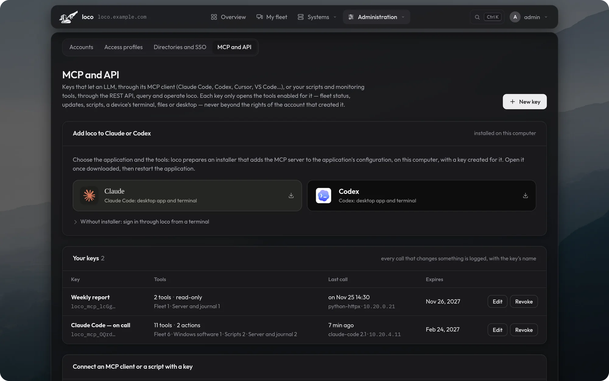

**English** · [Français](fr/mcp.md) · [Español](es/mcp.md)

# MCP and API



loco exposes an **MCP server** (Model Context Protocol, the protocol through which an LLM calls tools): an LLM queries and operates loco from its **MCP client** — Claude Code, Cursor, VS Code or any client that accepts an authentication header. In **Administration → MCP and API**, add loco to **Claude** or **Codex** with an installer (see below), or create one **key** per client and enable one by one the tools it opens. The LLM can then answer "which devices are waiting for updates?", start them, read a system log or open a device's terminal, within the key's limits. The same keys open the [REST API](#rest-api-http), for your scripts. Clients that connect from their vendor's cloud (claude.ai, ChatGPT) cannot reach a loco installed on a local network.

- **Tool by tool**: each key only opens the enabled tools (list or view devices, search for installed software, request an inventory, update, restart, install software from the catalog, cancel a pending action, read and run the library's scripts, run commands written by the LLM, adb shell of an Android device, server status, audit log…). The key's window sorts them by domain, with their MCP name (`list_devices`, `terminal_run`…) and an **action** or **sensitive** marker; **Read only**, **Everything I can** or **Nothing** presets.
- **Live remote access**, through the same sessions as the interface (**Open a remote terminal**, **Manage the device's files**, **Open the noVNC desktop** rights):
  - **terminal** (`terminal_run`): a command or script (up to 64 KB) in the device's root bash (Linux) or SYSTEM PowerShell (Windows), output and exit code in a few seconds.
    - **Timeout** (up to 5 min): beyond it, the command is **stopped for good** — its shell and all the processes it started are closed (`killed`), and the next call opens a fresh shell. A shell still **busy** with an earlier command is detected instead of making the next ones time out: it is closed with what it was running, the command goes to a fresh shell, and the answer says so (`note`). `fresh` asks for a fresh shell.
    - **Background**: `background` starts the command detached from the terminal (it survives the session's closing) and immediately returns a job number; `terminal_job` gives its state (running, finished, stopped, lost), its exit code and its output, or stops it with everything it started. Output and state stay on the device for a week (`/var/tmp/loco-jobs`, `%ProgramData%\loco\jobs` reserved for SYSTEM and administrators).
    - **Capped output**: `max_output` characters (24,000 by default, under the MCP clients' limit); beyond it, the beginning and the end are kept with a count of what was skipped. The command itself is never echoed back: on Linux and in the adb shell, the echo and line editing of this shell reserved for the assistant are turned off, and a long script goes out in short lines.
    - **Windows**: an `exit 3` returns its code without closing the session; a PowerShell error gives code 1.
  - **interactive terminal** (`terminal_interact`): the LLM types and presses keys (`{enter}`, `{ctrl+c}`, `{esc}`, arrows…) and reads the terminal's screen (120 × 40), for vim, top, yes/no prompts or PowerShell; the session keeps its state from one call to the next; `reset` replaces it with a fresh shell — the fallback when a program is stuck;
  - **files**: browse, read (text or base64), write (atomic replacement), create a folder, copy, move, rename, change permissions, delete — separate tools for reading, writing, organizing and deleting. `write_file` writes the text as **UTF-8 without BOM** by default, everywhere; `charset` (utf-8-bom, ascii, utf-16le-bom) and `newline` (lf, crlf) if needed. To drop code or a configuration, it is better than the terminal: PowerShell 5.1's `Set-Content -Encoding UTF8` adds a BOM (javac then fails);
  - **files over adb** (paired Android): `push_file` and `pull_file` send and fetch a file like `adb push` / `adb pull`, with the rights of Android's *shell* user (`/data/local/tmp`…). The content travels in the request body (up to ~6 MB per call, in several parts beyond), never in a command line, or goes **directly from one device to another** (`from_device` / `to_device`, up to 64 MB) — a `.dex` built on a PC thus goes to the tablet without passing through the assistant; it is checked on the device (size and SHA-256). Where the loco app has no access, `write_file` and `read_file` go through adb by themselves if the key also has the adb tools;
  - **desktop**: screenshot returned as an image to the LLM (Windows or Linux desktop, including GNOME under Wayland, lock screen, text console of a device without a display; zoom on an area), click, text input, keys and shortcuts (Ctrl+Alt+Del included), scroll wheel — each action returns a new screenshot.

  One session per key, device and type is reused from one call to the next and closes after 5 minutes without a call (2 for the desktop); revoking or editing the key closes it at once. A person comes before the MCP client: if the device's session limit is reached, opening a session from the interface first closes the idle MCP sessions. A device targeted by an MCP call is "warmed up" for one minute (polling every 2 s) so that the next session opens quickly, and the agent spaces out its polls when a session stays silent. After the first screenshot, only the changed areas of the screen travel; text input follows the device's real keyboard layout (AZERTY, dead keys, AltGr). Each command, write, deletion and desktop action goes into the audit log (the typed text does not).
- **New tools**: a key that had `terminal_run` also gets `terminal_job`, a key that had `adb_shell` gets `push_file` and `pull_file` (same rights); untick them if needed.
- **Never more than its creator**: a key is tied to the account that creates it; its effective rights are, at each call, the tools enabled **and** allowed by that account's current profile. Account disabled, deleted or to be finalized, directory turned off, key expired or revoked: immediate refusal. The device's agent also checks the account's rights again before running anything.
- **Key shown only once** (loco only keeps a fingerprint), with the `claude mcp add` command and the JSON configuration already filled in. Expiry of your choice (30 days, 90 days, 1 year, never).
- **Traceability**: each action goes through the same functions as the interface and lands in the audit log with the key's name ("· MCP "Claude Code""); a command written by the LLM is kept as is in the scripts history ("MCP: …"). The list of keys shows the last call of each one (date, address, client).
- **Each account sees its keys**: the page first shows *Your keys*; an account that can manage other accounts sees their keys separately, with the account that holds them, and can revoke them — not change their tools. An account that no longer has the right to create keys still sees and revokes its own.
- **Protocol**: `https://<server>:8443/mcp`, sessionless "Streamable HTTP" transport, `Authorization: Bearer <key>` header. loco answers both generations of MCP: the `initialize` handshake (2025-03-26 to 2025-11-25) and the 2026-07-28 generation (`server/discover`, per-request metadata). Served only over HTTPS, behind the same allowed networks as the interface; a web page from another origin is refused. Node.js clients that do not know loco's certificate accept it with `NODE_EXTRA_CA_CERTS=ca.crt` (authority downloadable at `/ca.crt`).

## Adding loco to Claude or Codex

Neither Claude nor Codex accepts a link that adds an MCP server. The **Add loco to Claude or Codex** block of the
MCP and API page therefore prepares an **installer** for the computer where the application runs:

1. Click **Claude** or **Codex**. In the window: key name, duration, the computer's system (guessed from
   the browser) and tools — viewing is ticked by default, remote access (files, screen, terminal) never.
2. **Download the installer** creates the key and returns a file that contains it:
   - **Windows** — `add-loco-to-claude.cmd`: open it (Windows may ask *More info*, then
     *Run anyway*: the file is not signed);
   - **macOS** and **Linux** — `add-loco-to-claude.command` / `.sh`: in the Terminal, `sh` followed by the file.
3. The installer writes the application's MCP configuration, then deletes itself:
   - **Claude Code** (`claude` command and *Code* tab of the desktop app): a `loco` entry of type `http`,
     with the key's header, in `~/.claude.json`;
   - **Codex** (desktop app and `codex` command): a `[mcp_servers.loco]` section (`url`, `http_headers`) in
     `~/.codex/config.toml` — an older `loco` section is replaced.

   The rest of these files is kept, and a copy of the old file is left next to it (`….avant-loco`).
4. Restart the application: loco appears among its MCP servers. The key is listed among your keys in loco ("obtained by
   the Claude installer"); change its tools or revoke it like the others.

**Certificate.** If the computer does not recognize loco's certificate and it was signed by loco's authority,
the installer shows it with its SHA-256 fingerprint and asks whether to trust it: the user's store
on Windows (Windows also asks for confirmation), session keychain on macOS; on Linux, Claude Code's
`NODE_EXTRA_CA_CERTS` setting (`~/.claude/settings.json`) and, for Codex, the system store (`sudo`).

The key goes neither through a conversation nor through a command line: it is in the downloaded file, then in
the application's configuration.

### Without an installer: signing in through loco

An MCP client can also connect **without a prepared key**, through OAuth 2.1 (MCP authorization specification):

```bash
claude mcp add --scope user --transport http loco https://<server>:8443/mcp && claude mcp login loco
codex mcp add loco --url https://<server>:8443/mcp && codex mcp login loco
```

The `login` command opens loco in the browser, on **Authorize Claude Code** (or Codex): name, duration and tools of the
key, then **Authorize**. The client discovers loco (`/.well-known/…`), registers by itself (public client) and receives the
key after exchanging the code with PKCE; the code only goes back to an application on the computer (local loopback or
an application's own scheme). Claude Code's *Sign out* (`claude mcp logout loco`) also removes the key from loco.

Codex refuses this connection when loco is reached through a private IP address: it needs a name, to declare in
*System › Network › Portal address* (the installer is not affected).

The **Create MCP and API keys** right (administrators by default) lets you create your own keys and revoke those of the accounts you manage. The feature can be turned off in **Features** ("MCP and API").

## REST API (HTTP)

The same keys open a **REST API**: each tool of the MCP server is an ordinary HTTP route, for a script, a
monitoring tool (Zabbix, a Grafana dashboard, a cron job) or another program — without an MCP client. Base `https://<server>:8443/api/v1`,
`Authorization: Bearer <key>` header. A key only gives the ticked tools there, with its account's rights, on its
profile's fleet; each action goes into the audit log with its name ("· API "key name"").

- **Reads with GET**, arguments in the address: `GET /api/v1/resources`, `GET /api/v1/devices`, `GET /api/v1/devices/{id}`,
  `GET /api/v1/groups`, `GET /api/v1/software?name=firefox`, `GET /api/v1/catalog`, `GET /api/v1/scripts`, `GET /api/v1/runs`,
  `GET /api/v1/overview`, `GET /api/v1/server`, `GET /api/v1/journal`.
- **Machine resources** (processor, memory, disks, network, time since boot):
  - `GET /api/v1/devices/{id}/resources` — one device, in bytes and percentages; `?history=1h|24h|7d` adds the curve;
  - `GET /api/v1/resources?sort=memory&os=linux` — the whole fleet, sortable by `cpu`, `memory` or `disk` (the busiest first).

  A device is named by its **number** or its **exact name**. Example:

  ```bash
  curl --cacert ca.crt -H "Authorization: Bearer $LOCO_KEY" \
       "https://<server>:8443/api/v1/resources?sort=memory"
  ```

- **Actions with POST or DELETE**, arguments in JSON: `POST /api/v1/devices/{id}/scan` (inventory), `…/update`, `…/reboot`,
  `…/wake`, `…/install`, `POST /api/v1/updates` (several devices), `DELETE /api/v1/devices/{id}/actions/{action}` (cancel),
  `POST /api/v1/scripts/{id}/run`. As with the MCP server, an action is **queued**: the agent runs it at its
  next check-in; read the state again with `GET /api/v1/devices/{id}` rather than assuming it.
- **JSON responses.** An error is `{"error": "…"}` with the right code: 400 (argument), 401 (key —
  `WWW-Authenticate: Bearer` header), 403 (tool not ticked or origin refused), 404 (not found), 405 (method), 413 (request
  too large), 503 (feature turned off or standby server).
- **OpenAPI 3.1 description** served **without a key** at `GET /api/v1/openapi.json` (to import into Insomnia, Postman or a
  client generator); `GET /api/v1` lists the routes and shows which ones the key can call. The API follows the same
  settings as the MCP server (same **MCP and API** box in **Features**, same allowed networks, refusal of a
  web page from another origin).

---

[← Back to the overview](../README.md) · [All the documentation](README.md)
