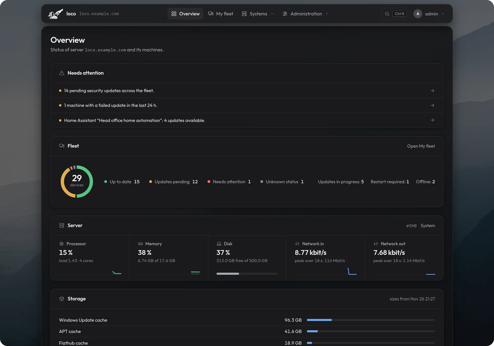

**English** · [Français](fr/operations.md) · [Español](es/operations.md)

# Running loco day to day

This guide is for the person who runs loco, once the installation is done:
what to watch, what to back up, how to update and what to do when something gets stuck.

To install: [Installing loco](installation.md). For an enterprise deployment (networks, GPO, proxy):
[Linux server](linux.md) and [Windows server](windows.md).



**Contents** —
[Landmarks](#1-landmarks) ·
[The routine](#2-the-routine) ·
[Monitoring](#3-monitoring) ·
[Backing up and restoring](#4-backing-up-and-restoring) ·
[Updating](#5-updating) ·
[Certificates](#6-certificates) ·
[Accounts and lost access](#7-accounts-and-lost-access) ·
[Logs](#8-logs) ·
[Changing without breaking](#9-changing-without-breaking) ·
[Features](#10-turning-a-feature-on-or-off) ·
[Incidents](#11-incidents-where-to-start) ·
[Stopping, moving, removing](#12-stopping-moving-removing)

---

## 1. Landmarks

### Where to run the commands

The same tools exist everywhere; only the way to call them changes.

| Installation | Example |
|---|---|
| Native Linux | `sudo loco-user list` |
| LXC container (from the Proxmox host) | `pct exec N -- loco-user list` |
| Docker (in the folder of `docker-compose.yml`) | `docker compose exec loco loco-user list` |
| ISO appliance | root console: `loco-user list` |
| Windows (administrator PowerShell) | `& "$env:ProgramFiles\loco\loco.cmd" user list` |

Below, the commands are written for native Linux.

### What runs

| Service (native Linux) | Role |
|---|---|
| `loco-portal` | the portal and the devices' scripts (unprivileged) |
| `nginx` | HTTPS, files, Windows Update cache |
| `apt-cacher-ng` | cache of the Debian and Ubuntu packages |
| `squid` | Windows Update proxy-cache, without DNS (if installed) |
| `loco-agent` | runs as root the operations requested by the portal, after validating them again |
| `loco-backup.timer` | daily backup, at 03:30 |
| `loco-stats.timer` | size of the caches, every 15 minutes |
| `loco-nginx.path` | reloads nginx when the list of domains changes |

On the appliance, OpenRC and supervisord replace systemd (`loco` and `loco-agent` services). With Docker, supervisord
starts everything in the container. On Windows, a single service: `loco`.

The **Administration › System** page shows the state of each one.

### The ports

| Port | Used for | Who connects to it |
|---|---|---|
| 8443/tcp | portal, repositories, installers, agents (HTTPS) | devices and administrators |
| 8088/tcp | HTTP bootstrap of the devices (optional) | devices |
| 3142/tcp | APT cache | Linux devices |
| 80 and 443/tcp | Windows Update cache | Windows devices, through DNS |
| 3128/tcp | Windows Update proxy-cache, without DNS | managed Windows devices |
| 8089 and 8090 | portal and relay of the remote sessions | the server itself, locally |

### Where things are

| What | Linux | Windows |
|---|---|---|
| Program | `/opt/loco` | `%ProgramFiles%\loco` |
| Repositories, catalog, caches | `/srv/loco` | `%ProgramData%\loco` |
| Database, GPG key, statistics | `/var/lib/loco` | `%ProgramData%\loco` |
| Configuration, authority, certificates | `/etc/loco` | `%ProgramData%\loco` |
| Backups | `/var/backups/loco` | folder chosen at installation (`-BackupPath`) |

---

## 2. The routine

None of this takes long. Most of it fits on the overview.

**Every day — one minute**

- [ ] Open the **overview**: is the **Needs attention** block empty?
- [ ] A failure in **My fleet › Updates**? Its reason is on the row.

**Every week**

- [ ] **Administration › Updates**: install the server's security fixes, restart if the page asks for it.
- [ ] **Administration › System**: the last backup is less than a day old, the disk has room.
- [ ] The devices with "no recent check-in": switched off, or forgotten?

**Every month**

- [ ] **Restore a backup** on a test machine (see [§ 4](#4-backing-up-and-restoring)). A backup never restored is only a hope.
- [ ] Review the **accounts** and the **MCP and API keys**: remove what is no longer used.
- [ ] Check the expiry date of the **certificate** (System page).

**With each new version of loco**

- [ ] Read the [changelog](../CHANGELOG.md).
- [ ] Create a backup: `sudo loco-backup create`.
- [ ] Update (see [§ 5](#5-updating)), then open the overview.

> **The simplest is not to have to think about it**: set the [alerts](#the-alerts) once, and loco writes to you when
> something needs your attention.

---

## 3. Monitoring

### In the portal

- **Overview** — *Needs attention* gathers what matters: pending security fixes, failed updates,
  paused deployment, stopped service, overdue backup.
- **Administration › System** — services, certificate, disk, last backup, version.
- **My fleet** — each device's page has its **Monitoring** tab: processor, memory, network and disks, live
  then over 24 hours or 7 days.

### The alerts

**Administration › Audit log › Alerts**: one switch per condition, a *Test* button. Sent by **e-mail** (SMTP) or
**webhook**. Each alert has its repeat delay: no bursts.

| Alert | Triggers when |
|---|---|
| Service stopped | nginx, a cache, the portal or the agent is no longer running |
| HTTPS certificate expiring | less than 21 days are left (adjustable) |
| Backup overdue | the daily backup was missed |
| Off-site copy failed | the last copy to external storage failed |
| Syslog forwarding failing | the logs have not arrived for 5 minutes |
| Disk almost full | data storage exceeds 90% (adjustable) |
| Failed logins | more than 10 failures in 24 hours (adjustable) |
| Pending security updates | devices have security fixes to install |
| Devices out of contact | devices have not contacted loco recently |
| Rollout in waves paused | a wave failed, the next ones are waiting |
| A device's disk, memory or processor | the threshold is exceeded (15-minute average for memory and processor) |

### From your monitoring

Two addresses:

- `https://SERVER:8443/healthz` answers `ok` — the simplest check.
- `https://SERVER:8443/metrics`, in Prometheus format, reserved to the administration networks (`--admin-allow`).

| Metric | Tells |
|---|---|
| `loco_info` | installed version |
| `loco_service_up` | whether each service is running |
| `loco_disk_bytes` | data disk |
| `loco_cache_bytes` | size of each cache |
| `loco_wu_recent_bytes` | recent Windows Update volume, served from the cache or fetched from the Internet |
| `loco_tls_cert_expiry_days` | days before the certificate expires |
| `loco_backup_last_timestamp_seconds` | date of the last backup |
| `loco_devices` | fleet devices, by status light (up to date, pending, needs attention) |
| `loco_deb_packages`, `loco_rpm_packages`, `loco_windows_apps` | content of the repositories and the catalog |

Scrape example:

```yaml
scrape_configs:
  - job_name: loco
    scheme: https
    metrics_path: /metrics
    tls_config:
      ca_file: /etc/prometheus/loco-ca.crt      # loco's authority (System page)
    static_configs:
      - targets: ["loco.example.lan:8443"]
```

---

## 4. Backing up and restoring

### What is backed up

Every night at 03:30, an archive is written to `/var/backups/loco`. The three most recent are kept
(adjustable: System page, or `--backup-keep`).

| In the archive | Not in the archive |
|---|---|
| configuration, accounts, audit log | the caches — they rebuild themselves |
| keys: HTTPS authority, GPG key of the repositories | the ongoing remote sessions |
| APT, RPM and Flatpak repositories, Windows catalog | |

> ⚠️ **An archive contains private keys.** Keep it as a secret.

### The steps

```bash
sudo loco-backup create       # right now
sudo loco-backup list
```

In the portal, **Administration › Backups**, *loco* tab: download an archive, set the number of archives
kept, restore (native Linux server and appliance).

### Getting the backups off the server

A backup stored on the server it protects does not protect much.
On the same page, the **Destination** tab sends the latest archive every night to:

- an **S3-compatible** storage (cloud, MinIO);
- an **SFTP** server;
- a **folder** or a mount point.

With a passphrase, the archive goes **encrypted**. Without one, it goes as is — keys included.
A failure triggers the "Off-site copy failed" alert.

The same destination also receives, if you want, the backups of your Home Assistant instances; and the Proxmox
machines are backed up from loco to a Proxmox storage: see [Backups](backups.md).

### Restoring

**On the same server** — Backups page, *loco* tab, *Restore*, or:

```bash
sudo loco-backup restore loco-NAME-YYYYMMDD-HHMMSS.tar.gz
```

**On a new server** — three commands:

```bash
sudo ./install.sh                                              # 1. install loco, as the first time
sudo loco-backup restore loco-OLD-YYYYMMDD-HHMMSS.tar.gz       # 2. bring back accounts, keys, repositories
sudo ./install.sh                                              # 3. redo services and certificate for this machine
```

The authority is restored: **the devices have nothing to redo**. The address, ports and networks of the new server are
kept. If the address changes, update the Windows Update DNS — and tell the agents *before* the move
(see [§ 9](#9-changing-without-breaking)).

On Windows: `& $lr backup restore 'D:\…\loco-….tar.gz'`. Windows and Linux backups are not interchangeable.

### The monthly exercise

1. Install loco on a test machine, away from the devices' network.
2. Restore the latest archive there.
3. Sign in, open My fleet and a repository: is everything there?
4. Switch off the test machine.

---

## 5. Updating

### loco itself

Create a backup, then:

| Installation | Command |
|---|---|
| Native Linux | `git pull && sudo ./install.sh` |
| LXC container | `bash proxmox-lxc.sh --ctid N --update` (on the Proxmox host) |
| Docker | `docker compose pull && docker compose up -d` — or, from the sources, `git pull && sudo ./up.sh` |
| ISO appliance | **Administration › Updates**, or `loco-update loco` |
| Windows | get the sources, run `windows\install.ps1` again |

The database migrations are automatic. On the appliance, an update that fails is rolled back by itself:
configuration, database and previous version come back.

### The server's system

**Administration › Updates** lists the pending packages, security fixes first, says whether a restart
is needed and why. On the console:

```bash
sudo loco-update status      # where things stand
sudo loco-update check       # check again now
sudo loco-update security    # only the security fixes (Debian, Ubuntu, Rocky Linux)
sudo loco-update system      # all the packages, kernel included
sudo loco-update reboot
```

In an LXC container, the kernel is the host's: it is updated on Proxmox. With Docker and on Windows,
the system is updated by its usual means.

### The agents

Nothing to do: **the agents update themselves** when the server changes version. A device left behind?
Its page offers *More › Update the agent*.

---

## 6. Certificates

At installation, loco creates its own authority (valid 10 years) and signs the server's certificate (825 days).

- **Renewal** — `install.sh` redoes the certificate if it expires in less than 30 days or if the address changes.
  From the portal (native Linux server and appliance): **System › Certificate**.
- **Monitoring** — the "HTTPS certificate expiring" alert and the `loco_tls_cert_expiry_days` metric.
- **Enterprise certificate** — `sudo ./install.sh --tls-cert server.crt --tls-key server.key`, or the System ›
  Certificate page (signing request, import). The request only contains **DNS names**, never an IP address: when the
  agents reach loco by an IP, they keep the certificate of loco's authority, and the enterprise one is presented to
  whoever comes by name (SNI). An authority that restricts IP addresses (name constraints) would otherwise make BoringSSL
  clients, such as Claude Code, refuse the whole chain ("unsupported name constraint type"), even if OpenSSL validates it.
  The System page flags a certificate in service that would fall into this case: make a new request, then import the
  issued certificate.
- **Trusting the authority** — through GPO on a domain, or with the commands of the System page.
  Always compare the SHA-256 fingerprint shown by the installation.

The agents do not need the device's certificate store: they pin loco's authority.

---

## 7. Accounts and lost access

| Situation | Command (root) |
|---|---|
| `admin` password lost | `sudo loco-user passwd admin` — shows a temporary password |
| Two-factor authentication phone lost | `sudo loco-user mfa-reset NAME` |
| Passkey lost | `sudo loco-user passkeys-reset NAME` |
| No administrator left | `sudo loco-user roles` then `sudo loco-user set-role NAME PROFILE` |
| Block an account right away | `sudo loco-user disable NAME` (`enable` to reopen it) |
| See the accounts | `sudo loco-user list` |

After 5 failures on an account within 15 minutes (or 20 from the same address), sign-in is blocked for 15 minutes.
A session idle for 8 hours is closed. Changing a password closes the account's other sessions.

The rest — profiles, fleet scope, directories, SSO — is set in the portal: [Accounts, profiles and SSO](accounts.md).

---

## 8. Logs

### The portal's audit log

**Administration › Audit log**: sign-ins, failures, changes, with the account and the source address.
Filters by period, account, category; JSON export; adjustable retention.
It can go to your **syslog server** (RFC 5424, TLS, TCP or UDP), with the devices' logs if you want:
[Audit log and syslog](audit-log.md).

Remote sessions record when they open and close — never the keystrokes or the screen contents.

### The system logs

| Installation | Where to look |
|---|---|
| Native Linux | `journalctl -u loco-portal -u nginx -u apt-cacher-ng`, `/var/log/nginx/loco-*.log`, `/var/log/loco-install.log` |
| ISO appliance | `/var/log/loco/`, `/var/lib/loco-agent/jobs/` |
| Docker | `docker compose logs loco` |
| Windows | `%ProgramData%\loco\logs` |

---

## 9. Changing without breaking

Three changes are worth preparing. Each has its procedure, with no interruption for the fleet.

| You want to | The principle | The detail |
|---|---|---|
| **Change the server's address** | announce the future address to the agents, wait until they know it, then switch | [My fleet](fleet.md) — "Changing the server's address" |
| **Change the portal's port** | open the new port next to the old one, let the agents learn it, close the old one | [My fleet](fleet.md) — "Changing the interface port" |
| **Open loco by a name** | set the portal address, without touching the agents' one | [My fleet](fleet.md) — "Opening loco by its name" |

Announcing a new address, on the console:

```bash
sudo loco-fleet announce https://192.168.1.20:8443     # the agents receive it within two minutes
sudo loco-fleet servers                                # how many devices have been told
sudo loco-fleet forget https://192.168.1.20:8443       # cancel the announcement
```

On the appliance, `setup-loco` (console) changes the network, the name, the passwords and SSH access, and makes the announcement
itself. `loco-config show` and `loco-config set KEY=VALUE` set the allowed networks, the features and the size
of the caches.

---

## 10. Turning a feature on or off

**Administration → Features**, reserved to accounts with the **Administrator** profile (any administrator, whatever their name or origin), turns whole parts of loco on or off: APT, RPM and Flatpak packages, Windows Update cache, My fleet and agents, Windows software, remote access, scripts, directories, alerts, MCP and API. A disabled feature disappears from the navigation, the buttons and the overview; its pages and API are refused with an explicit message and its rights stop having any effect. The agents receive "try again later" when the fleet is turned off; installations and scripts wait for it to be turned back on. Dependencies are applied (remote access and scripts follow the fleet). On the appliance, the Windows Update, RPM and Flatpak caches are also stopped or started again. The data is kept and each change is recorded in the audit log.

Two separate sections, off by default: **Experimental** (what is still maturing, such as Android devices) and **Optional** (what is complete but does not concern everyone, such as Home Assistant).

---

## 11. Incidents: where to start

### The server

| What you see | What to look at |
|---|---|
| The portal no longer answers | `systemctl status loco-portal nginx`, then `journalctl -u loco-portal -n 50` |
| Portal: 403 error | your address is not in the administration networks (`--admin-allow`) |
| "Service stopped" on the overview | System page: which one? `systemctl restart THE-SERVICE`, then its log |
| Disk almost full | each cache's page: *Empty the cache*; reduce the number of backups kept |
| "Backup overdue" | `systemctl status loco-backup.timer`, `sudo loco-backup create` to see the error |
| "port N is already in use" at installation | free the port, or `--https-port` / `--http-port`; `--no-wu` frees 80 and 443 |
| The installation stops | the message gives the line; details in `/var/log/loco-install.log` |
| Certificate expired | run `sudo ./install.sh` again, or System › Certificate page |

### The devices

| What you see | What to look at |
|---|---|
| A device is grey, "no recent check-in" | it is off, off the network, or its agent is stopped (`loco-client`) |
| An action stays "pending" | normal while the device is away: it does not expire and goes when the device is back |
| An update has failed | its reason is on the row of **My fleet › Updates**, the full output in the device's history |
| A deployment in waves is paused | too many failures in the wave: look at why, then *Start the next wave* or cancel, from its page |
| The remote desktop does not open | the user's approval may be required and refused; otherwise see [Remote sessions](remote-sessions.md) |
| Linux device: certificate error | the authority is not imported: `setup.sh … --trust-ca`, or GPO |
| Windows: `irm` fails over HTTPS | the authority is missing from the machine's "Trusted Root Certification Authorities" |
| Windows software that does not install | silent argument missing (often `/S`); time limit: `$env:LOCO_TIMEOUT` |
| Red Hat device: "elN repository unavailable" | create the version in *Linux › Packages*, or `--no-local` |

More cases, by platform: [Linux server troubleshooting](linux.md#10-troubleshooting) and [Windows guide](windows.md).

### Last resort

From **Administration › System › Root shell** (native Linux server and appliance), an administrator can open a root
terminal of the server in the portal — to be turned on first, with the password of a local administrator account. Handy when the
console is not within reach.

---

## 12. Stopping, moving, removing

- **Moving loco to another machine** — it is a restore on a new server ([§ 4](#4-backing-up-and-restoring)),
  preceded by the announcement of the new address ([§ 9](#9-changing-without-breaking)).
- **Doubling the server** — two servers, one address, automatic failover: [High availability](high-availability.md).
- **Removing the agent from a device** — from its page: *More › Remove the agent*. The device leaves the fleet cleanly.
- **Uninstalling loco**:

```bash
sudo /opt/loco/remove.sh             # keeps the data
sudo /opt/loco/remove.sh --purge     # erases everything, except the backups
```

With Docker: `docker compose down` (`-v` to erase the data too). On Windows: `windows\remove.ps1` (`-Purge` to erase everything).

---

[← Back to the overview](../README.md) · [All the documentation](README.md)
