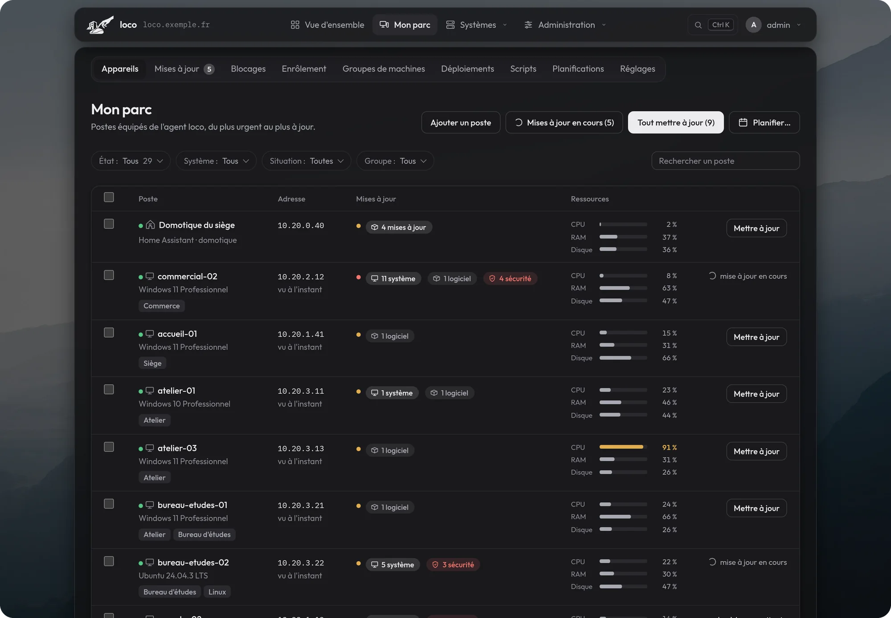
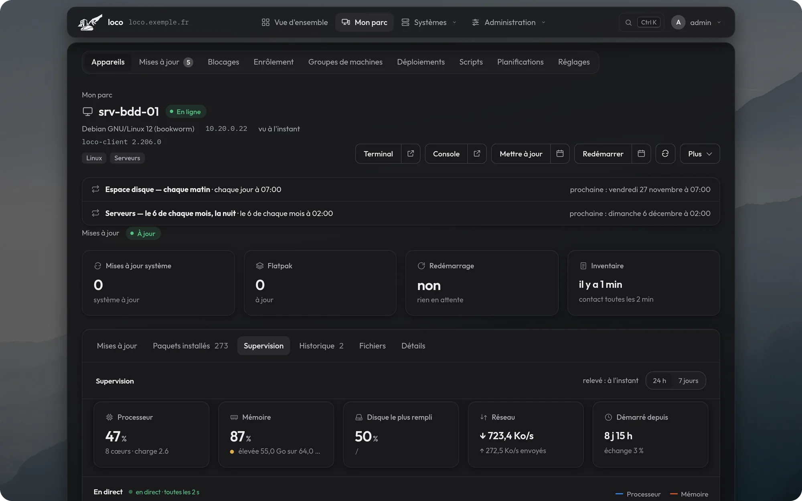
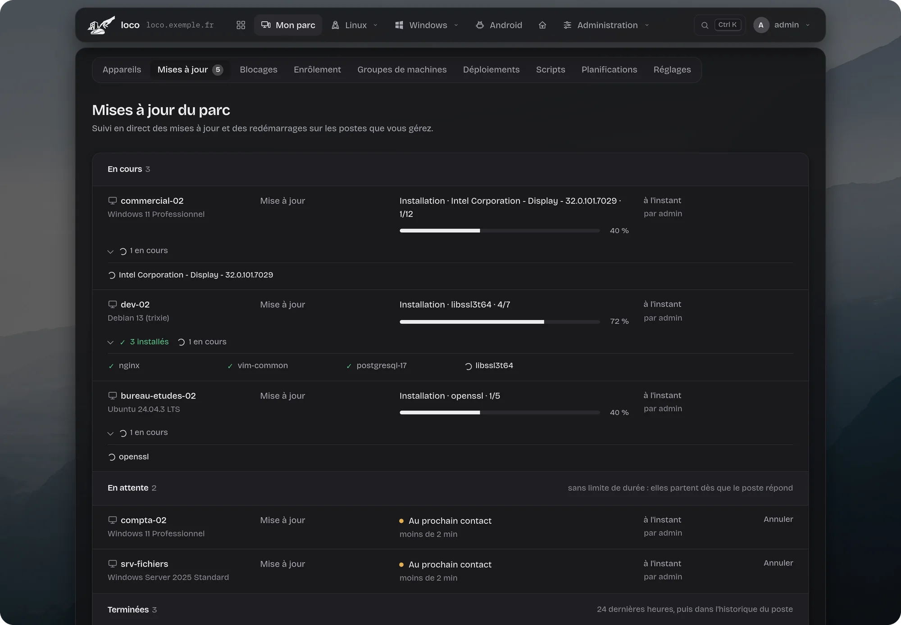
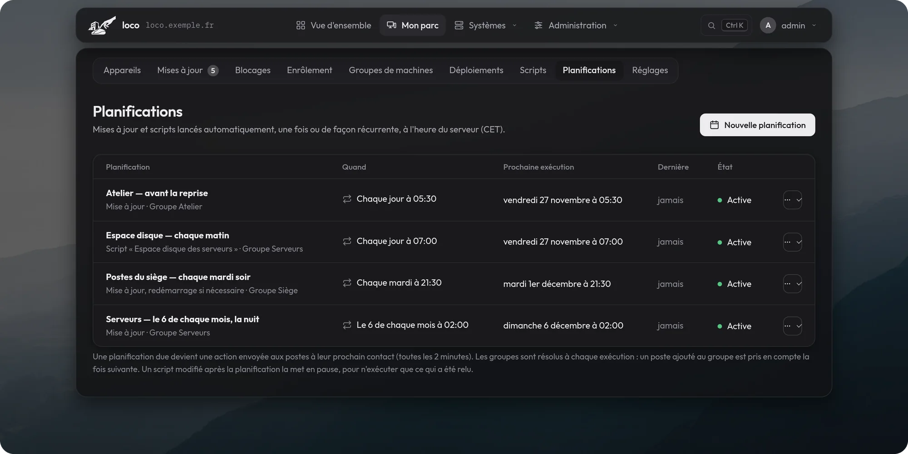
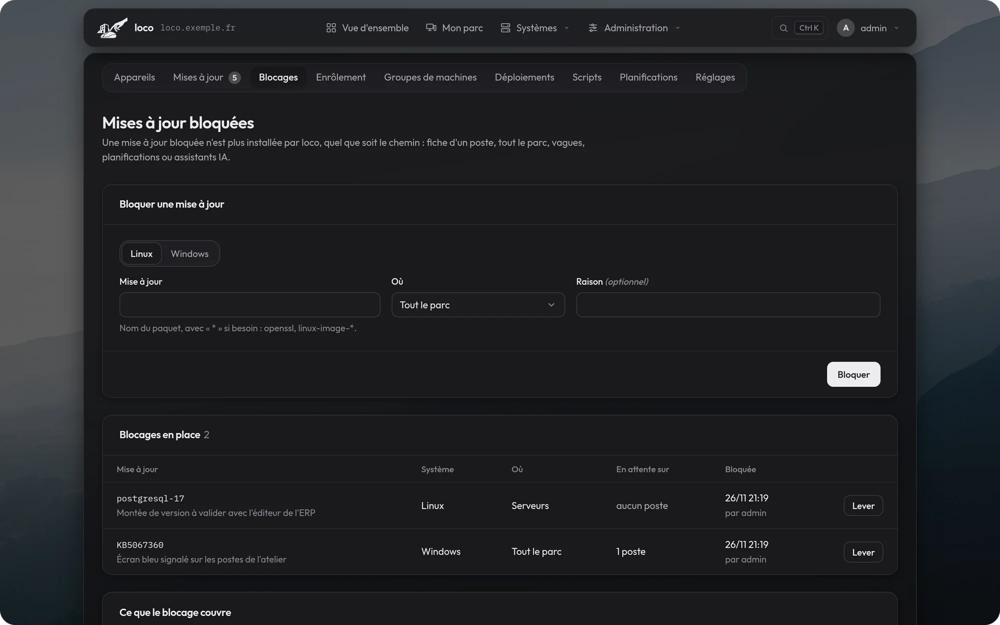
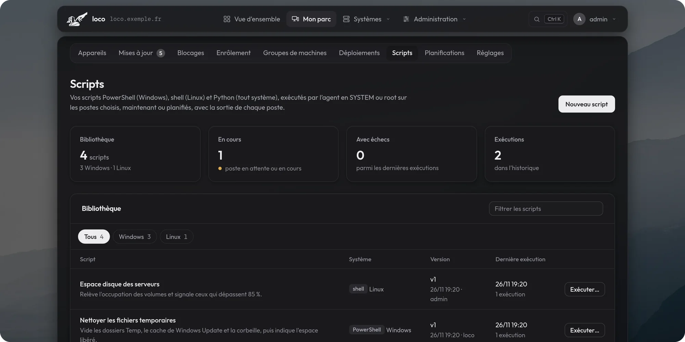

# Mon parc : agent des postes



L'agent `loco-client` (Windows et Linux) remonte l'inventaire des postes et exécute les actions reçues de loco —
mises à jour, logiciels, scripts, redémarrage. Un poste reste rattaché même quand son adresse IP change.

La page **Mon parc** liste les postes équipés de l'agent `loco-client`. Pour en ajouter un, ouvrez **Enrôlement**
(barre de navigation, ou *Ajouter un poste* dans Mon parc) : un onglet par système (Windows ; Debian, Ubuntu ;
Rocky, AlmaLinux, RHEL) avec l'installeur de l'agent à télécharger — **MSI**, paquet **.deb** ou **.rpm** — et sa
commande d'installation, puis la configuration des dépôts et caches (APT, DNF, Flatpak) et, sous Windows, les
logiciels du catalogue. Les fichiers et commandes de l'agent contiennent la clé d'inscription du serveur. Sans
paquet, la commande reste disponible :

```powershell
# Windows 10/11, Windows Server 2016+ (PowerShell administrateur) : installe le MSI, service « loco-client »
irm 'https://<ip>:8443/agent/windows.ps1?key=<clé>' | iex
```

```bash
# Debian, Ubuntu, Rocky Linux, AlmaLinux, RHEL (systemd) : agent Python et minuterie systemd
curl -fsSL 'https://<ip>:8443/agent/linux.sh?key=<clé>' | sudo sh
```

**Inscrire directement dans un groupe** : en haut de la page Enrôlement, *Inscrire les postes dans le groupe* bascule
le MSI, les paquets .deb/.rpm, les commandes et la commande de déploiement en masse (GPO, Intune) sur la **clé du
groupe** (`g<id>-…`) : un poste inscrit avec eux rejoint ce groupe (un poste déjà inscrit le rejoint aussi, sans
quitter les siens). Aucun agent à mettre à jour : la clé de groupe prend la place de la clé du serveur. Par défaut,
aucun groupe ; *Enrôler des postes dans ce groupe* (menu ⋯ d'un groupe) ouvre la page sur lui. Un compte limité à
une partie du parc n'inscrit que dans les groupes attribués à son profil (jamais sans groupe : le poste sortirait de
son parc). *Changer la clé de ce groupe* (droit *Configurer le parc*) rend caducs ses fichiers et commandes déjà
distribués ; supprimer le groupe aussi.

- L'agent contacte loco toutes les deux minutes au repos — et toutes les dix secondes tant qu'une action est en
  attente ou vient de s'exécuter, pour qu'elle parte presque tout de suite — et envoie l'inventaire des mises à jour
  (Windows Update avec les correctifs de sécurité, APT, DNF, Flatpak). L'inventaire des logiciels installés est aussi
  remonté, sous Windows (logiciels installés) comme sous Linux (paquets APT/RPM avec version, architecture et taille,
  applications Flatpak, et caractéristiques du poste : processeur, mémoire, disque, noyau, virtualisation) ; il
  s'affiche sur la fiche du poste dans Mon parc. À l'inscription d'un poste Linux, ses logiciels et caractéristiques
  s'affichent dès le premier contact, le décompte des mises à jour suivant une fois le premier scan réseau terminé.
- **Voyants** : vert, aucune mise à jour ; orange, 1 à 9 mises à jour ; rouge, 10 mises à jour ou plus.
  Le total additionne système, Flatpak et logiciels du catalogue. Le seuil rouge est réglable dans Mon parc.
  Un inventaire manquant, incomplet ou un poste sans contact récent est gris, sans fausser le comptage.
- **Actions** : *Mettre à jour* (un poste) ou *Tout mettre à jour* (tout le parc, tous systèmes), avec redémarrage
  facultatif ; installer ou mettre à jour un logiciel du catalogue ; inventaire ; redémarrage ; retrait de l'agent.
  Ces actions utilisent une liste fermée ; les administrateurs disposent aussi du terminal interactif décrit ci-dessous.
- **Nom personnalisé** : la fiche d'un poste (menu *Plus → Nom personnalisé…*) permet de lui donner un nom plus
  parlant, affiché à la place de son nom d'hôte dans Mon parc et dans la recherche ; le nom d'hôte reste visible.
  Droit *Nommer les appareils* (Administrateur et Opérateur).
- **Mises à jour une par une, en direct** : sur la fiche d'un poste, l'onglet *Mises à jour* permet de cocher
  certaines mises à jour du système (paquets APT/RPM, applications Flatpak, ou mises à jour Windows) et de lancer
  *Mettre à jour la sélection* ; *Mettre à jour* fait toujours tout. Pendant l'exécution, la fiche suit l'avancement
  sans se recharger : étape (préparation, téléchargement, installation), paquet ou mise à jour en cours, barre de
  progression, et dans le tableau les éléments terminés (✓) et celui en cours. Sous Windows, les mises à jour
  s'installent une par une (pile de maintenance d'abord) et une erreur n'arrête plus les suivantes. Agents 2.120.0 et
  plus (ils se mettent à jour seuls) ; l'outil MCP `update_device` accepte la même sélection (`updates`, `flatpak`).
- **Suivi des mises à jour** (*Mon parc → Mises à jour*) : les mises à jour et redémarrages de votre parc, en direct. **En cours** :
  étape, barre et paquets ou mises à jour Windows un par un (installé, en cours, en échec). **En attente** : ce que chaque ligne
  attend vraiment (prochain contact, planification, poste hors ligne) ; une action en attente n'expire pas, elle part au retour du
  poste, et *Annuler* la retire. **Terminées** : 24 heures sur cette page, échecs d'abord avec leur motif, puis dans l'historique du poste.
- **Planifications** (*Mon parc → Planifications*) : mises à jour et scripts lancés **une fois, chaque jour, chaque
  semaine** (jours au choix) **ou chaque mois** (jour fixe ou dernier jour), à l'heure du serveur, sur tout le parc, des
  groupes (membres résolus à chaque exécution) ou des appareils. On planifie aussi en contexte : bouton calendrier à
  côté de *Mettre à jour* sur la fiche d'un poste, *Planifier…* à côté de *Tout mettre à jour*, et choix « Maintenant /
  Planifier » à l'exécution d'un script. Un résumé en clair (« Chaque mardi et jeudi à 02:00 · prochaine exécution… »)
  accompagne la saisie ; la fiche d'un poste liste les planifications qui le concernent. Une planification due devient
  une action envoyée au prochain contact des agents ; une occurrence manquée n'est pas rattrapée. Pause, reprise et
  suppression depuis la liste. Un script modifié après sa planification la met en pause (on n'exécute que ce qui a été
  relu) ; une action encore en file s'annule depuis la fiche du poste. Droits : ceux de l'action planifiée (mettre à
  jour, tout le parc, redémarrer, exécuter des scripts), revérifiés à l'envoi aux postes.
- **Identité** : chaque poste a un identifiant et un jeton propres, indépendants de son adresse. Un poste qui change
  d'IP (DHCP, autre site, VPN) reste dans le parc ; seul *Retirer l'agent*, poussé depuis loco, le détache. Réinstaller
  l'agent garde la fiche du poste : l'agent prouve qu'il détient son jeton, sans le présenter. La clé d'inscription
  seule ne permet donc pas de reprendre un poste : qui présente l'identifiant d'un poste déjà inscrit sans cette preuve
  (disque restauré, clone, poste retiré) est inscrit comme un nouveau poste, et le journal le note.
- **Sécurité** : l'autorité HTTPS de loco est épinglée par l'agent (empreinte SHA-256) sans modifier le magasin de
  certificats du poste ; installeurs vérifiés par SHA-256 ; jetons stockés hachés côté serveur.
- **Paquets .deb et .rpm** : produits par loco pour ce serveur (adresse, autorité épinglée et clé incluses), ils
  s'installent par `sudo apt install ./loco-client_<version>+depots_all.deb` ou
  `sudo dnf install ./loco-client-<version>-1.depots.noarch.rpm` et inscrivent le poste aussitôt. Cette variante
  recommandée configure aussi les dépôts et le cache de loco (autorité confiée au système) ; la variante
  « agent seul » (`loco-client_<version>_all.deb`, `loco-client-<version>-1.noarch.rpm`) ne touche pas aux dépôts.
  Passer de l'agent seul au paquet complet est une mise à jour qui garde l'inscription ; désinstaller le paquet
  retire l'agent (et, pour le paquet complet, la configuration des dépôts). Le paquet ne contient que les scripts
  d'installation : l'agent se met ensuite à jour seul. Ils se téléchargent aussi depuis le poste, en HTTPS ou par
  le port HTTP d'amorçage (`/agent/loco-client.deb?key=…`, `&depots=1` pour la variante complète).
- **Windows, MSI téléchargé** : la page *Enrôlement* propose le MSI en téléchargement direct (lien public, également
  ouvrable depuis le navigateur du poste) et la commande `msiexec` à lancer en administrateur avec l'adresse, la clé
  et l'empreinte du serveur ; un simple double-clic installe le service sans l'inscrire.
- **Windows en masse** : distribuer `loco-client.msi` (GPO, Intune, SCCM) et définir `Server`, `Key` et `CaSha256`
  sous `HKLM\SOFTWARE\Policies\loco\Client`, ou `msiexec /i loco-client.msi SERVER=… KEY=… CA_SHA256=… /qn`.
  Le MSI est publié avec chaque version ; le serveur le télécharge depuis GitHub à la première installation
  (empreinte vérifiée) ou utilise celui déposé dans `portal/agents/`. Il n'est pas signé (pas de certificat de
  signature de code) : SmartScreen peut avertir lors d'une installation manuelle.
- **Logiciels** : dans *Logiciels Windows*, renseigner le nom affiché dans Windows et la version permet de repérer les
  postes à mettre à jour. Le *Centre de logiciels* importe un logiciel avec ces informations ; *Nouvelles versions*
  met à jour les logiciels issus de winget, puis les postes concernés passent en orange.

L'agent se met à jour automatiquement avec loco.





**Changer l'adresse du serveur** : annoncez d'abord la future adresse (*Mon parc › Adresse du serveur pour les agents*,
ou `sudo loco-fleet announce https://192.168.1.20:8443`), attendez que tous les postes soient prévenus
(`loco-fleet servers`), puis changez l'adresse (`install.sh --host`, ou `setup-loco` sur l'appliance qui fait l'annonce
lui-même). Les agents passent seuls à la nouvelle adresse, après vérification de l'autorité HTTPS de loco ; un poste
resté éteint pendant toute l'annonce se réinscrit avec la commande d'installation (même identité). Les agents Linux
mettent aussi à jour leur proxy APT et leurs dépôts ; un poste configuré par `setup.sh` sans agent doit le relancer.



**Déployer par vagues** : dans *Tout mettre à jour* et à la confirmation d'un déploiement, choisissez *Par vagues*, le nombre
de postes par vague, l'attente entre deux vagues, le seuil d'échecs et, si besoin, un groupe pilote. Une vague ne part
que si la précédente compte au moins une réussite et moins d'échecs que le seuil ; sinon tout se met en pause, la vue
d'ensemble le signale, une notification part, et vous décidez de la suite. Un poste éteint ne bloque pas. Les
planifications et *Mettre à jour les sélectionnés* partent toujours d'un coup.

**Accord de l'utilisateur avant le bureau distant** (désactivé par défaut) : exigé sur un poste (fiche, onglet *Détails*, ou sélection
dans Mon parc), ou demandé pour une session (menu *Plus* de la fiche). La personne devant le poste accepte ou refuse dans une fenêtre,
avant toute capture. Sans réponse en une minute, ou sur un écran verrouillé, c'est un refus. Si personne n'est connecté, le bureau
s'ouvre sans demande. Sous Linux, il faut zenity ou kdialog. Le terminal et les fichiers ne sont pas concernés.



**Bloquer une mise à jour** : onglet *Blocages* de Mon parc, ou *Bloquer* sur sa ligne dans la fiche d'un poste. Un paquet (Linux)
ou un KB ou un titre (Windows), avec « * » comme joker, sur tout le parc ou un groupe. loco ne l'installe plus, quel que soit le
chemin : poste, tout le parc, vagues, planifications, assistants IA. Sur le poste, Debian et Ubuntu retiennent le paquet
(`apt-mark hold`), ce qui vaut aussi pour leurs mises à jour automatiques, et Windows masque la mise à jour, sauf celles qu'il
impose. Avec DNF, seules les mises à jour lancées par loco sont concernées. Flatpak et logiciels du catalogue ne le sont pas.

**Réveiller un poste éteint** (Wake-on-LAN) : bouton *Réveiller* dans Mon parc et sur la fiche du poste. Il n'apparaît que si
le poste a une carte Ethernet branchée à son dernier contact, jamais en Wi-Fi, et si le serveur ou un poste allumé est sur le
même réseau : un paquet de réveil ne traverse pas les routeurs. La fiche indique les cartes du poste et, sinon, pourquoi le
réveil n'est pas disponible. *Activer le réveil* (fiche du poste, ou sélection) demande à l'agent de l'activer sur ses cartes
Ethernet et de le maintenir : sous Linux, il le réapplique à chaque contact, car un redémarrage le remet souvent à zéro. Il doit
aussi être autorisé dans le BIOS, ce que l'agent ne peut pas faire.

**Changer le port de l'interface** : *Système › Réseau › Port de l'interface web*. Le nouveau port s'ouvre à côté de
l'ancien, donc rien n'est coupé. Les agents l'apprennent à leur prochain contact et la page compte ceux qui le
connaissent. Ouvrez ensuite l'interface sur le nouveau port et fermez l'ancien depuis celui-ci : les agents basculent
seuls, y compris leurs dépôts HTTPS. Pensez au pare-feu devant le serveur, aux favoris, aux clients MCP, à la supervision
et, avec le SSO, à l'adresse de retour déclarée chez le fournisseur d'identité. En ligne de commande : `install.sh
--https-port N --https-old-ports "ANCIEN"`, puis `--https-old-ports ""` pour fermer. Sous Docker (`LOCO_HTTPS_PORT`) et sur
un serveur Windows (`install.ps1 -HttpsPort`), annoncez d'abord la nouvelle adresse aux agents : il n'y a pas de double écoute.

**Ouvrir loco par son nom** : *Système › Réseau › Adresse du portail*. C'est l'adresse des navigateurs et du retour SSO ;
les agents et l'enrôlement gardent la leur, donc rien ne change pour le parc. Le certificat doit couvrir ce nom : pour un
certificat de loco, cochez *Ajouter ce nom au certificat de loco* ; pour un certificat d'entreprise, demandez-en un qui le
couvre. La page liste les URL de retour à redéclarer chez les fournisseurs SSO. En ligne de commande : `loco-config
portal-url https://loco.exemple.lan:8443 [--add-to-certificate]`, et `--default` pour revenir à l'adresse des agents. Sous
Docker : `LOCO_PORTAL_URL`. Sur un serveur Windows : `install.ps1 -PortalUrl`.

**Noms que le DNS du serveur ne résout pas** : *Système › Réseau › Noms internes*, ou directement depuis *Vérifier la
configuration* d'un fournisseur SSO. Ils vont dans un bloc dédié de `/etc/hosts`, refait après une mise à jour ou
`setup-loco`. Les DNS du cache Windows Update (`--resolvers`) ne changent pas. Sous Docker : `extra_hosts`.

Sur Windows, le MSI installe aussi **loco-tray.exe**, lancé dans chaque session utilisateur. Sa pastille reprend l'état de Mon parc : vert sans mise à jour, orange de 1 à 9 mises à jour, rouge à partir de 10 (seuil réglable). Un état indisponible ou ancien est gris. Le menu et le double-clic affichent uniquement des détails : **aucune action de mise à jour n'est accessible à l'utilisateur**. Le compagnon ne contacte pas le serveur et ne lit aucun jeton ; il consulte un fichier d'état public, accessible uniquement en lecture aux utilisateurs standards. Le service privilégié reste seul responsable des actions reçues de loco.

## Scripts



**Mon parc → Scripts** regroupe une bibliothèque de scripts **PowerShell** (Windows) et **shell** (Linux) avec leur description, leur auteur et leur version : chaque changement de contenu ou de système crée une nouvelle version. **Exécuter** ouvre la sélection des appareils et des groupes de machines ; seuls les postes actifs du bon système sont retenus. La version relue doit être celle exécutée : un script modifié entre-temps impose de le revoir.

Le contenu envoyé est figé à l’exécution avec son empreinte SHA-256, vérifiée par l’agent avant de lancer le script en **SYSTEM** (PowerShell sans profil) ou **root** (`/bin/sh`, ou l’interpréteur de la première ligne `#!`), avec un délai de 30 minutes. La page de l’exécution suit chaque poste en direct : état, code de retour, sortie standard et erreurs. Les postes qui n’ont pas encore reçu le script peuvent être annulés ; un script déjà transmis se termine. Les résultats restent consultables après la suppression du script.

Les droits **Consulter les scripts**, **Gérer les scripts** et **Exécuter des scripts** sont distincts ; les deux derniers sont sensibles et réservés par défaut aux administrateurs. Le droit d’exécution est revérifié avant la transmission à l’agent. Agents Windows et Linux 2.14 ou plus récents.

---

[← Retour à la présentation](../README.md) · [Toute la documentation](README.md)
