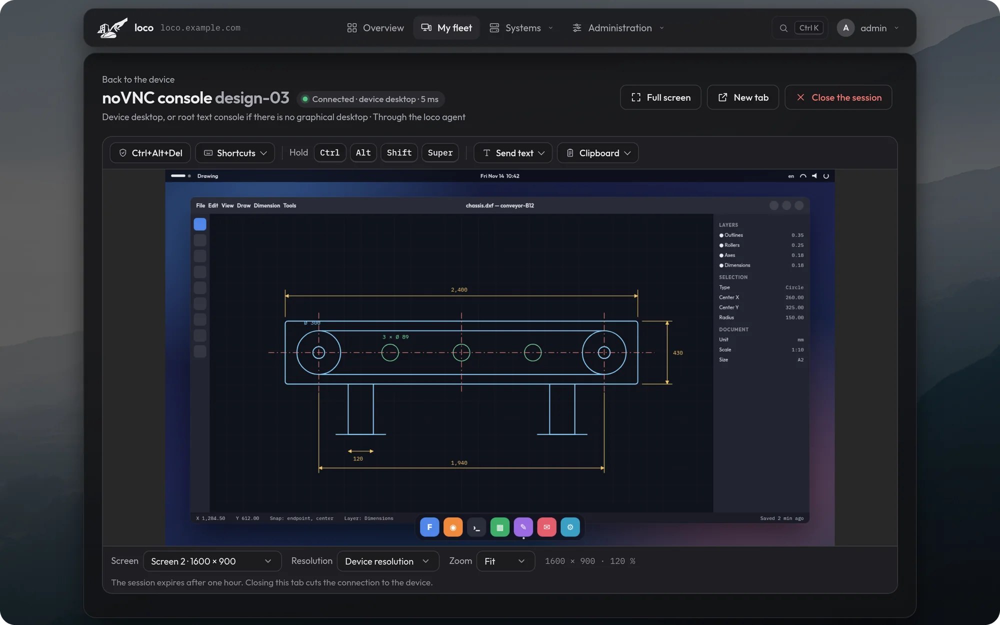
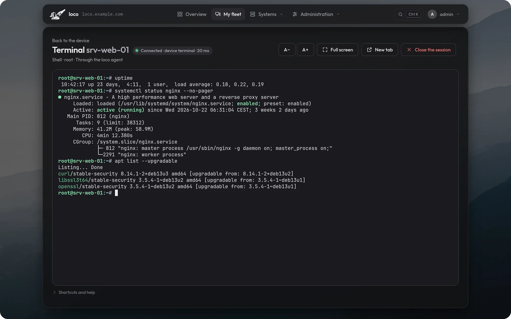
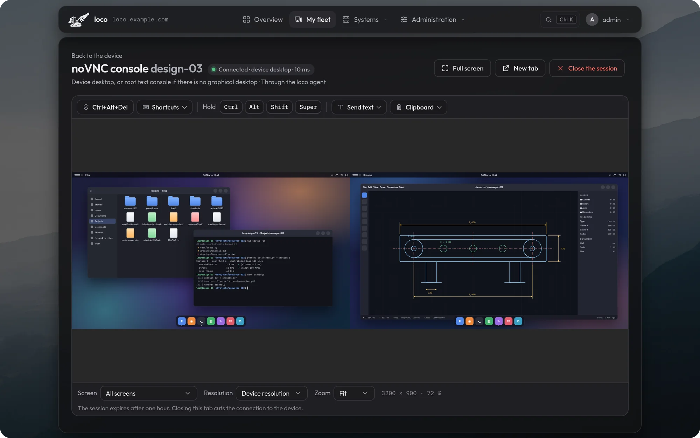

**English** · [Français](fr/remote-sessions.md) · [Español](es/remote-sessions.md)

# Remote sessions through the agent

Terminal, noVNC desktop and file manager of a device, driven by the agent through an outbound HTTPS
relay — no inbound port, VNC server or SSH account on the device.

**Experimental — Android**: the same screen, terminal and files are available on your own Android
devices, through an app to install (no QR code), behind *Features › Experimental*. An application
catalog installs APKs from verified F-Droid repositories (F-Droid, IzzyOnDroid…) and opens Google Play pages
on the device, and an adb terminal (wireless debugging) gives a real `adb shell` from the portal. Each access
is granted on the device. See [docs/android.md](android.md).

On a device's page in **My fleet**, an administrator can open a **Terminal / PowerShell** or the **noVNC desktop**. The **Full screen** and **New tab** buttons are available in both views. In **desktop full screen**, the image fills the whole screen and the controls (resolution, zoom, Ctrl+Alt+Del, shortcuts, held keys, sending text, clipboard, closing) move to a **retractable left rail**: a handle at the edge of the screen opens or folds it. The device's cursor stays visible and aligned in full screen as when you come back. The new tab opens a **dedicated console**, without the portal's navigation: a small toolbar and all the available space for the device. The device's page stays open in its tab; each console has its own independent connection.

The loco agent 2.4 or later opens the outbound HTTPS connections to loco itself, with the server's authority pinned. No inbound port on the device, SSH account, separate VNC server or Proxmox access is needed. From version **2.158**, the agent and the browser keep a **persistent connection** (WebSocket, on the same HTTPS port) with loco: the server notifies them as soon as a session is requested, a key is pressed or the device answers, instead of waiting for their next poll — a session opens at once, typing responds faster and no request goes out empty anymore. Nothing to open or set: if this connection is not possible (older agent, network equipment that cuts it, the server's local port 8090 already taken), the session goes through HTTPS round trips as before, without interruption. The terminal uses a real Linux PTY or Windows ConPTY, with a **root** shell or **SYSTEM PowerShell** depending on the service account.

The desktop is set with two independent menus, remembered by the browser. **Resolution**: *Fit to window* (default) changes the resolution of the Windows desktop to fill the window, **never with scrollbars**: if the driver imposes a slightly different mode, the image is adjusted; *Device resolution* keeps — and restores — the original resolution. **Zoom**: *Fit*, or 50 to 200 %. With the fitted resolution, the zoom enlarges the device's interface (like Windows scaling) while filling the window; with the device resolution, it enlarges the image, with scrolling beyond the window (100 %: one device pixel per screen pixel). The resolution and percentage obtained stay displayed, and the device's cursor follows the same scale. From Windows agent **2.13.1**, the fitted resolution temporarily reconfigures the desktop according to the driver's modes, then restores the initial resolution on closing; only one session changes it, multi-monitor devices keep their configuration and a request made during UAC waits for the return to the desktop. With the standard VGA adapter of a virtual machine (a single resolution), prefer VirtIO-GPU and its virtio-win driver. An older agent or an X11 desktop keeps the local fit; the Linux text console 2.13 or later really adapts the PTY.

**Several screens**: when the device has more than one, a **Screen** list appears next to *Resolution* — *All screens* (side by side, as before) or a single one, named by its number, its size and the word *primary*. The image takes the size of the chosen screen, mouse and keyboard stay accurate, and the choice is remembered per device in the browser: the next session reopens on the same screen. On Windows, the numbers are those of the display settings, and a single screen is read through DXGI duplication like a one-screen device. Available from agent **2.162.0** on Windows and on an X11 Linux desktop, **2.163.0** on KDE Plasma under Wayland; a screen unplugged during the session brings the view back to all screens. On KDE Plasma, the list appears when the sharing granted on the device is **Full workspace** (first tile of the "Screen sharing" window): loco then cuts each screen out of that image. If a single screen was granted, loco shows only that one — mouse in the right place, even next to other screens; to change your mind, delete `~/.config/loco/portal-token` on the device: the next session asks for consent again. GNOME under Wayland shows its primary screen.

A badge shows the session state and the latency to the server; an overlay accompanies the opening and offers, at the end of a session, to open a new one in one click. From Windows agent **2.17**, the screen is read through **DXGI duplication**: only when it changes, with the modified areas, and the image request waits as long as nothing moves (no traffic or computation on a still desktop). GDI takes over on the secure desktop, with several screens or a driver without duplication. Interface areas (text, flat colors, icons) are sent **losslessly** (Tight zlib), complex areas (photos, gradients, wallpapers) as **JPEG**; a still screen is not sent again. On machines whose display driver has no hardware cursor (VM, basic adapter), Windows draws its cursor into the image: the agent recognizes it and the browser then shows only a marker, instead of a second, shifted arrow. The **text clipboard** is shared both ways (Windows agent 2.15) through the *Clipboard* panel: text copied on the device appears in the browser (and, if it allows it, in the local clipboard); *Send to device* puts a text into the device's clipboard. An option automatically sends the local clipboard to the device on each click on the desktop. Only on the user desktop, never on the secure desktop; loco keeps nothing.

The desktop shares the existing graphical session: interactive session on **Windows 11 and Windows Server 2022/2025**, or graphical desktop on Linux: **X11** (X11 and XTest libraries required), **GNOME under Wayland** (Mutter remote desktop, images through PipeWire and GStreamer; GNOME shows its screen sharing indicator during the session), a **wlroots** Wayland compositor such as Sway or Hyprland (`grim`, embedded in the agent's `.deb` package — so present even on an offline device —, and `/dev/uinput`), or **KDE Plasma under Wayland** (`xdg-desktop-portal`: capture through ScreenCast/PipeWire and input through `/dev/uinput`; screen sharing consent is asked on the device the first time, then remembered for the next sessions). Other Wayland compositors are not supported. Windows agent 2.13 also allows control of the secure desktop (UAC, sign-in/lock) in the interactive session. A Linux device without a graphical session can open the text console described below.

On the same page, the **Files** tab opens a **file manager** of the device (loco agent **2.23** or later) — the same as the one for [file shares](file-shares.md#opening-a-share-in-the-browser): browse the tree (breadcrumb, previous and next folders, shortcuts to the root and the home folder, sorting, filter, hidden files, disk usage on Linux and Windows), upload files or whole folders (button or drag and drop), download, preview photos, PDFs, sound and videos (read from the device, 64 MB at most), text editor, new folder or file, rename, copy, cut and paste, move by dragging onto a folder, delete and, on Linux and Android, adjust permissions (octal). Multiple selection with a bar at the bottom of the screen, right click, keyboard shortcuts; a name already taken is raised before uploading or pasting. What a device's agent cannot do does not appear: ZIP archive of a folder, search in subfolders. Like the terminal and the desktop, everything goes through the same outbound HTTPS relay: the agent runs each operation as **root** (SYSTEM on Windows) and the server never connects to the device. The page's automatic refresh is suspended while the tab stays open, so as not to interrupt a transfer or an edit.

Sessions require the **Remote terminal**, **noVNC desktop** or **Manage the device's files** right, depending on the type chosen, and remain tied to the portal sign-in. The Administrator profile has these rights; other profiles must receive them explicitly. Closing the tab, signing out, removing the agent or revoking the rights cuts them. They expire after one hour, after one minute without a browser or after a prolonged loss of contact with the agent. Two sessions of each type can coexist per device, within a limit of eight sessions for the server. Reloading the page closes the old stream; **New session** starts over cleanly.

On a Linux device without a graphical session, or stopped at the GNOME sign-in screen, **noVNC console** automatically opens a **root text console** rendered over RFB by agent 2.7 or later: interactive shell, ANSI colors, arrows, tab and Ctrl+C. No X server or VNC port is needed. The **Remote terminal** right is required on top of the **noVNC desktop** right; without it, no shell is started. This private console does not replace the device's physical terminal. The screen starts at 128 columns × 40 lines (1024 × 640 pixels) and adapts the PTY and its pixels to the window with agent 2.13, with Latin glyphs and box-drawing characters; use the usual terminal for selecting/copying text, scrolling and other writing.

The text console embeds the sources of [pyte](https://pyte.readthedocs.io/en/stable/) (LGPLv3), wcwidth (MIT) and font8x8 (public domain), with their licenses in `portal/agents/console`; no dependency is downloaded on the device.

On Windows, agent 2.13 follows the secure desktop during a UAC request and then comes back to the user desktop. Graphical control runs as SYSTEM in the interactive session; the tray stays unprivileged. Momentarily unavailable transitions suspend capture and input without closing the session. No UAC policy is disabled.

The **command panel** of the noVNC console sends **Ctrl+Alt+Del** and the usual shortcuts (Start menu, Run, Explorer, Show desktop, Lock, Task Manager, Alt+Tab, Alt+F4, Esc, Print Screen, context menu). The Ctrl, Alt, Shift and Win keys can be held until the next click. **Send text** types a text character by character, whatever the keyboard layout of the device (passwords, commands); nothing is kept. On Windows, the secure attention sequence is only accepted from a service: the desktop companion signals it to the loco-client service, which sends it only during a remote desktop session (agent 2.14).

The audit log keeps openings and closings, without recording keystrokes or screen contents. Transfer queues are bounded, acknowledged then cleared; they are excluded from backups along with active sessions.

## Reserved device

An account with the **Reserve a device** right (the Administrator profile has it) can, from *More › Reserve this
device…* on a device's page, reserve it with a password of its choice. **Other accounts** — even with the
Administrator profile — must then enter that password to open its **terminal**, its **remote desktop**
(console included) and its **files**, to **restart** it (restart, update followed by a restart, upgrade
to a new version of the system), and on Android for its **adb terminal**, its **screen** and its
**unlocking**.
Once entered, access stays open for **half an hour**, for that account and in that browser (*Close again* closes it
earlier); five failed attempts lock that account out of the device for a quarter of an hour. **Everything else stays open to them**,
according to their rights: inventory, updates without a restart, deployments, scripts, removing the agent, forgetting the
device.

- From the My fleet list, *Restart* leaves out the devices another account has reserved, and *Update
  then restart* or *Update all* updates them without restarting them — except those whose password has already been
  entered. An update in waves never restarts them. A schedule only restarts a reserved device if its author is its owner: you
  cannot schedule the restart of a device reserved by another account, and a schedule for a group or the whole fleet
  leaves it out — its result says so (*1 reserved, not restarted*). The password entered in the browser only
  counts for what you do there yourself, never for a schedule or a wave that goes out later.
- The page shows *Reserved by …* (or *Reserved for you*), and My fleet a padlock next to the name. The owner changes
  the password or releases the device from *More*; nobody else can.
- Reserving a device, or changing its password, **closes the sessions already opened** by other accounts on that
  device, and closes the accesses opened with the old password. Reserving also cancels the restarts they had
  requested that have not yet gone out to the device (a pending update stays, without a restart).
- The **MCP tools and the API** of other accounts are refused on a reserved device: only a person can enter the
  password, in the portal. The owner's keep working as before.
- The password is only kept hashed: loco can never show it. **Lost password**: an administrator
  forgets the device, then enrolls it again, without a reservation. The reservation also disappears if the account that holds it is
  deleted.
- Each reservation, change, release, successful or failed entry is recorded in the audit log.

The reservation protects direct access to the device, not an administrator's control: a script or a deployment,
which remain allowed, run as root (SYSTEM on Windows), and restarting the Proxmox hypervisor that hosts it
also stops the device, along with its other machines.

---

[← Back to the overview](../README.md) · [All the documentation](README.md)
