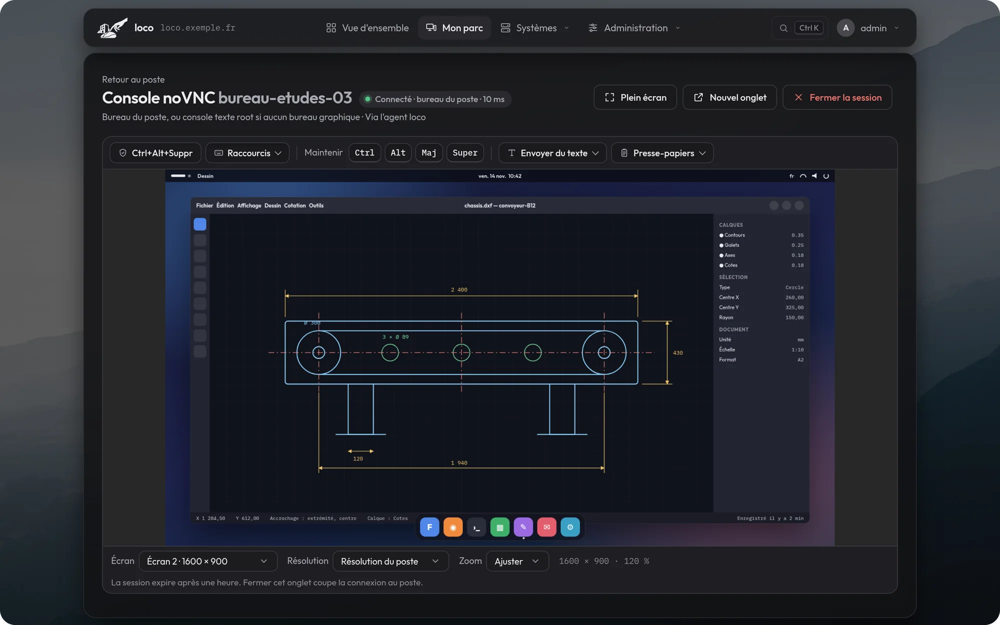
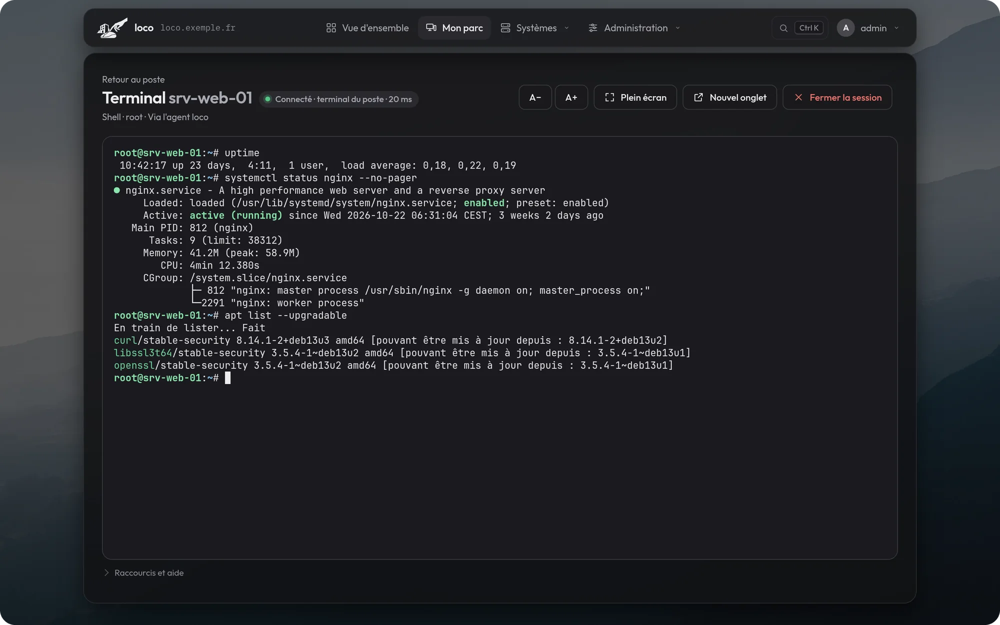
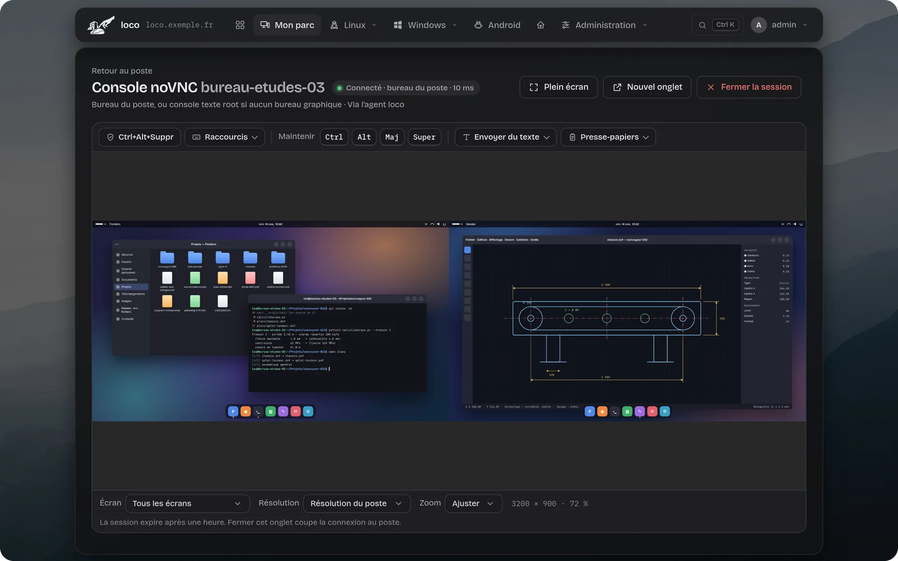

# Sessions distantes via l’agent

Terminal, bureau noVNC et gestionnaire de fichiers d’un poste, pilotés par l’agent via un relais HTTPS
sortant — aucun port entrant, serveur VNC ou compte SSH sur le poste.

**Expérimental — Android** : les mêmes écran, terminal et fichiers sont disponibles sur vos propres appareils
Android, via une application à installer (sans QR code), derrière *Fonctionnalités › Expérimental*. Un catalogue
d'applications installe des APK de dépôts F-Droid vérifiés (F-Droid, IzzyOnDroid…) et ouvre les fiches Google Play
sur l'appareil, et un terminal adb (débogage sans fil) donne un vrai `adb shell` depuis le portail. Chaque accès
s’accorde sur l’appareil. Voir [docs/android.md](android.md).

Dans la fiche d’un poste de **Mon parc**, un administrateur peut ouvrir un **Terminal / PowerShell** ou le **Bureau noVNC**. Les boutons **Plein écran** et **Nouvel onglet** sont disponibles dans les deux vues. En **plein écran du bureau**, l’image occupe tout l’écran et les commandes (résolution, zoom, Ctrl+Alt+Suppr, raccourcis, touches maintenues, envoi de texte, presse-papiers, fermeture) passent dans un **rail latéral gauche rétractable** : une poignée au bord de l’écran le déploie ou le replie. Le curseur du poste reste affiché et aligné en plein écran comme au retour. Le nouvel onglet ouvre une **console dédiée**, sans la navigation du portail : une petite barre d’outils et tout l’espace disponible pour le poste. La fiche de l’appareil reste ouverte dans son onglet ; chaque console dispose de sa connexion indépendante.

L’agent loco 2.4 ou ultérieur établit lui-même les connexions HTTPS sortantes vers loco, avec l’autorité du serveur épinglée. Aucun port entrant sur le poste, compte SSH, serveur VNC distinct ni accès Proxmox n’est nécessaire. À partir de la version **2.158**, l’agent et le navigateur gardent une **connexion persistante** (WebSocket, sur le même port HTTPS) avec loco : le serveur les prévient dès qu’une session est demandée, qu’une touche est frappée ou que le poste répond, au lieu d’attendre leur prochain relevé — une session s’ouvre aussitôt, la frappe répond plus vite et plus aucune requête ne part à vide. Rien à ouvrir ni à régler : si cette connexion n’est pas possible (agent plus ancien, équipement réseau qui la coupe, port local 8090 du serveur déjà pris), la session passe par des allers-retours HTTPS comme auparavant, sans coupure. Le terminal utilise un vrai PTY Linux ou ConPTY Windows, avec un shell **root** ou **PowerShell SYSTEM** selon le compte du service.

Le bureau se règle par deux menus indépendants, mémorisés par le navigateur. **Résolution** : *Adaptée à la fenêtre* (par défaut) change la résolution du bureau Windows pour remplir la fenêtre, **sans jamais d’ascenseurs** : si le pilote impose un mode un peu différent, l’image est ajustée ; *Résolution du poste* garde — et rétablit — la résolution d’origine. **Zoom** : *Ajuster*, ou 50 à 200 %. En résolution adaptée, le zoom agrandit l’interface du poste (comme la mise à l’échelle de Windows) tout en remplissant la fenêtre ; en résolution du poste, il agrandit l’image, avec défilement au-delà de la fenêtre (100 % : un pixel du poste par pixel de l’écran). La résolution et le pourcentage obtenus restent affichés, et le curseur du poste suit la même échelle. À partir de l’agent Windows **2.13.1**, la résolution adaptée reconfigure temporairement le bureau selon les modes du pilote, puis restaure la résolution initiale à la fermeture ; une seule session la modifie, les postes multi-moniteurs conservent leur configuration et une demande faite pendant l’UAC attend le retour au bureau. Avec l’adaptateur VGA standard d’une machine virtuelle (une seule résolution), préférer VirtIO-GPU et son pilote virtio-win. Un ancien agent ou un bureau X11 conserve l’ajustement local ; la console texte Linux 2.13 ou plus récente adapte réellement le PTY.

**Plusieurs écrans** : quand le poste en a plus d’un, une liste **Écran** apparaît à côté de *Résolution* — *Tous les écrans* (côte à côte, comme auparavant) ou un seul, désigné par son numéro, sa taille et la mention *principal*. L’image prend la taille de l’écran choisi, la souris et le clavier restent justes, et le choix est retenu par poste dans le navigateur : la session suivante rouvre sur le même écran. Sous Windows, les numéros sont ceux des paramètres d’affichage, et un écran seul est lu par duplication DXGI comme un poste à un écran. Disponible à partir de l’agent **2.162.0** sous Windows et sur un bureau Linux X11, **2.163.0** sur KDE Plasma en Wayland ; un écran débranché en cours de session rend la vue à tous les écrans. Sur KDE Plasma, la liste apparaît quand le partage accordé sur le poste est **Espace de travail complet** (première tuile de la fenêtre « Partage d’écran ») : loco découpe alors chaque écran dans cette image. Si un seul écran a été accordé, loco ne montre que lui — souris à la bonne place, même à côté d’autres écrans ; pour changer d’avis, supprimer `~/.config/loco/portal-token` sur le poste : la session suivante redemande l’accord. GNOME en Wayland montre son écran principal.

Une pastille indique l’état de la session et la latence vers le serveur ; une superposition accompagne l’ouverture et propose, en fin de session, d’en ouvrir une nouvelle en un clic. À partir de l’agent Windows **2.17**, l’écran est lu par **duplication DXGI** : seulement quand il change, avec les zones modifiées, et la demande d’image reste en attente tant que rien ne bouge (aucun trafic ni calcul sur un bureau immobile). GDI prend le relais sur le bureau sécurisé, avec plusieurs écrans ou un pilote sans duplication. Les zones d’interface (texte, aplats, icônes) sont transmises **sans perte** (Tight zlib), les zones complexes (photos, dégradés, fonds d’écran) en **JPEG** ; un écran immobile n’est pas retransmis. Sur les machines dont le pilote d’affichage n’a pas de curseur matériel (VM, adaptateur de base), Windows dessine son curseur dans l’image : l’agent le reconnaît et le navigateur n’en affiche alors qu’un point de repère, au lieu d’une seconde flèche décalée. Le **presse-papiers texte** est partagé dans les deux sens (agent Windows 2.15) via le panneau *Presse-papiers* : le texte copié sur le poste s’affiche dans le navigateur (et, s’il l’autorise, dans le presse-papiers local) ; *Envoyer au poste* place un texte dans le presse-papiers du poste. Une option envoie automatiquement le presse-papiers local au poste à chaque clic sur le bureau. Uniquement sur le bureau utilisateur, jamais sur le bureau sécurisé ; rien n’est conservé par loco.

Le bureau partage la session graphique existante : session interactive sous **Windows 11 et Windows Server 2022/2025**, ou bureau graphique sous Linux : **X11** (bibliothèques X11 et XTest requises), **GNOME en Wayland** (bureau à distance de Mutter, images par PipeWire et GStreamer ; GNOME affiche son indicateur de partage d’écran pendant la session) compositeur Wayland **wlroots** comme Sway ou Hyprland (`grim`, embarqué dans le paquet `.deb` de l’agent — donc présent même sur un poste hors-ligne —, et `/dev/uinput`), ou **KDE Plasma en Wayland** (portail `xdg-desktop-portal` : capture par ScreenCast/PipeWire et saisie par `/dev/uinput` ; un accord de partage d’écran est demandé sur le poste la première fois, puis mémorisé pour les sessions suivantes). Les autres compositeurs Wayland ne sont pas pris en charge. L’agent Windows 2.13 permet également le contrôle du bureau sécurisé (UAC, connexion/verrouillage) dans la session interactive. Un Linux sans session graphique peut ouvrir la console texte décrite ci-dessous.

Dans la même fiche, l’onglet **Fichiers** ouvre un **gestionnaire de fichiers** du poste (agent loco **2.23** ou ultérieur) — le même que celui des [partages de fichiers](partages.md#ouvrir-un-partage-dans-le-navigateur) : parcourir l’arborescence (fil d’Ariane, dossiers précédent et suivant, raccourcis vers la racine et le dossier personnel, tri, filtre, fichiers cachés, espace disque sous Linux et Windows), téléverser des fichiers ou des dossiers entiers (bouton ou glisser-déposer), télécharger, aperçu des photos, PDF, son et vidéos (lus depuis le poste, 64 Mo au plus), éditeur de texte, nouveau dossier ou fichier, renommer, copier, couper et coller, déplacer en glissant sur un dossier, supprimer et, sous Linux et Android, ajuster les droits (octal). Sélection multiple avec une barre en bas de l’écran, clic droit, raccourcis clavier ; un nom déjà pris est soumis avant l’envoi ou le collage. Ce que l’agent d’un poste ne sait pas faire n’y apparaît pas : archive ZIP d’un dossier, recherche dans les sous-dossiers. Comme le terminal et le bureau, tout passe par le même relais HTTPS sortant : l’agent exécute chaque opération en **root** (SYSTEM sous Windows) et le serveur ne se connecte jamais au poste. Le rafraîchissement automatique de la fiche est suspendu tant que l’onglet reste ouvert, pour ne pas interrompre un transfert ou une édition.

Les sessions nécessitent le droit **Terminal distant**, **Bureau noVNC** ou **Gérer les fichiers du poste**, selon le type choisi, et restent liées à la connexion au portail. Le profil Administrateur possède ces droits ; les autres profils doivent les recevoir explicitement. La fermeture de l’onglet, la déconnexion, le retrait de l’agent ou la révocation des droits les coupe. Elles expirent après une heure, après une minute sans navigateur ou après une perte prolongée du contact avec l’agent. Deux sessions de chaque type peuvent coexister par poste, dans une limite de huit sessions pour le serveur. Recharger la page ferme l’ancien flux ; **Nouvelle session** permet de repartir proprement.

Sur un Linux sans session graphique, ou arrêté à l’écran de connexion de GNOME, **Console noVNC** ouvre automatiquement une **console texte root** rendue en RFB par l'agent 2.7 ou plus récent : shell interactif, couleurs ANSI, flèches, tabulation et Ctrl+C. Aucun serveur X ni port VNC n'est nécessaire. Le droit **Terminal distant** est requis en plus du droit **Bureau noVNC** ; sans lui, aucun shell n'est lancé. Cette console privée ne remplace pas le terminal physique du poste. L’écran démarre à 128 colonnes × 40 lignes (1024 × 640 pixels) et adapte le PTY et ses pixels à la fenêtre avec l’agent 2.13, avec glyphes latins et tracés de tableaux ; utilisez le terminal habituel pour la sélection/copie de texte, le défilement et les autres écritures.

La console texte embarque les sources de [pyte](https://pyte.readthedocs.io/en/stable/) (LGPLv3), wcwidth (MIT) et font8x8 (domaine public), avec leurs licences dans `portal/agents/console` ; aucun téléchargement de dépendance n'est effectué sur le poste.

Sur Windows, l’agent 2.13 suit le bureau sécurisé lors d’une demande UAC et revient ensuite au bureau utilisateur. Le contrôle graphique s’exécute sous SYSTEM dans la session interactive ; le tray reste non privilégié. Les transitions momentanément indisponibles suspendent la capture et la saisie sans fermer la session. Aucune stratégie UAC n’est désactivée.

Le **panneau de commandes** de la console noVNC envoie **Ctrl+Alt+Suppr** et les raccourcis courants (menu Démarrer, Exécuter, Explorateur, Afficher le bureau, Verrouiller, Gestionnaire des tâches, Alt+Tab, Alt+F4, Échap, Impr. écran, menu contextuel). Les touches Ctrl, Alt, Maj et Win peuvent être maintenues jusqu’au clic suivant. **Envoyer du texte** tape un texte caractère par caractère, quelle que soit la disposition du clavier du poste (mots de passe, commandes) ; rien n’est conservé. Sous Windows, la séquence sécurisée n’est acceptée que d’un service : le compagnon de bureau la signale au service loco-client, qui l’envoie uniquement pendant une session de bureau à distance (agent 2.14).

Le journal conserve les ouvertures et fermetures, sans enregistrer les frappes ni le contenu des écrans. Les files de transfert sont bornées, acquittées puis effacées ; elles sont exclues des sauvegardes avec les sessions actives.

## Poste réservé

Un compte qui a le droit **Se réserver un appareil** (le profil Administrateur l’a) peut, depuis *Plus › Réserver ce
poste…* sur la fiche d’un appareil, le réserver avec un mot de passe qu’il choisit. Les **autres comptes** — même au
profil Administrateur — doivent alors saisir ce mot de passe pour ouvrir son **terminal**, son **bureau à distance**
(console comprise) et ses **fichiers**, pour le **redémarrer** (redémarrage, mise à jour suivie d’un redémarrage, mise
à jour vers une nouvelle version du système), et sur Android pour son **terminal adb**, son **écran** et son
**déverrouillage**.
Une fois saisi, l’accès reste ouvert **une demi-heure**, pour ce compte et dans ce navigateur (*Refermer* le ferme
plus tôt) ; cinq essais manqués bloquent ce compte un quart d’heure sur ce poste. **Tout le reste leur reste ouvert**,
selon leurs droits : inventaire, mises à jour sans redémarrage, déploiements, scripts, retrait de l’agent, oubli du
poste.

- Depuis la liste de Mon parc, *Redémarrer* laisse de côté les postes qu’un autre compte a réservés, et *Mettre à jour
  puis redémarrer* ou *Tout mettre à jour* les met à jour sans les redémarrer — sauf ceux dont le mot de passe est déjà
  saisi. Une mise à jour par vagues ne les redémarre jamais. Une planification ne redémarre un poste réservé que si son auteur en est le propriétaire : on ne
  peut pas planifier le redémarrage d’un poste réservé par un autre compte, et celle d’un groupe ou de tout le parc
  le laisse de côté — son résultat le dit (*1 réservé sans redémarrage*). Le mot de passe saisi dans le navigateur ne
  vaut que pour ce qu’on y fait soi-même, jamais pour une planification ou une vague qui part plus tard.
- La fiche montre *Réservé par …* (ou *Réservé pour vous*), et Mon parc un cadenas près du nom. Le propriétaire change
  le mot de passe ou libère le poste depuis *Plus* ; personne d’autre ne le peut.
- Réserver un poste, ou changer son mot de passe, **ferme les sessions déjà ouvertes** par les autres comptes sur ce
  poste, et referme les accès ouverts avec l’ancien mot de passe. Réserver annule aussi les redémarrages qu’ils avaient
  demandés et qui ne sont pas encore partis vers le poste (une mise à jour en attente reste, sans redémarrage).
- Les **outils MCP et l’API** des autres comptes sont refusés sur un poste réservé : seule une personne peut saisir le
  mot de passe, dans le portail. Ceux du propriétaire fonctionnent comme avant.
- Le mot de passe n’est gardé que haché : loco ne peut jamais l’afficher. **Mot de passe perdu** : un administrateur
  oublie le poste, puis le réinscrit, sans réservation. La réservation disparaît aussi si le compte qui la tient est
  supprimé.
- Chaque réservation, changement, libération, saisie réussie ou manquée est inscrite au journal.

La réservation protège l’accès direct au poste, pas le contrôle d’un administrateur : un script ou un déploiement,
qui restent permis, s’exécutent en root (SYSTEM sous Windows), et redémarrer l’hyperviseur Proxmox qui l’héberge
arrête aussi le poste, avec ses autres machines.

---

[← Retour à la présentation](../README.md) · [Toute la documentation](README.md)
