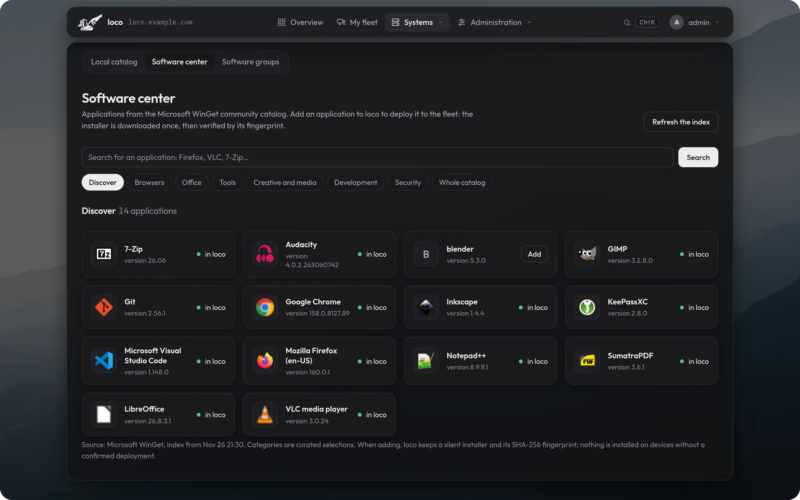
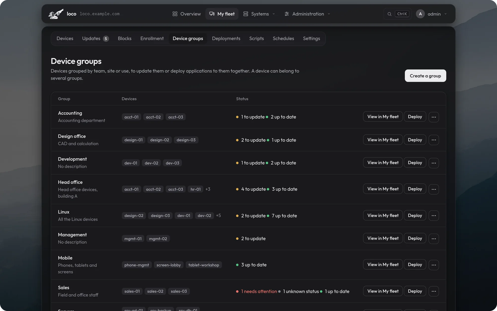
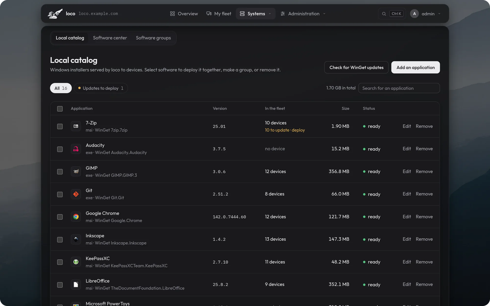

**English** · [Français](fr/windows-software.md) · [Español](es/windows-software.md)

# Windows software center

In **Windows → Software**, the **Local catalog**, **Software center** and **Software groups** tabs bring the applications together; their *Deploy* buttons open the preparation of a deployment, which you then follow in **My fleet → Deployments** (an action on the devices, like scripts). The software center uses Microsoft's community WinGet catalog, with search, categories, pages and logos that are checked and then cached on loco. An initial replaces unavailable logos. Each page shows the publisher, the version, the license and the available silent installer. **Add to loco** downloads the official installer and checks its SHA-256 fingerprint. The index is renewed every day; its last valid copy remains available if the Internet is temporarily unreachable. A program is removed from the catalog from its row, or several at once by ticking them, including those whose download failed; nothing is uninstalled from the devices.

From a software center page, **Deploy to devices or groups** imports the program if needed, then opens the preparation shared with the catalog's programs. You can also select several programs in the catalog or create a **software group** (for example "Office basics"). A program can belong to several groups. Adding a program to a group from the software center imports it only once into the catalog; refreshes and retries keep the WinGet fingerprint check.

In **My fleet → Device groups**, create the groups and choose their members; a device's page also lets you change its memberships. A device can be in several groups. The My fleet filter shows one group and limits the global update action to the devices of that group.

A deployment can combine programs and software groups, then individual devices and device groups. The preview removes duplicates and shows the devices that are left out: the programs of this store are meant for Windows, while device groups can also contain Linux. **No installation goes out before the confirmation** and the check of the installers. The selection is frozen at preparation time and valid for one hour: adding a member to a group never triggers an implicit installation. A page, a file or a target changed since the preparation requires a new preview.

On confirmation, loco keeps the installer versions and sends a batch to each Windows agent concerned, at the device's next check-in, including after a period offline. Changing or removing the program from the catalog afterwards does not replace those files. Versions already installed according to a recent inventory and identical installations already pending are skipped; an option allows an explicit reinstallation. **My fleet → Deployments** shows the progress, the exclusions and each device's log. Cancelling stops the commands not yet sent; an installation already received by an agent may finish. Backups keep the groups, the commands and the files they need; the cache of versions with no active command is purged after one hour.

The **Manage software groups**, **Manage device groups**, **View deployments** and **Deploy to groups or several devices** rights are separate. The last one is reserved for administrators by default; the Operator keeps individual deployment. Rights are checked again at confirmation and then before anything is sent to the agents.

---

[← Back to the overview](../README.md) · [All the documentation](README.md)
